# 01-architecture-overview: Database REST Server & Multi-DB Architecture

- **Spec ID:** `02-spec/21-app/database-rest-command-implementation/01-architecture-overview.md`
- **Status:** `APPROVED`
- **Version:** `1.0.0`
- **Subsystem:** Database REST Server, Multi-DB Routing Engine, Port Fallback Engine
- **Parent Plan:** `.ai-memory/plans/database-rest-command-implementation.md`
- **Dependencies:** `cli/cmddb`, `cli/store`, `cli/appfault`, `cli/constants`

---

## 1. Executive Summary & Core Intent

The `db-rest` subsystem introduces an on-the-fly, high-performance HTTP REST server and interactive management interface for SQLite databases managed by or registered within GitMap. It allows developers to mount one or more SQLite databases via registered aliases or direct file paths, dynamically probe for open network ports, expose standardized REST CRUD/DDL/View/Migration/Query endpoints, and host both dynamic OpenAPI 3.0 (Swagger) documentation and an embedded interactive visualizer UI.

### 1.1 Core Objectives
1. **Multi-Database Mounting & Unified Catalog:** Seamlessly resolve and mount single or comma-separated databases (`alias1,alias2`, `alias1,dbPath2`) into a unified REST server with a global catalog endpoint (`/api/v1/databases`) and isolated database routes (`/api/v1/db/{alias}/...`).
2. **Sequential Port Probing & Fallback:** Probe comma-separated user-provided ports (`$port,$port2`) or built-in sensible defaults (`8080,8081,8082,3000,3001,8888`), binding to the first available port and reporting active endpoint URLs.
3. **Split-DB Migration & Caching Storage:** Maintain an isolated SQLite Split-DB (`.gitmap/repodb/dbrest_cache.db`) for storing migration logs, schema alteration history, dynamic view definitions, and database clone metadata without modifying or polluting target databases.
4. **Single-Writer SQLite Concurrency Safety:** Guarantee absolute concurrency safety with `conn.SetMaxOpenConns(1)`, per-database mutex write serialization, in-memory result scanning prior to statement completion, and WAL (`Write-Ahead Logging`) mode.
5. **Universal Response Envelope:** Enforce PascalCase JSON payloads across all REST endpoints (`{ Status, Attributes, Results }`) with positive boolean indicators (`IsActive`, `IsSuccess`, `HasCompleted`).
6. **Dynamic OpenAPI/Swagger & Visualizer UI:** Automatically generate an OpenAPI 3.0 specification from live database schemas (`/swagger/doc.json`), serve embedded Swagger UI (`/swagger`), and provide a rich custom visualizer UI (`/ui`) for managing tables, columns, rows, views, and raw SQL queries.
7. **CLI Companion Commands:** Add `gitmap db-record-del` for terminal primary-key record deletion and `gitmap db-rm` for alias removal or database file deletion.

---

## 2. Subsystem Architecture & System Topology

```mermaid
flowchart TD
    subgraph CLIInvocation["CLI Entry Point (gitmap)"]
        CMD_REST["gitmap db-rest <targets> [ports]"]
        CMD_BIND["gitmap db-rest '<path>' as <alias>"]
        CMD_DEL["gitmap db-record-del <db> -table <table> -id <id>"]
        CMD_RM["gitmap db-rm <alias>"]
    end

    subgraph CoreEngine["Database REST Subsystem (cli/cmddb)"]
        PORT_PICKER["Port Scanner & Fallback Engine\n- Sequential TCP probe\n- Fallback port candidates"]
        TARGET_RESOLVER["Target Resolver & Multi-DB Manager\n- Alias resolution via gitmap.db\n- File path validation & normalization\n- Synthetic alias assignment"]
        ROUTER["HTTP Mux Router (net/http)\n- Route dispatch\n- CORS & Recovery middleware\n- Universal Response Envelope formatter"]
        
        subgraph Handlers["REST API Handlers"]
            H_CATALOG["Catalog & Meta (/api/v1/databases)"]
            H_SCHEMA["Schema & Tables (/api/v1/db/{alias}/tables, schema)"]
            H_COLUMNS["Column Discovery (/api/v1/db/{alias}/find-columns)"]
            H_CRUD["Record CRUD (/api/v1/db/{alias}/{table})"]
            H_SQL["Direct SQL Query (/api/v1/db/{alias}/query)"]
            H_VIEWS["Dynamic Views (/api/v1/db/{alias}/views)"]
            H_DDL["DDL Alterations (/api/v1/db/{alias}/alter, create)"]
            H_MIGRATE["Migrations Engine (/api/v1/db/{alias}/migrate)"]
            H_CLONE["Database Clone (/api/v1/db/{alias}/clone)"]
        end

        subgraph UIEngine["Documentation & Visualizer UI"]
            SWAGGER_GEN["Dynamic OpenAPI 3.0 Generator (/swagger/doc.json)"]
            SWAGGER_UI["Embedded Swagger UI (/swagger)"]
            CUSTOM_UI["Interactive Database Visualizer UI (/ui)"]
        end
    end

    subgraph StorageTier["Data & Cache Storage Tier"]
        TARGET_DBS["Target SQLite Databases (*.db / *.sqlite)\n- Single-writer MaxOpenConns(1)\n- Mutex per database handle\n- PRAGMA journal_mode=WAL"]
        ALIAS_REGISTRY["Registry Storage (gitmap.db)\n- DatabaseAlias table\n- Alias -> Path mappings"]
        CACHE_SPLIT_DB["Split-DB Migration & Cache (.gitmap/repodb/dbrest_cache.db)\n- MigrationLog\n- AlterationHistory\n- ViewDefinition\n- ClonedDatabase"]
    end

    CMD_REST --> PORT_PICKER
    CMD_REST --> TARGET_RESOLVER
    CMD_BIND --> ALIAS_REGISTRY
    CMD_DEL --> TARGET_RESOLVER
    CMD_RM --> ALIAS_REGISTRY

    PORT_PICKER --> ROUTER
    TARGET_RESOLVER --> ALIAS_REGISTRY
    TARGET_RESOLVER --> TARGET_DBS
    TARGET_RESOLVER --> ROUTER

    ROUTER --> Handlers
    ROUTER --> UIEngine

    Handlers --> TARGET_DBS
    H_MIGRATE --> CACHE_SPLIT_DB
    H_DDL --> CACHE_SPLIT_DB
    H_VIEWS --> CACHE_SPLIT_DB
    H_CLONE --> CACHE_SPLIT_DB
    H_CLONE --> TARGET_DBS
    
    SWAGGER_GEN --> TARGET_DBS
```



---

## 3. Target Resolution & Multi-Database Engine

### 3.1 Invocation Syntax Variations
The `db-rest` command supports four distinct target invocation patterns:
1. **Direct Path Binding with Alias:**
   ```bash
   gitmap db-rest "/path/to/custom.db" as myapp
   ```
   Registers `/path/to/custom.db` under alias `myapp` in the `DatabaseAlias` registry table (`gitmap.db`), then launches the REST server for `myapp`.
2. **Single Alias or Path:**
   ```bash
   gitmap db-rest myapp 8080,8081
   gitmap db-rest ./data/local.sqlite 3000
   ```
3. **Multiple Aliases (Comma-Separated):**
   ```bash
   gitmap db-rest appdb,analyticsdb 8080,8081
   ```
4. **Mixed Aliases and Raw File Paths:**
   ```bash
   gitmap db-rest appdb,./external/warehouse.db 8080,8081
   ```

### 3.2 Target Resolution Algorithm
When parsing database targets:
1. **Token Partitioning:** Target argument is split on commas (`,`). Each token is trimmed.
2. **Alias Lookup:** For each token, the resolver queries the `DatabaseAlias` table via `cmddb.ResolveDbPath(token)`.
3. **Filesystem Fallback:** If token does not match an alias, resolver validates it as a file path.
4. **Synthetic Alias Generation:** For raw paths without an alias, derives a base slug from filename without extension.
5. **Multi-DB Mount Registry:** In-memory registry maintains active database connections and mutexes.

### 3.3 Database Catalog Service
The catalog endpoint `GET /api/v1/databases` returns metadata for all mounted databases:
```json
{
  "Status": "success",
  "Attributes": {
    "TotalMounted": 2,
    "ServerPort": 8080,
    "IsMultiDb": true
  },
  "Results": [
    {
      "AliasName": "appdb",
      "ResolvedPath": "02-spec/testdata/app.db",
      "TableCount": 8,
      "FileSizeBytes": 65536,
      "IsReadOnly": false,
      "MountedAt": "2026-10-20T02:00:00Z"
    }
  ]
}
```

---

## 4. Sequential Port Probing & Fallback Engine

### 4.1 Port Candidate Parsing
Port arguments can be specified as single port, comma-separated ports, or omitted:
- **Explicit list:** `gitmap db-rest myapp 8080,8081,3000`
- **Default sequence:** If omitted, fallback engine probes `8080, 8081, 8082, 3000, 3001, 8888`.
- Ports must be valid TCP ports (1024–65535).

### 4.2 Probing Algorithm
The port scanner iterates through candidate ports sequentially:
```go
func ProbeAvailablePort(candidates []int) (int, error) {
    for _, port := range candidates {
        address := fmt.Sprintf("127.0.0.1:%d", port)
        listener, err := net.Listen("tcp", address)
        if err == nil {
            _ = listener.Close()
            return port, nil
        }
    }
    return 0, fmt.Errorf("no available ports found in candidates %v", candidates)
}
```

### 4.3 Startup Terminal Reporting
Upon binding, CLI displays a clear, ANSI-styled startup summary:
```text
[gitmap] Database REST Server Active
------------------------------------------------------------
Target Databases : appdb, warehouse
Listening Port   : 8080 (probed from 8080,8081)
Base REST API    : http://127.0.0.1:8080/api/v1
OpenAPI Spec     : http://127.0.0.1:8080/swagger/doc.json
Swagger UI       : http://127.0.0.1:8080/swagger
Visualizer UI    : http://127.0.0.1:8080/ui
------------------------------------------------------------
Press Ctrl+C to stop the server gracefully.
```
