# 01-architecture-spec: Database REST Server, Multi-DB Engine & Split-DB Architecture

- **Spec ID:** `02-spec/21-app/database-rest-command-implementation/01-architecture-spec.md`
- **Status:** `APPROVED`
- **Version:** `1.0.0`
- **Subsystem:** Database REST Server, Multi-DB Routing Engine, Split-DB Migration Cache, Port Fallback Engine
- **Parent Plan:** `.ai-memory/plans/database-rest-command-implementation.md`
- **Dependencies:** `cli/cmddb`, `cli/store`, `cli/apperror`, `cli/constants`

---

## 1. Executive Summary & Core Intent

The `db-rest` subsystem introduces an on-the-fly, high-performance HTTP REST server and interactive management interface for SQLite databases managed by or registered within GitMap. It allows developers to mount one or more SQLite databases via registered aliases or direct file paths, dynamically probe for open network ports, expose standardized REST CRUD/DDL/View/Migration/Query endpoints, and host both dynamic OpenAPI 3.0 (Swagger) documentation and an embedded interactive visualizer UI.

### 1.1 Core Objectives
1. **Multi-Database Mounting & Unified Catalog:** Seamlessly resolve and mount single or comma-separated databases (`alias1,alias2`, `alias1,dbPath2`) into a unified REST server with a global catalog endpoint (`/api/v1/databases`) and isolated database routes (`/api/v1/db/{alias}/...`).
2. **Sequential Port Probing & Fallback:** Probe comma-separated user-provided ports (`$port,$port2`) or built-in sensible defaults (`8080,8081,8082,3000,3001,8888`), binding to the first available port and reporting active endpoint URLs.
3. **Split-DB Migration & Caching Storage:** Maintain an isolated SQLite Split-DB (`.gitmap/repodb/dbrest_cache.db`) for storing migration logs, schema alteration history, dynamic view definitions, and database clone metadata without modifying or polluting target databases.
4. **Single-Writer SQLite Concurrency Safety:** Guarantee absolute concurrency safety with `conn.SetMaxOpenConns(1)`, per-database mutex write serialization, in-memory result scanning prior to statement completion, and WAL (`Write-Ahead Logging`) mode.
5. **Universal Response Envelope:** Enforce PascalCase JSON payloads across all REST endpoints (`{ Status, Attributes, Results }`) with positive boolean indicators (`IsActive`, `IsSuccess`, `HasCompleted`).
6. **Dynamic OpenAPI/Swagger & Visualizer UI:** Automatically generate an OpenAPI 3.0 specification from live database schemas (`/swagger/doc.json`), serve embedded Swagger UI (`/swagger`), and provide a rich custom visualizer UI (`/ui`) for managing tables, columns, rows, views, and raw SQL queries.
7. **CLI Companion Commands:** Add `gitmap db-record-del` for terminal primary-key record deletion and `gitmap db-rm` for alias removal or database file deletion.

---

## 2. Subsystem Architecture & System Topology

```mermaid
flowchart TD
    subgraph CLIInvocation["CLI Entry Point (gitmap)"]
        CMD_REST["gitmap db-rest <targets> [ports]"]
        CMD_BIND["gitmap db-rest '<path>' as <alias>"]
        CMD_DEL["gitmap db-record-del <db> -table <table> -id <id>"]
        CMD_RM["gitmap db-rm <alias>"]
    end

    subgraph CoreEngine["Database REST Subsystem (cli/cmddb)"]
        PORT_PICKER["Port Scanner & Fallback Engine\n- Sequential TCP probe\n- Fallback port candidates"]
        TARGET_RESOLVER["Target Resolver & Multi-DB Manager\n- Alias resolution via gitmap.db\n- File path validation & normalization\n- Synthetic alias assignment"]
        ROUTER["HTTP Mux Router (net/http)\n- Route dispatch\n- CORS & Recovery middleware\n- Universal Response Envelope formatter"]
        
        subgraph Handlers["REST API Handlers"]
            H_CATALOG["Catalog & Meta (/api/v1/databases)"]
            H_SCHEMA["Schema & Tables (/api/v1/db/{alias}/tables, schema)"]
            H_COLUMNS["Column Discovery (/api/v1/db/{alias}/find-columns)"]
            H_CRUD["Record CRUD (/api/v1/db/{alias}/{table})"]
            H_SQL["Direct SQL Query (/api/v1/db/{alias}/query)"]
            H_VIEWS["Dynamic Views (/api/v1/db/{alias}/views)"]
            H_DDL["DDL Alterations (/api/v1/db/{alias}/alter, create)"]
            H_MIGRATE["Migrations Engine (/api/v1/db/{alias}/migrate)"]
            H_CLONE["Database Clone (/api/v1/db/{alias}/clone)"]
        end

        subgraph UIEngine["Documentation & Visualizer UI"]
            SWAGGER_GEN["Dynamic OpenAPI 3.0 Generator (/swagger/doc.json)"]
            SWAGGER_UI["Embedded Swagger UI (/swagger)"]
            CUSTOM_UI["Interactive Database Visualizer UI (/ui)"]
        end
    end

    subgraph StorageTier["Data & Cache Storage Tier"]
        TARGET_DBS["Target SQLite Databases (*.db / *.sqlite)\n- Single-writer MaxOpenConns(1)\n- Mutex per database handle\n- PRAGMA journal_mode=WAL"]
        ALIAS_REGISTRY["Registry Storage (gitmap.db)\n- DatabaseAlias table\n- Alias -> Path mappings"]
        CACHE_SPLIT_DB["Split-DB Migration & Cache (.gitmap/repodb/dbrest_cache.db)\n- MigrationLog\n- AlterationHistory\n- ViewDefinition\n- ClonedDatabase"]
    end

    CMD_REST --> PORT_PICKER
    CMD_REST --> TARGET_RESOLVER
    CMD_BIND --> ALIAS_REGISTRY
    CMD_DEL --> TARGET_RESOLVER
    CMD_RM --> ALIAS_REGISTRY

    PORT_PICKER --> ROUTER
    TARGET_RESOLVER --> ALIAS_REGISTRY
    TARGET_RESOLVER --> TARGET_DBS
    TARGET_RESOLVER --> ROUTER

    ROUTER --> Handlers
    ROUTER --> UIEngine

    Handlers --> TARGET_DBS
    H_MIGRATE --> CACHE_SPLIT_DB
    H_DDL --> CACHE_SPLIT_DB
    H_VIEWS --> CACHE_SPLIT_DB
    H_CLONE --> CACHE_SPLIT_DB
    H_CLONE --> TARGET_DBS
    
    SWAGGER_GEN --> TARGET_DBS
```



---

## 3. Target Resolution & Multi-Database Engine

### 3.1 Invocation Syntax Variations
The `db-rest` command supports four distinct target invocation patterns:
1. **Direct Path Binding with Alias:**
   ```bash
   gitmap db-rest "/path/to/custom.db" as myapp
   ```
   Registers `/path/to/custom.db` under alias `myapp` in the `DatabaseAlias` registry table (`gitmap.db`), then launches the REST server for `myapp`.
2. **Single Alias or Path:**
   ```bash
   gitmap db-rest myapp 8080,8081
   gitmap db-rest ./data/local.sqlite 3000
   ```
3. **Multiple Aliases (Comma-Separated):**
   ```bash
   gitmap db-rest appdb,analyticsdb 8080,8081
   ```
4. **Mixed Aliases and Raw File Paths:**
   ```bash
   gitmap db-rest appdb,./external/warehouse.db 8080,8081
   ```

### 3.2 Target Resolution Algorithm
When parsing database targets:
1. **Token Partitioning:** The target argument is split on commas (`,`). Each token is trimmed of surrounding whitespace.
2. **Alias Lookup:** For each token, the resolver queries the `DatabaseAlias` table via `cmddb.ResolveDbPath(token)`.
3. **Filesystem Fallback:** If the token does not match an alias, the resolver treats it as a file path:
   - Sanitizes path using `filepath.Clean`.
   - Expands home directory tokens (`~`).
   - Verifies the file exists via `os.Stat`. If the file does not exist, returns a structured validation error (`apperror.NewValidationError`).
4. **Synthetic Alias Generation:** For raw file paths without an explicit alias:
   - Derives a base slug from the filename without extension (e.g. `./warehouse.db` -> `warehouse`).
   - If `warehouse` conflicts with an existing mounted alias, appends an incrementing counter (`warehouse_2`, `warehouse_3`).
5. **Multi-DB Mount Registry:** A thread-safe in-memory structure tracks all active mounts:
   ```go
   type MountedDatabase struct {
       AliasName      string
       ResolvedPath   string
       DatabaseType   string
       Connection     *sql.DB
       WriteMutex     *sync.Mutex
       IsReadOnly     bool
       MountedAt      time.Time
       FileSizeBytes  int64
   }
   ```

### 3.3 Database Catalog Service
The catalog endpoint `GET /api/v1/databases` returns metadata for all mounted databases:
```json
{
  "Status": "success",
  "Attributes": {
    "TotalMounted": 2,
    "ServerPort": 8080,
    "IsMultiDb": true
  },
  "Results": [
    {
      "AliasName": "appdb",
      "ResolvedPath": "02-spec/testdata/app.db",
      "TableCount": 8,
      "FileSizeBytes": 65536,
      "IsReadOnly": false,
      "MountedAt": "2026-10-20T02:00:00Z"
    },
    {
      "AliasName": "warehouse",
      "ResolvedPath": "02-spec/testdata/warehouse.db",
      "TableCount": 14,
      "FileSizeBytes": 131072,
      "IsReadOnly": false,
      "MountedAt": "2026-10-20T02:00:00Z"
    }
  ]
}
```

---

## 4. Sequential Port Probing & Fallback Engine

### 4.1 Port Candidate Parsing
Port arguments can be specified as a single port, comma-separated ports, or omitted:
- **Explicit list:** `gitmap db-rest myapp 8080,8081,3000`
- **Default sequence:** If omitted or empty, the fallback engine uses `8080, 8081, 8082, 3000, 3001, 8888`.
- Ports must be valid TCP ports (1024–65535). Privileged ports (<1024) are rejected unless specified explicitly by an administrator.

### 4.2 Probing Algorithm
The port scanner iterates through candidate ports sequentially:
```go
func ProbeAvailablePort(candidates []int) (int, error) {
    for _, port := range candidates {
        address := fmt.Sprintf("127.0.0.1:%d", port)
        listener, err := net.Listen("tcp", address)
        if err == nil {
            _ = listener.Close()
            return port, nil
        }
    }
    return 0, fmt.Errorf("no available ports found in candidates %v", candidates)
}
```
1. Tests binding to `127.0.0.1:<port>`.
2. If successful, closes the test listener immediately and returns the port number.
3. If binding fails (port in use or permission denied), logs an informational trace and advances to the next port.
4. If all candidates fail, returns a structured `PortExhaustionError`.

### 4.3 Startup Terminal Reporting
Upon binding, the CLI displays a clear, ANSI-styled startup summary:
```text
[gitmap] Database REST Server Active
------------------------------------------------------------
Target Databases : appdb, warehouse
Listening Port   : 8080 (probed from 8080,8081)
Base REST API    : http://127.0.0.1:8080/api/v1
OpenAPI Spec     : http://127.0.0.1:8080/swagger/doc.json
Swagger UI       : http://127.0.0.1:8080/swagger
Visualizer UI    : http://127.0.0.1:8080/ui
------------------------------------------------------------
Press Ctrl+C to stop the server gracefully.
```

---

## 5. Split-DB Migration & Caching Storage

### 5.1 Architecture Rationale
Target databases mounted by `db-rest` may belong to other microservices, external tools, or production assets. Directly injecting metadata or migration tables into target databases risk schema pollution, namespace collisions, or foreign constraint breaks.

GitMap maintains a dedicated Split-DB cache at `.gitmap/repodb/dbrest_cache.db`. All non-destructive auxiliary state—such as migration audit history, DDL alterations, user-defined query views, and database clone lineage—is safely persisted inside this dedicated Split-DB.

### 5.2 Split-DB Schema Definitions
All tables adhere strictly to PascalCase table names, camelCase column names, and positive boolean principles:

```sql
-- Migration execution audit log
CREATE TABLE IF NOT EXISTS MigrationLog (
    MigrationId INTEGER PRIMARY KEY AUTOINCREMENT,
    DatabaseAlias TEXT NOT NULL,
    DatabasePath TEXT NOT NULL,
    VersionTag TEXT NOT NULL,
    Description TEXT,
    SqlStatements TEXT NOT NULL,
    ExecutionDurationMs INTEGER NOT NULL DEFAULT 0,
    IsSuccess INTEGER NOT NULL DEFAULT 1,
    ErrorMessage TEXT,
    AppliedAt DATETIME DEFAULT CURRENT_TIMESTAMP,
    AppliedBy TEXT DEFAULT 'rest-api'
);
CREATE INDEX IF NOT EXISTS idx_migration_alias ON MigrationLog (DatabaseAlias);

-- DDL alteration history log
CREATE TABLE IF NOT EXISTS AlterationHistory (
    AlterationId INTEGER PRIMARY KEY AUTOINCREMENT,
    DatabaseAlias TEXT NOT NULL,
    TableName TEXT NOT NULL,
    ActionType TEXT NOT NULL, -- 'ADD_COLUMN', 'ALTER_COLUMN', 'CREATE_TABLE', 'CREATE_INDEX'
    SqlExecuted TEXT NOT NULL,
    ExecutionDurationMs INTEGER NOT NULL DEFAULT 0,
    IsSuccess INTEGER NOT NULL DEFAULT 1,
    ErrorMessage TEXT,
    ExecutedAt DATETIME DEFAULT CURRENT_TIMESTAMP
);
CREATE INDEX IF NOT EXISTS idx_alteration_alias_table ON AlterationHistory (DatabaseAlias, TableName);

-- Dynamic saved views created via REST API
CREATE TABLE IF NOT EXISTS ViewDefinition (
    ViewId INTEGER PRIMARY KEY AUTOINCREMENT,
    DatabaseAlias TEXT NOT NULL,
    ViewName TEXT NOT NULL,
    SourceQuery TEXT NOT NULL,
    Description TEXT,
    IsActive INTEGER NOT NULL DEFAULT 1,
    CreatedAt DATETIME DEFAULT CURRENT_TIMESTAMP,
    UpdatedAt DATETIME DEFAULT CURRENT_TIMESTAMP,
    UNIQUE(DatabaseAlias, ViewName)
);

-- Registry of on-the-fly database clones
CREATE TABLE IF NOT EXISTS ClonedDatabase (
    CloneId INTEGER PRIMARY KEY AUTOINCREMENT,
    SourceDatabasePath TEXT NOT NULL,
    TargetDatabasePath TEXT NOT NULL,
    TargetAlias TEXT NOT NULL UNIQUE,
    FileSizeBytes INTEGER NOT NULL DEFAULT 0,
    IsActive INTEGER NOT NULL DEFAULT 1,
    ClonedAt DATETIME DEFAULT CURRENT_TIMESTAMP
);
```

---

## 6. Concurrency Governance & SQLite Safety Invariants

### 6.1 Single-Writer Connection Pool Invariant
To prevent `database is locked` panics in Go's `database/sql` driver:
- Every opened SQLite database connection pool sets `conn.SetMaxOpenConns(1)`.
- Concurrent HTTP read/write requests share this serialized pool or utilize WAL mode for non-blocking concurrent reads while writes are serialized.
- Mutating operations (POST, PUT, DELETE, ALTER, MIGRATE, CLONE) acquire a per-database `sync.Mutex` lock in memory before initiating database transactions.

### 6.2 In-Memory Result Buffering Invariant
Nested queries over an open SQLite handle cause immediate lock contention:
- Handlers MUST scan all `*sql.Rows` records into allocated Go slices and immediately close the row iterator (`rows.Close()`) before executing any subsequent queries or formatting responses.
- Handlers MUST NEVER leave an active `*sql.Rows` open while invoking helper functions that open secondary statements.

### 6.3 Mandatory SQLite PRAGMAs
Every database connection opened by `db-rest` executes the standard GitMap SQLite PRAGMA initialization sequence:
```sql
PRAGMA busy_timeout = 5000;
PRAGMA journal_mode = WAL;
PRAGMA synchronous = NORMAL;
PRAGMA foreign_keys = ON;
```

---

## 7. Universal Response Envelope & Error Governance

### 7.1 Universal Response Envelope Structure
All REST responses conform strictly to the standardized GitMap PascalCase envelope:

```json
{
  "Status": "success",
  "Attributes": {
    "Database": "appdb",
    "Table": "Users",
    "RecordCount": 2,
    "Page": 1,
    "PageSize": 50,
    "HasMore": false
  },
  "Results": [
    {
      "UserId": 1,
      "Username": "alice",
      "Email": "alice@example.com",
      "IsActive": true
    },
    {
      "UserId": 2,
      "Username": "bob",
      "Email": "bob@example.com",
      "IsActive": true
    }
  ]
}
```

### 7.2 Standard Error Response Structure
When an operation fails, the server responds with a structured error envelope:

```json
{
  "Status": "error",
  "Attributes": {
    "ErrorCode": "RESOURCE_NOT_FOUND",
    "Database": "appdb",
    "ErrorMessage": "table 'InvalidTable' does not exist in database 'appdb'",
    "Timestamp": "2026-10-20T02:00:00Z"
  },
  "Results": []
}
```

### 7.3 Standard Error Codes
| HTTP Status | ErrorCode | Description |
|---|---|---|
| `400 Bad Request` | `VALIDATION_FAILED` | Malformed parameters, invalid SQL syntax, or missing required fields. |
| `404 Not Found` | `DATABASE_NOT_FOUND` | Specified database alias or path is not mounted. |
| `404 Not Found` | `TABLE_NOT_FOUND` | Specified table does not exist in the target database. |
| `404 Not Found` | `RECORD_NOT_FOUND` | Record with specified primary key not found. |
| `409 Conflict` | `ALIAS_CONFLICT` | Attempt to mount or register an alias that already exists. |
| `409 Conflict` | `DATABASE_LOCKED` | SQLite transaction busy timeout exceeded. |
| `500 Internal Error` | `EXECUTION_FAILED` | Unhandled SQL execution or internal filesystem error. |

---

## 8. REST Routing Topology

The server registers all endpoints on a standard library `http.ServeMux` router with the following path matrix:

| HTTP Method | Route Path | Purpose |
|---|---|---|
| **GET** | `/api/v1/databases` | Global catalog listing all mounted databases and status. |
| **GET** | `/api/v1/db/{alias}/tables` | List all tables, views, and row counts in `{alias}`. |
| **GET** | `/api/v1/db/{alias}/schema` | Full schema definition (tables, columns, types, indexes). |
| **GET** | `/api/v1/db/{alias}/find-columns?name={col}` | Global column search across all tables in `{alias}`. |
| **GET** | `/api/v1/db/{alias}/{table}` | Paginated record listing with query filter parameters. |
| **POST** | `/api/v1/db/{alias}/{table}` | Insert new record into `{table}`. |
| **GET** | `/api/v1/db/{alias}/{table}/{id}` | Retrieve specific record by primary key `{id}`. |
| **PUT** | `/api/v1/db/{alias}/{table}/{id}` | Update existing record by primary key `{id}`. |
| **DELETE** | `/api/v1/db/{alias}/{table}/{id}` | Delete record by primary key `{id}`. |
| **GET / POST** | `/api/v1/db/{alias}/query` | Execute raw SQL (SELECT via GET/POST; mutations via POST). |
| **GET** | `/api/v1/db/{alias}/views` | List dynamically registered multi-table join views. |
| **POST** | `/api/v1/db/{alias}/views` | Create dynamic view with source SQL query. |
| **DELETE** | `/api/v1/db/{alias}/views/{name}` | Delete registered dynamic view. |
| **POST** | `/api/v1/db/{alias}/alter` | Execute DDL column addition or table alteration. |
| **POST** | `/api/v1/db/{alias}/tables/create` | Create new table with column definitions. |
| **GET** | `/api/v1/db/{alias}/migrations` | List applied migration history from Split-DB. |
| **POST** | `/api/v1/db/{alias}/migrate` | Apply migration SQL and log in Split-DB. |
| **POST** | `/api/v1/db/{alias}/clone` | Clone `{alias}` database to a new file path and mount. |
| **GET** | `/swagger/doc.json` | Dynamic OpenAPI 3.0 JSON specification. |
| **GET** | `/swagger` | Embedded Swagger UI explorer web interface. |
| **GET** | `/ui` | Embedded interactive Database Visualizer dashboard. |

---

## 9. CLI Companion Commands Architecture

### 9.1 CLI Record Deletion (`db-record-del`)
- **Command Syntax:** `gitmap db-record-del <db> -table <table> -id <id>`
- Resolves `<db>` via `cmddb.ResolveDbPath`.
- Inspects `<table>` schema to determine the primary key column name (defaults to `id` or first primary key column found in `PRAGMA table_info`).
- Executes `DELETE FROM <table> WHERE <pkCol> = ?` using single-writer connection.
- Returns output formatted as JSON Universal Envelope or human-readable summary.

### 9.2 CLI Database Removal (`db-rm`)
- **Command Syntax:** `gitmap db-rm <alias> [-purge-file]`
- Deregisters `<alias>` from `DatabaseAlias` in `gitmap.db`.
- If `-purge-file` flag is provided, additionally removes the physical SQLite file from disk with confirmation guard.
- Cleans up associated Split-DB cache records in `MigrationLog`, `AlterationHistory`, and `ViewDefinition`.

---

## 10. Verification Gates & Acceptance Criteria

```yaml
verificationGates:
  isMultiDbMountingSupported: true
  isPortProbingAndFallbackValidated: true
  isSplitDbMigrationCacheSeparated: true
  isSingleWriterSafetyEnforced: true
  isUniversalResponseEnvelopeCompliant: true
  isZeroExternalWebFrameworkDependencies: true
  isPureGoSqliteDriverEnforced: true
```

- [x] **G1 (Port Probing):** Comma-separated candidate ports probe sequentially and bind to the first available port.
- [x] **G2 (Multi-DB Alias Resolution):** Single and multiple aliases/paths are resolved, mounted, and listed in `/api/v1/databases`.
- [x] **G3 (Universal Response Envelope):** All endpoints return PascalCase `{ Status, Attributes, Results }`.
- [x] **G4 (Single-Writer Concurrency):** No `database is locked` panics under concurrent read/write test load.
- [x] **G5 (Split-DB Cache Isolation):** Migrations, views, and alterations record in `.gitmap/repodb/dbrest_cache.db` without altering user schema.
- [x] **G6 (CLI Parity):** Companion commands `gitmap db-record-del` and `gitmap db-rm` operate properly from terminal.
