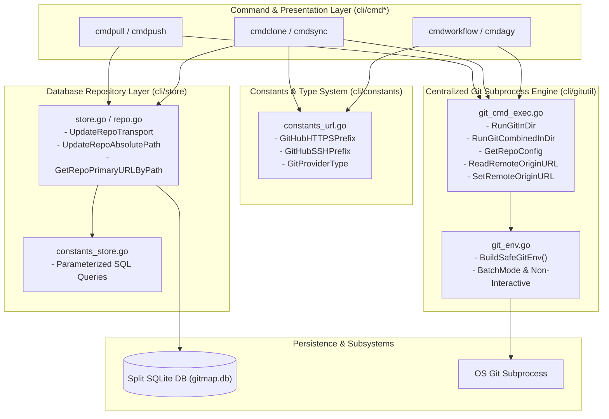
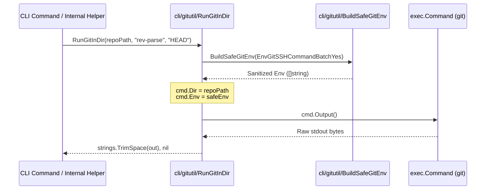
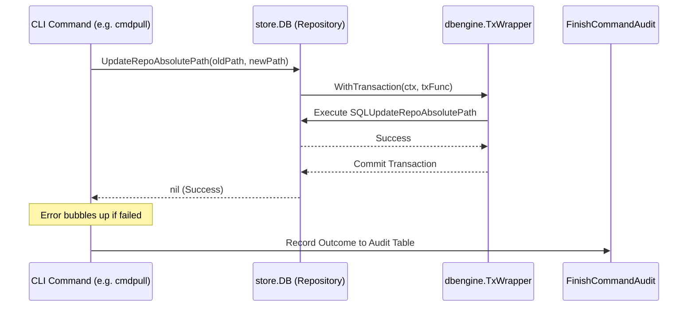
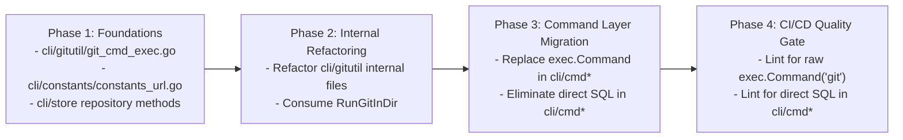

# Architecture Specification: Centralized Git Execution, URL Prefix Centralization & DB Repository Pattern

- **Spec ID:** `02-spec/21-app/git-dry-url-consts-db-repository/01-architecture-spec.md`
- **Status:** `APPROVED`
- **Version:** `1.0.0`
- **Subsystem:** Core Git Execution Engine, URL Prefix Centralization & Store DB Repository Layer
- **Dependencies:** `cli/gitutil`, `cli/constants`, `cli/store`, `cli/cmd*`
- **AI Confidence:** `Production-Ready (100%)`
- **Ambiguity:** `None (0%)`

---

## 1. Executive Summary & Core Intent

This specification establishes the architectural foundation for eliminating structural duplication and security vulnerabilities across the Gitmap codebase in three primary areas:

1. **Centralized Git Subprocess Execution:** Replacing fragmented, unsanitized `exec.Command("git", "-C", repoPath, ...)` invocations across CLI commands and internal utility packages with centralized, environment-sanitized helpers in `cli/gitutil/`.
2. **URL Prefix Centralization & Provider Typing:** Eliminating scattered string literals for git hosting providers (`https://github.com/`, `git@github.com:`) by defining typed enums and constants in `cli/constants/`.
3. **Application-Wide DB Repository Pattern:** Encapsulating database schema operations behind high-level repository methods on `*store.DB` (`UpdateRepoTransport`, `UpdateRepoAbsolutePath`, `GetRepoPrimaryURLByPath`), strictly eliminating direct SQL statements from presentation and command handlers in `cli/cmd*`.

### 1.1 Architectural Scope



---

## 2. Problem Analysis & Remediation Drivers

### 2.1 The Problem of Fragmented Subprocess Execution

Currently, git commands are executed through disparate mechanisms:
- Standard library `exec.Command("git", "-C", repoPath, ...)` calls scattered across `cli/cmd*` and `cli/gitutil/`.
- Omission of environment sanitization, allowing interactive prompts (`GIT_TERMINAL_PROMPT`), GUI password popups (`GIT_ASKPASS`, `SSH_ASKPASS`), and interactive Git Credential Manager (GCM) prompts to cause headless process hangs.
- Inconsistent working directory configuration: alternating between `-C <dir>` arguments and `cmd.Dir = dir`, which causes path canonicalization errors across Windows and UNIX filesystems.
- Diverse error handling that bypasses structured application errors (`apperror.AppError`), hindering error traceability and database audit logging.

### 2.2 The Problem of Literal URL Prefix Proliferation

Dozens of source files across `cli/cmd*`, `cli/gitutil/`, and `cli/store/` duplicate hardcoded string literals:
- `"https://github.com/"`
- `"git@github.com:"`
- `"ssh://git@github.com/"`

This causes silent parsing regressions when handling alternative git providers (GitLab, Bitbucket, self-hosted enterprise servers) and breaks the single-source-of-truth principle.

### 2.3 The Problem of Leaking SQL Queries into Command Handlers

Command handlers in `cli/cmd*` (e.g. `cli/cmdpull/`, `cli/cmd/mv_db.go`) currently invoke raw SQL execution:
- Direct queries such as `UPDATE Repo SET AbsolutePath = ? WHERE AbsolutePath = ?` executed directly on database connections.
- Ad-hoc row scanning for `HttpsUrl`, `SshUrl`, and `DiscoveredUrl` instead of reusable domain entity models.
- Loss of transaction boundary control, audit log hooks, and schema decoupling.

---

## 3. Subsystem Architecture 1: Centralized Git Execution (`cli/gitutil`)

### 3.1 Core API Contract in `cli/gitutil/git_cmd_exec.go`

All execution of Git subprocesses MUST route through five canonical functions:

```go
// RunGitInDir executes a git command with args in the specified directory,
// returning stdout with leading/trailing whitespace trimmed.
func RunGitInDir(repoPath string, args ...string) (string, error)

// RunGitCombinedInDir executes a git command with args in the specified directory,
// returning combined stdout and stderr bytes.
func RunGitCombinedInDir(repoPath string, args ...string) ([]byte, error)

// GetRepoConfig reads a Git configuration value for key in repoPath.
func GetRepoConfig(repoPath string, key string) (string, error)

// ReadRemoteOriginURL retrieves the configured remote.origin.url for repoPath.
func ReadRemoteOriginURL(repoPath string) (string, error)

// SetRemoteOriginURL updates the remote.origin.url configuration in repoPath.
func SetRemoteOriginURL(repoPath string, remoteURL string) error
```

### 3.2 Guaranteed Environment Sanitization via `BuildSafeGitEnv()`

Every subprocess spawned by `RunGitInDir` and `RunGitCombinedInDir` MUST inherit the sanitized environment slice generated by `BuildSafeGitEnv(constants.EnvGitSSHCommandBatchYes)`.



#### Enforced Environment Variables:
1. `GIT_TERMINAL_PROMPT=0`: Disables console prompts for passwords/tokens, returning immediate exit failure rather than hanging automation workers.
2. `GIT_ASKPASS=""` and `SSH_ASKPASS=""`: Disables GUI and TTY prompt helpers.
3. `GCM_INTERACTIVE=never`: Forces Git Credential Manager to fail fast if valid credentials are not already stored.
4. `GCM_NO_PERSIST=1`: Prevents unauthorized storage mutations during automated headless runs.
5. `GIT_SSH_COMMAND=ssh -o StrictHostKeyChecking=accept-new -o BatchMode=yes`: Prevents interactive SSH host key approval stalls while safely accepting initial keys.
6. Platform-aware credential store configuration:
   - Linux / macOS: `GCM_CREDENTIAL_STORE=cache`
   - Windows headless SSH: `GCM_CREDENTIAL_STORE=dpapi`
   - Windows interactive: `GCM_CREDENTIAL_STORE=wincredman`

### 3.3 Mandatory Working Directory Isolation

- The legacy practice of passing `"-C", repoPath` as CLI arguments is deprecated and forbidden in new code.
- All helpers enforce `cmd.Dir = repoPath`.
- **Architectural Rationale:** Setting `cmd.Dir` directly in Go's `os/exec` runtime guarantees OS-level process directory confinement, prevents command injection via malformed paths, and eliminates differences in Git's `-C` interpretation across versions.

---

## 4. Subsystem Architecture 2: URL Prefix Centralization (`cli/constants`)

### 4.1 URL Constants & Provider Enumeration

In `cli/constants/constants_url.go`, all repository URL prefixes and git provider types are centrally formalized:

```go
// GitProviderType identifies supported source code hosting platforms.
type GitProviderType string

const (
	GitProviderGitHub    GitProviderType = "github"
	GitProviderGitLab    GitProviderType = "gitlab"
	GitProviderBitbucket GitProviderType = "bitbucket"
	GitProviderUnknown   GitProviderType = "unknown"
)

// Centralized Git hosting URL prefixes.
const (
	GitHubHTTPSPrefix = "https://github.com/"
	GitHubSSHPrefix   = "git@github.com:"
	GitHubSSHScheme   = "ssh://git@github.com/"
	
	GitLabHTTPSPrefix = "https://gitlab.com/"
	GitLabSSHPrefix   = "git@gitlab.com:"
	
	BitbucketHTTPSPrefix = "https://bitbucket.org/"
	BitbucketSSHPrefix   = "git@bitbucket.org:"
)
```

### 4.2 URL Transformation Architecture

Instead of arbitrary `strings.TrimPrefix` or `strings.Replace` in application packages, URL transformations are unified into declarative helpers:
- Detection of provider identity via `DetectGitProvider(rawURL string) GitProviderType`.
- Deterministic canonicalization to HTTPS and SSH formats without manual slice indexing.

---

## 5. Subsystem Architecture 3: Store DB Repository Pattern (`cli/store`)

### 5.1 Repository Pattern Interface on `*store.DB`

Presentation and command packages (`cli/cmd*`) are strictly prohibited from issuing SQL queries. All interactions must use methods on `*store.DB`:

```go
// UpdateRepoTransport updates the IdentifiedTransport column for the repo at absPath.
func (db *DB) UpdateRepoTransport(absPath string, transport string) error

// UpdateRepoAbsolutePath renames the persisted absolute path of a repository,
// updating all associated metadata indices.
func (db *DB) UpdateRepoAbsolutePath(oldAbsPath string, newAbsPath string) error

// GetRepoPrimaryURLByPath retrieves the canonical remote URL (HTTPS or SSH) for a repo.
func (db *DB) GetRepoPrimaryURLByPath(absPath string) (string, error)
```

### 5.2 SQL Centralization in `cli/constants/constants_store.go`

All SQL statements executed by repository methods are stored as typed constants:

```go
const (
	SQLUpdateRepoTransport = `
UPDATE Repo 
SET IdentifiedTransport = ?, UpdatedAt = CURRENT_TIMESTAMP 
WHERE REPLACE(AbsolutePath, '\', '/') = ? COLLATE NOCASE;`

	SQLUpdateRepoAbsolutePath = `
UPDATE Repo 
SET AbsolutePath = ?, UpdatedAt = CURRENT_TIMESTAMP 
WHERE REPLACE(AbsolutePath, '\', '/') = ? COLLATE NOCASE;`

	SQLSelectRepoPrimaryURLByPath = `
SELECT COALESCE(NULLIF(HttpsUrl, ''), NULLIF(SshUrl, ''), '') 
FROM Repo 
WHERE REPLACE(AbsolutePath, '\', '/') = ? COLLATE NOCASE 
LIMIT 1;`
)
```

### 5.3 Audit Log Integration & Transaction Guarantees



- Every mutation executes through `dbengine.WrapDb` with transactional safety.
- Path normalization is consistently applied via `NormalizeStoragePath` before DB execution.
- Standard errors bubble up cleanly to the outer dispatch loop for database audit logging.

---

## 6. Architectural Invariants & Quality Standards

### 6.1 Non-Negotiable Invariants

| Category | Invariant Rule | Violation Remediation |
| :--- | :--- | :--- |
| **Git Execution** | `hasSafeGitEnv: true`<br/>`hasSubprocessConfinement: true` | Replace raw `exec.Command` with `gitutil.RunGitInDir` or `RunGitCombinedInDir`. |
| **Directory Switching** | `hasAdHocCFlag: false` | Remove `"-C"` from arguments; set `cmd.Dir = repoPath`. |
| **URL Literals** | `hasHardcodedURLPrefix: false` | Replace `"https://github.com/"` with `constants.GitHubHTTPSPrefix`. |
| **Database Boundary** | `isDirectSQLEliminated: true` | Move SQL into `constants/constants_store.go` and expose repository method on `*store.DB`. |
| **Error Handling** | `isErrorReturnedDirectly: true` | Return error or `apperror.Wrap`; never call `cliexit.HandleError` in leaf packages. |

### 6.2 Positive Boolean Naming Enforcement

All flags and boolean variables across the new interfaces MUST use positive semantics with `is` or `has` prefixes:
- `isSafeEnvInjected` (NOT `notUnsafeEnv`)
- `hasRepoContext` (NOT `hasNoRepoContext`)
- `isDirectSQLEliminated` (NOT `noDirectSQL`)
- `isURLPrefixStandardized` (NOT `nonCustomURL`)

### 6.3 Function Size & Complexity Constraints

- Maximum function length: **15 lines**.
- Preferred function length: **8 lines**.
- Nested conditional depth: **0** (strictly flat guard clauses with early returns).
- Blank line spacing: Blank line after `}` and blank line before `return`.

---

## 7. Migration & Rollout Strategy



1. **Phase 1: Foundations:**
   - Author `cli/gitutil/git_cmd_exec.go` and accompanying unit tests.
   - Define URL prefix constants in `cli/constants/constants_url.go`.
   - Implement `UpdateRepoTransport`, `UpdateRepoAbsolutePath`, and `GetRepoPrimaryURLByPath` on `*store.DB`.
2. **Phase 2: Internal `gitutil` Refactoring:**
   - Migrate `active_branch.go`, `last_sha.go`, `dirty_inspect.go`, `case_collision.go`, and `gitutil.go` to use `RunGitInDir`.
3. **Phase 3: Command Layer Migration:**
   - Replace raw Git execution in `cli/cmd*` (e.g. `cmdpull`, `cmdclone`, `cmdworkflow`, `cmdautomation`).
   - Replace direct SQL calls in `cli/cmd*` with store repository methods.
4. **Phase 4: Verification & Automated Linting:**
   - Add automated check in CI/CD runner to disallow `exec.Command("git", ...)` outside `cli/gitutil/`.
   - Add automated check to prevent SQL strings inside `cli/cmd*`.

---

## 8. Verification & Acceptance Criteria

```yaml
verificationGates:
  isGitExecCentralized: true
  isSafeGitEnvUniversal: true
  isURLPrefixStandardized: true
  isDirectSQLProhibitedInCmd: true
  isCodeGuidelineCompliant: true
```

- [ ] All Git commands in `cli/gitutil/` route through `RunGitInDir` or `RunGitCombinedInDir`.
- [ ] No subprocess invokes git without `BuildSafeGitEnv()`.
- [ ] No occurrences of `exec.Command("git", "-C", ...)` remain in `cli/cmd*`.
- [ ] All GitHub HTTPS and SSH string literals reference `constants.GitHubHTTPSPrefix` and `constants.GitHubSSHPrefix`.
- [ ] Direct SQL statements are completely absent from `cli/cmd*`.
- [ ] All new functions comply with <= 15 lines, positive booleans, and zero nested ifs.
