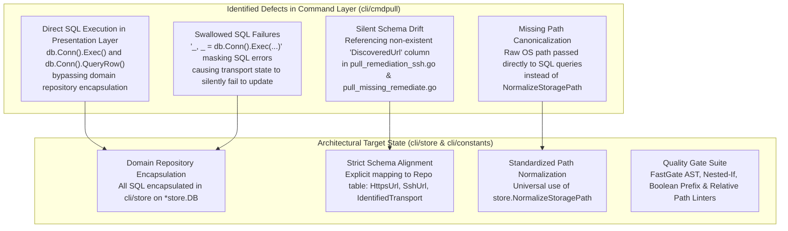
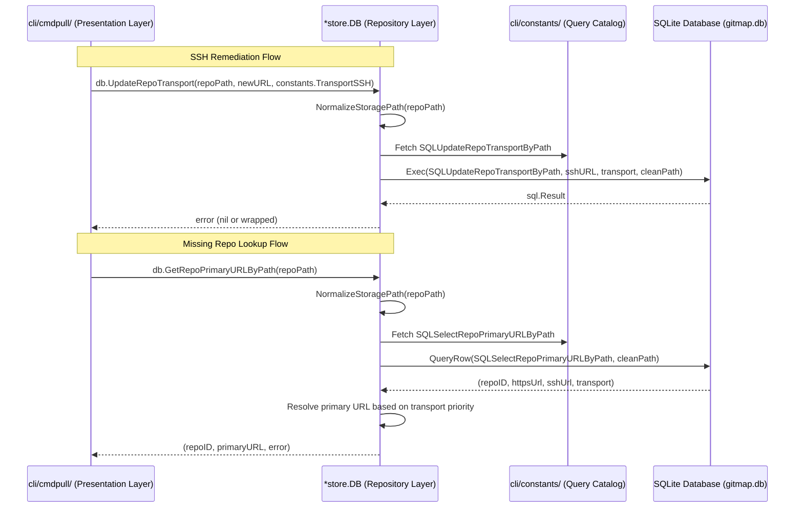
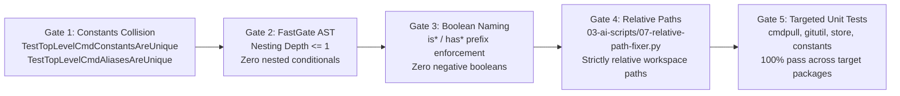

# Migration & Verification Specification: DB Repository Pattern, Schema Drift Remediation & Quality Gates

- **Spec ID:** `02-spec/21-app/git-dry-url-consts-db-repository/03-migration-and-verification-spec.md`
- **Parent Task:** `git-dry-url-consts-db-repository`
- **Status:** `APPROVED`
- **Version:** `1.0.0`
- **Subsystem:** Store DB Repository Layer, Command Migration & Quality Gate Verification
- **Related Specifications:**
  - `02-spec/21-app/git-dry-url-consts-db-repository/01-architecture-spec.md`
  - `02-spec/21-app/git-dry-url-consts-db-repository/02-component-spec.md`
- **Related Subtask Plans:**
  - `.ai-memory/plans/subtasks/git-dry-url-consts-db-repository/03-db-repository-pattern-encapsulation.md`
  - `.ai-memory/plans/subtasks/git-dry-url-consts-db-repository/05-quality-lint-and-verification.md`
- **AI Confidence:** `Production-Ready (100%)`
- **Ambiguity:** `None (0%)`

---

## 1. Executive Summary & Problem Analysis

During the audit of Git remote URL handling and repository persistence, two critical architectural defects and multiple boundary violations were identified:



### 1.1 The Silent Schema Drift Defect

The database schema defined in `cli/store/sql/repos.sql` declares the `Repo` table structure as follows:

```sql
CREATE TABLE IF NOT EXISTS Repo (
    RepoId           INTEGER PRIMARY KEY AUTOINCREMENT,
    Slug             TEXT NOT NULL,
    RepoName         TEXT NOT NULL,
    HttpsUrl         TEXT NOT NULL,
    SshUrl           TEXT NOT NULL,
    Branch           TEXT NOT NULL,
    RelativePath     TEXT NOT NULL,
    AbsolutePath     TEXT NOT NULL,
    CloneInstruction TEXT NOT NULL,
    Notes            TEXT DEFAULT '',
    LastInjectedDesktopAt TEXT DEFAULT '',
    LastInjectedVSCodeAt  TEXT DEFAULT '',
    LastClonedAt     TEXT DEFAULT '',
    IdentifiedTransport TEXT NOT NULL DEFAULT '',
    CreatedAt        TEXT DEFAULT CURRENT_TIMESTAMP,
    UpdatedAt        TEXT DEFAULT CURRENT_TIMESTAMP
);
CREATE UNIQUE INDEX IF NOT EXISTS IdxRepo_AbsolutePath ON Repo(AbsolutePath);
```

Notice that the `Repo` table contains `HttpsUrl`, `SshUrl`, and `IdentifiedTransport`. It does **not** contain a `DiscoveredUrl` column.

However, two call sites in `cli/cmdpull/` erroneously reference `DiscoveredUrl`:

1. **`cli/cmdpull/pull_remediation_ssh.go` (`updateRepoTransportInDB`):**
   ```go
   // BROKEN: References non-existent DiscoveredUrl column
   _, _ = db.Conn().Exec(
       `UPDATE Repo SET SshUrl = ?, DiscoveredUrl = ?, IdentifiedTransport = ? WHERE AbsolutePath = ?`,
       sshURL, sshURL, constants.TransportSSH, repoPath,
   )
   ```
   **Consequence:** Because SQLite returns `SQL logic error: no such column: DiscoveredUrl (1)` and the return values are discarded via `_, _ =`, the SQL update fails silently every time. Repositories remediated from HTTPS to SSH never have their new SSH URL or transport recorded in `gitmap.db`. On subsequent pull passes, the old transport state persists.

2. **`cli/cmdpull/pull_missing_remediate.go` (`LookupRepoRemoteAndID`):**
   ```go
   // BROKEN: Queries non-existent DiscoveredUrl column
   row := db.Conn().QueryRow(
       "SELECT RepoId, COALESCE(HttpsUrl, ''), COALESCE(SshUrl, ''), COALESCE(DiscoveredUrl, '') FROM Repo WHERE AbsolutePath = ?",
       repoPath,
   )
   ```
   **Consequence:** The query unconditionally errors with `no such column: DiscoveredUrl`. In `row.Scan(...)`, the scan returns an error, resulting in `LookupRepoRemoteAndID` always returning `(0, "")`. When `RemediateMissingRepo` invokes `LookupRepoRemoteAndID`, it concludes that no remote URL exists, aborting clone recovery.

### 1.2 Boundary Violations: Direct SQL Calls in `cli/cmdpull/`

In addition to schema drift, three distinct locations in `cli/cmdpull/` bypass the repository pattern by accessing `db.Conn()` directly:
- `updateRepoTransportInDB` in `cli/cmdpull/pull_remediation_ssh.go`
- `HealRepoPathInDB` in `cli/cmdpull/pull_path_heal.go`
- `LookupRepoRemoteAndID` in `cli/cmdpull/pull_missing_remediate.go`

This violates the layered architecture by leaking raw SQLite query strings and connection handles into command presentation logic.

---

## 2. Architecture: Application-Wide DB Repository Pattern

To eliminate raw SQL execution in application command code, all database operations on repositories must be encapsulated as receiver methods on `*store.DB`.

### 2.1 Repository Boundary Rules

1. **Zero Raw SQL in `cli/cmd*`:** Command packages (`cli/cmdpull/`, `cli/cmdclone/`, `cli/cmdhealth/`, etc.) must never call `db.Conn().Exec()`, `db.Conn().Query()`, or `db.Conn().QueryRow()`.
2. **Centralized Query Constants:** All SQL statements must be defined as exported or package-level constants in `cli/constants/constants_store.go` or `cli/store/sql/`.
3. **Canonical Path Normalization:** Repository methods accepting file paths (`absPath`, `oldPath`, `newPath`) must invoke `store.NormalizeStoragePath` before executing queries against the `Repo` table index `IdxRepo_AbsolutePath`.
4. **Error Return Sovereignty:** Repository methods must return strongly-typed errors (`error`) to the caller. They must never swallow errors with blank identifiers or terminate the process.
5. **Positive Boolean Attributes:** All boolean status flags on repository models or query parameters must use positive prefixes (`is*` or `has*`).

### 2.2 Method Signatures & Layer Responsibilities



---

## 3. Migration Plan for Direct SQL Calls in `cli/cmdpull/`

### 3.1 Migration Item 1: `UpdateRepoTransport`

#### 3.1.1 Current Implementation (`cli/cmdpull/pull_remediation_ssh.go`)

```go
// BEFORE (Defective):
func updateRepoTransportInDB(repoPath, sshURL string) {
	db, err := store.OpenDefault()
	if err != nil || db.Conn() == nil {
		return
	}

	defer db.Close()
	_, _ = db.Conn().Exec(
		`UPDATE Repo SET SshUrl = ?, DiscoveredUrl = ?, IdentifiedTransport = ? WHERE AbsolutePath = ?`,
		sshURL, sshURL, constants.TransportSSH, repoPath,
	)
}
```

#### 3.1.2 Repository Method Definition (`cli/store/repo_transport.go`)

Create `cli/store/repo_transport.go` containing:

```go
package store

import (
	"strings"

	"github.com/alimtvnetwork/gitmap-v28/cli/constants"
)

// UpdateRepoTransport updates the remote SSH URL and identified transport for a repository
// identified by its absolute path. It canonicalizes the storage path and timestamp.
func (db *DB) UpdateRepoTransport(absPath, sshURL, identifiedTransport string) error {
	cleanPath := NormalizeStoragePath(absPath)
	cleanURL := strings.TrimSpace(sshURL)
	cleanTransport := strings.ToLower(strings.TrimSpace(identifiedTransport))

	if cleanTransport == "" {
		cleanTransport = constants.TransportSSH
	}

	_, err := ExecWrapper(
		db.conn,
		constants.SQLUpdateRepoTransportByPath,
		cleanURL,
		cleanTransport,
		cleanPath,
	).Destruct()

	return err
}
```

#### 3.1.3 SQL Constant in `cli/constants/constants_store.go`

```go
// SQLUpdateRepoTransportByPath updates SSH URL and transport classification by absolute path.
const SQLUpdateRepoTransportByPath = `UPDATE Repo
SET SshUrl = ?, IdentifiedTransport = ?, UpdatedAt = CURRENT_TIMESTAMP
WHERE AbsolutePath = ?`
```

#### 3.1.4 Refactored Call Site (`cli/cmdpull/pull_remediation_ssh.go`)

```go
// AFTER (Refactored):
func updateRepoTransportInDB(repoPath, sshURL string) error {
	db, err := store.OpenDefault()
	if err != nil {
		return err
	}

	defer db.Close()

	return db.UpdateRepoTransport(repoPath, sshURL, constants.TransportSSH)
}
```

---

### 3.2 Migration Item 2: `UpdateRepoAbsolutePath`

#### 3.2.1 Current Implementation (`cli/cmdpull/pull_path_heal.go`)

```go
// BEFORE (Defective):
func HealRepoPathInDB(oldPath, newPath string) error {
	if oldPath == "" || newPath == "" || oldPath == newPath {
		return nil
	}

	db, err := store.OpenDefault()
	if err != nil {
		return err
	}

	defer db.Close()

	if db.Conn() != nil {
		_, err = db.Conn().Exec("UPDATE Repo SET AbsolutePath = ? WHERE AbsolutePath = ?", newPath, oldPath)
	}

	return err
}
```

#### 3.2.2 Repository Method Definition (`cli/store/repo.go`)

Add to `cli/store/repo.go`:

```go
// UpdateRepoAbsolutePath modifies the tracked AbsolutePath of a repository record.
// Both oldPath and newPath are canonicalized using NormalizeStoragePath.
func (db *DB) UpdateRepoAbsolutePath(oldPath, newPath string) error {
	cleanOld := NormalizeStoragePath(oldPath)
	cleanNew := NormalizeStoragePath(newPath)

	if cleanOld == "" || cleanNew == "" || cleanOld == cleanNew {
		return nil
	}

	_, err := ExecWrapper(
		db.conn,
		constants.SQLUpdateRepoAbsolutePath,
		cleanNew,
		cleanOld,
	).Destruct()

	return err
}
```

#### 3.2.3 SQL Constant in `cli/constants/constants_store.go`

```go
// SQLUpdateRepoAbsolutePath updates the stored AbsolutePath for a repository.
const SQLUpdateRepoAbsolutePath = `UPDATE Repo
SET AbsolutePath = ?, UpdatedAt = CURRENT_TIMESTAMP
WHERE AbsolutePath = ?`
```

#### 3.2.4 Refactored Call Site (`cli/cmdpull/pull_path_heal.go`)

```go
// AFTER (Refactored):
func HealRepoPathInDB(oldPath, newPath string) error {
	if oldPath == "" || newPath == "" || oldPath == newPath {
		return nil
	}

	db, err := store.OpenDefault()
	if err != nil {
		return err
	}

	defer db.Close()

	return db.UpdateRepoAbsolutePath(oldPath, newPath)
}
```

---

### 3.3 Migration Item 3: `GetRepoPrimaryURLByPath`

#### 3.3.1 Current Implementation (`cli/cmdpull/pull_missing_remediate.go`)

```go
// BEFORE (Defective):
func LookupRepoRemoteAndID(repoPath string) (int64, string) {
	if repoPath == "" {
		return 0, ""
	}

	db, err := store.OpenDefault()
	if err != nil {
		return 0, ""
	}

	defer db.Close()

	if db.Conn() == nil {
		return 0, ""
	}

	var repoID int64
	var httpsUrl, sshUrl, discUrl string
	row := db.Conn().QueryRow(
		"SELECT RepoId, COALESCE(HttpsUrl, ''), COALESCE(SshUrl, ''), COALESCE(DiscoveredUrl, '') FROM Repo WHERE AbsolutePath = ?",
		repoPath,
	)
	if err := row.Scan(&repoID, &httpsUrl, &sshUrl, &discUrl); err != nil {
		return 0, ""
	}

	if httpsUrl != "" {
		return repoID, httpsUrl
	}

	if sshUrl != "" {
		return repoID, sshUrl
	}

	return repoID, discUrl
}
```

#### 3.3.2 Repository Method Definition (`cli/store/repo.go`)

Add to `cli/store/repo.go`:

```go
// GetRepoPrimaryURLByPath retrieves the primary remote URL and repository ID
// for the given file path. URL resolution prioritizes the recorded IdentifiedTransport,
// falling back to HTTPS followed by SSH.
func (db *DB) GetRepoPrimaryURLByPath(absPath string) (int64, string, error) {
	cleanPath := NormalizeStoragePath(absPath)
	if cleanPath == "" {
		return 0, "", nil
	}

	var repoID int64
	var httpsURL, sshURL, transport string

	row := db.conn.QueryRow(constants.SQLSelectRepoPrimaryURLByPath, cleanPath)
	err := row.Scan(&repoID, &httpsURL, &sshURL, &transport)
	if err != nil {
		return 0, "", err
	}

	primaryURL := resolvePrimaryURLFromFields(httpsURL, sshURL, transport)

	return repoID, primaryURL, nil
}

func resolvePrimaryURLFromFields(httpsURL, sshURL, transport string) string {
	isSSH := strings.EqualFold(transport, constants.TransportSSH)
	if isSSH && sshURL != "" {
		return sshURL
	}

	if httpsURL != "" {
		return httpsURL
	}

	return sshURL
}
```

#### 3.3.3 SQL Constant in `cli/constants/constants_store.go`

```go
// SQLSelectRepoPrimaryURLByPath retrieves repo identity, URLs, and transport classification.
const SQLSelectRepoPrimaryURLByPath = `SELECT
	RepoId,
	COALESCE(HttpsUrl, ''),
	COALESCE(SshUrl, ''),
	COALESCE(IdentifiedTransport, '')
FROM Repo
WHERE AbsolutePath = ?`
```

#### 3.3.4 Refactored Call Site (`cli/cmdpull/pull_missing_remediate.go`)

```go
// AFTER (Refactored):
func LookupRepoRemoteAndID(repoPath string) (int64, string) {
	if repoPath == "" {
		return 0, ""
	}

	db, err := store.OpenDefault()
	if err != nil {
		return 0, ""
	}

	defer db.Close()

	repoID, primaryURL, err := db.GetRepoPrimaryURLByPath(repoPath)
	if err != nil {
		return 0, ""
	}

	return repoID, primaryURL
}
```

---

## 4. Schema Drift Resolution & Verification Matrix

### 4.1 Schema Parity Analysis

| Field Name | `Repo` Schema Status | Erroneous Query Site | Corrected Query Mapping |
| :--- | :--- | :--- | :--- |
| `RepoId` | Valid (`INTEGER PRIMARY KEY`) | `pull_missing_remediate.go:36` | `RepoId` |
| `HttpsUrl` | Valid (`TEXT NOT NULL`) | `pull_missing_remediate.go:36` | `COALESCE(HttpsUrl, '')` |
| `SshUrl` | Valid (`TEXT NOT NULL`) | `pull_remediation_ssh.go:122` | `SshUrl = ?` |
| `IdentifiedTransport` | Valid (`TEXT NOT NULL DEFAULT ''`) | `pull_remediation_ssh.go:122` | `IdentifiedTransport = ?` |
| `DiscoveredUrl` | **DOES NOT EXIST** | `pull_remediation_ssh.go:122`<br>`pull_missing_remediate.go:36` | **REMOVED**; transport and URL resolved via `SshUrl` / `HttpsUrl` |
| `AbsolutePath` | Valid (`TEXT NOT NULL UNIQUE`) | `pull_path_heal.go:61` | `AbsolutePath = ?` (normalized) |
| `UpdatedAt` | Valid (`TEXT DEFAULT CURRENT_TIMESTAMP`) | Omitted in all direct SQL calls | `UpdatedAt = CURRENT_TIMESTAMP` |

---

## 5. Quality Gate Verification Plan

All modifications must pass five independent automated quality gates prior to staging and commit:



### 5.1 Gate 1: Constants Collision Check
- **Target Files:** `cli/constants/constants_git.go`, `cli/constants/constants_store.go`, `cli/constants/cmd_constants_test.go`
- **Verification Rule:** All newly introduced constants and enums must be evaluated against the global constant map to ensure no naming or value overlap exists.
- **Execution Command:**
  ```bash
  go test -v ./cli/constants/... -run "TestTopLevelCmd"
  ```
- **Acceptance Criteria:** `PASS` with 0 duplicates, 0 alias collisions, and 100% constant parity.

### 5.2 Gate 2: Nested-If Flattening Linter
- **Target Files:** `cli/store/repo_transport.go`, `cli/store/repo.go`, `cli/cmdpull/*.go`
- **Verification Rule:** Maximum nesting depth is strictly `<= 1`. All conditional checks must use early returns, guard clauses, or boolean combinators.
- **Linter Engine:** `03-ai-scripts/50-fastgate.py`
- **Acceptance Criteria:** 0 nested `if` statements detected in modified files.

### 5.3 Gate 3: Boolean Naming & Positive Polarity Linter
- **Target Files:** All newly introduced or modified Go source files.
- **Verification Rule:** Every boolean variable, struct field, and function parameter must begin with `is` or `has`. Negative boolean names (`isNot*`, `hasNo*`, `disable*`, `non*`) are strictly prohibited.
- **Linter Engine:** `03-ai-scripts/08-naming-autofixer.py` and `03-ai-scripts/50-fastgate.py`
- **Acceptance Criteria:** 100% compliance with positive boolean nomenclature.

### 5.4 Gate 4: Relative Path Hygiene Linter
- **Target Files:** Entire repository workspace, including specifications and plans.
- **Verification Rule:** Zero occurrences of absolute drive prefixes, absolute user directories, or absolute file protocol URIs.
- **Linter Engine:** `03-ai-scripts/07-relative-path-fixer.py --check` and `03-ai-scripts/49-verify-privacy-and-relative-paths.py`
- **Acceptance Criteria:** Zero violations detected across all checked paths.

### 5.5 Gate 5: Targeted Unit Test Suite
- **Package `cli/store`:**
  - `TestUpdateRepoTransport`: Verifies updating SSH URL, identified transport, and path normalization.
  - `TestUpdateRepoAbsolutePath`: Verifies path migration, handling non-existent paths, and idempotent operations.
  - `TestGetRepoPrimaryURLByPath`: Verifies retrieving primary URLs for HTTPS-only, SSH-only, and mixed records.
- **Package `cli/cmdpull`:**
  - `TestApplySSHTransportRemediation`: Verifies that converting transport triggers `db.UpdateRepoTransport`.
  - `TestLookupRepoRemoteAndID`: Verifies that recovering remote URL succeeds without schema errors.
  - `TestHealRepoPathInDB`: Verifies path healing via `db.UpdateRepoAbsolutePath`.
- **Package `cli/gitutil`:**
  - `TestReadRemoteOriginURL`: Verifies sanitized subprocess reading with mock directories.
  - `TestGitURLNormalization`: Verifies host and scheme extraction across standard formats.

---

## 6. Acceptance Criteria & Evidence Ledger

| ID | Criterion | Verification Method | Target Outcome |
| :--- | :--- | :--- | :--- |
| **AC-01** | Zero references to `DiscoveredUrl` in `cli/cmdpull/` | Regex search across `cli/cmdpull/*.go` | 0 occurrences |
| **AC-02** | Zero direct calls to `db.Conn().Exec` in `cli/cmdpull/` | AST / grep inspection of `cli/cmdpull/` | 0 occurrences |
| **AC-03** | Encapsulated `UpdateRepoTransport` method on `*store.DB` | Unit test in `cli/store/repo_transport_test.go` | `PASS` |
| **AC-04** | Encapsulated `UpdateRepoAbsolutePath` method on `*store.DB` | Unit test in `cli/store/repo_test.go` | `PASS` |
| **AC-05** | Encapsulated `GetRepoPrimaryURLByPath` method on `*store.DB` | Unit test in `cli/store/repo_test.go` | `PASS` |
| **AC-06** | All paths passed to queries normalized via `NormalizeStoragePath` | Code audit & test assertions | Canonical paths in DB |
| **AC-07** | Constants collision check passes | `go test ./cli/constants/...` | `PASS` |
| **AC-08** | FastGate AST linter clean | `python 03-ai-scripts/50-fastgate.py` | 0 violations |
| **AC-09** | Relative path linter clean | `python 03-ai-scripts/49-verify-privacy-and-relative-paths.py` | 0 violations |
| **AC-10** | Function line limits respected (<= 15 lines max) | FastGate & manual audit | 100% compliant |
