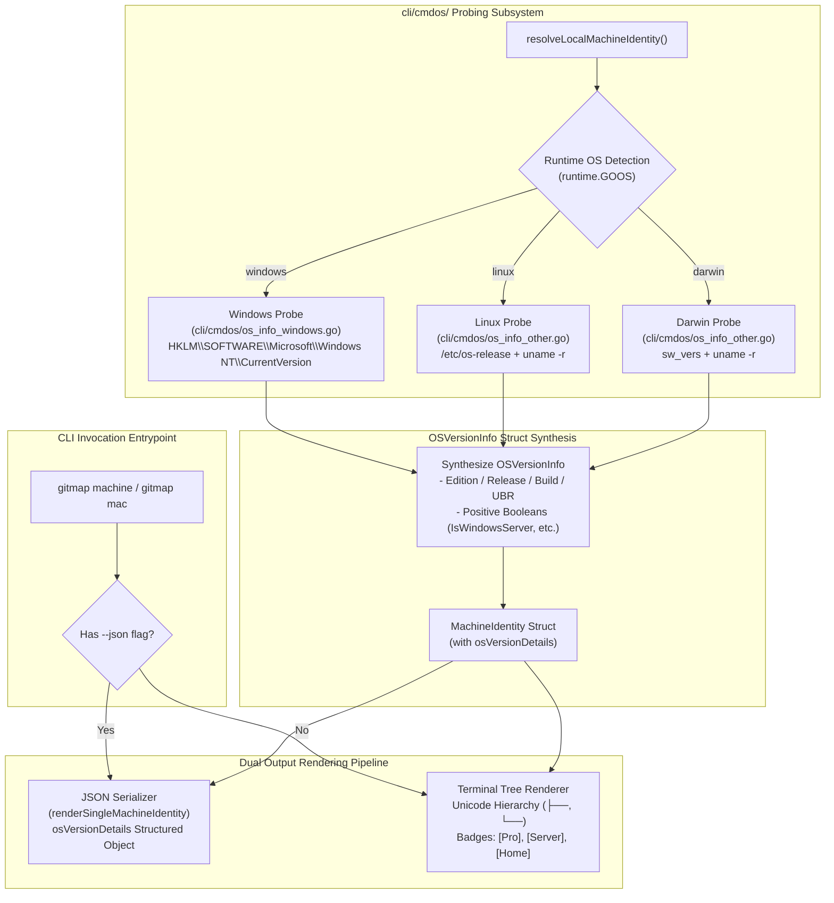
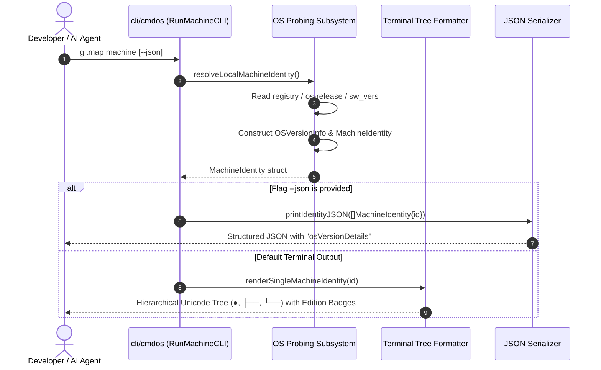
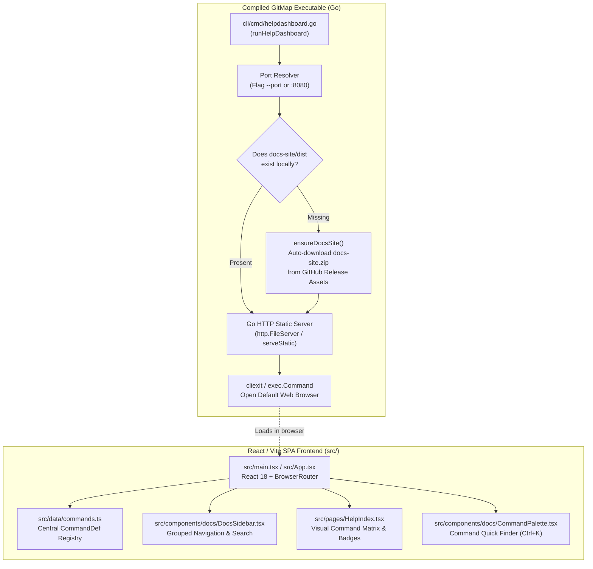

# Architecture Specification: Machine OS Version Detection & HD Docs UI Improvement

- **Spec ID:** `02-spec/21-app/git-prime-machine-os-version-and-ui-help-docs-improvement/01-architecture-spec.md`
- **Feature Slug:** `git-prime-machine-os-version-and-ui-help-docs-improvement`
- **Status:** `APPROVED`
- **Version:** `1.0.0`
- **Target Release:** `v6.534.0`
- **Subsystem:** Machine Identity & Hardware Profiling, Deep OS Version Probing, Help Dashboard (HD) Web Architecture & Command Catalog
- **Dependencies:** `cli/cmdos/`, `cli/cmd/helpdashboard.go`, `src/data/commands.ts`, `src/pages/HelpIndex.tsx`, `src/components/docs/DocsSidebar.tsx`, `src/App.tsx`

---

## 1. Executive Summary & Architectural Intent

GitMap provides cross-platform repository intelligence, multi-machine fleet clustering, and automated developer tooling. As GitMap expands into autonomous AI multi-agent orchestration (`agent-ai`), high-concurrency parallel git workflows (`cpar`), and AI tree synthesis (`merge-ai`), two architectural capabilities become fundamental:

1. **High-Fidelity Operating System & Machine Identity (`gitmap machine`):**
   Automated AI coding agents and distributed cluster fleets require exact, structured telemetry regarding the underlying host OS. A generic string like `"Windows"` or `"Linux"` is inadequate when build systems, script runners, and terminal behaviors diverge dramatically between Windows 10 vs. Windows 11, Windows Client vs. Windows Server, Ubuntu 22.04 LTS vs. 24.04 LTS, or macOS Sonoma vs. Sequoia. This architecture establishes the `OSVersionInfo` data contract, low-overhead native registry/sysfs probes, and dual terminal/JSON output pipelines.

2. **Help Dashboard (HD) Web UI Architecture & Command Catalog Parity:**
   GitMap ships with an offline, high-density React / Vite single-page application served directly from the compiled Go binary (`gitmap help-dashboard` / `hd`). Recent minor releases introduced high-leverage CLI commands (`merge-ai`, `agent-ai`, `heatmap`, `machine`, `full-summary`, `new-commands`, `tree`, `which-format`, and `cpar`). This architecture formalizes the static asset delivery pipeline, the type-safe command catalog schema in TypeScript, and sidebar route registration to ensure 100% parity between CLI capability and interactive documentation.

---

## 2. Machine Identity & Deep OS Version Detection Architecture

### 2.1 Core Problem & Limitations of Legacy Probes

The legacy OS probing mechanism (`cli/cmdos/os_info_windows.go` and `cli/cmdos/os_info_other.go`) suffered from three major deficits:
- **Windows 11 Misidentification:** Windows registry key `ProductName` often reports `"Windows 10 Pro"` on Windows 11 workstations due to Microsoft backward compatibility shims, unless build numbers (`>= 22000`) are evaluated.
- **Missing Edition & Server Differentiation:** Legacy structs did not distinguish between Windows Server Datacenter/Standard and Windows Desktop editions, nor between Pro and Home SKUs.
- **Unstructured Version Strings:** Downstream consumers (agents, scripts, Split-DB nodes) were forced to regex-parse `"Windows 10 Pro (Build 26100)"` rather than consuming typed integers (`Major: 10`, `Minor: 0`, `Build: 26100`, `UBR: 2161`).

### 2.2 System Architecture Diagram



### 2.3 `OSVersionInfo` Struct Design

The `OSVersionInfo` struct represents structured, validated operating system telemetry. It lives in `cli/cmdos/os_info_types.go` and is embedded within `MachineIdentity` and `OSInfoReport`.

```go
package cmdos

// OSVersionInfo provides typed, structured operating system and kernel version metrics.
type OSVersionInfo struct {
	Type            string `json:"type"`                      // "windows", "linux", "darwin", "freebsd"
	IsWindowsServer bool   `json:"isWindowsServer"`           // Affirmative: true if Windows Server edition
	IsWindowsPro    bool   `json:"isWindowsPro"`              // Affirmative: true if Windows Pro/Enterprise
	IsWindowsHome   bool   `json:"isWindowsHome"`             // Affirmative: true if Windows Home/Core
	Version         string `json:"version"`                   // Canonical semver/composite string (e.g. "10.0.26100.2161")
	Major           int    `json:"major"`                     // Major release number (e.g. 10, 24, 15)
	Minor           int    `json:"minor"`                     // Minor release number (e.g. 0, 4, 3)
	Build           int    `json:"build"`                     // Build number (e.g. 26100)
	Release         string `json:"release"`                   // Marketing / code release (e.g. "24H2", "Noble", "Sequoia")
	Edition         string `json:"edition"`                   // Human-readable edition (e.g. "Windows 11 Pro", "Ubuntu 24.04 LTS")
	KernelVersion   string `json:"kernelVersion"`             // Underling kernel string (e.g. "10.0.26100.2161", "6.8.0-45-generic")
}
```

### 2.4 Platform Probing Mechanics

#### 2.4.1 Windows Registry Probing (`cli/cmdos/os_info_windows.go`)
Windows telemetry is extracted directly from the registry using standard library `golang.org/x/sys/windows/registry`:
- **Registry Key:** `HKLM\SOFTWARE\Microsoft\Windows NT\CurrentVersion`
- **Access Right:** `registry.QUERY_VALUE` (safe non-elevated read)

##### Windows Registry Value Mapping Table
| Registry Value Name | Type | Sample Value | Destination Field in `OSVersionInfo` | Processing Rule |
| :--- | :--- | :--- | :--- | :--- |
| `InstallationType` | `REG_SZ` | `"Client"` / `"Server"` | `IsWindowsServer` | `strings.EqualFold(val, "Server")` |
| `EditionID` | `REG_SZ` | `"Professional"`, `"ServerDatacenter"`, `"Core"` | `IsWindowsPro`, `IsWindowsHome` | `"Professional"` / `"ServerDatacenter"` / `"Core"` |
| `ProductName` | `REG_SZ` | `"Windows 10 Pro"` | Raw product name fallback | Subject to Windows 11 build normalization |
| `DisplayVersion` | `REG_SZ` | `"24H2"`, `"23H2"` | `Release` | Direct string assignment |
| `CurrentBuildNumber` | `REG_SZ` | `"26100"` | `Build`, `Edition` | Converted to integer `strconv.Atoi()` |
| `UBR` | `REG_DWORD`| `2161` | `KernelVersion`, `Version` | Composite build: `fmt.Sprintf("%s.%d", build, ubr)` |

##### Windows 11 Build Normalization Logic:
Because Microsoft retains `"Windows 10 Pro"` in `ProductName` for application compatibility across Windows 11 builds, the probing engine applies the following deterministic rule:
```go
// If build number >= 22000 and marketing name contains Windows 10, normalize to Windows 11
if buildNum >= 22000 {
    edition = strings.Replace(edition, "Windows 10", "Windows 11", 1)
}
```

##### Affirmative Boolean Classification:
- `IsWindowsServer`: `InstallationType == "Server" || strings.Contains(strings.ToLower(editionId), "server")`
- `IsWindowsPro`: `strings.Contains(strings.ToLower(editionId), "pro") || strings.Contains(strings.ToLower(editionId), "enterprise")`
- `IsWindowsHome`: `strings.EqualFold(editionId, "core") || strings.Contains(strings.ToLower(editionId), "home")`

#### 2.4.2 Linux `/etc/os-release` & Kernel Probing (`cli/cmdos/os_info_other.go`)
- **Config Files:** `/etc/os-release`, falling back to `/usr/lib/os-release`.
- **Parsing:** Key-value pairs matching `PRETTY_NAME`, `VERSION_ID`, `VERSION_CODENAME`, and `ID`.
- **Kernel Probe:** Execution of `uname -r` or reading `/proc/sys/kernel/osrelease`.
- **Version Parsing:** Split `VERSION_ID` on `.` to populate `Major` and `Minor`.
- **Booleans:** `IsWindowsServer`, `IsWindowsPro`, `IsWindowsHome` default strictly to `false`.

#### 2.4.3 macOS (Darwin) Probing (`cli/cmdos/os_info_other.go`)
- **Product Version:** Execution of `sw_vers -productVersion` (e.g. `"15.3.1"`).
- **Build Version:** Execution of `sw_vers -buildVersion` (e.g. `"24D70"`).
- **Kernel:** Execution of `uname -r` (e.g. `"24.3.0"`).
- **Marketing Name Mapping:**
  - Major `15` -> `"Sequoia"`
  - Major `14` -> `"Sonoma"`
  - Major `13` -> `"Ventura"`
  - Major `12` -> `"Monterey"`
- **Booleans:** `IsWindowsServer`, `IsWindowsPro`, `IsWindowsHome` default strictly to `false`.

---

## 3. Data Flow & Dual Rendering Architecture

The `gitmap machine` command supports two output modalities: interactive terminal output and machine-readable JSON output.



### 3.1 Terminal Hierarchical Tree Layout Specification
When run interactively (`gitmap machine`), the command renders a structured, colored terminal tree using UTF-8 box-drawing characters:

```
● Machine Identity:
  ├── Alias:             devbox-primary
  ├── Hostname:          DESKTOP-R9Q8K2M
  ├── IP Address:        192.168.1.150
  ├── Operating System:  Windows 11 Pro [Pro]
  │   ├── Edition:       Windows 11 Pro (64-bit)
  │   ├── Version:       10.0.26100.2161 (Release 24H2)
  │   ├── Build:         26100 (UBR: 2161)
  │   └── Kernel:        Windows NT 10.0
  ├── Architecture:      amd64 (16 Cores)
  ├── Current User:      Administrator
  └── GitMap Version:    v6.534.0
```

### 3.2 Structured JSON Schema Contract (`gitmap machine --json`)
To preserve 100% backward compatibility with existing automated consumers while providing the new typed metrics, the root object preserves all existing properties and adds `osVersionDetails`:

```json
[
  {
    "sequence": 1,
    "nodeId": "local-01",
    "ipAddress": "192.168.1.150",
    "alias": "devbox-primary",
    "machineName": "DESKTOP-R9Q8K2M",
    "osHostname": "DESKTOP-R9Q8K2M",
    "osPlatform": "Windows (windows)",
    "osVersion": "Windows 11 Pro 24H2 (Build 26100.2161)",
    "architecture": "amd64",
    "cpuCores": 16,
    "currentUser": "Administrator",
    "gitmapVersion": "v6.534.0",
    "scope": "local",
    "osVersionDetails": {
      "type": "windows",
      "isWindowsServer": false,
      "isWindowsPro": true,
      "isWindowsHome": false,
      "version": "10.0.26100.2161",
      "major": 10,
      "minor": 0,
      "build": 26100,
      "release": "24H2",
      "edition": "Windows 11 Pro",
      "kernelVersion": "10.0.26100.2161"
    }
  }
]
```

---

## 4. Help Dashboard (HD) Web UI Architecture

### 4.1 System Topology: Go Server & React SPA



### 4.2 Frontend Architecture Specifications

#### 4.2.1 Data Models (`src/data/commands.ts`)
The TypeScript command registry maintains a strongly typed contract:
- `CommandDef`: Defines the command name, primary alias, description, invocation syntax (`usage`), parameter flags (`flags`), executable examples (`examples`), sequential execution recipes (`howToProceed`), operational caveats (`notes`), category identifier (`category`), and cross-links (`seeAlso`).
- `Categories`: Array of `CommandCategory` objects providing category grouping, display labels, icons, and descriptions.

#### 4.2.2 Command Catalog Expansion Matrix
The following 9 recently added commands are registered in `src/data/commands.ts` and integrated across the docs UI:

| Command | Alias | Category | Description | Key Flags | Shipped Status |
| :--- | :--- | :--- | :--- | :--- | :--- |
| `merge-ai` | `ma` | `movemerge` | AI-assisted multi-source tree merge with collision isolation (`01_`/`02_`) | `--destination`, `--source`, `--url`, `--config` | `Shipped` |
| `agent-ai` | `aai` | `antigravity` | Multi-agent task coordination, Split-DB synchronization, lease management | `--task`, `--status`, `--lease`, `--json` | `Shipped` |
| `heatmap` | `hm` | `history` | Concurrency & file contention heatmap visualizer for AI agent touches | `--window`, `--threshold`, `--json`, `--live` | `Shipped` |
| `machine` | `mac` | `tools` | Machine identity, hardware profiling, and deep OS version detection | `--ssh`, `--json`, `--set-alias`, `--set-name` | `Shipped` |
| `full-summary` | `fsum` | `history` | High-density terminal dashboard of repo metrics, dirty status, and health | `--depth`, `--filter`, `--export` | `Shipped` |
| `new-commands` | `nc` | `tools` | Interactive catalog and version changelog of newly introduced GitMap commands | `--since`, `--category`, `--search` | `Shipped` |
| `tree` | `tr` | `scanning` | ASCII directory tree visualizer with git status tracking and file exclusion | `--depth`, `--all`, `--no-ignore` | `Shipped` |
| `which-format` | `wf` | `data` | JSON schema inspector and validator for GitMap exports, profiles, and logs | `--schema`, `--validate`, `--strict` | `Shipped` |
| `cpar` | `cp` | `monitoring` | High-speed concurrent parallel execution engine for git operations across nodes | `--concurrency`, `--timeout`, `--continue-on-error` | `Shipped` |

#### 4.2.3 UI Components Integration
- **`src/pages/HelpIndex.tsx`:** Categorized command cards showing aliases, one-line descriptions, and green `Shipped` status pills (`StatusType.Shipped`).
- **`src/components/docs/DocsSidebar.tsx`:** Grouped sidebar links with relevant Lucide icons (e.g. `Brain` for `agent-ai`, `GitMerge` for `merge-ai`, `Monitor` for `machine`, `Flame` for `heatmap`).
- **`src/App.tsx`:** Explicit route registrations for new command detail pages or unified documentation viewers.

---

## 5. Architectural Invariants

Every modification across the Go backend and React frontend must strictly comply with the following architectural invariants:

- **`INV-01`: Affirmative Booleans Only**  
  All boolean properties in Go structs and JSON payloads must be formulated affirmatively (e.g. `IsWindowsServer`, `IsWindowsPro`, `IsWindowsHome`, `HasGit`, `HasPowerShell`, `IsActive`). Negative flags such as `IsNotServer`, `IsNonPro`, or `NoGit` are strictly prohibited.

- **`INV-02`: Backward Compatible JSON Payloads**  
  Additions to existing JSON payloads must be purely additive. The root properties of `MachineIdentity` (`sequence`, `nodeId`, `ipAddress`, `alias`, `machineName`, `osHostname`, `osPlatform`, `osVersion`, `architecture`, `cpuCores`, `currentUser`, `gitmapVersion`, `scope`) must retain their exact names and types. The structured version info is exposed as a nested object `osVersionDetails`.

- **`INV-03`: Strict Relative Git Paths**  
  All file paths referenced in specifications, plans, code imports, or error logs must be repository-relative Git paths (e.g. `cli/cmdos/os_info_windows.go`, `src/data/commands.ts`). Absolute paths containing Windows drive letters (`D:\work\...`) or Unix root paths (`/home/...`) are strictly forbidden.

- **`INV-04`: Safe, Non-Panicking Probes**  
  OS version probing must never panic or crash the process. Registry operations, subprocess calls (`sw_vers`, `uname`), and file reads (`/etc/os-release`) must handle permission denials, missing files, or truncated outputs gracefully, falling back to compile-time runtime constants (`runtime.GOOS`, `runtime.GOARCH`).

- **`INV-05`: Offline-First Documentation Delivery**  
  The Help Dashboard web UI must function entirely offline. No external script tags, Google Fonts, CDN stylesheets, or unbundled network assets may be used. All icons, components, and data must reside in the compiled bundle.

---

## 6. Verification & Architectural Gateways

| Gateway ID | Verification Check | Automated Target | Success Criteria |
| :--- | :--- | :--- | :--- |
| **GATE-01** | Windows Registry Extraction | `cli/cmdos/os_info_windows_test.go` | Extracts `InstallationType`, `EditionID`, `DisplayVersion`, `CurrentBuildNumber`, `UBR` without error. |
| **GATE-02** | Windows 11 Build Normalization | `cli/cmdos/os_info_windows_test.go` | Build numbers `>= 22000` report `"Windows 11"` even when `ProductName` reports `"Windows 10"`. |
| **GATE-03** | Affirmative Boolean Validation | Go Struct Linter / Unit Test | `IsWindowsServer`, `IsWindowsPro`, `IsWindowsHome` strictly match edition registry values. |
| **GATE-04** | Dual Rendering Parity | `gitmap machine` & `gitmap machine --json` | Terminal renders hierarchical box tree; JSON output contains valid `osVersionDetails` object. |
| **GATE-05** | HD Docs UI Compilation | `pnpm build` in root / Vite compiler | React application compiles with zero TypeScript errors; all 9 commands present in bundle. |
