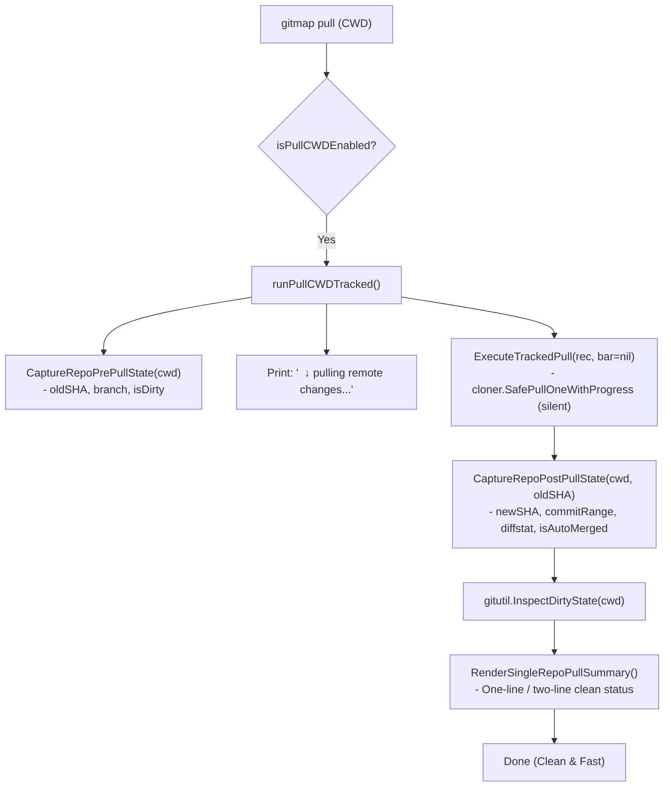

# Architecture Specification: GitMap Single-Repo Pull UX Simplification, Progress Bar Fix, Shell Wrapping RCA, and AGM Integration

**Application:** GitMap CLI & Antigravity Manager (AGM)  
**Task Slug:** `gitmap-and-antigravity-manager-agm-package-enhancements`  
**Target Version:** v6.572.0 (Minor Bump)  
**Status:** Approved & Implementing  
**Visual Artifacts:**  
- `assets/screenshots/gitmap-and-antigravity-manager-agm-package-enhancements-01.png`
- `assets/screenshots/gitmap-and-antigravity-manager-agm-package-enhancements-02.png`

---

## User Request (Verbatim)

```markdown
# GitMap and `Antigravity Manager (AGM)` Package Enhancements: high priority instruction, non-negotiable task

For the `gitmap` pool, the single repo, it needs to be very simple. It should not show that much of a 20%, 30% progress bar. It should just say progressing and at the end, the previous UI. Very simple. It has updated from this commit to this. Probably this many lines has been changed. Everything is clean and active, things like that. If the state is dirty, we could mention the dirty. If it executed auto merge, then it would also mention auto merge is executed, things like that. Very simple UI. And also there is a little bit bug into the main test UI, which I do like if it could show multiple progress bar when you are downloading or pull all for the repos. I do think that it could get too much buggy, so try to keep the single progress bar which we have in the past. It is a bug I think. I would consider this as a bug. And also in some cases, the AI tried to run PowerShell command using `gitmap`, which it could have executed already using the `gitmap` directly. So why it does that? Can you find the root cause and try to fix it? Can you please start working on this as we have discussed?

Also, the recent changes in the `Antigravity Manager (`Antigravity Manager (AGM)`)` package, check that new commands and new functionalities with the prompt rerun and prompt review. Let's check if we have from our end, `gitmap`, AGY commands there to backup, restore, take the whole prompt with images. Images becomes a very big problem. You can suggest me some ways how I could create the image as a standalone single URL or things like that. What could be the easiest way to deal with it? You shared that thought and currently started fixing this. That should be enough for now. Also, please check the RC agent, which is similar to the `heatmap` RC command, which I requested from another AI here. Try to see if you could synchronize with that AI. If not, then skip that part. Try to do a git pull before you start working. Is it clear?

at the do minor bump and release

## task: GitMap and `Antigravity Manager (AGM)` Package Enhancements
## slug: gitmap-and-`Antigravity Manager (AGM)`-package-enhancements

# Actionable Items Must Follow Non-Negotiable

1. Git pull BEFORE starting any work — first try `gitmap pull <repo path>` (or run `gitmap pull` in repository folder); if that fails, fall back to regular `git pull` and resolve any merge conflicts so the repository is completely up to date and clean before starting.
2. Write spec under 02-spec/21-app/gitmap-and-`Antigravity Manager (AGM)`-package-enhancements/ and enqueue plan task in .ai-memory/plans/gitmap-and-`Antigravity Manager (AGM)`-package-enhancements.md (subtasks in .ai-memory/plans/subtasks/gitmap-and-`Antigravity Manager (AGM)`-package-enhancements/) first
3. Search codebase exclusively via GitMap (gitmap aum search, gitmap find, gitmap cat, gitmap ps, gitmap py, gitmap llm train); TOTAL BAN on rg, ripgrep, grep, git grep, Select-String
4. Strictly use relative Git paths (02-spec/..., .ai-memory/..., cmd/...); only add the relative paths, never add the absolute path during your work, and ensure this is respected on the release page and in release notes as well
5. Simplify the `gitmap` pool UI to avoid showing detailed progress bars; instead, display a simple "progressing" message and summarize changes at the end.
6. Investigate and fix the bug in the main test UI related to multiple progress bars; ensure a single progress bar is maintained.
7. Identify and resolve the issue where AI runs PowerShell commands unnecessarily when `gitmap` commands suffice.
8. Review recent changes in the `Antigravity Manager (`Antigravity Manager (AGM)`)` package, focusing on new commands and functionalities.
9. Explore solutions for handling images as standalone URLs in the `Antigravity Manager (AGM)` package.
10. Check the RC agent for synchronization with the `heatmap` RC command; skip if synchronization is not possible.
11. Perform a minor bump and release after completing the tasks.
```

---

## Visual Ground Truth


*Figure 1: `gitmap pa` progress bar waterfall / staircase stacking defect (bottom) and AI unnecessary PowerShell wrapping via `gitmap ps "git -C ... show ..."` (top).*


*Figure 2: `gitmap pull` non-TTY verbose progress line spamming in agent task background runner.*

---

## 1. Executive Summary & Defect Classification

| Defect / Feature ID | Subsystem | Severity | Symptom | Forensic Root Cause | Architectural Remediation |
|---|---|---|---|---|---|
| **PULL-UX-01** | `cli/cmdpull` (`pull_cwd.go`) | **HIGH** | Verbose 0%-100% counting/compressing lines and 8-column batch table for single repo | `executeCWDTrackedPull` spawns a full `PullProgressBar(1)` with active git milestone callbacks and prints batch table | Bypass `PullProgressBar` when pulling single repo; show clean "pulling remote changes..." and concise 1-2 line summary table with commit delta, diffstat, status, auto-merge |
| **BAR-WRAP-02** | `cli/cmdpull` (`pull_progress_bar_render.go`) | **HIGH** | Progress bar forms waterfall/staircase across updates in terminal | `clampLineToTermWidth` counts runes instead of terminal column widths (`runewidth`). Wide characters (`⚡`, `🔍`) cause line to touch terminal edge, auto-wrapping cursor to row Y+1 where `\r` cannot erase previous lines | Integrate `github.com/mattn/go-runewidth`, calculate actual cell widths, and enforce safety right-margin of `termWidth - 4` |
| **BAR-NTTY-03** | `cli/cmdpull` (`pull_progress_bar_visual.go`) | **MEDIUM** | Denser newline spam in CI/agent runners | `renderNonTTY()` outputs `\n` on every git milestone tick | Suppress intermediate milestone ticks in Non-TTY mode; output single clean line on completion |
| **SHELL-WRAP-04** | Prompts, Skills & GitMap Tooling | **HIGH** | AI executes `gitmap ps "git show ..."` or shell commands instead of native commands | Conflicting prompt directives ("Worker Git Ban" applied over-broadly to read-only inspection, `gitmap ps` misclassified as search tool, lack of native `gitmap show`/`gitmap log`) | Refine prompts and skills, ban unnecessary shell wrapping, clarify read-only git inspection, and implement native `gitmap show` and `gitmap log` |
| **AGM-AGY-05** | `cli/cmdagy` & AGM Bridge | **MEDIUM** | Inconsistent prompt review, rerun, and image payload bloat | Embedded base64 images bloat context window and IPC payloads; lack of unified asset URL handler | Design local asset bridge (`:18188`), content-addressable SHA256 storage (`.ai-memory/assets/`), and lightweight URL rewriting |
| **HEATMAP-RC-06** | `cli/heatmap` / `cli/store` | **MEDIUM** | Multi-agent telemetry collisions | Simultaneous AI agents writing SQLite files in `repo-cache` risks merge conflicts | Document and verify the 6-stage continuous reconciliation protocol (`RunRcHeatmapSyncWithConflictResolution`) |

---

## 2. Subsystem Detailed Architectures

### 2.1 Single-Repo Pull UX Architecture


#### Output Formatting Specification:
1. **Up-to-date**:
   ```
     ✓ gitmap: up-to-date (fe6c03b) [main] (clean)
   ```
2. **Updated with Changes**:
   ```
     ✓ gitmap: updated 812bd599..fe6c03b5 (+15/-3, 2 files) [main] (clean)
   ```
3. **Auto-Merge Executed**:
   ```
     ✓ gitmap: auto-merge executed 812bd599..fe6c03b5 (+15/-3, 2 files) [main] (clean)
   ```
4. **Dirty Working Tree**:
   ```
     ⚠ gitmap: updated 812bd599..fe6c03b5 (+15/-3, 2 files) [main] (dirty: 2 uncommitted files)
   ```
5. **Conflict / Error**:
   ```
     ✗ gitmap: pull failed - merge conflict detected [main] (dirty)
   ```

### 2.2 Terminal Progress Bar Column Width & Wrap Prevention Architecture
To eliminate the staircase/waterfall progress bar bug:
1. **Rune Width Calculation**:
   Replace `utf8.RuneCountInString(plain)` with `runewidth.StringWidth(plain)`.
   In `truncateANSI`, increment visible width by `runewidth.RuneWidth(r)` rather than `1`.
2. **Safety Right Margin**:
   ```go
   maxLen := termWidth - 4
   if maxLen < 20 {
       maxLen = 20
   }
   ```
   Ensuring lines never hit column $W$ completely eliminates the Windows ConHost auto-wrap trigger, preserving the integrity of `\r\033[K`.
3. **Non-TTY Suppression**:
   In non-TTY mode, `renderNonTTY()` is throttled to only emit on repository completion or suppress milestone ticks.

### 2.3 Shell Wrapping RCA & Native Command Engine
The forensic investigation established 5 causes for AI shell wrapping. We resolve them through:
1. **Prompt Sanitization**: Remove `gitmap ps` from search ban lists in all Letterly, Cursor, and V6 prompts.
2. **Checklist Correction**: Score native GitMap primitives (`cpf`, `cpb`, `cpr`, `aum search`, `find`, `cat`, `lf`) and penalize `gitmap ps` wrapping.
3. **Rule Clarification**: Distinguish mutating git commands (`git add`, `git commit`, `git checkout` — strictly banned for subagents) from read-only inspections (`git show`, `git log` — permitted when examining past commits).
4. **Tooling Gap Closure**: Implement native `gitmap show <rev>` and `gitmap log` commands in GitMap so AI agents never need raw shell execution.

### 2.4 Standalone Image URL & Lightweight Prompts Architecture
1. **Asset Endpoint**: Formalize `GET /assets/:sha256.:ext` on `127.0.0.1:18188`.
2. **Extraction Pipeline**:
   - Ingest prompt containing `data:image/...;base64,...`.
   - Decode binary payload, compute SHA-256 hash.
   - Save binary to `.ai-memory/assets/img-<sha256>.<ext>`.
   - Rewrite prompt markdown to:
     ```markdown
     
     <!-- asset: .ai-memory/assets/img-a1b2c3d4.png -->
     ```
3. **Agent Vision Dispatcher**: Resolves local file paths for local IDE agents and HTTP URLs for cluster nodes.

### 2.5 Heatmap RC Multi-Agent Synchronization
1. Partitioning by AI namespace (`01-antigravity/`, `02-muse/`, `03-cloud-code/`).
2. Continuous reconciliation using ephemeral SQLite database export (`ExportPendingChangesToTempDB`).
3. Clean Git rebase against `repo-cache` upstream.
4. Deterministic upsert replay (`INSERT ... ON CONFLICT(TaskSlug) DO UPDATE`).

---

## 3. Implementation Invariants & Quality Gates
- **Zero Builds / Test Suites**: No full compilation or test suites run during routine workflow (R1).
- **Targeted Unit Tests**: File-scoped tests for `cli/cmdpull` and `cli/cmdagy`.
- **Strict Relative Paths**: All paths relative from workspace root; zero absolute paths in release notes or docs.
- **GitMap Commit Primacy**: Atomic feature commit formatted with hyphen (`gitmap cpf "cmdpull - simplify single repo pull UX and fix progress bar wrapping"`).
