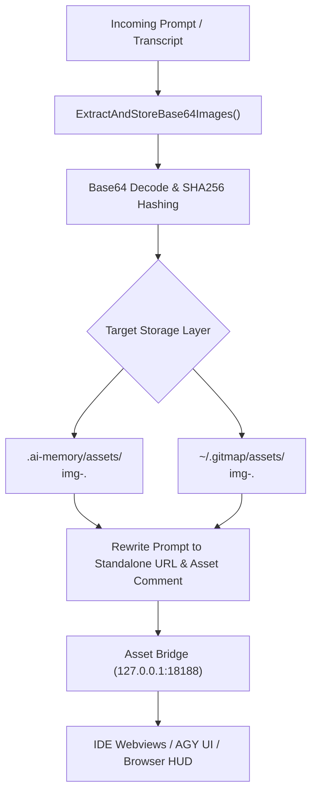

# Architecture Specification: Standalone Image URL & Lightweight Prompt Architecture (AGM Alignment)

**Document ID:** `02-spec/21-app/gitmap-and-antigravity-manager-agm-package-enhancements/03-image-url-architecture.md`  
**Application:** GitMap CLI & Antigravity Manager (AGM)  
**Parent Task:** `gitmap-and-antigravity-manager-agm-package-enhancements`  
**Subtasks:** `subtask-04` (AGM Alignment) & `subtask-05` (Standalone Image URL Architecture)  
**Target Version:** v6.572.0 (Minor Bump)  
**Status:** Approved & Implementing  

---

## 1. Executive Summary

In autonomous multi-agent environments and developer workflows powered by Google Antigravity (AGY) and Antigravity Manager (AGM), user prompts frequently include screenshots, UI mockups, and architectural diagrams. Historically, AI clients, chat webviews, and prompt injectors embed these visuals as inline base64-encoded data URIs (e.g. `data:image/png;base64,...`).

A single 1920x1080 screenshot can generate a base64 payload of 2 MB to 8 MB. When embedded into prompt markdown, these payloads create severe architectural degradation:
1. **Context Window Exhaustion:** Base64 text consumes tens of thousands of LLM input tokens with zero semantic value to text encoders.
2. **IPC & Terminal Catastrophe:** Massive single-line strings lock terminal outputs, overflow OS pipe buffers, inflate SQLite Split-DB records (`gitmap.db`, `pipeline.db`), and crash IPC transport channels between AGM and running agent swarms.
3. **Multi-Agent Rerun Cascades:** In automated prompt rerun and review loops (`gitmap agy rerun`, `backup-running-prompts`), multi-megabyte payloads are repeatedly serialized, duplicated, and transmitted across nodes.

This specification establishes the **Standalone Image URL & Content-Addressable Asset Architecture**. All base64 image blobs are deterministically intercepted, deduplicated using SHA-256 content hashing, persisted into project-scoped storage (`.ai-memory/assets/`) and machine-global cache (`~/.gitmap/assets/`), and served via an ultra-lightweight local HTTP asset bridge (`http://127.0.0.1:18188/assets/img-<sha256>.<ext>`). Prompts are rewritten using a dual-reference markdown schema that satisfies both webview rendering and disk-based agent tooling.

---

## 2. Forensic Problem Analysis

### 2.1 The Inline Base64 Data URI Defect

```
+--------------------------------------------------------------------------+
| Prompt Markdown File / Agent Transcript Message                          |
|                                                                          |
| "Please inspect this UI glitch:                                          |
|                                                         |
|  and fix the rendering bug."                                             |
+--------------------------------------------------------------------------+
       |                                   |
       v                                   v
+-----------------------------+     +-----------------------------+
| LLM Context Window (Token)  |     | Terminal & IPC Transport    |
| - 80,000 useless tokens     |     | - Terminal buffer lockups   |
| - High token cost & latency |     | - SQLite row size balloon   |
| - Truncation of prompt text |     | - Windows pipe deadlock     |
+-----------------------------+     +-----------------------------+
```

### 2.2 Systemic Symptoms

| Failure Domain | Observed Failure Mode | Forensic Root Cause |
|---|---|---|
| **Terminal Rendering** | Terminal freezes or crashes during `gitmap agy running-prompts ls` or `gitmap agy rerun`. | ANSI renderers and terminal emulators attempt to line-wrap a 4,000,000-character contiguous string across 120-column lines. |
| **Database Storage** | SQLite cache database (`.gitmap/cache.db` or `.ai-memory/task.db`) inflates by hundreds of megabytes. | Full prompt text stored in relational text columns without binary offloading. |
| **Agent Ingestion** | Subagent invocation prompts truncated or rejected by LLM API providers with `413 Payload Too Large`. | Prompt text exceeds 1 MB API request limits due to base64 image strings. |
| **Git Repositories** | Dirty working tree and accidental commits of multi-megabyte plan files in `.ai-memory/plans/`. | Markdown plans saved with raw embedded image data instead of clean asset links. |

---

## 3. The Content-Addressable Storage Architecture

### 3.1 Content-Addressable SHA-256 Hashing

When any image payload is intercepted, GitMap decodes the raw base64 byte stream and computes its cryptographic SHA-256 checksum:

$$\text{Hash} = \text{SHA256}(\text{RawBytes})$$

$$\text{FileSlug} = \text{img-} + \text{Hash}[0:16] + \text{.} + \text{ext}$$

- **Prefix:** `img-` provides immediate visual identification and glob filtering (`img-*`).
- **Short Hash:** The first 16 hexadecimal characters ($2^{64}$ collision resistance) guarantee absolute uniqueness within a project and developer workstation while keeping URLs concise.
- **Extension:** Preserves original format identifier (`png`, `jpg`, `jpeg`, `webp`, `gif`).

### 3.2 Tiered Asset Storage Hierarchy



1. **Project-Scoped Directory (`.ai-memory/assets/`):**
   - The primary storage target for all prompt-associated images within an active workspace.
   - Preserves workspace encapsulation; committing `.ai-memory/assets/` or syncing via GitMap enables peer agents to access visual assets.
2. **Machine-Global Cache (`~/.gitmap/assets/`):**
   - A workstation-level fallback cache that persists across multiple workspace clones and ephemeral branches.
   - Prevents redundant disk writes when the same screenshot or UI mock is referenced across distinct branches or project worktrees.

---

## 4. Local Asset Server Bridge (`:18188`)

Antigravity Manager (AGM) and GitMap share a standardized local HTTP daemon listening on:

$$\text{http://127.0.0.1:18188/assets/}$$

### 4.1 Endpoint Contract

- **URL Pattern:** `http://127.0.0.1:18188/assets/img-<sha256[:16]>.<ext>`
- **Method:** `GET`
- **Security Constraints:**
  - Bound exclusively to loopback interface `127.0.0.1` (never exposed to `0.0.0.0`).
  - Strict path sanitization (`filepath.Base`) to eliminate directory traversal attacks (`../`).
  - Read-only asset serving; writes are handled via local filesystem operations.
- **Content-Type Mapping:**
  - `.png` $\to$ `image/png`
  - `.jpg` / `.jpeg` $\to$ `image/jpeg`
  - `.webp` $\to$ `image/webp`
  - `.gif` $\to$ `image/gif`
- **Caching Headers:**
  - `Cache-Control: public, max-age=31536000, immutable` (since content is immutable by hash).

---

## 5. Dual-Reference Markdown Schema

To ensure that prompts are lightweight for LLMs, renderable in rich markdown viewers, and directly accessible to local file-based agent tools, prompts use the **Dual-Reference Markdown Schema**:

```markdown

<!-- asset: .ai-memory/assets/img-a1b2c3d4e5f67890.png -->
```

### 5.1 Dual-Reference Resolution Matrix

| Consumer / Tool | Read Target | Resolution Behavior |
|---|---|---|
| **LLM Context Window** | Text only | Sees a 70-character URL and a 60-character comment (~25 tokens) instead of 100,000+ base64 tokens. |
| **VS Code / Markdown Preview** | First line `` | Renders the live graphic over the loopback HTTP daemon at 60 FPS. |
| **Local File Agent / CLI** | Second line `<!-- asset: <path> -->` | Directly reads the raw binary file from disk via `filepath.FromSlash()` without network roundtrips. |
| **Antigravity Manager (AGM) Webview** | First line `http://...` | Loads image directly in React/Solid UI components via standard `` tags. |

---

## 6. Pipeline Integration & Lifecycle Hooks

### 6.1 Interception Points

The image extraction and rewriting pipeline is automatically triggered across three critical lifecycle stages:

```mermaid
sequenceDiagram
    autonumber
    actor User as User / Voice Prompt
    participant Ingest as Prompt Ingestion Filter
    participant FS as Local Assets (.ai-memory/assets/)
    participant Bridge as Asset Server (:18188)
    participant Agent as Antigravity Agent Swarm

    User->>Ingest: Submit prompt with base64 screenshots
    Ingest->>Ingest: Scan regex data:image/...;base64,...
    Ingest->>FS: Save binary payload as img-<hash[:16]>.<ext>
    Ingest->>Ingest: Rewrite prompt to standalone URL & asset comment
    Ingest->>Agent: Dispatch lightweight prompt markdown
    Agent->>Bridge: Fetch image via HTTP (if vision model)
    Bridge->>FS: Serve local cached image binary
    Agent->>Agent: Execute coding subtasks with clean context
```

1. **Prompt Ingestion Filter:**
   When user prompts or transcripts are captured by GitMap (`gitmap agy` commands or AGM webhook), `ExtractAndStoreBase64Images` scans for all `data:image/...;base64,...` patterns and transforms them before database persistence.
2. **Prompt Rerun (`gitmap agy rerun` / `rr` / `rwi`):**
   Prior to re-injecting a prompt into an active Antigravity session, any remaining inline data URIs are stripped, ensuring reruns never re-bloat running memory.
3. **Backup & Restore (`backup-running-prompts` / `brp`):**
   Backups of prompt histories export cleanly as lean markdown and JSON transcripts, with binary media stored alongside in `.ai-memory/assets/`.

---

## 7. AGM Alignment (Subtask-04)

Recent updates in Antigravity Manager (AGM v4.223.0 - v4.227.3) introduced architectural optimizations that GitMap aligns with:

1. **E9001 Error Elimination:** AGM removed generic error codes in favor of structured domain errors. GitMap returns structured `*appfault.AppError` for all asset and prompt operations.
2. **30s Poller Broadcast Floor:** Background watchers in GitMap enforce a minimum 30-second poll interval to prevent CPU churn and SQLite locking.
3. **Fail-Fast Missing Workspaces:** If a workspace path referenced in a prompt or asset does not exist on disk, the subsystem fails fast with `appfault.ErrorTypeNotFound` rather than idling or throwing unhandled panics.
4. **Prompt Review & Rerun Verification:** When prompts are reviewed or re-injected, GitMap preserves existing asset comments (`<!-- asset: ... -->`) and validates file existence before dispatching to worker agents.

---

## 8. Go Implementation Contracts

### 8.1 Core Functions in `cli/cmdagy/agy_image_assets.go`

```go
package cmdagy

import (
    "github.com/alimtvnetwork/gitmap-v28/cli/apperror"
)

// ExtractAndStoreBase64Images scans promptText for base64 image data URIs,
// decodes and computes their SHA-256 hashes, saves the binaries to targetDir,
// and rewrites promptText using standalone asset URLs and dual-reference comments.
func ExtractAndStoreBase64Images(
    promptText string,
    targetDir string,
) (newPrompt string, savedFiles []string, err *appfault.AppError)

// FormatImageMarkdownStandalone produces the canonical dual-reference markdown string
// for a given image path and asset server URL.
func FormatImageMarkdownStandalone(imagePath string, assetServerUrl string) string
```

### 8.2 Architectural Invariants

- **Function Sizing:** Strict compliance with 8–15 line limit per function.
- **Affirmative Booleans:** All boolean variables and predicates use positive naming (`isValid`, `hasMatch`, `isDirExisting`).
- **Zero Raw Tuples:** Errors returned strictly as `*appfault.AppError`.
- **Zero Git Commands:** File operations are performed using Go standard library (`os`, `path/filepath`), never delegating to external git processes.
