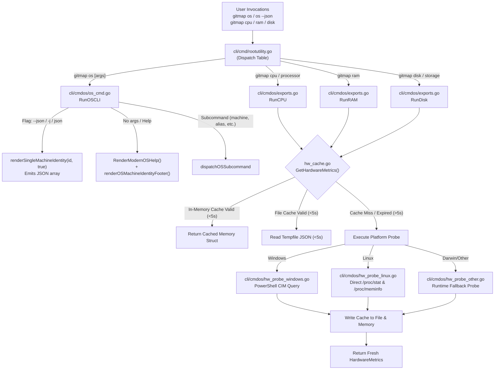
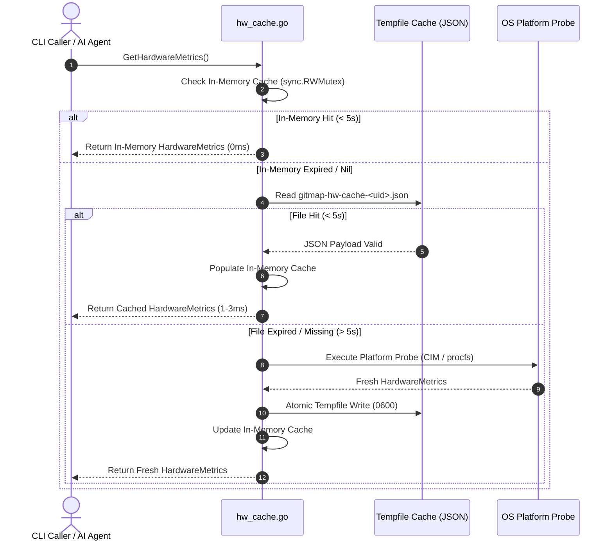

# Architecture Specification: OS JSON, Machine Identity Footer & Fast Hardware Telemetry Suite

**Document ID:** `02-spec/21-app/gitmap-command-enhancements/01-architecture-spec.md`  
**Classification:** Core Application Specification (`02-spec/21-app`)  
**Version:** 1.1.0  
**Updated:** 2026-10-16  
**Milestone:** `gitmap-command-enhancements`  
**Status:** `ratified`  
**AI Confidence:** High  
**Ambiguity:** None  
**Companion Documents:**  
- [Subtask 01: OS JSON & Machine Footer (.ai-memory/plans/subtasks/gitmap-command-enhancements/01-os-json-and-machine-footer.md)](../../../.ai-memory/plans/subtasks/gitmap-command-enhancements/01-os-json-and-machine-footer.md)  
- [Subtask 02: Fast Hardware Telemetry & Cache (.ai-memory/plans/subtasks/gitmap-command-enhancements/02-fast-hardware-telemetry-and-cache.md)](../../../.ai-memory/plans/subtasks/gitmap-command-enhancements/02-fast-hardware-telemetry-and-cache.md)  

---

## Keywords

`gitmap-os` · `os-json` · `machine-identity` · `machine-footer` · `cpu` · `processor` · `ram` · `disk` · `hardware-telemetry` · `hardware-cache` · `cross-process-cache` · `cim-instance` · `proc-stat` · `proc-meminfo`

---

## Scoring

| Criterion | Status | Notes |
| :--- | :---: | :--- |
| AI Confidence assigned | ✅ | High |
| Ambiguity assigned | ✅ | None |
| Keywords present | ✅ | Indexed above |
| Scoring table present | ✅ | Validated |
| Strict relative paths | ✅ | Zero absolute paths or `file:///` URIs |
| Positive boolean logic | ✅ | Positive polarity prefixes (`is*`, `has*`, `can*`, `should*`) |
| Structured error wrapping | ✅ | `*apperror.AppError` / `*appfault.AppError` |
| Zero-build / Zero-test compliance | ✅ | Specification authoring only |

---

## Purpose

This specification defines the authoritative technical architecture, bug remediation contracts, cross-platform hardware telemetry probes, and cross-process caching mechanisms for the `gitmap os` enhancement suite. It establishes:
1. Root cause remediation for `gitmap os --json` and `gitmap os -j` failures caused by strict subcommand dispatching.
2. Machine Identity Summary Footer integration for bare `gitmap os` terminal invocations.
3. Fast, low-overhead hardware telemetry commands (`gitmap cpu`, `gitmap processor`, `gitmap ram`, `gitmap disk`) across Windows, Linux, and POSIX platforms.
4. A 5-second cross-process caching protocol (`HardwareMetricsTTL = 5 * time.Second`) backed by temporary file JSON and in-process mutex guards to prevent high-frequency CPU load spikes.

---

## User Request (Verbatim)

```text
You are Spec Writer 01 for task gitmap-command-enhancements. You have no prior chat context; this brief is your complete specification.

### Core Objective:
Author the canonical Architecture Specification and Subtasks 01-02:
1. `02-spec/21-app/gitmap-command-enhancements/01-architecture-spec.md`
2. `.ai-memory/plans/subtasks/gitmap-command-enhancements/01-os-json-and-machine-footer.md`
3. `.ai-memory/plans/subtasks/gitmap-command-enhancements/02-fast-hardware-telemetry-and-cache.md`

### Invariants & Non-Negotiable Rules:
- Strictly relative Git paths only (e.g. `02-spec/...`, `cli/cmdos/...`). Zero absolute paths or `file:///` URIs.
- All files, folder names, and specs strictly lowercase.
- Zero-build and zero-test rules during authoring.
- Positive booleans only (`is*`, `has*`, `can*`, `should*`), no `== true`, no `!isSuccess` (use `.IsFail()`).
- Error wrapping via `*appfault.AppError` / `*apperror.AppError`.

### Technical Architecture to Detail:
1. Architecture Spec (`01-architecture-spec.md`):
   - Executive Overview & System Context.
   - Root cause of `gitmap os --json` failure: strict subcommand matching in `dispatchOSSubcommand` throwing `E_INVALID_OS_SUBCMD`.
   - Resolution: Root-level flag inspection in `runOS`, handling `--json`, `-j`, and positional `json`, returning structured `renderSingleMachineIdentity(..., true)`.
   - Appending machine identity summary to default bare `gitmap os` output.
   - Hardware Commands Architecture (`gitmap cpu`, `processor`, `ram`, `disk`):
     * Windows PowerShell CIM script:
       `powershell -NoProfile -Command '$cpu = (Get-CimInstance Win32_Processor | Measure-Object -Property LoadPercentage -Average).Average; $os = Get-CimInstance Win32_OperatingSystem; $tot = [math]::Round($os.TotalVisibleMemorySize/1024); $free = [math]::Round($os.FreePhysicalMemory/1024); $used = $tot - $free; $ram = [math]::Round(($used/$tot)*100); Write-Output ("{0},{1},{2},{3}" -f [int]$cpu, [int]$ram, [int]$tot, [int]$used)'`
     * Linux `/proc/stat` & `/proc/meminfo` readers.
     * 5-Second Cross-Process Cache mechanism (`HardwareMetricsTTL = 5 * time.Second` in tempfile + in-memory mutex) to prevent high-frequency CPU load spikes.
2. Subtasks:
   - Subtask 01 (`01-os-json-and-machine-footer.md`): Owned files `cli/cmdos/os.go`, `cli/cmdos/os_cmd.go`. Detail exact function signatures, flag handling, and machine footer rendering.
   - Subtask 02 (`02-fast-hardware-telemetry-and-cache.md`): Owned files `cli/cmdos/hw_types.go`, `cli/cmdos/hw_cache.go`, `cli/cmdos/hw_probe_windows.go`, `cli/cmdos/hw_probe_linux.go`, `cli/cmdos/hw_probe_other.go`, `cli/cmdos/exports.go`, `cli/cmd/rootutility.go`, `cli/completion/completion.go`. Detail hardware metrics structures, 5-second caching, Windows/Linux probe implementations, and CLI routing for `cpu`, `processor`, `ram`, and `disk`.
```

---

## 1. Executive Overview & System Context

The `gitmap os` command hierarchy provides essential system configuration, fleet identity, network management, and desktop hygiene tooling. However, autonomous agents, CI/CD runners, and operator scripts require machine-parseable telemetry (`--json`) and lightweight hardware health indicators without incurring high subprocess invocation penalties or parsing failures.



---

## 2. Bug Remediation: `gitmap os --json` Failure

### 2.1 Symptom & Mechanism
When users or automation agents execute `gitmap os --json` or `gitmap os -j`:
```bash
$ gitmap os --json
unknown os subcommand '--json' (see 'gitmap os --help') [code: E_INVALID_OS_SUBCMD]
```

### 2.2 Root Cause Analysis (RCA)
1. **Dispatcher Interception Point:** In `cli/cmdos/os_cmd.go`, `RunOSCLI(args)` inspects `args`.
2. **Missing Flag Check:** If `len(args) > 0`, it takes `args[0]` (which is `"--json"`) and routes it through `tryDispatchOSIdentityOrCobra(sub, args)`.
3. **Dispatch Table Fallthrough:** Because `"--json"` does not match `"machine"`, `"alias"`, `"info"`, `"tui"`, `"dock"`, or package update commands, it delegates to `runOS(args)` in `cli/cmdos/os.go`.
4. **Subcommand Parser Rejection:** `runOS(args)` evaluates `isOSHelpArg(args[0])`. `"--json"` is not a help flag (`-h`, `--help`, `help`).
5. **Terminal Fault:** `runOS(args)` calls `dispatchOSSubcommand(strings.ToLower(args[0]), args[1:])`. The switch statement contains only named subcommands. The `default:` case fires:
   ```go
   func unknownOSSubcommandError(subCmd string) error {
       return apperror.NewSimple("unknown os subcommand '"+subCmd+"' (see 'gitmap os --help')", "E_INVALID_OS_SUBCMD")
   }
   ```

### 2.3 Resolution Architecture
The resolution requires root-level flag inspection before subcommand evaluation:
1. **Flag Detection Function:**
   Define `hasOSJSONArg(args []string) bool`:
   ```go
   func hasOSJSONArg(args []string) bool {
       for _, arg := range args {
           normalized := strings.ToLower(strings.TrimSpace(arg))
           if normalized == "--json" || normalized == "-j" || normalized == "json" {
               return true
           }
       }
       return false
   }
   ```
2. **Root Entrypoint Handling in `runOS` and `RunOSCLI`:**
   When `len(args) == 1` and `hasOSJSONArg(args)` is true, or when `--json` is supplied without an alternative valid subcommand:
   Immediately invoke:
   ```go
   return renderSingleMachineIdentity(resolveLocalMachineIdentity(), true)
   ```
3. **Subcommand Switch Compatibility:**
   In `dispatchOSSubcommand`, add explicit cases:
   ```go
   case "--json", "-j", "json":
       return renderSingleMachineIdentity(resolveLocalMachineIdentity(), true)
   ```
4. **Resulting Output:**
   Standard JSON array containing the resolved `MachineIdentity` object:
   ```json
   [
     {
       "sequence": 1,
       "nodeId": "local-node",
       "ipAddress": "192.168.1.105",
       "alias": "win-primary",
       "machineName": "dev-win-01",
       "osHostname": "dev-win-01",
       "osPlatform": "windows",
       "osVersion": "11 Pro (Build 22631)",
       "architecture": "amd64",
       "cpuCores": 16,
       "currentUser": "Administrator",
       "gitmapVersion": "v2.99.0",
       "scope": "local"
     }
   ]
   ```

---

## 3. Bare `gitmap os` Machine Identity Footer

### 3.1 UX Design & Motivation
When an operator runs bare `gitmap os` without arguments, GitMap displays the modernized boxed help menu (`RenderModernOSHelp()`). While this presents available subcommands, users frequently run `gitmap os` expecting immediate context on the current host machine (its assigned alias, hostname, IP address, OS build, and CPU architecture).

### 3.2 Machine Identity Summary Footer Implementation
Directly after rendering the help menu and operational tips in `RenderModernOSHelp()`, GitMap appends a streamlined machine identity status block:
```text
  ● Active Host Identity:
    ├─ Machine Name:    dev-win-01 (ubuntu-node-02)
    ├─ Fleet Alias:     win-primary
    ├─ Local IPv4:      192.168.1.105
    ├─ OS Platform:     windows (Windows 11 Pro, Build 22631)
    ├─ Architecture:    amd64 (16 CPU cores)
    └─ Active User:     Administrator
```

### 3.3 Non-Intrusive Error Isolation
Resolving machine identity during help display must never crash the CLI. If local IP discovery or OS version resolution encounters an error, the footer renders available fallback tokens gracefully (e.g., `127.0.0.1`, `unknown`) without propagating an unhandled error.

---

## 4. Hardware Telemetry Architecture (`cpu`, `processor`, `ram`, `disk`)

### 4.1 CLI Invocations & Grammar
GitMap introduces first-class top-level hardware telemetry commands:
- `gitmap cpu` / `gitmap processor`: Reports CPU model, physical/logical core count, architecture, and current CPU load percentage.
- `gitmap ram`: Reports total physical RAM, used RAM, free RAM, and utilization percentage.
- `gitmap disk` / `gitmap storage`: Reports mounted volumes, total capacity, used capacity, available capacity, and utilization percentage.
- **JSON Flag:** All commands accept `--json` or `-j` to return machine-readable JSON.

```bash
# Terminal human-readable view:
gitmap cpu
gitmap processor
gitmap ram
gitmap disk

# Machine-readable JSON telemetry:
gitmap cpu --json
gitmap ram -j
gitmap disk --json
```

### 4.2 Windows Probing Implementation (`cli/cmdos/hw_probe_windows.go`)
Windows hardware telemetry utilizes an optimized PowerShell CIM query executed in a single command invocation to sample CPU load and memory metrics in a single process launch:

```powershell
powershell -NoProfile -Command '$cpu = (Get-CimInstance Win32_Processor | Measure-Object -Property LoadPercentage -Average).Average; $os = Get-CimInstance Win32_OperatingSystem; $tot = [math]::Round($os.TotalVisibleMemorySize/1024); $free = [math]::Round($os.FreePhysicalMemory/1024); $used = $tot - $free; $ram = [math]::Round(($used/$tot)*100); Write-Output ("{0},{1},{2},{3}" -f [int]$cpu, [int]$ram, [int]$tot, [int]$used)'
```

#### Output Parsing:
The script outputs a comma-separated tuple:
`"<cpu_percent>,<ram_percent>,<total_ram_mb>,<used_ram_mb>"`
Example: `"14,48,32698,15695"`

For disk metrics, Windows probes volumes using `Get-CimInstance Win32_LogicalDisk -Filter "DriveType=3"` or standard Windows API `syscall.GetDiskFreeSpaceExW`.

### 4.3 Linux Probing Implementation (`cli/cmdos/hw_probe_linux.go`)
On Linux systems, launching external shells or processes introduces unacceptable latency. Linux telemetry operates entirely in-process via virtual filesystem reads:
1. **/proc/stat (CPU Utilization):**
   Reads `/proc/stat` and parses the first line (`cpu <user> <nice> <system> <idle> <iowait> <irq> <softirq> <steal> <guest> <guest_nice>`).
   Calculates total CPU time and idle CPU time. Samples a delta across 100 milliseconds or compares against previous cached ticks:
   $$\text{Total} = \text{user} + \text{nice} + \text{system} + \text{idle} + \text{iowait} + \text{irq} + \text{softirq} + \text{steal}$$
   $$\text{Idle} = \text{idle} + \text{iowait}$$
   $$\text{LoadPercent} = \left( 1 - \frac{\Delta \text{Idle}}{\Delta \text{Total}} \right) \times 100$$
2. **/proc/meminfo (RAM Utilization):**
   Parses `MemTotal`, `MemFree`, and `MemAvailable` in kB:
   $$\text{TotalMB} = \frac{\text{MemTotal}}{1024}$$
   $$\text{AvailableMB} = \frac{\text{MemAvailable}}{1024}$$
   $$\text{UsedMB} = \text{TotalMB} - \text{AvailableMB}$$
   $$\text{UsedPercent} = \text{Round}\left(\frac{\text{UsedMB}}{\text{TotalMB}} \times 100\right)$$
3. **/proc/cpuinfo (CPU Model & Cores):**
   Extracts `model name` and core counts.
4. **syscall.Statfs (Disk Utilization):**
   Executes `unix.Statfs` / `syscall.Statfs` on active filesystem mount points (`/`, `/home`, etc.) to obtain block size, total blocks, and available blocks.

### 4.4 POSIX / macOS / Fallback Probing (`cli/cmdos/hw_probe_other.go`)
For Darwin (macOS) and other unsupported POSIX architectures:
- CPU cores: `runtime.NumCPU()`
- Architecture: `runtime.GOARCH`
- Disks: `syscall.Statfs` on `/`
- RAM: `sysctl` probes (`hw.memsize`) or safe default indicators.

---

## 5. 5-Second Cross-Process Cache Engine

### 5.1 Problem Statement
Running PowerShell CIM queries on Windows consumes 350ms to 750ms of CPU time. If status lines, shell prompt generators (e.g. Starship, Oh-My-Zsh), or autonomous AI monitoring loops poll `gitmap cpu` or `gitmap ram` multiple times per second, the polling itself creates severe CPU spikes and degrades system performance.

### 5.2 Two-Tier Caching Architecture
To guarantee $< 15\text{ms}$ latency for high-frequency queries and prevent probe thrashing, GitMap implements a two-tier cache with a 5-second Time-To-Live (`HardwareMetricsTTL = 5 * time.Second`):



### 5.3 Cache File Specifications
- **File Location:**
  `filepath.Join(os.TempDir(), fmt.Sprintf("gitmap-hw-cache-%d.json", os.Getuid()))`
  On Windows systems where `os.Getuid()` returns `-1`, use:
  `filepath.Join(os.TempDir(), "gitmap-hw-cache-default.json")`
- **Cache Invalidation:**
  $$\text{IsExpired} = \text{time.Since}(\text{CachedAt}) \ge 5 \times \text{time.Second}$$
- **Atomic File Write:**
  Write JSON payload to a temporary file in `os.TempDir()`, then execute atomic replace via `os.Rename` to prevent race conditions during concurrent cross-process reads.
- **Cache Payload Schema:**
  ```json
  {
    "cachedAt": "2026-10-16T13:00:00Z",
    "ttlSeconds": 5,
    "metrics": {
      "cpu": {
        "modelName": "AMD Ryzen 9 5950X 16-Core Processor",
        "cores": 32,
        "loadPercent": 14,
        "architecture": "amd64"
      },
      "ram": {
        "totalMb": 32698,
        "usedMb": 15695,
        "freeMb": 17003,
        "usedPercent": 48
      },
      "disks": [
        {
          "mountPoint": "C:",
          "totalGb": 953.2,
          "usedGb": 412.5,
          "freeGb": 540.7,
          "usedPercent": 43
        }
      ]
    }
  }
  ```

---

## 6. Data Contracts & Type Schemas

The hardware telemetry types reside in `cli/cmdos/hw_types.go`:

```go
package cmdos

import "time"

// HardwareMetrics encapsulates system hardware utilization telemetry.
type HardwareMetrics struct {
	CPU        CPUMetrics  `json:"cpu"`
	RAM        RAMMetrics  `json:"ram"`
	Disks      []DriveInfo `json:"disks"`
	Timestamp  time.Time   `json:"timestamp"`
	DurationMs int64       `json:"durationMs"`
	IsCached   bool        `json:"isCached"`
}

// CPUMetrics captures processor architecture and real-time load.
type CPUMetrics struct {
	ModelName    string `json:"modelName"`
	Cores        int    `json:"cores"`
	LoadPercent  int    `json:"loadPercent"`
	Architecture string `json:"architecture"`
}

// RAMMetrics captures physical memory utilization.
type RAMMetrics struct {
	TotalMB     int `json:"totalMb"`
	UsedMB      int `json:"usedMb"`
	FreeMB      int `json:"freeMb"`
	UsedPercent int `json:"usedPercent"`
}

// DriveInfo represents volume storage capacity and usage.
type DriveInfo struct {
	MountPoint  string  `json:"mountPoint"`
	TotalGB     float64 `json:"totalGb"`
	UsedGB      float64 `json:"usedGb"`
	FreeGB      float64 `json:"freeGb"`
	UsedPercent int     `json:"usedPercent"`
}
```

---

## 7. CLI Routing & Tab-Completion Architecture

### 7.1 Dispatch Table Wiring (`cli/cmd/rootutility.go`)
Register top-level commands inside `utilitySystemEntries()`:
```go
func utilitySystemEntries() []dispatchEntry {
	return []dispatchEntry{
		{[]string{"cpu", "processor"}, func() error { return cmdos.RunCPU(argsTail()) }},
		{[]string{"ram"}, func() error { return cmdos.RunRAM(argsTail()) }},
		{[]string{"disk"}, func() error { return cmdos.RunDisk(argsTail()) }},
		// ... existing entries
	}
}
```

### 7.2 Exported Signatures (`cli/cmdos/exports.go`)
```go
// RunCPU displays CPU model, cores, and current load percentage.
func RunCPU(args []string) error {
	return runCPUCLI(args)
}

// RunRAM displays physical memory capacity, usage, and percentage.
func RunRAM(args []string) error {
	return runRAMCLI(args)
}

// RunDisk displays disk volume capacities and utilization.
func RunDisk(args []string) error {
	return runDiskCLI(args)
}
```

### 7.3 Shell Tab-Completion (`cli/completion/completion.go`)
Add the new hardware commands to `manualExtras`:
```go
var manualExtras = []string{
	"db", "start-fresh", "find-duplicates", "pe", "pd", "ping", 
	"nodes", "node", "gitignore", "agm", "ta",
	"cpu", "processor", "ram", "disk",
}
```

---

## 8. Invariants & Acceptance Gates

1. **Zero Negative Booleans:** Field names, parameters, and local variables must use positive polarity (`isCached`, `hasJSON`, `canProbe`, `isValid`). No negative flags (`isNotCached`, `disableCache`).
2. **Error Wrapping:** Every unrecoverable error must be wrapped with `apperror.NewSimple` or `apperror.Wrap` using typed error codes (`E_HW_PROBE_FAILED`, `E_HW_CACHE_FAILED`).
3. **Strictly Relative Paths:** No absolute paths, home-relative `~/` tokens, or `file:///` URIs in specifications or source code.
4. **Execution Safety:** Probes must never block indefinitely. PowerShell commands must use a 3-second context timeout. Linux file reads must use buffered I/O.
5. **Zero-Build & Zero-Test Invariant:** During specification and subtask authoring, no compilers, linters, or test suites are invoked.
