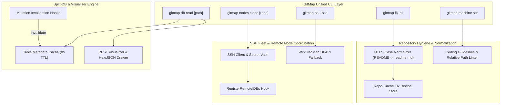

# GitMap Enhancement and Issue Resolution - Executive Overview

- **Document Path:** `02-spec/21-app/gitmap-enhancement-and-issue-resolution/00-overview.md`
- **Specification Group:** `21-app/gitmap-enhancement-and-issue-resolution`
- **Status:** Approved
- **Lifecycle Budget:** 400 Steps (V6 Swarm Hierarchy: A=3, H=2, Capacity=6)
- **Target Release:** GitMap v6.590.0

---

## 1. Executive Overview

This specification establishes the architectural blueprints, technical requirements, and verification protocols for resolving operational anomalies across GitMap CLI, the SSH multi-node fleet, and the Split SQLite database visualization engine.

The core objectives span eight foundational areas:
1. **Database Read Introspection with Dynamic TTL Cache:** Upgrade `gitmap db read` (`dbr`) to accept bare database paths or aliases, introspect and display table metadata (columns, row counts, schema definitions), and maintain a 5–10 second in-memory cache that automatically invalidates when database write mutations occur.
2. **Database Visualizer Professional Overhaul:** Modernize the embedded HTML/JS and React Database Table Browser (`src/pages/Database.tsx` and `cli/cmddb/rest_visualizer_*.go`) to cleanly render binary/protobuf structures in `error_details` and `metadata` using hex previews, collapsible JSON trees, and cell inspection drawers.
3. **Automated Case Normalization for Storytelling V1:** Implement automated NTFS case-conflict resolution in `gitmap fix-all` (`fa`) for stubborn `README.md` tracking anomalies, ensuring files normalize to lowercase `readme.md` and logging the exact resolution recipe in `repo-cache/`.
4. **Remote Fleet Clone IDE Registration:** Hook `RegisterRemoteIDEs` from `cli/cmdnodes/nodes_deploy_ide.go` directly into `cli/cmdnodes/nodes_clone_remote.go` so repositories cloned on remote SSH nodes automatically register in GitHub Desktop (`github open`), VS Code Project Manager (`projects.json`), Cursor, and Antigravity.
5. **WinCredMan SSH Fleet Pull Recovery:** Implement automated detection and graceful fallback in `gitmap pa --ssh` for remote Windows nodes experiencing Windows Credential Manager authentication failures (`wincredman failed to persist credentials`), utilizing GitMap credential resolution and DPAPI storage.
6. **Machine Set Interactive Prompt:** Enhance `gitmap machine set` to detect missing arguments and interactively prompt the user for the machine alias/name instead of immediately terminating with an error.
7. **Universal `readme.text` & Timestamp Ban:** Eradicate all legacy memory references, spec exceptions, and instructions suggesting `readme.text` or timestamp generation, cementing lowercase `readme.md` standards repository-wide.
8. **Repository Coding Guidelines Compliance:** Perform systematic static audits to verify positive boolean prefixes (`is*`, `has*`), 15-line function caps, zero nested `if` statements, strict relative paths, and outer caller exit error handling.

---

## 2. Verbatim User Request

The incoming user request initiating this architecture is recorded below:

```text
A couple of issues. First, when working with GitMap, if we run the GitMap read, it does not have proper help. For example, I give a path and then try to see the tables, I failed. Just giving a path to the database using the Database (Database (Db)) read should show all the table information to get us started with using a cache. We should have a cache for five to 10 seconds that tells us the database information. Unless the database is changed through us, then the cache will be invalidated. The current problem is through the GitMap pull all from multiple machines. One problem is in the Storytelling V1 app that has a README file which I cannot discard or fix. First, find how this came up. I've seen this problem several times. Using our fix all, we should be able to fix it automatically. This README fix should be written to the repo cache, like what steps we're following, and ensure it becomes lowercase. Provide that fix automatically across the repositories. When I try to clone using nodes, I ran GitMap nodes clone and given a repository. The repository cloned nicely. Everything is good. On the current machine, it showed up in the GitHub desktop. But on the remote machine, it did not show up in the GitHub desktop and the VS Code project. Fix those. The GitMap Database (Database (Db)) visualizer needs a better UI. The current UI is not professional. Make a better visualization in the GitMap Database (Database (Db)) UI, REST Database (Database (Db)) UI section. I'm giving you the logs for the GitMap PA SSH to find the root cause and fix it. Connect to the other machine and fix it so every clone is smooth. I found errors. For example, if I type GitMap machine set and press enter, it gives an error, which is correct. Showing the error is right. But we will prompt the user that they forgot to pass the machine name. If they do not provide the machine name, we will prompt them to provide it. Once they provide it, it will be automatically set. Never use or add the README.text for adding the timestamp. If that memory exists, correct it everywhere, not only in GitMap but also in the coding guideline. Make sure README text never exists. Find out how many places the code is not following the coding guideline.
```

---

## 3. Strategic Intent & Systems Topology

The strategic intent is to maintain GitMap as an ultra-reliable, zero-downtime, polyglot developer companion and fleet management orchestrator. Every failure state must feature automated self-healing, deterministic telemetry, and declarative recovery mechanisms.



---

## 4. Requirements Traceability Matrix (Task-01 through Task-11)

| Requirement ID | User Directive / Functional Requirement | Target Subsystem / File Scope | Allocated Subtask Plan | Verification Protocol |
|---|---|---|---|---|
| **Task-01** | Git pre-flight pull and working tree clean state verification | Entire GitMap repository | `Master Plan (Phase 1)` | `git status` clean check |
| **Task-02** | Author comprehensive specifications and modular subtask plans | `02-spec/21-app/`, `.ai-memory/plans/` | `Subtasks 01-07` | Peer review & consistency audit |
| **Task-03** | Exclusive search via GitMap toolchain (total ban on `rg`/`grep`) | Operational invariant | `All Subtasks` | Execution log audit |
| **Task-04** | 100% strictly relative paths across code, docs, and notes | All generated files & release notes | `Master Plan & Subtask 07` | Regex scan for absolute paths |
| **Task-05** | Database read path introspection & 5–10s TTL cache with invalidation | `cli/cmddb/` | `01-subtask-db-read-table-cache.md` | Unit tests & TTL expiry test |
| **Task-06** | Storytelling V1 `README` NTFS case normalization & repo-cache recipe | `cli/cmdfix/`, `repo-cache/` | `04-subtask-storytelling-readme-case-normalization.md` | Case-conflict staging test |
| **Task-07** | Remote node clone IDE registration (GitHub Desktop, VS Code, Cursor) | `cli/cmdnodes/` | `03-subtask-nodes-clone-ide-registration.md` | Mock SSH IDE dispatch test |
| **Task-08** | Database visualizer overhaul: binary/protobuf hex dump & JSON tree | `cli/cmddb/`, `src/pages/Database.tsx` | `02-subtask-database-ui-visualizer-enhancement.md` | Visualizer UI rendering test |
| **Task-09** | SSH fleet pull WinCredMan authentication failure auto-recovery | `cli/gitutil/`, `cli/cmdpull/` | `05-subtask-wincredman-ssh-pull-fix.md` | Headless SSH credential test |
| **Task-10** | `gitmap machine set` interactive prompting for missing machine name | `cli/cmdos/` | `06-subtask-machine-set-interactive-prompt.md` | Interactive CLI mock test |
| **Task-11** | Universal `readme.text` timestamp elimination & guidelines audit | `.ai-memory/`, `02-spec/`, `cli/` | `07-subtask-readme-text-ban-and-guidelines-audit.md` | Full repository regex & lint audit |

---

## 5. Scope Boundaries

### In-Scope
1. Extending `cli/cmddb/` to detect bare database file paths, list schema tables, cache metadata for 8 seconds, and clear cached state on record insertions, updates, deletions, and resets.
2. Enhancing the web UI templates (`cli/cmddb/rest_visualizer_*.go`) and React frontend (`src/pages/Database.tsx`) to detect protobuf and binary fields, rendering clean hex previews and JSON collapsible objects.
3. Hooking `RegisterRemoteIDEs` into `cli/cmdnodes/nodes_clone_remote.go` following successful remote clone operations.
4. Adding automated case-reconciliation in `cli/cmdfix/` for upper-case `README` files on case-insensitive filesystems.
5. Providing fallback credential handlers in `cli/gitutil/` for headless remote SSH processes.
6. Adding interactive terminal input prompts in `cli/cmdos/` when `gitmap machine set` lacks positional arguments.
7. Purging all references to `readme.text` and timestamp generation from all project documentation, specifications, and memory files.

### Out-of-Scope
1. Altering underlying SQLite database split topologies (`gitmap.db`, `installation.db`, `repodb/pipeline.db`).
2. Modifying Casbin RBAC security policies or table migration definitions.
3. Introducing third-party external dependencies or heavyweight CGO libraries.

---

## 6. Non-Negotiable Architectural Constraints

All implementations adhering to this specification must enforce the following rules:

1. **Relative Paths Invariant (CODE RED):** Zero absolute file paths (`C:\`, `D:\`, `file:///`) are permitted in source code, Markdown specs, documentation, or release notes. Every path must be relative to the repository root.
2. **Positive Boolean Naming:** All booleans must begin with `is` or `has` exclusively (`isWin`, `hasCache`, `isValid`). Negative prefixes (`not`, `non`, `no`) and non-compliant verbs (`can`, `should`, `was`, `will`) are strictly banned.
3. **15-Line Function Limit:** Functions must remain concise: `<= 8` lines preferred, `<= 15` lines maximum. Complex routines must decompose into discrete single-responsibility helper functions.
4. **Zero Nested Conditionals:** Nested `if` blocks are prohibited. Conditional branching must be flattened using guard clauses and immediate returns.
5. **AppError & Exit Handler Sovereignty:** Leaf functions must return errors directly wrapped in `apperror.Wrap` or standard formatting. Leaf functions must never call `cliexit.HandleError` or `os.Exit`.
6. **No Build & No Test Execution During Authoring:** Phase 1 and Phase 2 strictly prohibit intermediate build and test runs to conserve compute budget and prevent premature failures.
