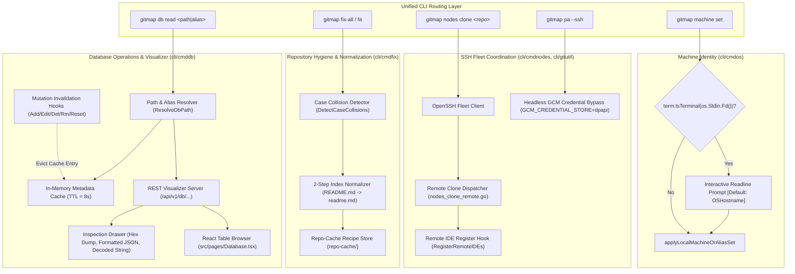
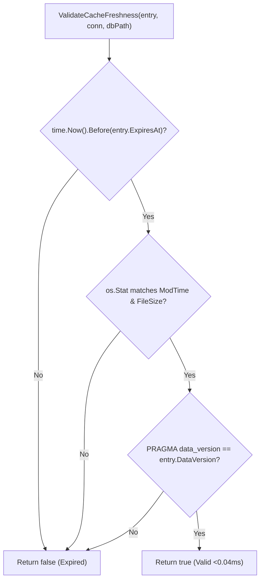
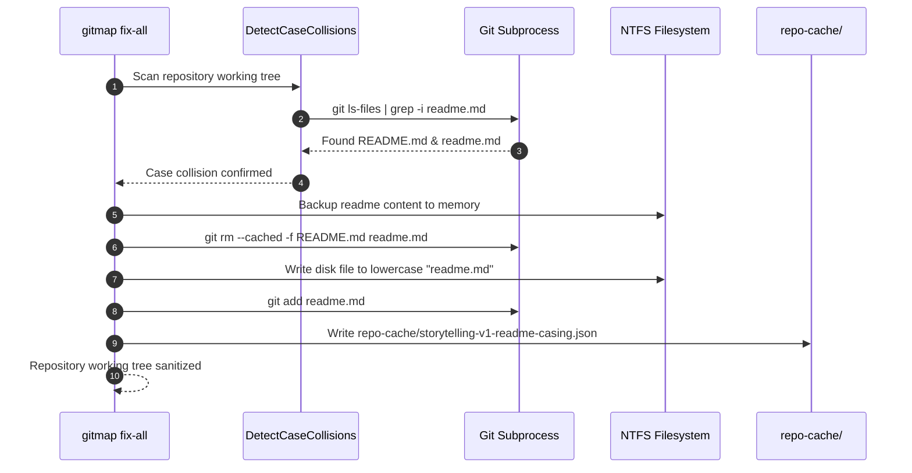

# System Architecture: GitMap Enhancement & Multi-Node Fleet Issue Resolution

## Status
- **Specification Version**: 2.0.0
- **Status**: APPROVED
- **Date**: 2026-10-21
- **Domain**: Database Introspection, TTL Caching, Visualizer Modernization, NTFS Casing Normalization, Remote SSH Fleet IDE Registration, Headless WinCredMan Bypass, and Interactive Machine Identity
- **Target Subsystems**: `cli/cmddb`, `cli/cmdfix`, `cli/cmdnodes`, `cli/cmdos`, `cli/gitutil`, `src/pages`

---

## 1. Executive Summary & Purpose

The GitMap platform provides automated developer tooling, high-speed repository scanning, multi-node SSH fleet operations, and Split SQLite database management (`gitmap.db`, `installation.db`, `repodb/pipeline.db`). As usage expands across heterogeneous operating systems (Windows, Linux, macOS) and headless SSH fleet nodes, several operational frictions have emerged:

1. **Bare Path Database Introspection Deficiencies (`gitmap db read <path>`)**: Passing only a database file path or alias currently routes to basic table name listing (`handleReadLs`), missing detailed schemas (DDL), column definitions, and row counts.
2. **Missing Sub-Millisecond Metadata TTL Cache**: High-frequency schema queries and table count aggregations (`SELECT COUNT(*)`) repeatedly trigger full SQLite schema parses and table traversals without in-memory caching.
3. **Binary/Protobuf Cell Clutter & Replacement Glyphs in Visualizer**: The web visualizer backend naively casts raw `[]byte` values (such as Protobuf blobs, cryptographic keys, binary hashes, and raw BLOBs) into Go strings, rendering corrupted black diamond glyphs (`\uFFFD`) in browser viewports without inspection drawers.
4. **Storytelling-v1 NTFS Casing Tracking Anomaly (`README.md` vs `readme.md`)**: On Windows NTFS filesystems (`core.ignorecase=true`), dual casing tracking in Git creates a perpetual dirty status loop where files cannot be cleanly discarded or fixed without an automated 2-step index normalization recipe logged to `repo-cache/`.
5. **Remote Node Clone IDE Omission over SSH**: When running `gitmap nodes clone`, cloned repositories register in local IDEs and GitHub Desktop, but fail to register in remote node IDEs (GitHub Desktop, VS Code Project Manager `projects.json`, and VS Code workspace `state.vscdb`).
6. **Remote SSH WinCredMan Failure in Headless Sessions**: Executing `gitmap pa --ssh` triggers Git operations on remote Windows nodes where Windows OpenSSH Service Logon Type 3 (Network Logon) prevents interactive desktop session access to Windows Credential Manager (`wincredman`), failing operations with code 128 unless `GCM_CREDENTIAL_STORE=dpapi` or headless credential bypass is applied.
7. **Abrupt Error on Missing Machine Name (`gitmap machine set`)**: Invoking `gitmap machine set` without arguments immediately fails with an error rather than interactively prompting the developer in interactive terminal sessions.

This unified architecture specification defines the design, contracts, interfaces, and protocols to resolve all seven challenges with zero-downtime reliability, strict relative path hygiene, and positive boolean standards.

---

## 2. Comprehensive System Topology



---

## 3. Pillar A: Database Read Introspection & In-Memory TTL Cache

### 3.1 Bare Path & Alias Routing
When `gitmap db read <path>` is executed with a single argument representing a database file path or registered database alias (without SQL tokens such as `SELECT` or subcommands like `ls`/`table`):
1. **Resolution**: `cmddb.ResolveDbPath(rawPath)` normalizes the path or alias.
2. **Introspection Pipeline**: The command opens a read-only database handle with `PRAGMA query_only = ON;`.
3. **Cache Lookup**: Query the in-memory metadata cache via `GetCachedTableMetadata(conn, dbPath)`.
4. **Introspection Gathering**: On cache miss, query `sqlite_master` for all non-system tables/views, calculate column counts via `PRAGMA table_info`, calculate row counts via `SELECT COUNT(*)`, and fetch DDL schemas.
5. **Presentation**: Render formatted terminal output or JSON output (`--json`).

### 3.2 In-Memory TTL Cache Architecture (`cli/cmddb/cmddb_cache.go`)
- **TTL Duration**: 8 seconds default (configurable between 5 and 10 seconds).
- **Concurrency**: Thread-safe with `sync.RWMutex`.
- **Validation Pipeline (<0.04ms target)**:
  1. *TTL Expiry*: `time.Now().Before(entry.ExpiresAt)`.
  2. *Filesystem Stat*: `os.Stat(dbPath)` matches `ModTime` and `FileSize`.
  3. *SQLite Data Version*: `PRAGMA data_version;` matches `entry.DataVersion`.



### 3.3 Mutation-Based Invalidation Hooks
To guarantee immediate consistency, write operations trigger explicit eviction hooks:
- `cli/cmddb/cmd_add.go`: Calls `InvalidateDbTableCache(dbPath)` upon insert commit.
- `cli/cmddb/cmd_edit.go`: Calls `InvalidateDbTableCache(dbPath)` upon update commit.
- `cli/cmddb/cmd_record_del.go`: Calls `InvalidateDbTableCache(dbPath)` upon row deletion.
- `cli/cmddb/cmd_rm.go`: Calls `InvalidateDbTableCache(dbPath)` upon database/alias removal.
- `cli/cmddb/cmddb_reset.go`: Calls `InvalidateAllDbTableCaches()` upon database reset.
- `cli/cmddb/rest_handlers_crud.go` & `rest_handlers_ddl.go`: Evicts cache on REST mutations (`POST`, `PUT`, `DELETE`).

---

## 4. Pillar B: Database Visualizer UI Binary Formatting & Inspection Drawer

### 4.1 Binary & Protobuf Payload Detection
In `cli/cmddb/rest_handlers_crud.go`, the row scanner checks `[]byte` values using `isBinaryPayload(b []byte) bool`:
- If `!utf8.Valid(b)` or if null-byte ratio exceeds thresholds, tag as binary.
- Encapsulate detected binary fields into a structured JSON envelope:
  ```json
  {
    "__blob": true,
    "size": 128,
    "hex": "4749544d4150000102030405...",
    "preview": "[BLOB 128B]"
  }
  ```
- Prevents Unicode `\uFFFD` black diamond glyph corruption across all browser viewports.

### 4.2 Frontend Smart Cell Rendering
In `cli/cmddb/rest_visualizer_js1.go` and `src/pages/Database.tsx`:
1. **BLOB Hex Badge**: Renders as `[BLOB 128B]` badge with monospace styling. Clicking opens the Inspection Drawer in Hex mode.
2. **Collapsible JSON Tree**: JSON objects or parseable JSON strings render with a `[JSON: N keys]` pill. Clicking expands inline or launches the JSON drawer.
3. **Boolean Badges**: Strict green check `✓ true` or muted `✗ false`.
4. **Text Truncation**: Strings exceeding 100 characters truncate with hover tooltips and double-click to copy.

### 4.3 Side-Sliding Inspection Drawer
The inspection drawer provides three interactive inspection modes:
- **Hex Dump Mode**: 16-byte aligned offset, hex octets, and ASCII printable sidebar.
- **Formatted JSON Mode**: Indented, syntax-highlighted, collapsible tree.
- **String Decoding Mode**: Raw UTF-8 / ASCII text decoder with copy-to-clipboard and file download.

### 4.4 Pagination Boundary Enforcement
- Calculates `totalPages = Math.max(1, Math.ceil(totalRecords / limit))`.
- Disables `btn-next` when `page >= totalPages` and disables `btn-prev` when `page <= 1`.
- Prevents unbounded navigation into empty datasets.

---

## 5. Pillar C: Storytelling-v1 README Casing Normalization & Repo-Cache

### 5.1 Root Cause Analysis (NTFS Duality Loop)
On Windows NTFS (`core.ignorecase=true`), Git index tracks files case-sensitively while the filesystem treats them case-insensitively:
- An index tracking both `README.md` and `readme.md` points to the same disk inode.
- Discarding, checking out, or hard resetting overwrites the file, causing Git status to detect the complementary file as modified/missing.
- The repository enters an unbreakable dirty working tree loop.

### 5.2 Two-Step Normalization Algorithm
To safely normalize without file loss or checkout collisions:
1. Stage temporary index rename: `git mv --force README.md readme.md.tmp`.
2. Commit or stage second rename: `git mv --force readme.md.tmp readme.md`.
3. If Git index duplicity exists (`git ls-files` reports both):
   - Cache file contents in memory.
   - Remove both index entries: `git rm --cached --force README.md readme.md`.
   - Re-write disk file as lowercase `readme.md`.
   - Add single lowercase path: `git add readme.md`.



### 5.3 Repo-Cache Recipe Store
Store the remediation recipe in `repo-cache/storytelling-v1-readme-casing.json`:
- Timestamp, repository slug, affected file, previous casing, normalized casing, and execution status.
- Integrated into `gitmap fix-all` (`fa`) so future occurrences are resolved autonomously.

---

## 6. Pillar D: Remote Node Clone IDE Registration over SSH

### 6.1 Problem Statement
When `gitmap nodes clone <repo>` clones repositories across fleet nodes:
- The local node executes local IDE registration (GitHub Desktop, VS Code, Cursor).
- Remote SSH worker nodes clone successfully, but skip IDE configuration registration.
- Developers switching to remote hosts cannot find the cloned repos in GitHub Desktop or VS Code recent projects.

### 6.2 Architectural Solution
Hook `RegisterRemoteIDEs` from `cli/cmdnodes/nodes_deploy_ide.go` directly into `cli/cmdnodes/nodes_clone_remote.go`:
1. Following successful clone completion in `executeRemoteCloneSession`, extract the cloned repository name and remote destination directory.
2. Invoke `RegisterRemoteIDEs(client, conn, repoName, remoteRepoPath, opts.WithPinned)`.
3. For Windows remote nodes:
   - Registers repository in GitHub Desktop by executing remote CLI command `github open <path>`.
   - Appends workspace entry into remote VS Code Project Manager `projects.json`.
   - Updates VS Code recent workspaces database (`state.vscdb`).
4. For Linux remote nodes:
   - Updates `~/.config/Code/User/globalStorage/alefragnani.project-manager/projects.json`.
   - Updates VS Code workspace state databases.

---

## 7. Pillar E: Remote SSH WinCredMan Headless Session Fix

### 7.1 Problem Statement (Logon Type 3 Isolation)
When `gitmap pa --ssh` dispatches Git operations to remote Windows nodes over SSH:
- OpenSSH on Windows spawns sessions under Logon Type 3 (Network Logon).
- Logon Type 3 sessions do not load the full interactive user profile desktop and lack access to the Windows Credential Manager (`wincredman`) vault.
- Git subprocesses configured with `GCM_CREDENTIAL_STORE=wincredman` throw fatal errors:
  `fatal: wincredman failed to persist credentials` or authentication failure (exit code 128).

### 7.2 Architectural Resolution
In `cli/gitutil/git_env.go` and `cli/cmdpull/pull_remediation_ssh.go`:
1. **Headless Session Detection**: Detect remote SSH environments via environment flags (`SSH_CONNECTION`, `SSH_CLIENT`, `SSH_TTY`, `GITMAP_REMOTE_EXEC`).
2. **Credential Store Selection**:
   - In headless Windows SSH sessions, switch `GCM_CREDENTIAL_STORE=dpapi` or `GCM_CREDENTIAL_STORE=none` with `GCM_NO_PERSIST=1`.
   - DPAPI securely decrypts credentials without requiring an interactive Windows desktop session.
3. **Automated Protocol Fallback**:
   - If an HTTPS clone fails due to credential manager persistence issues on a remote SSH node, auto-convert the remote repository URL to SSH (`git@github.com:...`) and retry with node-authorized SSH keys.

---

## 8. Pillar F: Machine Set Interactive Prompt for Missing Argument

### 8.1 Problem Statement
Running `gitmap machine set` without arguments immediately terminates with:
`Error: missing target name/alias (e.g. gitmap machine set dev-win-01 -y)`.
While syntactically correct, developer experience requires an interactive fallback prompt.

### 8.2 Architectural Solution
In `cli/cmdos/os_machine_alias.go`:
1. In `executeMachineAliasSet`, inspect `len(args)`:
   - If `len(args) > 0`, proceed with existing logic.
   - If `len(args) == 0`:
     - Inspect whether stdin is an interactive terminal (`term.IsTerminal(int(os.Stdin.Fd()))`) and `--json` is false.
     - If non-interactive, return `apperror.NewSimple("missing target name/alias...", "E_MISSING_MACHINE_NAME")`.
     - If interactive, resolve default machine name via `os.Hostname()` and prompt:
       ```text
       Enter machine name [default: <osHost>]: 
       ```
     - Read line from stdin. If input is non-empty, sanitize and apply. If input is empty, apply default `osHost`.

---

## 9. Non-Negotiable Coding Standards & Invariants

1. **Relative Paths Invariant (CODE RED)**:
   - All references across specifications, plans, code comments, and release documentation must use strictly relative Git paths (e.g. `cli/cmddb/cmd_read.go`).
   - Zero absolute paths (`C:\`, `D:\`, `file:///`) are permitted.
2. **Positive Boolean Naming**:
   - All booleans must begin with `is` or `has` exclusively (`isValid`, `hasCache`, `isJson`, `isInteractive`).
   - Negative prefixes (`not`, `non`, `no`) and non-compliant verbs (`can`, `should`, `was`, `will`) are strictly banned.
3. **15-Line Function Limit**:
   - Functions must remain `<= 15` lines maximum (`<= 8` lines preferred).
   - Decompose into discrete single-responsibility helper functions.
4. **Zero Nested Conditionals**:
   - Nested `if` blocks are prohibited. Flatten all logic using guard clauses and early returns.
5. **AppError & Exit Handler Sovereignty**:
   - Leaf functions return direct `error` or `*appfault.AppError`. No calls to `os.Exit` or CLI exit handlers.
6. **Zero Git Commands**:
   - Subagents do not execute `git` commands directly. Git operations are handled via dedicated Go packages or the lead orchestrator.
7. **Strict Lowercase Filenames**:
   - All generated specification and plan files must use strictly lowercase naming.
