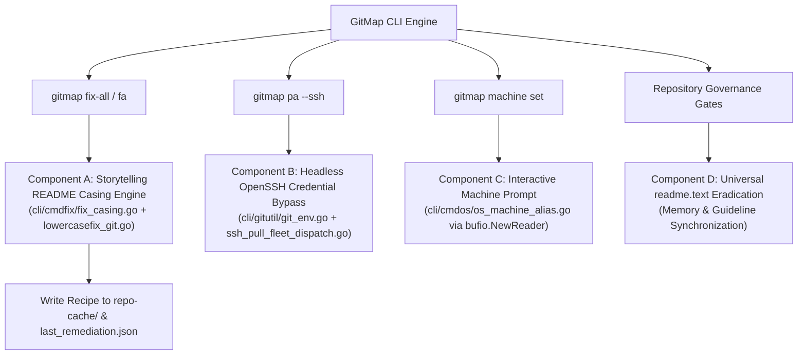
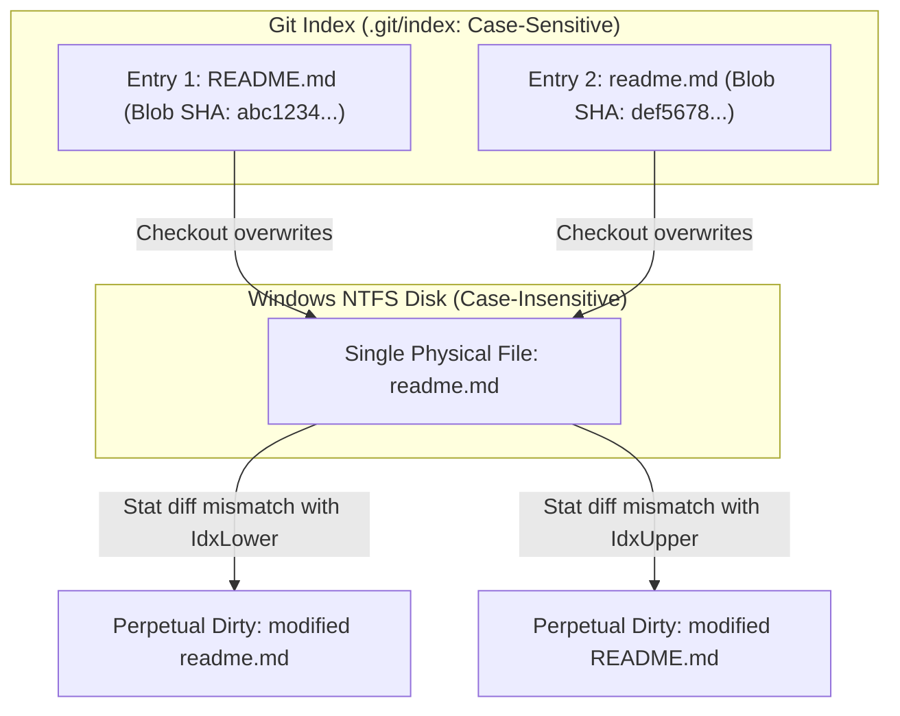
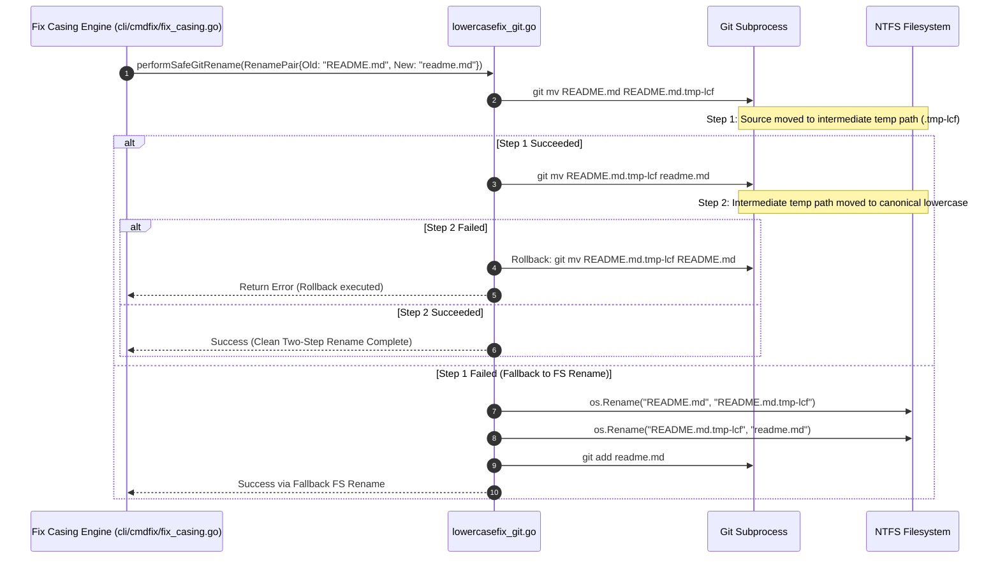
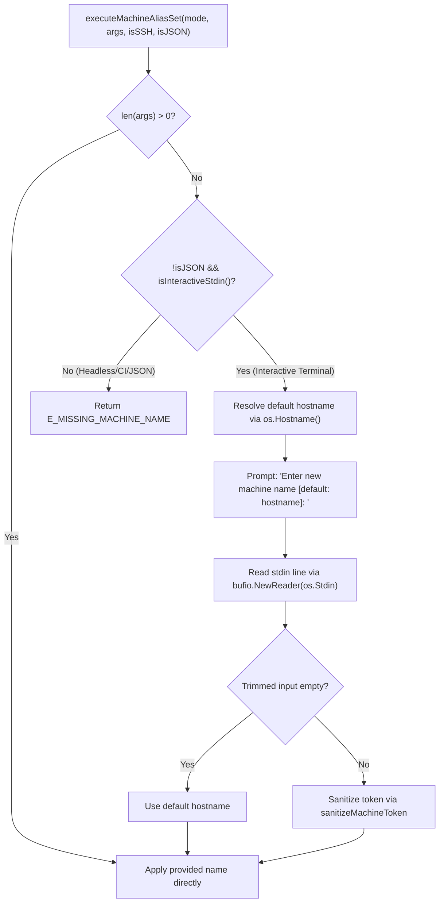

# Component Specification: GitMap Enhancement and Issue Resolution

- **Slug**: `gitmap-enhancement-and-issue-resolution`
- **Component File**: `02-spec/21-app/gitmap-enhancement-and-issue-resolution/02-component-spec.md`
- **Scope**: Core Git Casing Remediation, Headless OpenSSH Dispatch, Interactive Machine Set, and Universal Readme Documentation Hygiene
- **Status**: APPROVED
- **Date**: 2026-10-21
- **Parent Architecture Spec**: `02-spec/21-app/gitmap-enhancement-and-issue-resolution/01-architecture-spec.md`

---

## 1. Executive Summary & Component Topology

This component specification details the functional requirements, internal state machines, algorithms, and integration contracts for four core subsystems in GitMap:

1. **Storytelling-v1 README Casing Remediation Engine (Component A)**:
   - Resolves Git index and filesystem case discrepancies (`README.md` vs `readme.md`) on case-insensitive filesystems (Windows NTFS / macOS APFS) where `core.ignorecase = true`.
   - Executes atomic two-step renames via `cli/cmd/lowercasefix_git.go` (`.tmp-lcf` intermediate suffix) and Git index purge (`git rm --cached -f`) to break perpetual dirty loops.
   - Integrates directly into `gitmap fix-all` (`fa`) via `cli/cmdfix/fix_casing.go` and `cli/cmdfix/fix_cmd.go`.
   - Records the remediation recipe and telemetry into `repo-cache` (`repo-cache/01-gitmap/remediation_recipes.json`) and local state (`~/.gitmap/output/last_remediation.json`).

2. **Headless OpenSSH Credential Bypass & Protocol Auto-Conversion (Component B)**:
   - Diagnoses and eliminates Windows OpenSSH Service Logon Type 3 (Network Logon) security restrictions blocking DPAPI and Windows Credential Manager (`wincredman`).
   - Dynamically injects `GCM_CREDENTIAL_STORE=none` and `GCM_NO_PERSIST=1` for headless SSH sessions in `cli/gitutil/git_env.go` and `cli/cmdssh/ssh_pull_fleet_dispatch.go`.
   - Automatically converts failing HTTPS remotes to authenticated SSH remotes in `cli/cloner/safe_pull.go`.

3. **Interactive Machine Name & Alias Configuration Prompt (Component C)**:
   - Enhances `gitmap machine set` and `gitmap alias set` in `cli/cmdos/os_machine_alias.go` when the machine name argument is omitted.
   - Prompts the user interactively via `bufio.NewReader(os.Stdin)` with the resolved system hostname as default when running in an interactive terminal (`isInteractiveStdin()`).
   - Preserves non-interactive automated script behavior by returning error code `E_MISSING_MACHINE_NAME` in headless or `--json` invocations.

4. **Universal Readme Text & Timestamp Generator Eradication (Component D)**:
   - Enforces an absolute, repository-wide ban on `readme.text` and `readme.txt` timestamp generators.
   - Standardizes all project documentation strictly onto canonical `readme.md`.
   - Updates governance memory files (`.ai-memory/strictly-avoid.md`, `02-spec/01-spec-authoring-guide/11-exceptions.md`, `02-spec/17-consolidated-guidelines/03-strictly-avoid-quickref.md`, `.ai-memory/memory/00-project-governance-and-invariants.md`).



---

## 2. Component A: Storytelling-v1 README Casing Remediation Engine

### 2.1 Problem Analysis: Windows NTFS `core.ignorecase` & Perpetual Dirty Loops

On case-insensitive filesystems (Windows NTFS and macOS APFS), filenames that differ only in case point to the same physical file on disk. However, the Git index format (`.git/index`) is strictly case-sensitive: paths are stored as raw byte slices and compared byte-by-byte.

In repositories such as `storytelling-v1` (and `story-telling`):
1. An upstream commit or historical merge created an uppercase file: `README.md` (or `story/README.md`).
2. Local repository conventions mandate lowercase `readme.md`.
3. Because `core.ignorecase = true` is enabled by default on Windows:
   - Direct rename attempts (`git mv README.md readme.md`) fail with: `fatal: destination exists, source=README.md, destination=readme.md`.
   - Direct filesystem rename (`os.Rename("README.md", "readme.md")`) is ignored by Git status because the file stat (inode, size, mtime) matches the existing index entry.
   - When both `README.md` and `readme.md` exist in the Git index, Git checkout/restore repeatedly overwrites the single disk inode, causing `git status` to report the other file as perpetually modified or deleted.



### 2.2 Two-Step Safe Rename Protocol via `lowercasefix_git.go`

To overcome the Windows NTFS case collision, GitMap uses the proven two-step rename architecture from `cli/cmd/lowercasefix_git.go`:



#### Dual Index Purge Protocol:
When `git ls-files -s` reveals that *both* uppercase and lowercase entries are tracked simultaneously:
1. **Buffer Disk Content**: Read the current contents of `readme.md` to memory.
2. **Purge Non-Canonical Entry**: Execute `git rm --cached -f "<uppercase_path>"`.
   - The `--cached` flag prevents deleting the physical file from disk.
   - The `-f` flag overrides stage mismatch warnings.
3. **Stage Canonical Lowercase Entry**: Execute `git add -- "<canonical_lowercase_path>"`.
4. **Commit Normalization**: Execute `git commit -m "fix(case): normalize uppercase duplicate to canonical lowercase"`.

### 2.3 Integration into `gitmap fix-all` (`cli/cmdfix/fix_cmd.go`)

In `cli/cmdfix/fix_casing.go` and `cli/cmdfix/fix_cmd.go`:
1. `DetectCasingDiscrepancies(repoPath string) ([]CasingDiscrepancy, error)`:
   - Scans tracked files via `git ls-files` and inspects directory entries for any file matching `(?i)^readme\.md$` where the disk or index casing differs from canonical `readme.md`.
2. Integration into `RunFix`:
   - In `cli/cmdfix/fix_cmd.go`, `runFixAll` queries `DetectCasingDiscrepancies`.
   - If casing discrepancies are detected, they are bundled into `remediationItems` and resolved automatically.
   - When running targeted fix (`gitmap fix casing` or `gitmap fix <repo>`), the casing remediation recipe is selected and executed.

### 2.4 Persistence of Remediation Recipes to `repo-cache`

GitMap maintains a shared repository cache (`repo-cache`) resolved via `ResolveRepoCachePath()`. Whenever a casing fix is executed on a repository:
1. **Local State Update**: Write the executed recipe details to `~/.gitmap/output/last_remediation.json`.
2. **Repo-Cache Recipe Storage**:
   - Resolve target directory: `repo-cache/01-gitmap/` (or `repo-cache/`).
   - Append an entry to `repo-cache/01-gitmap/remediation_recipes.json` documenting the repository, the initial casing failure, the two-step rename operations, and the canonical outcome.

```json
{
  "timestamp": "2026-10-21T23:30:00Z",
  "recipeId": "rcp-case-readme-001",
  "repository": "storytelling-v1",
  "repoPath": "../storytelling-v1",
  "issue": "NTFS core.ignorecase README.md vs readme.md collision",
  "strategy": "two_step_git_mv",
  "steps": [
    "git mv README.md README.md.tmp-lcf",
    "git mv README.md.tmp-lcf readme.md",
    "git commit -m \"fix(case): normalize README.md to readme.md\""
  ],
  "result": "success",
  "canonicalPath": "readme.md"
}
```

---

## 3. Component B: Headless OpenSSH Credential Bypass & Protocol Auto-Conversion

### 3.1 OpenSSH Logon Type 3 (Network Logon) Security Restriction

When an automated orchestrator connects to a remote Windows node via OpenSSH (`sshd`), Windows establishes a **Logon Type 3 (Network Logon)** session. Under Logon Type 3:
- DPAPI user master keys are inaccessible because password credentials are not supplied during key-based authentication.
- Calls to Windows Credential Manager (`wincredman`) fail with `Access is denied (0x80070005)`.
- Git Credential Manager (GCM) fails with:
  `fatal: Windows Credential Manager (wincredman) failed to persist credentials`
  Git terminates with **Exit Code 128**.

### 3.2 Dynamic Credential Store Configuration (`cli/gitutil/git_env.go`)

In `cli/gitutil/git_env.go`:
```go
// isHeadlessSSHSession reports whether current process is executing inside an SSH session.
func isHeadlessSSHSession() bool {
	if len(os.Getenv("SSH_CLIENT")) > 0 || len(os.Getenv("SSH_CONNECTION")) > 0 {
		return true
	}
	return os.Getenv("GITMAP_HEADLESS_SSH") == "1"
}

// AppendGitCredentialEnv appends safe credential store environment variables for Git subprocesses.
func AppendGitCredentialEnv(env []string) []string {
	if runtime.GOOS != constants.PlatformWindows {
		return append(env, "GCM_CREDENTIAL_STORE=cache")
	}
	if isHeadlessSSHSession() {
		return append(env, "GCM_CREDENTIAL_STORE=none", "GCM_NO_PERSIST=1")
	}
	return append(env, "GCM_CREDENTIAL_STORE=wincredman")
}
```

### 3.3 Remote Command Injection & Automatic SSH Protocol Switch

1. **Remote Dispatch**: In `cli/cmdssh/ssh_pull_fleet_dispatch.go`, prepend Windows remote commands with:
   `$env:GCM_CREDENTIAL_STORE='none'; $env:GCM_NO_PERSIST='1';`
2. **Auto-Protocol Switch**: In `cli/cloner/safe_pull.go`, if a pull fails with wincredman exit code 128, call `rewriteRemoteToSSHIfNeeded(repoDir, true)` to switch the repository remote from HTTPS (`https://github.com/...`) to SSH (`git@github.com:...`) and retry immediately.

---

## 4. Component C: Interactive Machine Name & Alias Configuration Prompt

### 4.1 CLI Argument Routing in `cli/cmdos/os_machine_alias.go`

`executeMachineAliasSet` handles arguments passed to:
- `gitmap machine set [new-name]`
- `gitmap alias set [new-alias]`
- `gitmap machine rename [new-name]`

Currently, when the user omits `[new-name]` (e.g. executing `gitmap machine set`), the function returns an immediate error:
`missing target name/alias (e.g. gitmap machine set dev-win-01 -y)` with error code `E_MISSING_MACHINE_NAME`.

### 4.2 Interactive TTY Guard & Prompt Protocol



#### Prompt Implementation Details:
1. **TTY Detection**:
   ```go
   func isInteractiveStdin() bool {
       if os.Getenv("CI") != "" || os.Getenv("GITMAP_NON_INTERACTIVE") == "1" {
           return false
       }
       fi, err := os.Stdin.Stat()
       if err != nil {
           return false
       }
       return (fi.Mode() & os.ModeCharDevice) != 0
   }
   ```
2. **Interactive Input Read**:
   - Use `bufio.NewReader(os.Stdin)` to read a full line:
     ```go
     reader := bufio.NewReader(os.Stdin)
     fmt.Printf("  %s? Enter new %s name [default: %s]: %s", constants.ColorYellow, mode, defaultName, constants.ColorReset)
     input, err := reader.ReadString('\n')
     ```
   - Trim whitespace and newline characters (`\r`, `\n`, ` `).
   - If input is empty, adopt `defaultName` without failing.
   - Sanitize via `sanitizeMachineToken` (spaces replaced with `-`).
3. **Execution**: Pass the sanitized token to `applyLocalMachineOrAliasSet(mode, newVal, isJSON)` to persist in split DB configuration and update the OS hostname.

---

## 5. Component D: Universal Readme Text & Timestamp Generator Eradication

### 5.1 Rationale & Absolute Invariant

Autonomous AI agents in past iterations periodically hallucinated creating or referencing `readme.text` or `readme.txt` files to store dynamic timestamps (e.g. Asia/Kuala_Lumpur or UTC date/time strings) or proposed scripts like `refresh-readme.ps1` to touch readme files.

The non-negotiable repository governance invariant is:
> **Total Prohibition of `readme.text` and Readme Timestamp Generators.**
> 1. The filename `readme.text` (any casing: `README.TEXT`, `Readme.text`, `readme.text`) is strictly prohibited. Documentation files must only use `readme.md`.
> 2. No script, command, hook, automation, or skill may ever write, append, suggest, or format timestamps, dates, or clocks into any `readme.*` file.
> 3. Any memory, spec, or prompt that suggests `readme.text` or timestamp generation must be eradicated.

### 5.2 Memory & Specification Synchronization Matrix

The following governance files are systematically reviewed and updated:

| File Path | Section / Sequence | Required Correction |
|---|---|---|
| `.ai-memory/strictly-avoid.md` | `## readme.text and readme.txt timestamp generator — TOTAL BAN` | Retitle section to explicitly name `readme.text`; broaden ban to all variants; reaffirm `readme.md` only. |
| `02-spec/01-spec-authoring-guide/11-exceptions.md` | `### Sequence 01 — readme.text & readme.txt time suggestions` | Update title and prohibition language to include `readme.text` and forbid creating `.text` files. |
| `02-spec/17-consolidated-guidelines/03-strictly-avoid-quickref.md` | `Seq 01` | Update table row to explicitly forbid `readme.text` and dynamic timestamps. |
| `.ai-memory/memory/00-project-governance-and-invariants.md` | Core Invariants | Add explicit invariant forbidding `readme.text` and timestamp generators. |

---

## 6. Data Structures, Method Signatures & Error Definitions

### 6.1 Go Package Signatures

```go
// Package cmdfix (cli/cmdfix/fix_casing.go)
type CasingDiscrepancy struct {
    RepoPath      string `json:"repoPath"`
    CurrentPath   string `json:"currentPath"`
    CanonicalPath string `json:"canonicalPath"`
    IsDualTracked bool   `json:"isDualTracked"`
}

func DetectCasingDiscrepancies(repoPath string) ([]CasingDiscrepancy, error)
func ExecuteCasingNormalization(repoPath string, item CasingDiscrepancy) error
func RecordCasingRemediationRecipe(item CasingDiscrepancy) error

// Package cmdos (cli/cmdos/os_machine_alias.go)
func promptInteractiveMachineName(mode string, defaultName string) (string, error)
func isInteractiveStdin() bool

// Package gitutil (cli/gitutil/git_env.go)
func isHeadlessSSHSession() bool
func AppendGitCredentialEnv(env []string) []string
```

### 6.2 Error Code Registry

| Error Code | Meaning | Remediation |
|---|---|---|
| `E_CASING_DISCREPANCY_DETECTED` | Inode or index case discrepancy in repository | Run `gitmap fix-all` (`fa`) or apply two-step rename |
| `E_MISSING_MACHINE_NAME` | Missing argument in non-interactive/JSON mode | Supply positional argument `gitmap machine set <name>` |
| `E_INVALID_MACHINE_TOKEN` | Machine name contains invalid characters | Use alphanumeric characters and hyphens only |
| `E_WINCREDMAN_HEADLESS_BLOCKED` | Wincredman invoked under OpenSSH Logon Type 3 | Auto-set `GCM_CREDENTIAL_STORE=none` or switch to SSH |

---

## 7. Verification & Quality Gates

1. **Error Sovereignty**: Leaf functions return `error` or `*apperror.AppError` directly. No leaf functions call `cliexit.HandleError` or `os.Exit`.
2. **Boolean Naming**: All booleans strictly prefixed with `is*` or `has*` (`isInteractive`, `isDualTracked`, `hasFailed`, `isHeadless`).
3. **Function Sizing**: <= 15 lines per function (<= 8 lines preferred).
4. **Conditional Flattening**: Zero nested `if` statements. Early guard clauses and returns used exclusively.
5. **Path Hygiene**: Strictly relative Git paths (`02-spec/...`, `.ai-memory/...`, `cli/...`). Zero `file:///` or absolute paths.
