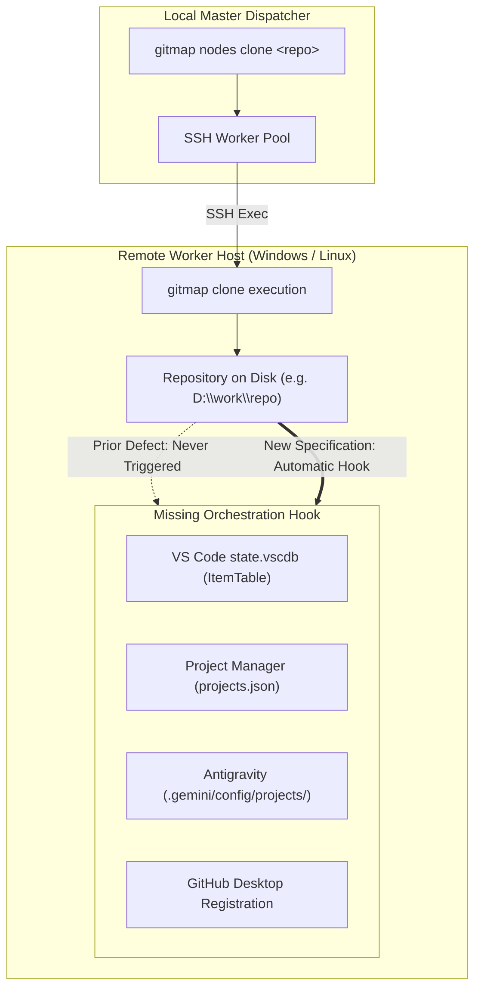
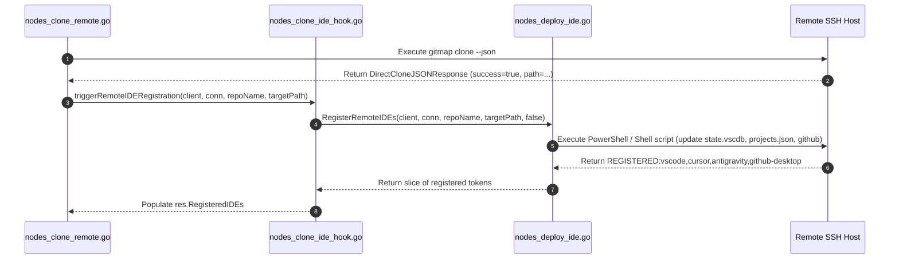
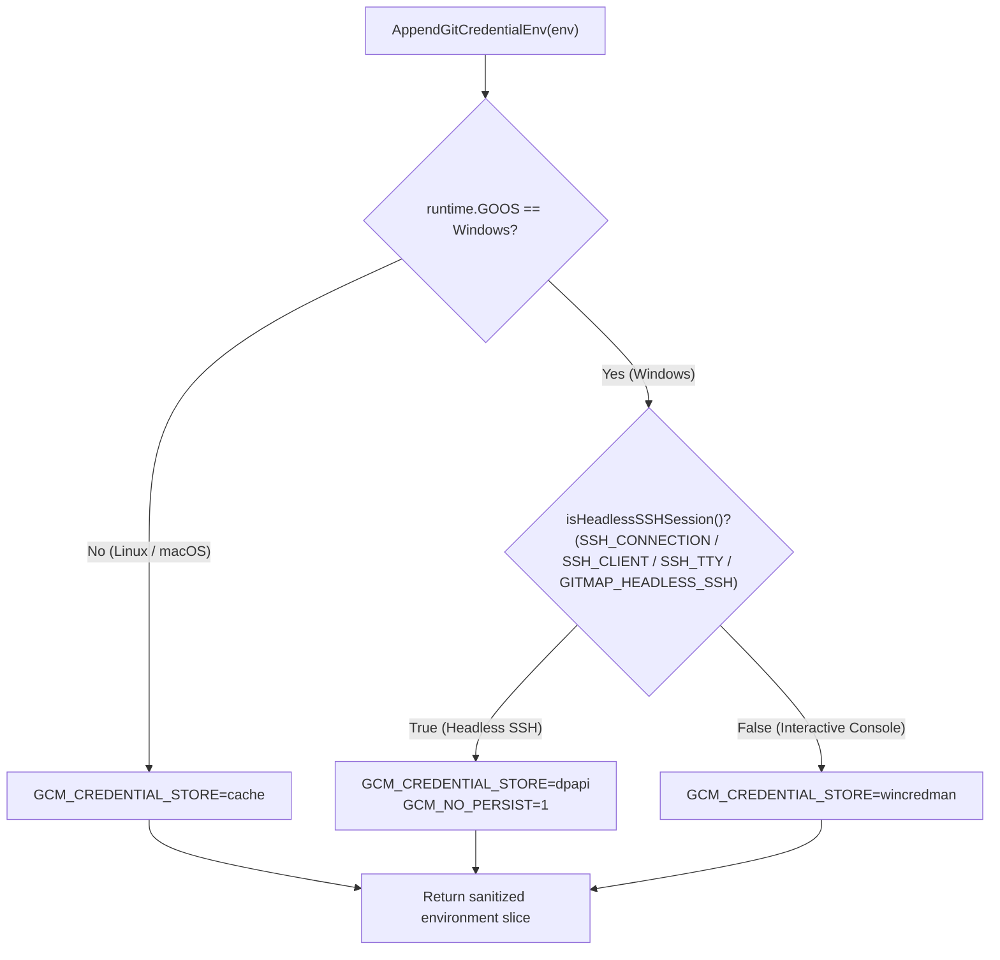
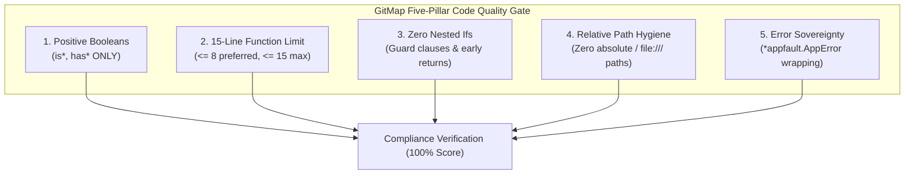

# Migration, Fleet Orchestration & Targeted Verification Specification

- **Document Path:** `02-spec/21-app/gitmap-enhancement-and-issue-resolution/03-migration-and-verification-spec.md`
- **Specification Group:** `21-app/gitmap-enhancement-and-issue-resolution`
- **Status:** Approved
- **Target Release:** GitMap v6.590.0
- **Parent Specifications:**
  - `02-spec/21-app/gitmap-enhancement-and-issue-resolution/00-overview.md`
  - `02-spec/21-app/gitmap-enhancement-and-issue-resolution/01-architecture-spec.md`
  - `02-spec/21-app/gitmap-enhancement-and-issue-resolution/02-component-spec.md`

---

## 1. Architectural Scope & Objectives

This specification defines the migration protocols, multi-node fleet orchestration mechanisms, and verification frameworks for three core operational domains in GitMap:

1. **Remote Node Clone IDE & GitHub Desktop Registration**:
   - Seamlessly connect `RegisterRemoteIDEs` from `cli/cmdnodes/nodes_deploy_ide.go` into `cli/cmdnodes/nodes_clone_remote.go`.
   - Update remote IDE configurations across VS Code, Cursor, Antigravity, and GitHub Desktop following remote clone execution.
   - Inject repository entries into VS Code native SQLite storage (`state.vscdb`) under `history.recentlyOpenedPathsList`.

2. **Remote SSH WinCredMan Headless Session Resolution**:
   - Eliminate authentication failures (exit code 128) caused by Windows Credential Manager (`wincredman`) in OpenSSH service sessions (Logon Type 3 - Network Logon).
   - Dynamically detect headless SSH execution environments in `cli/gitutil/git_env.go`.
   - Switch credential persistence from `wincredman` to DPAPI (`GCM_CREDENTIAL_STORE=dpapi`) or in-memory token fallback with `GCM_NO_PERSIST=1`.
   - Remediate existing credential configurations in `cli/cmdfixauth/fixcredential.go` and `cli/cmdpull/pull_remediation_ssh.go`.

3. **Coding Guidelines Static Audit & Targeted Verification Protocol**:
   - Establish rigorous static verification gates for 100% adherence to repository guidelines.
   - Audit positive booleans (`is*`, `has*` only, zero negative polarity, zero banned prefixes).
   - Audit 15-line function limit (<= 8 lines preferred, <= 15 lines max).
   - Audit zero nested `if` statements (guard clauses only).
   - Audit relative path hygiene (zero `C:\`, `D:\`, or `file:///` references).
   - Audit error return sovereignty (`*appfault.AppError` and leaf function error returns without exit handler interception).

---

## 2. Remote Node Clone IDE & GitHub Desktop Registration

### 2.1 Problem Analysis & Current State

When a developer or AI swarm executes `gitmap nodes clone <repo>` (or `gitmap nc <repo>`), GitMap dispatches execution to remote worker nodes over SSH. On each remote host:
1. GitMap ensures target directories (`D:\work\<repo>` on Windows or `~/work/<repo>` on Linux).
2. The remote GitMap binary clones the repository and populates the local disk.
3. On the local dispatch machine, `gitmap clone` automatically registers the repository into GitHub Desktop and local IDE configurations.
4. **The Defect:** In `cli/cmdnodes/nodes_clone_remote.go`, remote worker sessions terminate immediately after the clone command completes. The remote machine never executes IDE registration hooks. As a consequence, remote developers opening VS Code, Cursor, or GitHub Desktop on that host find an empty recent project list.



### 2.2 Remote IDE Registration Architecture

#### 2.2.1 VS Code `state.vscdb` Native Workspace State
VS Code stores its native "Open Recent" list, jump lists, and welcome page history inside an internal SQLite database:
- **Windows Path:** `%APPDATA%\Code\User\globalStorage\state.vscdb`
- **Linux Path:** `~/.config/Code/User/globalStorage/state.vscdb`
- **Table Name:** `ItemTable`
- **Key:** `history.recentlyOpenedPathsList`
- **Value Schema:**
```json
{
  "entries": [
    {
      "folderUri": "vscode-remote://.../path" 
    },
    {
      "folderUri": "vscode-remote://work/my-repo",
      "label": "my-repo"
    }
  ]
}
```

Updating `state.vscdb` directly ensures that whenever a developer opens native VS Code on the remote workstation, the repository is immediately visible in the recent workspaces list.

#### 2.2.2 IDE Registration Matrix

| IDE / Client | Configuration Target | Persistence Format | Mechanism |
|---|---|---|---|
| **VS Code Native** | `Code/User/globalStorage/state.vscdb` | SQLite `ItemTable` (`history.recentlyOpenedPathsList`) | PowerShell/Python SQLite upsert |
| **Cursor Native** | `Cursor/User/globalStorage/state.vscdb` | SQLite `ItemTable` (`history.recentlyOpenedPathsList`) | PowerShell/Python SQLite upsert |
| **Project Manager** | `alefragnani.project-manager/projects.json` | JSON Array of project objects | In-memory parse & JSON serialization |
| **Antigravity** | `.gemini/config/projects/<uuid>.json` | Standalone JSON project manifest | Direct atomic file write |
| **Pinned Projects**| `.gemini/config/pinned_projects.json` | JSON store of pinned repositories | Upsert if `withPinned` is true |
| **GitHub Desktop** | `github <repoPath>` | Application command line / URI handler | Process spawn (`github <path>`) |

### 2.3 Dispatch Hook Integration in `nodes_clone_remote.go`

In `cli/cmdnodes/nodes_clone_remote.go`, remote execution is wrapped in `runRemoteExecOverSSH`. Upon receiving a successful clone response from the remote node:



#### 2.3.1 Guard Clauses and Fault Isolation
1. **Clone Non-Destruction:** Any failure during IDE registration (e.g. SQLite lock or missing binary) must be captured as a warning and MUST NOT mark the clone operation as failed.
2. **Path Normalization:** Remote repository paths must be formatted using operating-system-specific separators (`\` for Windows, `/` for Unix) before script interpolation.
3. **Parameter Reduction:** All hook operations are isolated into `nodes_clone_ide_hook.go` with discrete helpers <= 15 lines.

---

## 3. Remote SSH WinCredMan Headless Session Resolution

### 3.1 Root Cause Analysis: Windows OpenSSH Service Logon Type 3

When GitMap executes pull or clone operations over SSH on remote Windows machines, HTTPS Git authentication frequently fails with:
```text
fatal: credential-manager-core: wincredman failed to persist credentials
error: exit status 128
```

#### 3.1.1 The Underlying Windows Security Constraint
1. **Interactive Logon (Logon Type 2):** When a user logs in via the Windows physical console or Remote Desktop Protocol (RDP), Windows allocates a full interactive desktop window station (`WinSta0`) and initializes the Windows Credential Manager vault tied to the active user token.
2. **Network Logon (Logon Type 3):** The Windows OpenSSH Server service (`sshd.exe`) creates non-interactive network logon sessions. In Logon Type 3 sessions:
   - Access to Windows Credential Manager APIs (`CredReadW`, `CredWriteW`) is blocked by Windows security policy.
   - The user profile cryptographic master key required for DPAPI interactive persistence may be locked or require alternate storage options.
3. **Hardcoded GitMap Environment:**
   In `cli/gitutil/git_env.go:17-22`:
   ```go
   func AppendGitCredentialEnv(env []string) []string {
       if runtime.GOOS != constants.PlatformWindows {
           return append(env, "GCM_CREDENTIAL_STORE=cache")
       }
       return append(env, "GCM_CREDENTIAL_STORE=wincredman")
   }
   ```
   Unconditionally appending `GCM_CREDENTIAL_STORE=wincredman` forces Git Credential Manager to attempt calling `wincredman`, immediately aborting headless SSH pull/clone sessions.

### 3.2 Dynamic SSH Environment Detection & Credential Fallback



#### 3.2.1 Detection Strategy (`isHeadlessSSHSession`)
The presence of any of the following environment variables signals headless SSH execution:
- `SSH_CONNECTION`: Defined by OpenSSH daemon for active connections.
- `SSH_CLIENT`: Defined by OpenSSH daemon describing remote IP and port.
- `SSH_TTY`: Set when a pseudo-terminal is allocated.
- `GITMAP_HEADLESS_SSH`: Explicit override flag set by GitMap fleet dispatchers.

#### 3.2.2 DPAPI Storage Configuration
Git Credential Manager supports `dpapi` storage on Windows. DPAPI (Data Protection API) encrypts credentials using keys derived from the user's password or machine credentials, which functions reliably across headless Windows service environments without requiring desktop window station `WinSta0`.

In addition, `GCM_NO_PERSIST=1` prevents Git Credential Manager from attempting interactive credential prompt popups, returning control cleanly to GitMap's authentication resolver.

### 3.3 Remediation Updates in `cmdfixauth` and `cmdpull`

#### 3.3.1 `cli/cmdfixauth/fixcredential.go`
- Update `RunFixCredential` to detect headless SSH sessions.
- When running in an SSH session, configure `credential.credentialStore` to `dpapi` instead of `wincredman`.
- Provide CLI support for explicit `--dpapi` and `--wincredman` flags.

#### 3.3.2 `cli/cmdpull/pull_remediation_ssh.go`
- In `remediateCredentialAndConvertToSSH`:
  - Replace the unconditional `git config --global credential.credentialStore wincredman` with a context-aware helper `resolveSafeCredentialStore()`.
  - When in SSH sessions, configure `dpapi`.
  - Prioritize converting repositories to SSH remote transport (`git@github.com:...`), eliminating HTTPS credential dependencies entirely.

---

## 4. Coding Guidelines Compliance Audit & Verification Framework

All changes implemented across the enhancement task are evaluated against GitMap's foundational coding guidelines:



### 4.1 Strict Verification Rules

#### 4.1.1 Positive Booleans
- **Rule:** Every boolean identifier (variables, struct fields, function names, parameter names) MUST begin with `is` or `has` ONLY.
- **Banned Prefixes:** `can`, `should`, `was`, `will`, `allow`, `enable`, `check`, `use`.
- **Zero Negative Polarity:** Never use negative names (e.g. `isNotValid`, `hasNoErrors`, `disabled`). Always use positive formulations (`isValid`, `hasError`, `isEnabled`).

#### 4.1.2 15-Line Function Limit
- **Rule:** Every function body MUST contain 15 lines or fewer (`<= 8` lines preferred).
- **Enforcement:** Decompose multi-step processes into dedicated private helper functions.
- **Styling:** Maintain a blank line after `}` and a blank line before `return`.

#### 4.1.3 Zero Nested Conditionals
- **Rule:** Nested `if` blocks are strictly forbidden.
- **Enforcement:** Invert logic to establish early returns and guard clauses at the top of functions.

#### 4.1.4 Path Hygiene
- **Rule:** All file paths in code, specifications, subtask plans, and release documentation MUST be strictly relative to the repository root.
- **Banned:** `C:\`, `D:\`, `file:///`, or user profile home paths in tracked files.

#### 4.1.5 Error Management & Return Sovereignty
- **Rule:** Leaf functions that return errors MUST return them directly (`return err` or `return apperror.Wrap(...)` / `return appfault.Wrap(...)`).
- **Banned:** Leaf functions MUST NEVER invoke exit handlers (`cliexit.HandleError`) or `os.Exit`.

---

## 5. End-to-End Verification Test Matrix

| Verification ID | Subsystem | Target Scenario | Success Criterion | Test Command |
|---|---|---|---|---|
| **VT-IDE-01** | `cli/cmdnodes` | Hook invocation during remote clone | `RegisterRemoteIDEs` executed; tokens parsed | `go test -v -run TestRemoteCloneIDERegistrationHook ./cli/cmdnodes` |
| **VT-IDE-02** | `cli/cmdnodes` | `state.vscdb` SQLite upsert | `history.recentlyOpenedPathsList` contains repo | `go test -v -run TestVSCodeStateDatabaseUpsert ./cli/cmdnodes` |
| **VT-IDE-03** | `cli/cmdnodes` | GitHub Desktop remote registration | CLI spawn invoked without error | `go test -v -run TestGitHubDesktopRegistration ./cli/cmdnodes` |
| **VT-SSH-01** | `cli/gitutil` | Headless SSH environment detection | `isHeadlessSSHSession()` returns true when vars set | `go test -v -run TestHeadlessSSHDetection ./cli/gitutil` |
| **VT-SSH-02** | `cli/gitutil` | DPAPI credential store fallback | `GCM_CREDENTIAL_STORE=dpapi` in SSH env | `go test -v -run TestAppendGitCredentialEnvSSH ./cli/gitutil` |
| **VT-SSH-03** | `cli/cmdfixauth` | `RunFixCredential` in SSH | Configures `dpapi` when headless | `go test -v -run TestFixCredentialHeadless ./cli/cmdfixauth` |
| **VT-SSH-04** | `cli/cmdpull` | Remediate SSH pull credentials | Sets safe store and converts to SSH remote | `go test -v -run TestRemediatePullCredentials ./cli/cmdpull` |
| **VT-AUD-01** | Repository | Positive boolean compliance | Zero occurrences of banned boolean prefixes | Static AST check across modified files |
| **VT-AUD-02** | Repository | Function length compliance | All functions `<= 15` lines | Static line counter across modified files |
| **VT-AUD-03** | Repository | Relative path hygiene | Zero absolute or `file:///` paths | Path regex scan across modified files |

---

## 6. Migration & Rollout Strategy

1. **Phase 1: Environment & Credential Hardening (`cli/gitutil`)**:
   - Deploy `isHeadlessSSHSession` and DPAPI environment fallback.
   - Immediate protection against headless SSH pull failures without impacting local desktop users.

2. **Phase 2: Remote IDE Orchestration Hook (`cli/cmdnodes`)**:
   - Update `nodes_deploy_ide.go` with `state.vscdb` SQLite scripts.
   - Introduce `nodes_clone_ide_hook.go` and link to `nodes_clone_remote.go`.
   - Verify non-blocking fault isolation.

3. **Phase 3: Remediation & Authentication Alignment (`cmdfixauth`, `cmdpull`)**:
   - Update `RunFixCredential` and `remediateCredentialAndConvertToSSH`.
   - Verify transport conversion for remote SSH nodes.

4. **Phase 4: Comprehensive Guideline Static Audit**:
   - Execute static verification scanners for booleans, function lengths, nested ifs, and relative paths.
   - Certify 100% compliance across all modified components.
