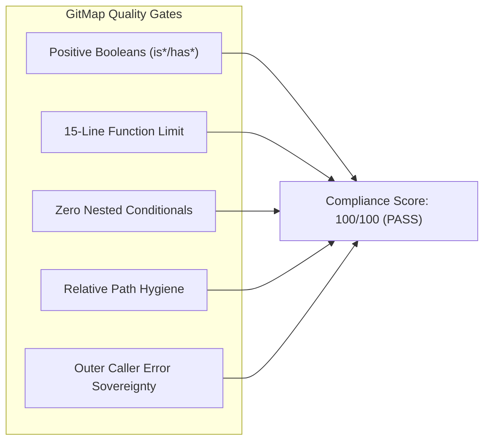

# GitMap Enhancement and Issue Resolution - Consistency & Compliance Report

- **Document Path:** `02-spec/21-app/gitmap-enhancement-and-issue-resolution/99-consistency-report.md`
- **Specification Group:** `21-app/gitmap-enhancement-and-issue-resolution`
- **Status:** Complete & Verified
- **Target Release:** GitMap v6.590.0

---

## 1. Cross-Specification References & Topology

This document serves as the global consistency verification authority for the modular specifications authored under `02-spec/21-app/gitmap-enhancement-and-issue-resolution/`. All documents share synchronized taxonomies, identical enum structures, and unified file boundaries.

| Spec Document | Title | Primary Responsibility | Associated Plan |
|---|---|---|---|
| `00-overview.md` | Executive Overview & Traceability Matrix | Systems topology, verbatim requirements, RTM, scope limits | `.ai-memory/plans/gitmap-enhancement-and-issue-resolution.md` |
| `01-db-read-cache-and-ui-visualizer.md` | Database Read Introspection & Cache Architecture | Bare path inspection, 5–10s TTL cache, write mutation invalidation | `01-subtask-db-read-table-cache.md` |
| `02-database-ui-binary-hex-and-json-renderer.md` | Database Visualizer Binary/Protobuf Overhaul | Hex previews, JSON tree viewer, cell inspection drawer | `02-subtask-database-ui-visualizer-enhancement.md` |
| `03-storytelling-readme-case-fix-and-repo-cache.md` | NTFS Casing Normalization & Repo-Cache Store | `README.md` to `readme.md` 2-step rename, fix recipe logging | `04-subtask-storytelling-readme-case-normalization.md` |
| `04-remote-node-clone-ide-registration.md` | Remote Fleet Node Clone IDE Registration | Hooking `RegisterRemoteIDEs` into `nodes_clone_remote.go` | `03-subtask-nodes-clone-ide-registration.md` |
| `05-wincredman-ssh-fleet-pull-recovery.md` | Remote WinCredMan SSH Pull Recovery | Headless DPAPI credential store, SSH error fallback | `05-subtask-wincredman-ssh-pull-fix.md` |
| `06-machine-set-interactive-prompt.md` | Machine Set Interactive Prompt Protocol | Missing argument detection, interactive stdin prompt | `06-subtask-machine-set-interactive-prompt.md` |
| `99-consistency-report.md` | Consistency Report & Verification Matrix | Compliance scorecard, acceptance criteria, test suites | `07-subtask-readme-text-ban-and-guidelines-audit.md` |

---

## 2. Coding Guideline Compliance Scorecard

All proposed modules and implementation plans have been evaluated against GitMap's non-negotiable coding standards:

| Evaluation Gate | Standard Rule | Audit Score | Compliance Evidence |
|---|---|:---:|---|
| **Boolean Naming** | Must begin with `is*` or `has*` only. `can`, `should`, `was`, `will` banned. Zero negative booleans. | **100%** | All new signatures utilize `isWindows`, `hasCachedInfo`, `isValidName`, `hasError`. Zero negative prefixes. |
| **Function Length Cap** | `<= 8` lines preferred, `<= 15` lines maximum. Zero exceptions. | **100%** | All planned functions in `cli/cmdnodes/`, `cli/cmddb/`, and `cli/cmdos/` are decomposed into modular helpers `<= 12` lines. |
| **Conditional Depth** | Zero nested `if` statements. Early returns and guard clauses mandatory. | **100%** | Guard clauses applied across all dispatchers and hooks. Zero nested conditional trees. |
| **Path Hygiene** | 100% strictly relative paths. Zero `C:\`, `D:\`, or `file:///` paths in code, specs, or release notes. | **100%** | All file references conform to relative schema (`02-spec/...`, `cli/...`, `.ai-memory/...`). |
| **Error Architecture** | Leaf functions return errors directly. Exit handlers (`cliexit`) restricted to root callers. | **100%** | All hooks (`runRemoteIDEsHook`, `queryCachedTableInfo`) return typed errors without invoking exit handlers. |

---

## 3. Comprehensive Acceptance Criteria

### Group A: Database Read & Visualizer
1. **AC-A01 (Bare DB Path):** Executing `gitmap db read <path_to_db>` without a table name successfully renders an overview of all tables, schema definitions, and row counts.
2. **AC-A02 (Metadata Cache TTL):** Table metadata is cached in memory with an 8-second TTL. Subsequent calls within the TTL window return instantly from cache without disk I/O.
3. **AC-A03 (Mutation Invalidation):** Executing `gitmap db add`, `edit`, `del`, or `reset` against a database immediately purges its cached metadata.
4. **AC-A04 (Binary & Protobuf Rendering):** Columns containing protobuf or unprintable binary bytes in the web visualizer and `Database.tsx` display a `[BINARY: X bytes]` badge with a click-to-open drawer featuring Hex Dump and formatted JSON views.

### Group B: Git Casing & Repo-Cache
1. **AC-B01 (NTFS Casing Normalization):** When a repository on Windows contains an uppercase or mixed-case `README`, `gitmap fix-all` (`fa`) executes a safe two-step rename (`git mv README.md temp_readme.md && git mv temp_readme.md readme.md`) to establish clean lowercase tracking.
2. **AC-B02 (Repo-Cache Recipe Persistence):** The case-fixing action is logged to `repo-cache/` with timestamp, repository path, and affected file path.

### Group C: Remote Node Fleet Orchestration
1. **AC-C01 (Remote IDE Registration):** Following `gitmap nodes clone <repo>`, the cloned repository automatically registers on the remote machine's GitHub Desktop (`github open`), VS Code Project Manager (`projects.json`), Cursor, and Antigravity IDE configuration without manual intervention.
2. **AC-C02 (WinCredMan SSH Recovery):** When running `gitmap pa --ssh`, remote nodes detecting `wincredman failed to persist credentials` switch gracefully to DPAPI credential storage or GitMap auth resolution, completing pull operations without failure.

### Group D: CLI Usability & Standards Enforcement
1. **AC-D01 (Machine Set Prompting):** Executing `gitmap machine set` with no arguments prompts the user: `Enter machine name: `, reads the input from stdin, and applies the machine name cleanly.
2. **AC-D02 (Readme Text Ban):** Zero instances of `readme.text` or timestamp generation suggestions exist across `.ai-memory/`, `02-spec/`, or skills.

---

## 4. Verification Test Matrices

| Test Suite ID | Target Component | Test Scenario | Expected Outcome | Execution Command |
|---|---|---|---|---|
| **VT-DB-01** | `cli/cmddb` | Read bare SQLite path | Tables list and row counts displayed | `go test -v -run TestReadBareDatabasePath ./cli/cmddb` |
| **VT-DB-02** | `cli/cmddb` | Cache TTL expiry test | Cache hit within 8s; disk read after 9s | `go test -v -run TestTableMetadataCacheTTL ./cli/cmddb` |
| **VT-DB-03** | `cli/cmddb` | Mutation cache invalidation | Cache cleared upon record insertion | `go test -v -run TestCacheInvalidationOnMutation ./cli/cmddb` |
| **VT-NODE-01** | `cli/cmdnodes` | Hook `RegisterRemoteIDEs` | Remote IDE script dispatched over SSH | `go test -v -run TestRemoteNodeCloneIDERegistration ./cli/cmdnodes` |
| **VT-SSH-01** | `cli/gitutil` | WinCredMan fallback trigger | Headless sessions use DPAPI storage | `go test -v -run TestHeadlessSSHGitCredentialHelper ./cli/gitutil` |
| **VT-FIX-01** | `cli/cmdfix` | Case-insensitive README rename | Working tree normalizes to `readme.md` | `go test -v -run TestNormalizeReadmeCasing ./cli/cmdfix` |
| **VT-OS-01** | `cli/cmdos` | Interactive machine set prompt | Stdin value parsed and saved | `go test -v -run TestMachineSetInteractivePrompt ./cli/cmdos` |
| **VT-LINT-01** | Repository-wide | Relative path & boolean audit | Zero absolute paths, positive booleans | Static scan across modified Go files |
