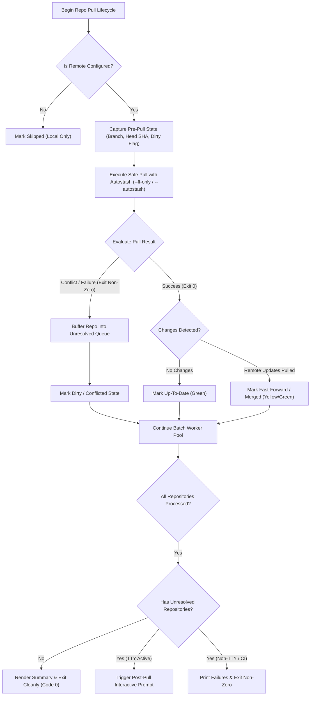
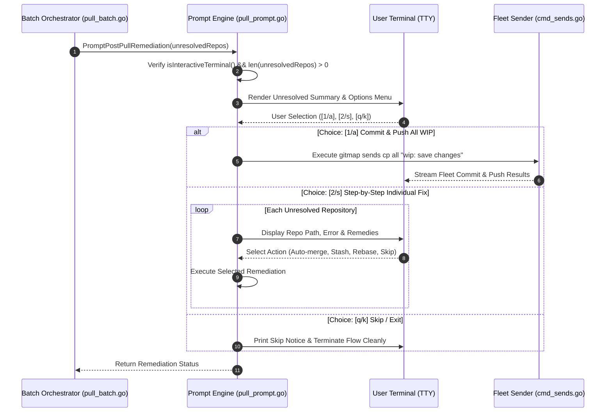
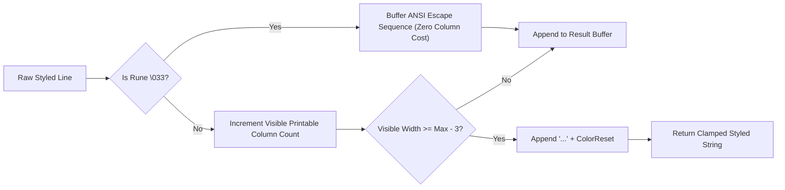
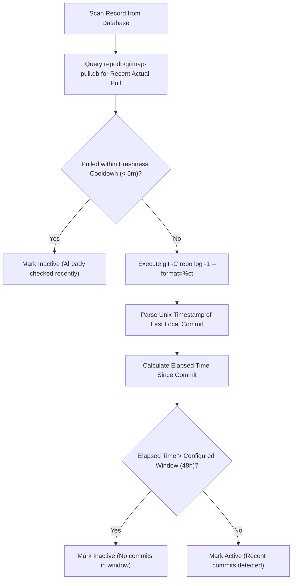

# Architecture Specification: GitMap Enhancement and Optimization

- **Feature Slug:** `gitmap-enhancement-and-optimization`
- **Module:** `cli/cmdpull`, `cli/store`, `cli/constants`
- **Specification Version:** 1.0.0
- **Status:** APPROVED

---

## 1. Executive Overview & System Context

The `gitmap-enhancement-and-optimization` subsystem modernizes core repository synchronization routines across GitMap CLI commands, specifically targeting:

1. **Resilient Pull-First Execution & Post-Pull Prompting (`gitmap pa` / `gitmap pull-all`):**
   Prior implementations prematurely aborted pull operations if a repository working tree was detected as dirty prior to pull execution. The resilient architecture attempts `git pull --autostash` first. Clean remote updates and automatically restashed local changes complete seamlessly. If merge conflicts or unstash collisions occur, the repository is buffered into an unresolved queue. After batch execution completes, an interactive terminal prompt offers immediate remediation (fleet-wide WIP commit vs individual step-through).

2. **Terminal ANSI Color Restoration & Visual Completion Indicator (`PullProgressBar`):**
   Progress bar rendering truncated long lines via `clampLineToTermWidth`. When line length exceeded terminal column bounds, the routine stripped all ANSI sequences and returned monochrome plain text, eliminating cyan spinners, cyan/green visual bars, and dimmed timestamp formatting. The ANSI-aware truncation engine measures printable visible width while preserving escape codes and terminating sequences with `ColorReset`. When progress reaches 100%, the active spinner transforms into a vibrant green completion checkmark (`✓`).

3. **Commit Recency-Based Activity Partitioning & Settings Integration (`gitmap pae` / `gitmap pull-all-efficient`):**
   Efficient pull previously hardcoded a 24-hour activity window. The enhanced architecture integrates with GitMap's Split-DB tier (`gitmap.db` settings table and `repodb/gitmap-pull.db` telemetry). It evaluates local commit recency via `git log -1 --format=%ct` against a configurable time window (defaulting to 48 hours), configurable via CLI flags (`--hours`, `--window`) and persistent database settings.

---

## 2. Technical Architecture & Subsystems

### 2.1 Resilient Pull-First Execution Flow

In previous iterations, `cli/cmdpull/pull_worker.go:runTrackedPullLifecycle` called `CaptureRepoPrePullState`. If `isDirty` was true, it immediately invoked `handleDirtyRepoPull` and skipped the pull entirely. This created unnecessary friction in workflows where uncommitted local modifications did not collide with upstream changes.

The resilient pull flow attempts `git pull --autostash` directly:



#### Detailed Pull Execution Protocol:
1. **Remote Check:** Verify remote URL configuration via `isRemoteConfigured(rec)`. If absent, designate `PullStepTypeSkipped` ("local-only").
2. **Pre-Pull Snapshot:** Read branch name and HEAD SHA via `CaptureRepoPrePullState(rec.AbsolutePath)`.
3. **Safe Pull Execution:** Stream `cloner.SafePullOneWithProgress(rec, rec.AbsolutePath, onProgress)`. This triggers `git pull --progress --ff-only --autostash` (with automated fallback to `--no-rebase --no-edit --autostash` for diverged tracking branches).
4. **Outcome Evaluation:**
   - If `result.IsSuccess()`: Local changes were successfully stashed, remote commits incorporated, and stashed work cleanly reapplied. Finalize state via `handleSuccessfulPull`.
   - If `result.IsFail()`: Inspect failure output. If unstash conflict or merge conflict arises, record error message and mark state as failed/conflicted. Append to `unresolved` queue for post-batch resolution.

---

### 2.2 Interactive Post-Pull Prompting Architecture

Interactive post-pull prompting activates after the concurrent batch completes and all worker goroutines return.



#### Remediation Menu Structure:
When one or more repositories fail or remain conflicted after pull attempts, the CLI renders:
```text
  [?] 3 repository(ies) require remediation:
      • my-service: autostash conflict (local modifications collide with upstream)
      • frontend-app: diverged branches require merge resolution
      • data-pipeline: remote rejected fast-forward

  Options:
    [1/a] Commit & push all local WIP (gitmap sends cp all "wip: save changes")
    [2/s] Resolve repositories individually step-by-step
    [q/k] Skip and exit without modifying repositories

  Choice [1/2/q]:
```

#### Safeguards & Non-Interactive Bypass:
- **TTY Verification:** Evaluated via `termout.IsStdoutTTY()`. If standard output is redirected or stdin is closed, prompting is bypassed.
- **Machine-Readable Mode:** When `--json` is supplied, interactive prompts are silenced, and structured JSON diagnostics are emitted.
- **Fail-Safe Exit:** Choosing `q` / `k` exits without crashing or making unwanted alterations.

---

### 2.3 Terminal ANSI Color Preservation & Visual Completion Indicator

#### Root Cause Analysis of Monochrome Truncation:
In `cli/cmdpull/pull_progress_bar_render.go`, `clampLineToTermWidth(line string)` measured visible terminal width by stripping ANSI codes:
```go
plain := stripANSI(line)
if len(plain) <= maxLen {
    return line
}
return plain[:maxLen-3] + "..."
```
When `len(plain) > maxLen`, the function returned `plain[:maxLen-3] + "..."`. Because `plain` had all escape sequences stripped, any line exceeding terminal width lost all colors (spinner cyan, bar fill cyan/green, elapsed time dim, badges).

#### ANSI-Aware Truncation Algorithm:
The updated routine iterates through raw string bytes/runes with a lightweight state machine:
1. Detect ANSI escape prefixes (`\033[` or `\x1b[`).
2. Consume parameters until the terminating letter (e.g. `m`). All ANSI bytes are passed through without advancing the printable column counter.
3. Advance visible column counter for printable characters.
4. When visible counter reaches `maxVisible - 3`, insert ellipsis (`...`), append `constants.ColorReset` (`\033[0m`), and return the correctly styled string.



#### Green Completion Bar Indicator:
When batch synchronization concludes (`completed >= total`):
- `currentSpinner()` returns a bold green completion symbol: `constants.ColorGreen + "✓" + constants.ColorReset` (or `"+"` under safe ASCII mode).
- Visual bar fill is rendered in full green (`constants.ColorGreen`).
- Final output flush cleanly preserves the checkmark on the finished line before terminal newline.

---

### 2.4 Split-DB PAE Commit Recency & Configurable Window

The efficient pull command (`gitmap pae` / `gitmap pull-all-efficient`) optimizes network bandwidth and execution duration by skipping inactive repositories that have no recent commits and were checked recently.

#### Split-DB Architectural Tiers:
1. **Configuration Store (`gitmap.db`):**
   - Resides at `<user_config>/gitmap/gitmap.db`.
   - Table `Setting` (Key `pull_activity_window_hours`, default `48`).
   - Managed via `cli/constants/constants_settings.go` and `cli/store/settings.go`.
2. **Telemetry & History Store (`repodb/gitmap-pull.db`):**
   - Resides at `<user_data>/gitmap/repodb/gitmap-pull.db`.
   - Records historical sync telemetry in `PullRun`, `PullRepoRun`, and `PullError`.
   - Queries last actual pull timestamp via `GetRecentActualRepoPullHistory(repoPath, 1)`.



#### Parameter Precedence for Activity Window:
1. **Explicit CLI Flag:** `--hours <N>` / `--hours=<N>` or `--window <N>` / `--window=<N>`.
2. **Database Setting:** `SELECT Value FROM Setting WHERE Key = 'pull_activity_window_hours'`.
3. **Hardcoded Fallback:** `constants.DefaultPullActivityWindowHours` = 48 hours.

---

## 3. Invariants & Implementation Contracts

1. **Strictly Relative Paths:** All specification documents, subtask plans, and code references MUST strictly use relative Git repository paths (e.g., `02-spec/...`, `cli/cmdpull/...`).
2. **Strictly Lowercase Naming:** All new directory and file paths must be strictly lowercase.
3. **Positive Booleans Only:** All variable, parameter, and struct field names must express positive polarity (`isSuccess`, `hasChanges`, `canPrompt`, `shouldRetry`). Negated checks must use semantic methods (e.g., `result.IsFail()` instead of `!result.IsSuccess`).
4. **Structured Error Handling:** All internal errors must be wrapped with `*apperror.AppError` / `*appfault.AppError`.
5. **Zero-Build & Zero-Test Governance:** Specification authoring strictly prohibits executing `go build` or `go test` suites.
