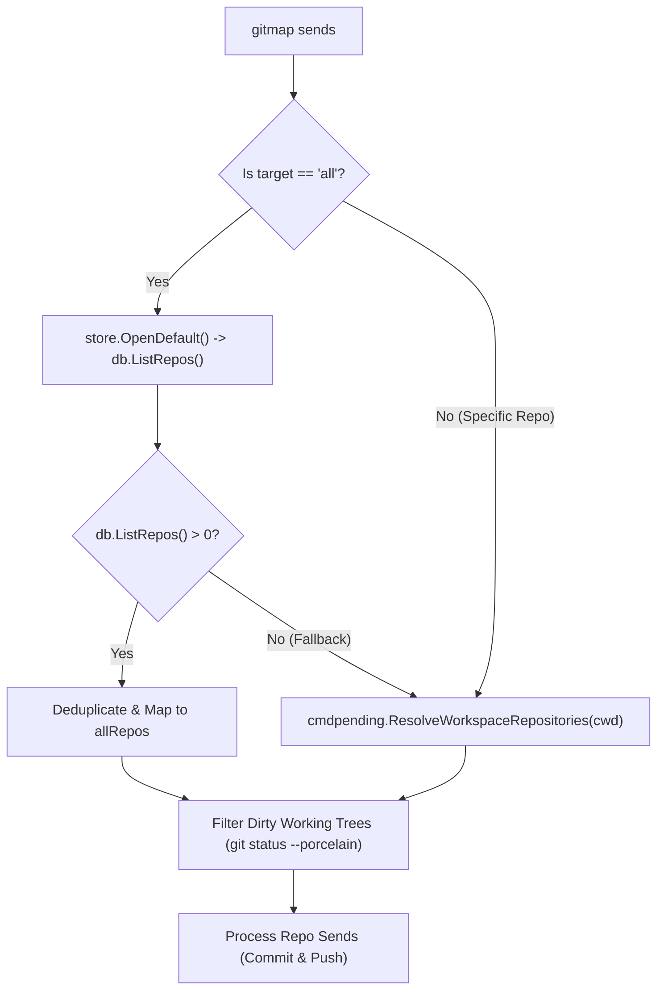
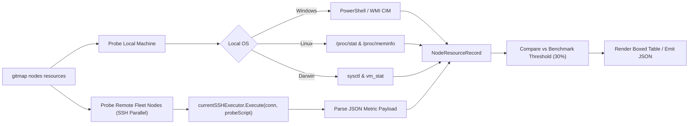

# Component Specification: GitMap Enhancement and Optimization

- **Slug:** `gitmap-enhancement-and-optimization`
- **Spec Type:** Component Architecture Specification
- **Spec Path:** `02-spec/21-app/gitmap-enhancement-and-optimization/02-component-spec.md`
- **Master Plan Reference:** `.ai-memory/plans/gitmap-enhancement-and-optimization.md`
- **Architecture Spec Reference:** `02-spec/21-app/gitmap-enhancement-and-optimization/01-architecture-spec.md`
- **Status:** `approved`
- **Created:** 2026-10-16

---

## 1. Executive Summary & Component Scope

This component specification details the technical architecture, data structures, execution pipelines, and public interfaces for the second wave of enhancements in `gitmap-enhancement-and-optimization`. It provides exhaustive specifications for:
1. **Multi-Repository Workspace Target Resolution (`gitmap sends cp all`)**: Resolving the repository discovery defect in `cli/cmd/cmd_sends.go` by interrogating the primary SQLite Split-DB (`gitmap.db`) instead of scoping strictly to the current working directory (`CWD`).
2. **Semantic Change Grouping Engine (`cli/cmdsends/sends_grouping.go`)**: Pattern-based porcelain status parsing and category classification (CSS/styling, core code, boolean/guards, assets/media, specs/docs) to synthesize natural-language Markdown commit summaries with relative file links `[relative/path](relative/path)`.
3. **Fleet Node Resource Monitoring (`gitmap nodes resources`)**: Live cross-platform CPU and RAM telemetry probing across local operating systems (WMI/CIM on Windows, `/proc` on Linux) and remote SSH fleet nodes.
4. **Adaptive Concurrency Worker Boost**: Dynamically expanding pull concurrency up to `max(runtime.NumCPU(), 6)` with 2 concurrent worker hands per CPU core when local utilization remains under a configurable benchmark threshold (default: 30%).
5. **Bidirectional Settings Management**: Registering `SettingNodeResourceThreshold` (`node_resource_threshold`, default 30%) and `SettingPaeRecencyWindowHours` (`pae_recency_window_hours`, default 48h) in `cli/constants/constants_settings.go`, terminal settings CLI (`cli/cmdagy/agy_telegram_email_settings.go`), and React web dashboard (`src/pages/Settings.tsx`).
6. **SSH Fleet Delegation Parity & Help Docs**: Registering `gitmap nodes cp all` in `cli/cmdnodes/nodes_cmd.go` and `cli/cmdnodes/nodes_commits.go`, authoring documentation in `cli/helpdoc/` and `docs/commands/`, and registering metadata in `src/data/commands.ts`.

---

## 2. Multi-Repo Target Resolution (`gitmap sends cp all`)

### 2.1 Problem Analysis & Defect Identification

In `cli/cmd/cmd_sends.go`, the dispatch function `executeSendsDispatch` currently resolves candidate repositories via:
```go
cwd, errCwd := os.Getwd()
if errCwd != nil {
    cwd = "."
}
allRepos := cmdpending.ResolveWorkspaceRepositories(cwd)
targets, errTargets := filterTargetRepositories(allRepos, opts.Target)
```

`cmdpending.ResolveWorkspaceRepositories(cwd)` calls `cmdpull.ResolvePullDirectoryTargets(cwd)`. If `cwd` points to a single repository root (e.g. `d:/work/gitmap`) or a workspace subdirectory, `ResolvePullDirectoryTargets` returns only that single repository or immediately nested submodules. Consequently:
- Running `gitmap sends cp all "wip: save changes"` from within a single project directory only processes that single project (e.g. `scripts-fixer -> Clean working tree -> Skipped`), leaving dirty repositories across `d:/work/` uncommitted.
- The command violates user expectation: target `"all"` must scope across the entire registered workspace fleet indexed in `gitmap.db`.

### 2.2 Architectural Remediation: Split-DB Catalog Query

When `strings.EqualFold(opts.Target, "all")` is supplied:
1. `executeSendsDispatch` must invoke a dedicated resolver `resolveAllIndexedRepositories()` that queries `store.OpenDefault()` (`gitmap.db`).
2. It executes `db.ListRepos()` to retrieve all indexed `model.ScanRecord` entries across all registered workspace roots.
3. If `gitmap.db` is empty or unavailable, it gracefully falls back to `cmdpending.ResolveWorkspaceRepositories(cwd)`.
4. It deduplicates records by canonical absolute path using `filepath.Clean`.



### 2.3 Interface & Function Signatures

In `cli/cmd/cmd_sends.go` (and package `cli/cmdsends`):

```go
package cmd

import (
    "path/filepath"
    "strings"

    "github.com/alimtvnetwork/gitmap-v28/cli/cmdpending"
    "github.com/alimtvnetwork/gitmap-v28/cli/model"
    "github.com/alimtvnetwork/gitmap-v28/cli/store"
)

// resolveAllIndexedRepositories retrieves all workspace repositories from gitmap.db,
// falling back to local filesystem discovery if the database query yields zero records.
func resolveAllIndexedRepositories(cwd string) []model.ScanRecord {
    db, errDB := store.OpenDefault()
    if errDB == nil {
        defer db.Close()
        repos, errList := db.ListRepos()
        if errList == nil && len(repos) > 0 {
            return deduplicateScanRecords(repos)
        }
    }
    return cmdpending.ResolveWorkspaceRepositories(cwd)
}

func deduplicateScanRecords(repos []model.ScanRecord) []model.ScanRecord {
    seen := make(map[string]bool, len(repos))
    unique := make([]model.ScanRecord, 0, len(repos))
    for _, r := range repos {
        cleanPath := filepath.Clean(r.AbsolutePath)
        if !seen[cleanPath] {
            seen[cleanPath] = true
            unique = append(unique, r)
        }
    }
    return unique
}
```

---

## 3. Semantic Change Grouping Engine

### 3.1 Overview & Requirements

When performing batch WIP commits (`gitmap sends cp all "wip"` or `gitmap sends cp all WIP`), raw unstructured commit messages provide inadequate context for subsequent review. The Semantic Change Grouping Engine automatically parses `git status --porcelain` output across staged and unstaged files, categorizes changes by file type and semantic intent, and constructs a structured Markdown commit description with relative file links.

### 3.2 Category Classification Rules

The engine classifies modified, untracked, and added files into five discrete categories using deterministic pattern matching:

| Category ID | Display Heading | File Match Patterns | Semantic Intent Description |
|---|---|---|---|
| `CategoryStyle` | `Styling and CSS Updates` | `*.css`, `*.scss`, `*.less`, `*tailwind*`, `*.pcss` | UI styling, design tokens, responsive layout rules, CSS variables |
| `CategoryCore` | `Core Code Logic Changes` | `*.go`, `*.ts`, `*.tsx`, `*.rs`, `*.py`, `*.php`, `*.c`, `*.cpp` | Business logic, CLI commands, handlers, API routes, data models |
| `CategoryBoolean` | `Boolean & Guard Updates` | Files with `*bool*` in name, or files containing predicate updates (`is*`, `has*`, `can*`, `should*`, guard clauses) | Condition normalization, positive boolean flags, defensive return guards |
| `CategoryAsset` | `Asset & Image Updates` | `assets/*`, `*.png`, `*.svg`, `*.jpg`, `*.jpeg`, `*.gif`, `*.webp`, `*avatar*`, `*logo*`, `*icon*` | Media assets, icons, logos, static illustrations |
| `CategorySpec` | `Specification & Documentation` | `*.md`, `02-spec/*`, `docs/*`, `*.txt`, `*.rst` | System specifications, architecture documentation, task plans, guides |

### 3.3 Data Structures (`cli/cmdsends/grouping_types.go`)

```go
package cmdsends

// FileCategory defines the semantic classification of a changed file.
type FileCategory string

const (
    CategoryStyle   FileCategory = "style"
    CategoryCore    FileCategory = "core"
    CategoryBoolean FileCategory = "boolean"
    CategoryAsset   FileCategory = "asset"
    CategorySpec    FileCategory = "spec"
    CategoryOther   FileCategory = "other"
)

// ChangedFile represents a single modified, added, or untracked file.
type ChangedFile struct {
    RelativePath string       `json:"relativePath"`
    StatusCode   string       `json:"statusCode"`
    Category     FileCategory `json:"category"`
}

// CategorySummary encapsulates grouped changes and natural-language narrative.
type CategorySummary struct {
    Category    FileCategory  `json:"category"`
    Heading     string        `json:"heading"`
    Description string        `json:"description"`
    Files       []ChangedFile `json:"files"`
}

// CommitDescriptionPayload encapsulates the synthesized multi-category description.
type CommitDescriptionPayload struct {
    Title       string            `json:"title"`
    Categories  []CategorySummary `json:"categories"`
    TotalFiles  int               `json:"totalFiles"`
    MarkdownDoc string            `json:"markdownDoc"`
}
```

### 3.4 Description Generation Logic (`cli/cmdsends/grouping_engine.go`)

The grouping engine generates a structured Markdown commit message body formatted as follows:

```markdown
wip: save changes

### Styling and CSS Updates
Modernized responsive layout tokens and component stylesheets.
- [src/index.css](src/index.css)
- [src/components/layout.module.css](src/components/layout.module.css)

### Core Code Logic Changes
Updated CLI dispatch routing and database query routines.
- [cli/cmd/cmd_sends.go](cli/cmd/cmd_sends.go)
- [cli/cmdsends/sends_grouping.go](cli/cmdsends/sends_grouping.go)

### Asset & Image Updates
Avatar and icon assets updated for UI parity.
- [assets/icons/node-active.svg](assets/icons/node-active.svg)
```

#### Markdown Relative Link Rules:
1. Links must use strictly relative repository paths (e.g. `[cli/cmd/cmd_sends.go](cli/cmd/cmd_sends.go)`).
2. Zero absolute paths (`d:/work/...`) or protocol URIs (`file:///...`).
3. Folder names and paths must preserve exact filesystem casing while respecting lowercase spec standards.
4. If a category contains more than 10 files, the first 8 are listed explicitly followed by a concise count: `- ... and 4 additional files`.

---

## 4. Fleet Node Resource Monitoring (`gitmap nodes resources`)

### 4.1 CLI Interface & Subcommand Registration

Register `resources` and its aliases (`res`, `usage`, `metrics`) under `gitmap nodes`:
```bash
gitmap nodes resources [target] [flags]
```

#### Flags:
- `--benchmark <N>` / `-b <N>`: Benchmark CPU/RAM threshold percentage (default: read from `constants.SettingNodeResourceThreshold` or `30`).
- `--json` / `-j`: Output machine-readable JSON array of node telemetry records.
- `--open-only`: Only probe reachable and online nodes.
- `--timeout <ms>`: Probe timeout per node in milliseconds (default: `2500ms`).

### 4.2 Cross-Platform Telemetry Collectors



#### Windows Local Telemetry Collector:
Uses PowerShell CIM cmdlets for non-blocking instantaneous CPU and RAM interrogation:
```powershell
$cpu = (Get-CimInstance Win32_Processor | Measure-Object -Property LoadPercentage -Average).Average
$os = Get-CimInstance Win32_OperatingSystem
$totalRam = [math]::Round($os.TotalVisibleMemorySize / 1024, 0)
$freeRam = [math]::Round($os.FreePhysicalMemory / 1024, 0)
$usedRam = $totalRam - $freeRam
$ramPercent = [math]::Round(($usedRam / $totalRam) * 100, 1)
[PSCustomObject]@{ cpu = [int]$cpu; ram = [double]$ramPercent; total_mb = [int]$totalRam; used_mb = [int]$usedRam } | ConvertTo-Json -Compress
```

#### Linux Local Telemetry Collector:
Reads `/proc/stat` across two 100ms intervals to calculate active CPU percentage, and parses `MemTotal` and `MemAvailable` from `/proc/meminfo`:
```bash
cpu_pct=$(awk '{u=$2+$4; t=$2+$4+$5; if (NR==1){u1=u; t1=t;} else print int((u-u1)*100/(t-t1))}' <(head -n 1 /proc/stat; sleep 0.1; head -n 1 /proc/stat))
ram_pct=$(awk '/MemTotal/{t=$2} /MemAvailable/{a=$2} END{print int((t-a)*100/t)}' /proc/meminfo)
echo "{\"cpu\": $cpu_pct, \"ram\": $ram_pct}"
```

#### Remote SSH Telemetry:
Remote nodes are probed concurrently via `currentSSHExecutor.Execute` with a 2.5s execution deadline. The probe script is tailored based on node OS (`windows` or `linux`).

### 4.3 Data Structures (`cli/cmdnodes/nodes_resources.go`)

```go
package cmdnodes

import "time"

// NodeResourceRecord encapsulates CPU, RAM, and benchmark evaluation for a single node.
type NodeResourceRecord struct {
    NodeAlias      string        `json:"nodeAlias"`
    Host           string        `json:"host"`
    OS             string        `json:"os"`
    IsLocal        bool          `json:"isLocal"`
    IsOnline       bool          `json:"isOnline"`
    CPUPercent     int           `json:"cpuPercent"`
    RAMPercent     int           `json:"ramPercent"`
    TotalRAMMB     int           `json:"totalRamMb"`
    UsedRAMMB      int           `json:"usedRamMb"`
    BenchmarkLimit int           `json:"benchmarkLimit"`
    IsUnderLoaded  bool          `json:"isUnderLoaded"` // true if CPU < benchmark AND RAM < benchmark
    LoadStatus     string        `json:"loadStatus"`    // "HEALTHY", "MODERATE", "HEAVY", "OFFLINE"
    Latency        time.Duration `json:"latency"`
    ErrorMessage   string        `json:"errorMessage,omitempty"`
}
```

### 4.4 Load Status Classification & Table Rendering

| Condition | Status Badge | ANSI Color | Action Implication |
|---|---|---|---|
| `CPU < 30%` AND `RAM < 30%` | `● HEALTHY` | `constants.ColorGreen` | Eligible for Adaptive Concurrency Boost |
| `30% <= CPU <= 70%` OR `30% <= RAM <= 70%` | `● MODERATE` | `constants.ColorYellow` | Standard worker pool execution |
| `CPU > 70%` OR `RAM > 70%` | `▲ HEAVY` | `constants.ColorRed` | Throttled / restricted execution |
| Unreachable / Network Timeout | `○ OFFLINE` | `constants.ColorDim` | Node skipped |

---

## 5. Adaptive Concurrency Boost

### 5.1 Trigger Invariants

The Adaptive Concurrency Boost dynamically scales the pull worker pool in `cli/cloneconcurrency/pull_concurrency.go` and `cli/cmdpull/pull_worker.go` when and only when all of the following conditions hold:
1. **Local-Only Run**: The command is executing on the self machine without remote SSH fanout (`!isFleetDistributed`).
2. **Idle CPU & RAM**: Local CPU load is `< 30%` AND local RAM utilization is `< 30%` (or `< SettingNodeResourceThreshold`).
3. **No External Node Contention**: Remote nodes are either idle or not participating in the current run.

### 5.2 Concurrency Scaling Formula

Under normal conditions, `ResolveAdaptivePullConcurrency` applies conservative limits based on logical core count:
- 1–2 cores: 1 worker
- 3–4 cores: 2 workers
- 5–8 cores: 3 workers
- 9–16 cores: 4 workers
- 16+ cores: 6 workers

When the **Adaptive Concurrency Boost** activates:
$$\text{BoostedWorkers} = \max(\text{runtime.NumCPU}(), 6)$$
Each worker pool operates with 2 concurrent worker hands, maximizing socket reuse and filesystem I/O pipelining while maintaining system stability.

```go
package cloneconcurrency

import "runtime"

// ResolveBoostedPullConcurrency calculates aggressive worker pool size for idle environments.
func ResolveBoostedPullConcurrency(isLocalOnly bool, cpuPercent, ramPercent, threshold int) int {
    if !isLocalOnly {
        return ResolveAdaptivePullConcurrency(CPUProfileAuto, 0)
    }
    if cpuPercent < threshold && ramPercent < threshold {
        cores := runtime.NumCPU()
        if cores < 6 {
            return 6
        }
        return cores
    }
    return ResolveAdaptivePullConcurrency(CPUProfileAuto, 0)
}
```

---

## 6. Settings Architecture & UI Synchronization

### 6.1 Database & Constant Keys (`cli/constants/constants_settings.go`)

Add the following constants to `cli/constants/constants_settings.go`:

```go
const (
    // SettingNodeResourceThreshold defines the CPU and RAM benchmark percentage (default: 30).
    SettingNodeResourceThreshold = "node_resource_threshold"

    // SettingPaeRecencyWindowHours defines lookback window in hours for gitmap pae (default: 48).
    SettingPaeRecencyWindowHours = "pae_recency_window_hours"

    // DefaultNodeResourceThreshold is the baseline benchmark utilization limit.
    DefaultNodeResourceThreshold = 30

    // DefaultPaeRecencyWindowHours is the baseline lookback window for commit recency.
    DefaultPaeRecencyWindowHours = 48
)
```

### 6.2 Terminal Settings CLI (`cli/cmdagy/agy_telegram_email_settings.go`)

Extend `SpeedSettingsStatus` and the CLI handler `RunAgySettingsCLI` to accept:
- `gitmap settings --threshold <N>`: Updates `node_resource_threshold`.
- `gitmap settings --recency-hours <N>`: Updates `pae_recency_window_hours`.
- `gitmap settings set node_resource_threshold <N>`.
- `gitmap settings set pae_recency_window_hours <N>`.

```go
type SpeedSettingsStatus struct {
    LapDefaultHours         string `json:"lapDefaultHours"`
    AccountSwitchThreshold  string `json:"accountSwitchThreshold"`
    NodeResourceThreshold   string `json:"nodeResourceThreshold"`
    PaeRecencyWindowHours   string `json:"paeRecencyWindowHours"`
    TelegramBotTokenMasked  string `json:"telegramBotTokenMasked"`
    TelegramChatID          string `json:"telegramChatId"`
    TelegramReady           bool   `json:"telegramReady"`
    EmailSMTPHost           string `json:"emailSmtpHost"`
    EmailFrom               string `json:"emailFrom"`
    EmailTo                 string `json:"emailTo"`
    EmailReady              bool   `json:"emailReady"`
    MachineAlias            string `json:"machineAlias"`
    SpecialReposSecretsName string `json:"specialReposSecretsName"`
    SpecialReposCacheName   string `json:"specialReposCacheName"`
}
```

### 6.3 React Web Dashboard (`src/pages/Settings.tsx`)

In `src/pages/Settings.tsx`, introduce a dedicated `NodeResourceConfigCard` component adhering to the 4-Plane elevation depth tokens:

```tsx
interface NodeResourceSettingsProps {
  nodeThreshold: number;
  onNodeThresholdChange: (val: number) => void;
  recencyHours: number;
  onRecencyHoursChange: (val: number) => void;
}

export function NodeResourceConfigCard({
  nodeThreshold,
  onNodeThresholdChange,
  recencyHours,
  onRecencyHoursChange,
}: NodeResourceSettingsProps) {
  return (
    <div className="p-6 rounded-xl bg-card border border-border/40 shadow-sm space-y-6">
      <div className="flex items-center gap-3">
        <div className="h-10 w-10 rounded-lg bg-primary/10 flex items-center justify-center text-primary">
          <Cpu className="h-5 w-5" />
        </div>
        <div>
          <h3 className="text-lg font-heading font-semibold text-foreground">
            Fleet Resources &amp; Pull Optimization
          </h3>
          <p className="text-sm text-muted-foreground">
            Configure idle resource thresholds and smart commit lookback windows.
          </p>
        </div>
      </div>

      <div className="grid grid-cols-1 md:grid-cols-2 gap-6">
        <div className="space-y-2">
          <label className="text-sm font-medium text-foreground">
            Node Resource Benchmark Threshold ({nodeThreshold}%)
          </label>
          <input
            type="range"
            min={10}
            max={80}
            step={5}
            value={nodeThreshold}
            onChange={(e) => onNodeThresholdChange(Number(e.target.value))}
            className="w-full accent-primary"
          />
          <span className="text-xs text-muted-foreground">
            Concurrency boost activates when local and fleet utilization stays under this threshold.
          </span>
        </div>

        <div className="space-y-2">
          <label className="text-sm font-medium text-foreground">
            PAE Commit Recency Window ({recencyHours} Hours)
          </label>
          <input
            type="number"
            min={1}
            max={720}
            value={recencyHours}
            onChange={(e) => onRecencyHoursChange(Number(e.target.value))}
            className="w-full px-3 py-2 rounded-lg border border-input bg-background text-sm"
          />
          <span className="text-xs text-muted-foreground">
            Pull All Efficient (`gitmap pae`) limits pull targets to repositories committed within this window.
          </span>
        </div>
      </div>
    </div>
  );
}
```

Bidirectional state sync integrates with `handleSave()` via `localStorage` keys `gitmap_node_resource_threshold` and `gitmap_pae_recency_window_hours`, dispatched to `/api/settings` during save operations.

---

## 7. SSH Fleet Parity & Help Docs Parity

### 7.1 SSH Fleet Delegation: `gitmap nodes cp all`

In `cli/cmdnodes/nodes_commits.go` and `cli/cmdnodes/nodes_cmd.go`:
1. Register `RunNodesCommitPush(args []string)` mapping to `RunNodesCommitsWithAction("cp", args)`.
2. In `RunUnifiedNodesCLI(args []string)`:
   ```go
   } else if strings.EqualFold(args[0], "cp") {
       return RunNodesCommitPush(args[1:])
   }
   ```
3. Fleet delegation behavior:
   - When executed as `gitmap nodes cp all "<message>"`, it resolves all candidate SSH fleet nodes.
   - For each node, it executes `gitmap sends cp all "<message>" --json` over SSH using `currentSSHExecutor`.
   - Results are rendered in a unified status table with columns: `NODE ALIAS`, `HOST`, `OS`, `REPOSITORIES COMMITTED`, `STATUS`, `LATENCY`.

### 7.2 Help Documentation Updates

1. **`cli/helpdoc/nodes.md`**: Add `gitmap nodes cp all "<msg>"` and `gitmap nodes resources` to Synopsis, Subcommands table, Flags, and Examples.
2. **`cli/helpdoc/sends.md`**: Document `gitmap sends cp all WIP` and automatic semantic grouping behavior.
3. **`docs/commands/cluster/nodes.md`**: Update cluster documentation with resource probing and fleet commit examples.

### 7.3 Web Command Registry (`src/data/commands.ts`)

Add command definitions for `nodes resources` and `nodes cp all` under categories `"cluster"` and `"commit"`:

```typescript
{
  category: "cluster",
  name: "nodes resources",
  alias: "nodes res",
  description: "Probe CPU and RAM utilization across local machine and registered SSH fleet nodes.",
  usage: "gitmap nodes resources [target] [--benchmark 30] [--json]",
  flags: [
    { flag: "--benchmark <N>, -b <N>", description: "Benchmark utilization threshold percentage (default: 30%)" },
    { flag: "--json, -j", description: "Output structured JSON array of node telemetry records" },
    { flag: "--open-only", description: "Only probe online and reachable fleet nodes" },
  ],
  examples: [
    { command: "gitmap nodes resources", description: "Display resource usage table across all fleet nodes" },
    { command: "gitmap nodes resources --benchmark 25", description: "Evaluate nodes against a strict 25% load threshold" },
  ],
  seeAlso: [
    { name: "nodes ping", description: "Probe network reachability and latency" },
    { name: "pull all", description: "Execute parallel repository updates" },
  ],
},
{
  category: "cluster",
  name: "nodes cp all",
  description: "Broadcast flat WIP commits and push across all dirty repositories on remote fleet nodes.",
  usage: "gitmap nodes cp all \"<message>\" [flags]",
  flags: [
    { flag: "--dry-run, -n", description: "Simulate commits on remote nodes without mutating refs" },
    { flag: "--no-push", description: "Commit locally on remote nodes without pushing to remote upstream" },
    { flag: "--json, -j", description: "Output structured JSON array of execution outcomes" },
  ],
  examples: [
    { command: "gitmap nodes cp all \"wip: save changes\"", description: "Commit all pending work across all fleet nodes" },
  ],
  seeAlso: [
    { name: "sends cp all", description: "Commit pending changes across local workspace" },
    { name: "nodes cpf", description: "Broadcast feature commits across fleet" },
  ],
}
```

---

## 8. Quality, Safety & Acceptance Matrix

| Verification ID | Component / Scenario | Verification Criteria | Expected Outcome |
|---|---|---|---|
| `V-CMP-01` | Multi-Repo Target Resolution | Execute `gitmap sends cp all "wip: save"` from subfolder | All dirty repos across `gitmap.db` are processed; clean repos skipped |
| `V-CMP-02` | Semantic Grouping Engine | Commit with modified `.css`, `.go`, `assets/logo.png`, `02-spec/spec.md` | Commit body groups files under 4 Markdown headers with relative links |
| `V-CMP-03` | Node Resource Telemetry | Execute `gitmap nodes resources` on Windows and Linux | Correct CPU% and RAM% parsed and displayed with status badges |
| `V-CMP-04` | Adaptive Concurrency Boost | Trigger `gitmap pa` when local CPU < 30% and RAM < 30% | Concurrency scales up to `max(runtime.NumCPU(), 6)` workers |
| `V-CMP-05` | Settings DB & CLI Parity | Set `gitmap settings --threshold 25 --recency-hours 36` | `gitmap.db` `Setting` table updated; confirmed via `gitmap settings --json` |
| `V-CMP-06` | React UI Synchronization | Update sliders in `src/pages/Settings.tsx` and click Save | Changes persist to `localStorage` and trigger `/api/settings` POST |
| `V-CMP-07` | SSH Fleet Parity | Execute `gitmap nodes cp all "wip: save"` | Dispatched to all online SSH nodes via `gitmap sends cp all --json` |
| `V-CMP-08` | Relative Path Hygiene | Inspect generated commit bodies and documentation | Zero absolute paths (`d:/...`, `C:\...`); strictly relative links |
