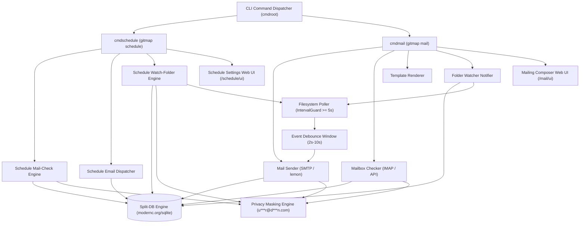

# GitMap Mailing & Scheduling Architecture Overview

**Specification File:** `02-spec/21-app/gitmap-mailing-and-scheduling-enhancements/01-architecture-overview.md`  
**Parent Index:** `02-spec/21-app/gitmap-mailing-and-scheduling-enhancements/readme.md`  
**Status:** DRAFT / RATIFIED  
**Target Subsystems:** `cli/cmdschedule`, `cli/cmdmail`, `cli/store`

---

## 1. System Context & Architectural Vision

GitMap's scheduling and communication backbone coordinates background task execution, filesystem monitoring, multi-mailbox inspection, and automated notifications across developer workstations and remote fleet nodes. This specification establishes a cohesive architecture unifying two primary CLI command trees:

1. **`gitmap schedule` (`cmdschedule`):** Extended to support periodic multi-mailbox polling (`mail-check`), scheduled email dispatches (`email`), and event-driven folder watcher tasks (`watch-folder`).
2. **`gitmap mail` (`cmdmail`):** A dedicated, standalone email utility engine providing direct mailing primitives (`send`, `check`, `test`, `template`, `notify`) and an embedded zero-CDN web composer UI (`ui`).

Both command trees interact with the Split-DB storage tier, share the unified privacy masking engine, and execute within strict single-writer SQLite invariants (`MaxOpenConns(1)`).

---

## 2. Subsystem Topology & Component Interaction



---

## 3. Core Architectural Subsystems

### 3.1 Multi-Mailbox Checker Architecture
The Multi-Mailbox Checker inspects one or more configured email accounts to detect unread counts, status changes, and recent message snippets without downloading full mail payloads:

- **Account Registry:** Stored in Split-DB table `MailboxConfig` with positive boolean `IsActive`. Credentials reference encrypted local secrets or system credential stores.
- **Polling Strategy:** Supports ad-hoc checking (`gitmap mail check`) and daemonized periodic evaluation (`gitmap schedule mail-check --interval 15m`).
- **Telemetry & State Tracking:** Tracks `LastCheckTimestamp`, `UnreadCount`, `TotalCount`, and `LastError` in table `MailboxStateRecord`.
- **Privacy Enforcement:** All retrieved email addresses in subject headers and metadata are routed through the Privacy Masking Engine prior to terminal rendering or JSON envelope serialization.

### 3.2 Scheduled Email Lifecycle
Automated scheduled emails transition through a deterministic lifecycle managed by `cmdschedule`:

1. **Registration:** CLI command `gitmap schedule email` persists a job record in `ScheduledEmail` table with attributes: `ScheduleCron`, `IntervalDuration`, `RecipientList`, `TemplateName`, and `PayloadBody`.
2. **Evaluation:** The scheduler worker loop polls active tasks where `IsActive = 1` and `NextRunTimestamp <= CurrentTimestamp`.
3. **Execution Guard:** Checks concurrency locks and updates state to `IsRunning = 1`.
4. **Template Compilation:** Reads template files or inline templates, substituting dynamic parameters (e.g., node name, workspace status, commit SHA).
5. **Dispatch:** Invokes the mail transmission engine via local SMTP or Lemon daemon connector.
6. **Telemetry & Log:** Appends a run entry to `ScheduleRunRecord` and `MailNotificationLog` with execution status (`HasCompleted = 1`, `IsSuccess = 1`).

### 3.3 Event-Driven Folder Watcher & Trigger Notifier
The Folder Watcher triggers automated email notifications based on filesystem activity (file creation, modification, or deletion):

- **Polling-Based File Stat Engine:** To ensure cross-platform compatibility across Windows, Linux, and macOS without native CGO dependencies, the watcher uses a periodic stat-caching algorithm with `IntervalGuard` (minimum interval `5s`, default `8s`).
- **State Snapshot Cache:** Maintains an in-memory and Split-DB map of `FilePath -> FileMetadata { ModTime, FileSize, SHA256 }`.
- **Debounce Window:** Rapid burst changes (e.g., build outputs, temp file creations) are grouped into a configurable debounce window (default `3s`, range `1s`–`30s`).
- **Notification Dispatch:** Once the debounce window closes, a summarized digest of changed paths is constructed and mailed to configured `RecipientList` addresses stored in `FolderWatchRule`.

### 3.4 Privacy Masking Engine
To prevent sensitive PII leakage across terminal logs, console captures, CI/CD telemetry, and public UI envelopes, the Privacy Masking Engine enforces:

- **Email Masking Pattern:** `user@domain.com` -> `u***r@d***n.com`.
  - Usernames with length <= 2: first character preserved followed by `***` (e.g. `a@b.com` -> `a***@b***.com`).
  - Usernames with length > 2: first and last character preserved with `***` in between.
  - Domain names: domain name masked similarly, top-level domain preserved.
- **Default Privacy Mode:** Masking is active by default (`IsMasked = 1`). Unmasking requires explicit `--reveal` or `--no-mask` flags with administrative credentials.

### 3.5 Dual Embedded Web Dashboards (Zero-CDN)
Two embedded lightweight web servers deliver responsive visual management:

1. **Mailing Composer UI (`/mail/ui`):**
   - Accessible via `gitmap mail ui --port 9095`.
   - Features rich composer, template preview, recipient autocompletion with privacy masking, test dispatch buttons, and delivery status monitors.
2. **Schedule & Notifier Settings UI (`/schedule/ui`):**
   - Accessible via `gitmap schedule ui --port 9096`.
   - Visual dashboard for cron tasks, folder watcher rules, active polling timers, recipient mappings, and real-time execution logs.
- **Zero-CDN Architecture:** All CSS, JavaScript, and SVG icons are embedded as raw Go constants (`string` / `[]byte`) inside the binary. External CDN links (`unpkg`, `cdnjs`, `jsdelivr`) are strictly forbidden.

---

## 4. Storage & Database Safety Invariants

All persistence adheres to GitMap's SQLite Split-DB standard (`cli/store`):

| Invariant | Specification Rule |
|---|---|
| **Driver** | Pure Go `modernc.org/sqlite` (strict CGO-free portability). |
| **Connection Safety** | `db.SetMaxOpenConns(1)` single-writer connection pool to eliminate SQLite lock contention and database busy errors. |
| **Journal Mode** | Mandatory `PRAGMA journal_mode = WAL;` and `PRAGMA busy_timeout = 5000;`. |
| **Table Naming** | PascalCase table names: `ScheduledEmail`, `MailboxConfig`, `MailboxStateRecord`, `FolderWatchRule`, `MailNotificationLog`. |
| **Column Naming** | PascalCase column names: `Id`, `CreatedAt`, `UpdatedAt`, `IsActive`, `IsEnabled`, `HasCompleted`, `IsSuccess`, `IsMasked`. |
| **Boolean Hygiene** | Positive boolean semantics only (`IsActive`, `IsEnabled`, `IsMasked`). Negative booleans (`Disabled`, `Unmasked`) are forbidden. |

---

## 5. Error Management & Fault Tolerance

All subsystems wrap errors with `*appfault.AppError` providing structured diagnostic context:

```go
// Example AppError wrapping in mailing engine
if err != nil {
    return appfault.Wrap(err, appfault.CodeMailDeliveryFailed, "failed to dispatch notification email").
        WithAttr("TargetRecipient", maskedRecipient).
        WithAttr("RuleName", rule.RuleName)
}
```

- **Graceful Degradation:** If an SMTP server or remote mailbox is unreachable, jobs record failure in `MailNotificationLog`, back off exponentially, and avoid crashing daemon loops.
- **Exit Codes:** CLI commands return deterministic exit codes (0 for success, 1 for runtime error, 2 for validation failure, 3 for network/auth failure).

---

## 6. Security & Credential Isolation

- **Secret Storage:** SMTP passwords, IMAP tokens, and API secrets are never stored in plaintext within configuration files. They are referenced via key identifiers from GitMap's local encrypted credentials vault (`installation.db`).
- **PII Governance:** Unmasked email addresses are ephemeral and confined strictly to the transport layer during socket transmission. All logging and persistence layers store or render masked representations unless configured for audited debug mode.
