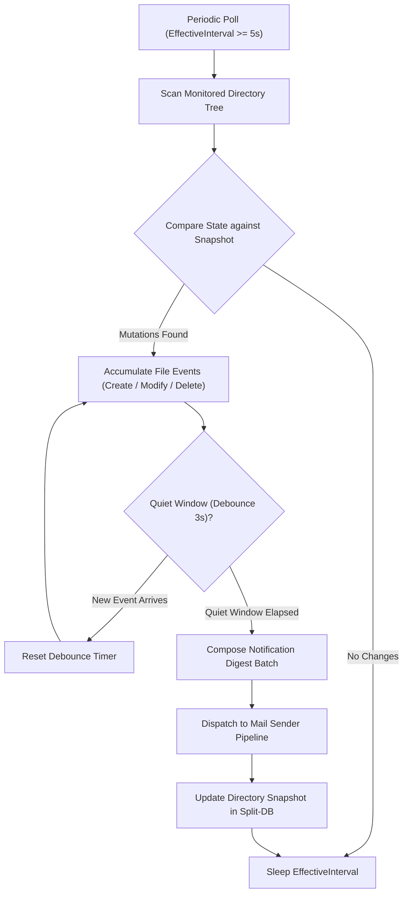

# 03-folder-watcher-and-triggers: Folder Watcher & Event Notification Specification

- **Spec ID:** `02-spec/21-app/gitmap-mailing-and-scheduling-enhancements/03-folder-watcher-and-triggers.md`
- **Status:** `APPROVED`
- **Version:** `1.0.0`
- **Subsystem:** Scheduler, Filesystem Watcher, Event Trigger Pipeline, Mail Dispatcher
- **Dependencies:** `cli/cmdmail`, `cli/cmdschedule`, `cli/apperror`, `cli/store`
- **Associated Plan:** `.ai-memory/plans/gitmap-mailing-and-scheduling-enhancements.md`
- **Subtask Plan:** `.ai-memory/plans/subtasks/gitmap-mailing-and-scheduling-enhancements/04-subtask-folder-watcher-and-mail-core.md`

---

## 1. Executive Summary & Core Intent

This specification establishes the architecture, timing invariants, debouncing mechanics, and notification dispatch pipelines for GitMap's event-driven folder watcher.

The folder watcher monitors user-designated directories for file lifecycle activities—specifically file creation, content modification, and deletion. Upon detecting activity, it debounces rapid event bursts, aggregates change metadata, and automatically dispatches formatted notification emails to configured recipient lists.

### 1.1 Core Capabilities
1. **Stat/ModTime Periodic Polling:** Cross-platform polling watcher decoupled from OS-specific filesystem notify handles, ensuring 100% reliability across Windows NTFS, macOS APFS, Linux ext4/tmpfs, and network-mounted shares (SMB/NFS).
2. **IntervalGuard Protection:** Hard minimum polling interval enforcement (`MinInterval = 5s`, `DefaultInterval = 8s`) preventing CPU spinning and disk I/O exhaustion.
3. **Burst Event Debouncing:** Sliding aggregation window that bundles multiple rapid filesystem operations into a single cohesive notification digest.
4. **Action Trigger Pipeline:** Configurable action dispatches connecting filesystem mutation batches directly to GitMap's mailing engine.

---

## 2. Polling Architecture & IntervalGuard Invariants

### 2.1 Polling Mechanism vs Native OS FSNotify
GitMap selects periodic `os.Stat` and directory listing polling over OS native notify hooks (`ReadDirectoryChangesW`, `inotify`, `kqueue`) for scheduled watcher tasks due to:
- Cross-platform determinism across local and mapped network drives.
- Immunity to operating system handle exhaustion and buffer overflows during massive batch file writes.
- Predictable, low CPU and disk I/O footprint under constant daemon operation.

### 2.2 IntervalGuard Enforcement Specification

The watcher runtime enforces the `IntervalGuard` invariant before initializing or persisting any watcher task:

```go
package cmdmail

import "time"

const (
    MinPollingInterval     = 5 * time.Second
    DefaultPollingInterval = 8 * time.Second
    DefaultDebounceWindow  = 3 * time.Second
)

type IntervalGuard struct {
    ConfiguredInterval time.Duration
    EffectiveInterval  time.Duration
    WasClamped         bool
}

func NewIntervalGuard(requested time.Duration) IntervalGuard {
    if requested <= 0 {
        return IntervalGuard{
            ConfiguredInterval: requested,
            EffectiveInterval:  DefaultPollingInterval,
            WasClamped:         false,
        }
    }
    if requested < MinPollingInterval {
        return IntervalGuard{
            ConfiguredInterval: requested,
            EffectiveInterval:  MinPollingInterval,
            WasClamped:         true,
        }
    }
    return IntervalGuard{
        ConfiguredInterval: requested,
        EffectiveInterval:  requested,
        WasClamped:         false,
    }
}
```

If a user specifies `--interval 2s`, the watcher logs an advisory notice and clamps `EffectiveInterval` to `5s`.

---

## 3. Burst Event Debouncing & Aggregation Engine

### 3.1 Event Lifecycle & Debounce State Machine

When a file modification occurs (e.g., an IDE saving multiple files or a compiler generating build artifacts), multiple atomic operations fire in rapid succession. The watcher queues events in an in-memory accumulator and waits for a quiet window (`DebounceWindow = 3s`) before triggering notification.



### 3.2 File Event Types

| Event Type | Condition | Action Payload Metadata |
|---|---|---|
| `FILE_CREATED` | Path present in current scan, absent in snapshot | File path, file size, creation timestamp |
| `FILE_MODIFIED` | Path in both scans, `ModTime` or `Size` changed | File path, previous size, new size, updated `ModTime` |
| `FILE_DELETED` | Path in snapshot, absent in current scan | File path, last recorded size and `ModTime` |

---

## 4. Go Type Definitions & Data Structures

```go
package cmdmail

import "time"

type FileEventType string

const (
    EventCreate FileEventType = "create"
    EventModify FileEventType = "modify"
    EventDelete FileEventType = "delete"
)

type FileItemState struct {
    RelativePath string    `json:"relativePath"`
    SizeBytes    int64     `json:"sizeBytes"`
    ModifiedAt   time.Time `json:"modifiedAt"`
    IsDirectory  bool      `json:"isDirectory"`
}

type FileEventRecord struct {
    EventType  FileEventType `json:"eventType"`
    Path       string        `json:"path"`
    SizeBytes  int64         `json:"sizeBytes"`
    Timestamp  time.Time     `json:"timestamp"`
    Details    string        `json:"details"`
}

type WatcherBatch struct {
    RuleID       string            `json:"ruleId"`
    TargetFolder string            `json:"targetFolder"`
    TriggeredAt  time.Time         `json:"triggeredAt"`
    TotalEvents  int               `json:"totalEvents"`
    Events       []FileEventRecord `json:"events"`
    Recipients   []string          `json:"recipients"`
}

type WatcherConfig struct {
    RuleID          string        `json:"ruleId"`
    TargetDirectory string        `json:"targetDirectory"`
    IncludePatterns []string      `json:"includePatterns"`
    ExcludePatterns []string      `json:"excludePatterns"`
    PollingInterval time.Duration `json:"pollingInterval"`
    DebounceWindow  time.Duration `json:"debounceWindow"`
    Recipients      []string      `json:"recipients"`
    SubjectTemplate string        `json:"subjectTemplate"`
    IsRecursive     bool          `json:"isRecursive"`
    IsActive        bool          `json:"isActive"`
}
```

---

## 5. CLI Command Contracts

### 5.1 Registration via `gitmap schedule watch-folder`
```bash
gitmap schedule watch-folder \
  --path "./reports" \
  --interval 10s \
  --debounce 3s \
  --events create,modify \
  --to "dev-team@example.com,ops@example.com" \
  --subject "GitMap Alert: Reports Directory Activity" \
  --recursive
```

### 5.2 Ad-hoc On-demand Execution via `gitmap mail notify watch`
```bash
gitmap mail notify watch \
  --path "./build/output" \
  --interval 8s \
  --to "audit@example.com" \
  --once
```

### 5.3 Command Line Flags Reference

| Flag | Default | Description |
|---|---|---|
| `--path <dir>` | `.` | Target directory path to monitor. |
| `--interval <dur>` | `8s` | Polling frequency. Enforced minimum: `5s`. |
| `--debounce <dur>` | `3s` | Inactivity window before firing batch notification. |
| `--events <list>` | `create,modify,delete` | Comma-delimited list of lifecycle events to track. |
| `--to <emails>` | Configured Notifier | Destination email address list. |
| `--include <glob>` | `*` | Inclusion wildcard filter pattern. |
| `--exclude <glob>` | `.git/**,*.tmp` | Exclusion wildcard filter pattern. |
| `--recursive` | `true` | Recurse into nested subdirectories. |
| `--once` | `false` | Run single poll cycle, fire if changed, then exit. |

---

## 6. Notification Payload Generation & Email Body Template

When a batch fires, the watcher renders an HTML and plain-text digest.

### 6.1 Default Digest Format
```text
Subject: [GitMap Notifier] 3 file changes detected in /reports

GitMap File Watcher Activity Report
------------------------------------------------------------
Target Directory: /reports
Batch Triggered:  2026-10-20 14:32:05 UTC
Total Events:     3

Changes:
  [CREATE] 2026-10-20-q3-summary.pdf (142,850 bytes)
  [MODIFY] daily-metrics.csv (from 1,024 to 4,210 bytes)
  [DELETE] stale-draft.tmp

-- 
Automated notification generated by GitMap Scheduler.
To configure, run: gitmap schedule ui
```

---

## 7. Storage & Split-DB State Persistence

Watcher configurations and state snapshots persist in GitMap's SQLite Split-DB (`gitmap.db` and `installation.db`):

```sql
CREATE TABLE IF NOT EXISTS EmailWatcherRule (
    ruleId TEXT PRIMARY KEY,
    targetDirectory TEXT NOT NULL,
    pollingIntervalSeconds INTEGER NOT NULL DEFAULT 8,
    debounceSeconds INTEGER NOT NULL DEFAULT 3,
    eventFilterMask TEXT NOT NULL DEFAULT 'create,modify,delete',
    recipientsList TEXT NOT NULL,
    subjectTemplate TEXT,
    isRecursive INTEGER NOT NULL DEFAULT 1,
    isActive INTEGER NOT NULL DEFAULT 1,
    createdAt DATETIME DEFAULT CURRENT_TIMESTAMP,
    updatedAt DATETIME DEFAULT CURRENT_TIMESTAMP
);

CREATE TABLE IF NOT EXISTS EmailWatcherSnapshot (
    ruleId TEXT NOT NULL,
    relativePath TEXT NOT NULL,
    sizeBytes INTEGER NOT NULL,
    modifiedAtEpochMs INTEGER NOT NULL,
    fileHash TEXT,
    PRIMARY KEY (ruleId, relativePath)
);
```

---

## 8. Failure Recovery & Edge Case Handling

1. **Target Directory Deleted:** If the monitored directory disappears, the watcher logs a warning, enters a degraded retry state, and checks every 30s. When re-created, it resets snapshot and resumes normal interval.
2. **Locked Files (Windows):** If a file is opened with exclusive lock by another process during `os.Stat`, the watcher skips reading file content, relies solely on directory entry metadata, and defers detailed hashing.
3. **Clock Skew / DST Changes:** Modification times are compared using UTC Unix epoch timestamps to prevent daylight savings shifts from generating false modify events.
4. **Shutdown Signal:** Receives `os.Interrupt` / `SIGTERM`, flushes pending debounced batches if non-empty, and terminates cleanly.

---

## 9. Verification & Acceptance Criteria

- **AC-FW-01:** Polling interval requested below 5s (`--interval 2s`) is clamped to 5s with an advisory warning.
- **AC-FW-02:** Creating 10 files in a 1-second burst triggers exactly 1 aggregated email notification containing 10 event items after the 3s debounce window.
- **AC-FW-03:** Modifications to excluded globs (`.git/*`, `*.tmp`) do not trigger email notifications.
- **AC-FW-04:** Deletion of an existing file generates an event of type `delete`.
- **AC-FW-05:** Watcher state recovers cleanly upon process restart using `EmailWatcherSnapshot`.
