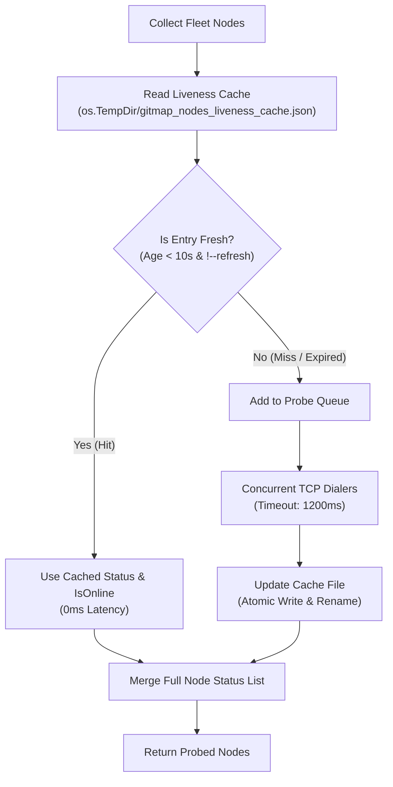
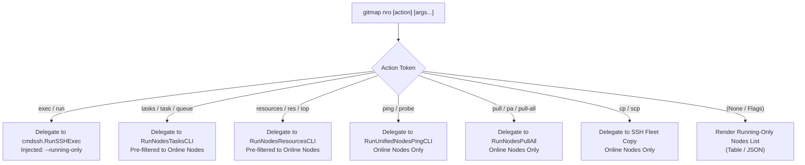

# Architecture Specification: Running-Only Fleet Nodes & Liveness Cache (`gitmap nodes-running-only` / `nro`)

> **Spec ID:** `SPEC-271`  
> **Subsystem:** `cli/cmdnodes`, `cli/cmdssh`, `cli/cmd`  
> **Status:** Draft / Ready for Implementation  
> **Date:** 2026-10-16  

---

## 1. Executive Overview & System Context

The GitMap fleet orchestration engine connects distributed machines across SSH, Cluster, and Server-Client (SC) network topologies. Operators frequently perform rapid terminal iterations, health checks, batch commands, and repository synchronizations across fleets.

In production environments, a subset of fleet machines (e.g. `w3`, `w2`, `w4`, `u1`) may frequently be powered off, suspended, or unreachable due to maintenance or DHCP churn. Currently, inspecting fleet nodes or executing batch operations across them incurs significant overhead:

1. **TCP Probing Latency:** Probing offline machines incurs a default 1.2-second TCP dial timeout per unreachable host. Even when probed concurrently via goroutines, every CLI invocation is bounded by the slowest 1.2s timeout.
2. **Terminal Output Pollution:** Standard fleet commands output prominent warning banners detailing offline or unreachable machines (e.g. `Notice: The following machine(s) are currently OFF or unreachable:`), cluttering interactive terminal sessions and complicating scripting pipelines.
3. **Redundant Repeated Network Probes:** Consecutive command invocations (e.g. `gitmap nodes`, followed by `gitmap nodes tasks`, followed by `gitmap se "git status"`) repeat the identical TCP probes within seconds, wasting network cycles and degrading CLI responsiveness.

This specification establishes the **Running-Only Fleet Architecture**:
- A dedicated command and ultra-compact root alias: `gitmap nodes-running-only` and `gitmap nro`.
- High-efficiency cross-process **Node Liveness Cache** with a 10-second TTL to deliver sub-millisecond responses for warm fleet nodes.
- Clean terminal rendering and JSON output containing **strictly online/active nodes**, suppressing offline warnings.
- First-class **Delegation Model** (`nro exec`, `nro tasks`, `nro resources`, `nro ping`, `nro pull`, `nro cp all`) executing operations exclusively against reachable machines.

---

## 2. Problem Statement & Performance Analysis

### 2.1 The TCP Timeout Bottleneck
Under `cli/cmdssh/sshjoin_probe.go` and `cli/cmdnodes/nodes_filter.go`, fleet node status is determined via TCP dialers with timeouts between 1200ms and 1500ms:

```go
dialer := net.Dialer{Timeout: 1200 * time.Millisecond}
conn, err := dialer.DialContext(ctx, "tcp", addr)
```

When 4 out of 10 nodes are powered off, any command that probes liveness must wait for 1200ms before returning results. In rapid iterative terminal operations, this 1.2s delay stalls interactive responsiveness and breaks user flow.

### 2.2 Output Pollution & Automation Friction
Executing remote SSH commands via `gitmap se "<cmd>"` or `gitmap nodes scan` prints multi-line warning blocks for offline machines:

```text
  Notice: The following machine(s) are currently OFF or unreachable:
    • [w2 | 192.168.1.102] (machine is off)
    • [w3 | 192.168.1.103] (machine is off)
    • [w4 | 192.168.1.104] (machine is off)
    • [u1 | 192.168.1.105] (machine is off)
```

In JSON mode (`--json`), offline nodes are injected as placeholder objects (`{"alias": "w2", "status": "offline"}`), forcing downstream scripts and tools to manually filter out unreachable machines.

---

## 3. Node Liveness Cache Architecture

To eliminate repeated 1.2s TCP timeouts without risking stale routing, a cross-process file-backed cache with atomic serialization is introduced.

### 3.1 Cache Storage & Location
- **Path:** `filepath.Join(os.TempDir(), "gitmap_nodes_liveness_cache.json")`.
- **Scope:** Cross-process (shared across all concurrently executing GitMap CLI processes and subagents on the same host).
- **Concurrency Control:**
  - In-process: Protected by a package-level `sync.RWMutex`.
  - Cross-process: Atomic write via temporary file creation (`gitmap_nodes_liveness_cache.json.tmp.<pid>`) followed by atomic rename (`os.Rename`).

### 3.2 Cache Data Structures
```go
package cmdnodes

import "time"

// NodeLivenessEntry stores reachability state for a single node host/port.
type NodeLivenessEntry struct {
	Alias        string `json:"alias"`
	Host         string `json:"host"`
	Port         int    `json:"port"`
	Status       string `json:"status"`
	IsOnline     bool   `json:"is_online"`
	ProbedAtUnix int64  `json:"probed_at_unix"`
}

// NodeLivenessCache represents the on-disk cache payload.
type NodeLivenessCache struct {
	Version int                          `json:"version"`
	Entries map[string]NodeLivenessEntry `json:"entries"`
}
```

The cache entry key is normalized as `strings.ToLower(fmt.Sprintf("%s:%d", host, port))`.

### 3.3 Cache TTL & Lifecycle
- **Default TTL:** 10 seconds (`const NodeLivenessDefaultTTL = 10 * time.Second`).
- **Validity Check:**
  ```go
  func isCacheEntryFresh(entry NodeLivenessEntry, nowUnix int64, ttl time.Duration) bool {
  	ageSeconds := nowUnix - entry.ProbedAtUnix
  	maxAgeSeconds := int64(ttl.Seconds())
  	return ageSeconds >= 0 && ageSeconds < maxAgeSeconds
  }
  ```
- **Cache Invalidation:**
  - Flags `--no-cache`, `--refresh`, and `-r` force cache bypass and immediate probe.
  - When invalidation flags are present, live TCP probes execute for all nodes, and the cache file is updated with fresh timestamps upon completion.

### 3.4 Parallel Incremental Probing
When fleet nodes are collected:
1. The cache is read from disk into memory.
2. Nodes with valid, fresh entries (`isCacheEntryFresh` returns true) are populated directly from cache.
3. Only nodes that are **uncached** or **stale** are added to the TCP probe queue.
4. Uncached/stale nodes are probed concurrently via worker goroutines bounded by `1200ms`.
5. Upon probe completion, new results are merged with existing cache entries and flushed to disk atomically.



---

## 4. Command Dispatch & Alias Hierarchy

### 4.1 Root-Level Dispatch (`cli/cmd/rootcore.go`)
Registered in `coreClusterEntries()`:
```go
{
	[]string{
		"nodes-running-only",
		"nro",
		"nodes-running",
		"nodes-online",
		"nodes-open",
		"nodes-active",
	},
	func() error { return cmdnodes.RunNodesRunningOnlyCLI(argsTail()) },
},
```

### 4.2 Subcommand Hierarchy (`cli/cmdnodes/nodes_cmd.go`)
Supported under `gitmap nodes`:
- `gitmap nodes running-only [flags] [args...]`
- `gitmap nodes running [flags] [args...]`
- `gitmap nodes online [flags] [args...]`
- `gitmap nodes open [flags] [args...]`
- `gitmap nodes ro [flags] [args...]`
- `gitmap nodes nro [flags] [args...]`

### 4.3 Command Flags
- `-j, --json`: Emit raw JSON array of online nodes or execution results.
- `-r, --refresh`: Force live TCP probing, bypassing the 10s cache.
- `--no-cache`: Disable cache reading and writing.
- `-t, --target <alias|ip>`: Filter by specific node alias or IP.
- `--ssh`: Filter to SSH subsystem nodes.
- `--cluster`: Filter to Cluster subsystem nodes.
- `--sc`: Filter to Server-Client subsystem nodes.

---

## 5. Output Formatting & Presentation

### 5.1 Formatted ANSI Table
When invoked without subcommands (e.g. `gitmap nro`):
- Displays the primary table containing **only nodes where `is_online` is true**.
- Displays the command matrix table for running nodes.
- Displays summary footer:
  ```text
  ● Running Nodes: 6 active node(s) (4 offline nodes omitted)
  ```
- Omits all red/yellow offline warning banners entirely.

### 5.2 JSON Output
When invoked with `--json` or `-j`:
- Emits a JSON array containing **exclusively** nodes where `IsOnline` is true.
- Unreachable nodes are completely omitted from the output array.
- Structure aligns with `UnifiedFleetNode`:
  ```json
  [
    {
      "alias": "devbox",
      "role": "worker",
      "host": "192.168.1.10",
      "port": 22,
      "user": "root",
      "status": "● ready",
      "subsystems": ["SSH", "Cluster", "SC"],
      "enrolled_at": "2026-10-10 12:00:00",
      "is_online": true
    }
  ]
  ```

---

## 6. Delegation Model & Subcommand Passthrough

When `gitmap nro` or `gitmap nodes-running-only` is invoked with trailing arguments, it acts as an intelligent open-only delegation wrapper.



### 6.1 Remote Command Execution (`nro exec "<cmd>"`)
- `gitmap nro exec "git status"` or `gitmap nro run "uptime"`:
  - Dispatches directly to `cmdssh.RunSSHExec` with `--running-only` injected.
  - Suppresses start offline banner (`printOfflineAtStart`).
  - Suppresses finish offline summary (`printExecFinishSummary`).
  - In JSON mode (`--json`), excludes offline stubs from the output array, returning only results from active executing nodes.

### 6.2 Fleet Tasks & Resource Queries
- `gitmap nro tasks`: Queries tasks exclusively on reachable nodes, avoiding connection timeout delays.
- `gitmap nro resources`: Gathers CPU/memory metrics exclusively from online nodes.

### 6.3 Fleet Synchronization & Transfers
- `gitmap nro pull`: Synchronizes repositories across online nodes without stalling on dead nodes.
- `gitmap nro cp all <src> <dst>`: Copies files only to active machines.

---

## 7. Architecture Invariants & Coding Guidelines Alignment

1. **Relative Paths Only:** All file paths referenced in specs, plans, and source code must be relative to the Git repository root (e.g. `cli/cmdnodes/nodes_liveness_cache.go`).
2. **Positive Booleans:** Boolean fields and functions must adhere strictly to positive naming (`isOnline`, `hasSubsystem`, `canUseCache`, `isFresh`, `isStale`). Negative boolean expressions (`!isSuccess`, `isNotOnline`) and `== true` comparisons are strictly prohibited.
3. **Guard Clauses & Zero Deep Nesting:** All branching must employ early returns to prevent indentation nesting beyond one level.
4. **Structured Error Handling:** All errors must be wrapped via `*apperror.AppError` using `apperror.WrapSimple` or `apperror.NewSimple`.
5. **Zero-Build & Zero-Test During Spec Authoring:** Spec authoring must not trigger build or test scripts.
