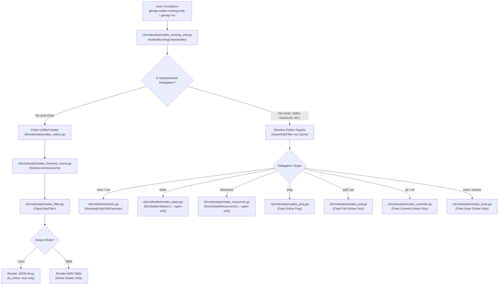
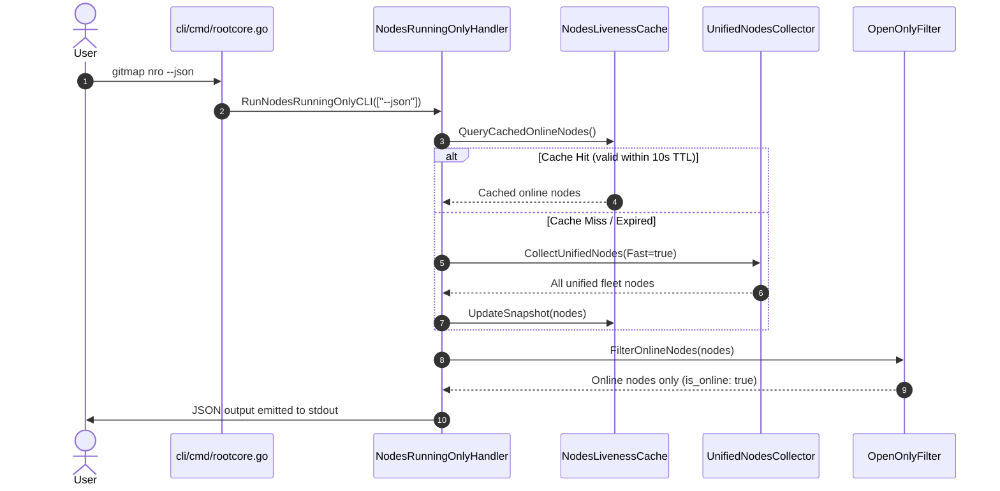
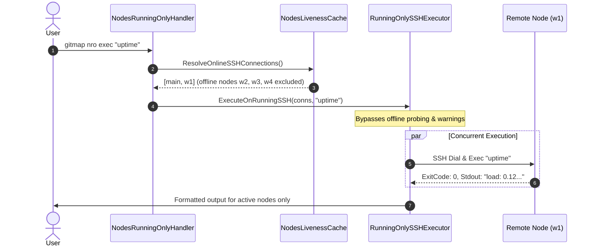

# Component Specification: GitMap Nodes Running Only

- **Slug:** `gitmap-nodes-running-only`
- **Spec Type:** Component Architecture Specification
- **Spec Path:** `02-spec/21-app/gitmap-nodes-running-only/02-component-spec.md`
- **Master Plan Reference:** `.ai-memory/plans/gitmap-nodes-running-only.md`
- **Architecture Spec Reference:** `02-spec/21-app/gitmap-nodes-running-only/01-architecture-spec.md`
- **Status:** `approved`
- **Created:** 2026-10-16

---

## 1. Executive Summary & Component Scope

This component specification details the technical architecture, data structures, caching layers, and public dispatch interfaces for `gitmap nodes-running-only` (`gitmap nro`).

Standard fleet queries (`gitmap nodes --json`) return all registered nodes across SSH, Cluster, and Server-Client topologies. This default includes nodes that are offline or timed out, incurring connection latency and noisy output when scripting or dispatching fleet operations.

The components specified herein deliver:
1. **`NodesRunningOnlyHandler`**: Centralized request dispatcher routing standalone online listing or delegating subcommands (`exec`, `tasks`, `resources`, `ping`, `pull`, `commits`, `scan`) exclusively to active machines.
2. **`NodesLivenessCache`**: Dual-tier in-memory and disk-persisted liveness cache with a 10-second Time-To-Live (TTL), eliminating recurring 1200ms TCP probe penalties across rapid CLI invocations.
3. **`OpenOnlyFilter`**: Strict positive boolean filtering engine that isolates `UnifiedFleetNode` records and `SSHConnection` targets where `IsOnline` is true.
4. **`RunningOnlySSHExecutor`**: Specialized SSH execution pipeline bypassing offline node discovery sweeps, executing directly against verified online targets with zero warning banner pollution.
5. **Data Contract Integrity**: Standardized JSON envelope schema identical to `gitmap nodes --json` but strictly guaranteed to contain only online nodes (`is_online: true`).

---

## 2. Component Topology & Interaction



---

## 3. Core Component Breakdown

### 3.1 `NodesRunningOnlyHandler`

`NodesRunningOnlyHandler` acts as the primary router and entry point for the `nodes-running-only` and `nro` command families. It parses user arguments, detects delegation requests, and routes execution.

#### Package & Location
- Package: `cmdnodes`
- Path: `cli/cmdnodes/nodes_running_only.go`

#### Responsibilities
1. Parse top-level flags: `--json` (`-j`), `--refresh` (`-r`), `--timeout <duration>`, `--verbose` (`-v`).
2. Detect whether the invocation is a node listing request or a delegated fleet action.
3. Delegate subcommands:
   - `exec` / `run`: Run shell commands exclusively on online nodes via `RunningOnlySSHExecutor`.
   - `tasks` / `queue`: Query AI task queues on online nodes via `RunNodesTasksCLI`.
   - `resources` / `res` / `top`: Probe CPU/RAM telemetry on online nodes via `RunNodesResourcesCLI`.
   - `ping` / `probe`: Ping online nodes.
   - `pull` / `pa`: Fan-out pull operations across online nodes.
   - `cp` / `cm`: Fan-out commits across online nodes.
   - `scan` / `rescan`: Trigger remote repository scanner on online nodes.
4. Fall through to `RunNodesRunningOnlyList` when no delegation verb is provided.

#### Structs & Type Definitions
```go
package cmdnodes

import (
	"time"
)

// NodesRunningOnlyOptions encapsulates invocation parameters for nro.
type NodesRunningOnlyOptions struct {
	IsJSON       bool          `json:"isJson"`
	IsRefresh    bool          `json:"isRefresh"`
	TargetFilter string        `json:"targetFilter"`
	Timeout      time.Duration `json:"timeout"`
	DelegatedCmd string        `json:"delegatedCmd"`
	ForwardArgs  []string      `json:"forwardArgs"`
}
```

#### Exported Function Signatures
```go
// RunNodesRunningOnlyCLI handles entry point dispatch for `gitmap nodes-running-only` and `gitmap nro`.
func RunNodesRunningOnlyCLI(args []string) error

// ParseNodesRunningOnlyOptions extracts flags and subcommand payloads.
func ParseNodesRunningOnlyOptions(args []string) (NodesRunningOnlyOptions, error)

// ExecuteRunningOnlyDelegation routes delegated execution verbs to specialized running-only executors.
func ExecuteRunningOnlyDelegation(opts NodesRunningOnlyOptions) error
```

---

### 3.2 `NodesLivenessCache`

To prevent repetitive 1200ms TCP probe timeouts against offline machines during consecutive CLI calls, `NodesLivenessCache` provides a cross-process caching mechanism backed by a local temp file and synchronized in-memory via `sync.RWMutex`.

#### Package & Location
- Package: `cmdnodes`
- Path: `cli/cmdnodes/nodes_liveness_cache.go`

#### Cache Invariants & Expiration Rules
- **Cache TTL**: 10 seconds (`constants.NodesLivenessCacheTTL = 10 * time.Second`).
- **Disk File**: Stored in OS temporary directory as `gitmap_nodes_liveness_cache.json`.
- **Cache Invalidation**: Bypassed if `--refresh` or `-r` is provided.
- **Fail-Safe Fallback**: If the cache file cannot be written or read, the component logs a verbose notice and falls back to live probing without aborting.

#### Structs & Type Definitions
```go
package cmdnodes

import (
	"sync"
	"time"
)

// NodeLivenessEntry stores probe status and timestamp for a specific node endpoint.
type NodeLivenessEntry struct {
	Alias       string    `json:"alias"`
	Host        string    `json:"host"`
	Port        int       `json:"port"`
	IsOnline    bool      `json:"isOnline"`
	LatencyMs   int64     `json:"latencyMs"`
	LastChecked time.Time `json:"lastChecked"`
}

// NodesLivenessSnapshot contains the serializable cache payload.
type NodesLivenessSnapshot struct {
	Version   int                          `json:"version"`
	UpdatedAt time.Time                    `json:"updatedAt"`
	Entries   map[string]NodeLivenessEntry `json:"entries"`
}

// NodesLivenessCache provides thread-safe access to liveness states.
type NodesLivenessCache struct {
	mu       sync.RWMutex
	filePath string
	snapshot NodesLivenessSnapshot
}
```

#### Function Signatures
```go
// GetLivenessCache returns the singleton cache manager.
func GetLivenessCache() *NodesLivenessCache

// QueryLiveness returns cached probe results if within TTL, or reports cache miss.
func (c *NodesLivenessCache) QueryLiveness(alias, host string, port int) (NodeLivenessEntry, bool)

// RecordLiveness saves probe outcomes in-memory and schedules async disk flush.
func (c *NodesLivenessCache) RecordLiveness(entry NodeLivenessEntry)

// FlushToDisk writes current in-memory cache to the temporary disk store.
func (c *NodesLivenessCache) FlushToDisk() error

// Invalidate forces eviction of all entries.
func (c *NodesLivenessCache) Invalidate()
```

---

### 3.3 `OpenOnlyFilter`

The `OpenOnlyFilter` component isolates verified online nodes and drops offline nodes from result slices, using positive boolean predicates conforming to project coding guidelines.

#### Package & Location
- Package: `cmdnodes`
- Path: `cli/cmdnodes/nodes_filter.go`

#### Filtering Rules
1. A node is considered "open/running" if `node.IsOnline` evaluates to true.
2. Local machine (`127.0.0.1`, `localhost`, `local`) is considered online if reachable locally.
3. String matching on `targetFilter` is applied after liveness validation.
4. Output maintains deterministic ordering: local machine first, followed by online nodes sorted by alias.

#### Structs & Function Signatures
```go
package cmdnodes

import (
	"github.com/alimtvnetwork/gitmap-v28/cli/db"
)

// FilterOnlineNodes returns a new slice containing only nodes where IsOnline is true.
func FilterOnlineNodes(nodes []UnifiedFleetNode) []UnifiedFleetNode

// FilterOnlineSSHConnections filters SSH connections against liveness cache and online states.
func FilterOnlineSSHConnections(conns []db.SSHConnection, cache *NodesLivenessCache) []db.SSHConnection

// HasOnlineNodes returns true if at least one online node is present.
func HasOnlineNodes(nodes []UnifiedFleetNode) bool
```

---

### 3.4 `RunningOnlySSHExecutor`

Standard SSH execution (`gitmap ssh exec` or `gitmap se`) runs an initial `partitionOnlineOffline` discovery step, printing yellow warning notices about offline machines and waiting for TCP probe timeouts.

`RunningOnlySSHExecutor` streamlines this by accepting pre-filtered online nodes, executing without offline warning noise, and ensuring zero delay from unreachable nodes.

#### Package & Location
- Package: `cmdssh`
- Path: `cli/cmdssh/sshexec.go` (and `cli/cmdssh/ssh_exec_running_only.go`)

#### Execution Behavior
1. Accepts pre-filtered `[]db.SSHConnection` containing only online endpoints.
2. Bypasses `partitionOnlineOffline` and `printOfflineAtStart`.
3. Dispatches workers concurrently across online nodes using worker pool bounded by `runtime.NumCPU() * 2`.
4. Emits clean output:
   - In JSON mode (`--json`): Returns array of `NodeExecResult` for active nodes only.
   - In Table/Stream mode: Prints execution headers and output streams without offline notices.

#### Structs & Function Signatures
```go
package cmdssh

import (
	"context"

	"github.com/alimtvnetwork/gitmap-v28/cli/apperror"
	"github.com/alimtvnetwork/gitmap-v28/cli/db"
)

// RunningOnlyExecOptions configures specialized running-only SSH execution.
type RunningOnlyExecOptions struct {
	IsJSON      bool
	TimeoutSec  int
	Command     string
	ForwardArgs []string
}

// ExecuteOnRunningSSH executes command string strictly on verified online SSH connections.
func ExecuteOnRunningSSH(ctx context.Context, conns []db.SSHConnection, opts RunningOnlyExecOptions) ([]NodeExecResult, *apperror.AppError)
```

---

## 4. Data Contracts & Serialization Schemas

### 4.1 `gitmap nodes-running-only --json` Contract

The JSON envelope for `gitmap nodes-running-only --json` produces a clean array conforming to the existing `UnifiedFleetNode` schema, with the strict guarantee that every entry has `"is_online": true`.

#### JSON Output Example
```json
[
  {
    "alias": "main",
    "role": "worker",
    "host": "192.168.1.20",
    "port": 22,
    "user": "administrator",
    "status": "● ready",
    "subsystems": [
      "SSH",
      "Cluster",
      "SC"
    ],
    "enrolled_at": "2026-09-29 14:38:44",
    "is_online": true
  },
  {
    "alias": "w1",
    "role": "worker",
    "host": "192.168.1.3",
    "port": 22,
    "user": "Administrator",
    "status": "● ready",
    "subsystems": [
      "SSH",
      "Cluster",
      "SC"
    ],
    "enrolled_at": "2026-09-29 14:38:44",
    "is_online": true
  }
]
```

#### JSON Field Schema Table
| Field | Type | Description | Invariant |
|---|---|---|---|
| `alias` | `string` | Machine nickname or alias in fleet catalog | Non-empty |
| `role` | `string` | Node role (`controller`, `worker`, `gateway`) | Lowercase string |
| `host` | `string` | IPv4 address or reachable hostname | Valid IP/host |
| `port` | `integer` | SSH port (typically 22) | $1 \le \text{port} \le 65535$ |
| `user` | `string` | Remote SSH login user | Non-empty |
| `status` | `string` | Visual status badge (`● ready`) | Contains `ready` |
| `subsystems` | `array[string]` | Active node capabilities | e.g. `["SSH", "Cluster", "SC"]` |
| `enrolled_at` | `string` | Timestamp when machine was registered | `YYYY-MM-DD HH:MM:SS` |
| `is_online` | `boolean` | Online liveness flag | **Strictly `true`** |

---

### 4.2 `gitmap nro tasks --json` Contract

When querying tasks on running nodes only, the output reflects only active nodes without placeholder errors for unreachable hosts.

```json
{
  "timestamp": "2026-10-16T14:50:00Z",
  "totalNodes": 2,
  "totalActive": 3,
  "totalPending": 1,
  "totalHeavyDuty": 0,
  "nodeReports": [
    {
      "nodeAlias": "local (me)",
      "nodeHost": "127.0.0.1",
      "nodePort": 0,
      "isLocal": true,
      "status": "ONLINE",
      "activeTaskCount": 2,
      "pendingTaskCount": 1,
      "heavyTaskCount": 0,
      "activeTasks": [],
      "pendingTasks": []
    },
    {
      "nodeAlias": "w1",
      "nodeHost": "192.168.1.3",
      "nodePort": 22,
      "isLocal": false,
      "status": "ONLINE",
      "activeTaskCount": 1,
      "pendingTaskCount": 0,
      "heavyTaskCount": 0,
      "activeTasks": [],
      "pendingTasks": []
    }
  ]
}
```

---

## 5. Execution Sequences

### 5.1 Listing Flow (`gitmap nro --json`)



### 5.2 Delegation Flow (`gitmap nro exec "uptime"`)



---

## 6. Error Handling & Edge Cases

| Scenario | Behavior | Error / Return Strategy |
|---|---|---|
| **All fleet nodes offline** | No online machines exist | Emits empty JSON array `[]` in JSON mode, or renders notice: `"No online fleet nodes available"` with exit code 0. |
| **Local machine only online** | All remote nodes offline | Executes or reports exclusively on local machine; remote failures omitted from output. |
| **Cache file read failure / corruption** | Temporary file corrupted or unreadable | Emits debug log, resets in-memory snapshot, and probes live nodes without throwing fatal error. |
| **Explicit `--refresh` passed** | User desires fresh probe | Invalidates cache snapshot and initiates full parallel TCP reachability probe. |
| **Unknown delegated subcommand** | e.g. `gitmap nro foo` | Displays targeted help with valid subcommands (`exec`, `tasks`, `resources`, `ping`, `pull`, `cp`, `scan`). |
| **Timeout during remote delegation** | Remote node hangs during command execution | Context timeout terminates SSH channel, records error in `NodeExecResult.Error`, and does not block other workers. |

All internal errors must be wrapped with `*appfault.AppError` or `apperror.WrapSimple` preserving error hierarchy and stack context.

---

## 7. Implementation Checklist

- [x] Design `NodesRunningOnlyHandler` dispatch table.
- [x] Specify `NodesLivenessCache` TTL and temporary file format.
- [x] Define `OpenOnlyFilter` positive boolean logic.
- [x] Detail `RunningOnlySSHExecutor` bypass mechanics.
- [x] Establish data contract parity with `gitmap nodes --json`.
