# Architecture Specification: GitMap Repository Management and Release Process

- **Feature Slug:** `gitmap-repository-management-and-release-process`
- **Module:** `cli/cmdscan`, `cli/cmdpull`, `cli/cmd`, `cli/store`, `cli/model`
- **Specification Version:** 1.0.0
- **Status:** APPROVED
- **Target Audience:** Autonomous AI Agents, Multi-Agent Workers, Lead Orchestrators, GitMap Engineers
- **Target Release:** Minor Bump

---

## 1. Executive Summary & Problem Statement

GitMap is an ultra-high-speed workspace management engine and multi-repository discovery tool. In modern software engineering workflows, developers frequently manage dozens of interdependent repositories alongside specialized companion repositories such as `repo-cache` (short key `rc`) and `repo-secrets` (short key `rs`).

When developers run commands such as `gitmap scan`, `gitmap clone`, or `gitmap pull`, two significant operational friction points have emerged:

1. **Omission of Repo-Cache in GitMap Manifests:**
   When scanning a workspace or adding new repositories via clone operations, the discovered repository list is written to `gitmap.json`. However, if the default work directory contains the companion repository `repo-cache`, its record has historically been omitted from local directory scans if the scan root was a child subdirectory or sister folder. As a consequence, subsequent distributed clones (`gitmap clone gitmap.json`) fail to restore the indispensable `repo-cache` companion repository.

2. **Inline and Raw Git Remediation Hints (Screenshot 01):**
   As demonstrated in `assets/screenshots/gitmap-repository-management-and-release-process-01.png`, when `gitmap pull` encounters dirty working trees or pull conflicts, the terminal output previously rendered remediation hints on flat inline lines containing raw git subprocess invocations:
   ```text
   Option 1 (Commit WIP): git -C "D:/work/repo-name" add -A && git -C "D:/work/repo-name" commit -m ...
   Option 2 (Stash Changes): git -C "D:/work/repo-name" stash -u && ...
   ```
   This legacy presentation violates GitMap interface standards in two ways:
   - **Visual Clutter:** Rendering commands inline makes reading long shell pipelines difficult and disrupts box-drawing alignments.
   - **Violation of GitMap Toolchain Primitives:** Emitting raw `git -C` commands bypasses GitMap's built-in, safer atomic operations (`gitmap sends cp`, `gitmap stash`, `gitmap fix`).

This specification resolves both issues by establishing:
- Automated discovery and injection of `repo-cache` into `gitmap.json` manifests backed by Split-DB queries.
- A two-tier hierarchical subtree solutions rendering engine that surfaces native GitMap remediation commands without inline clutter.

---

## 2. Visual Evidence & Interface Analysis

### 2.1 Inspection of Screenshot 01

The visual reference `assets/screenshots/gitmap-repository-management-and-release-process-01.png` captures the terminal state of `gitmap pull` when a repository exhibits uncommitted modifications:

```text
  Dirty Repositories (1):
  repository-name            dirty
    ├── Reason: dirty working tree (uncommitted changes)
    ├── Solutions:
    │   ├── Option 1 (Commit WIP): git -C "<path>" add -A && git -C "<path>" commit ...
    │   └── Option 2 (Stash Changes): git -C "<path>" stash -u && git -C "<path>" pull ...
```

### 2.2 Defects Identified
1. **Inline Command Pollution:** The solution command is tacked directly onto the option title line, causing visual overflow and poor scanability.
2. **Raw Git Subprocess Leaks:** The commands expose raw `git -C` syntax with verbose flags instead of using high-level GitMap commands.
3. **Lack of Fleet-Wide Option:** There is no single option provided to commit and synchronize all dirty repositories in one action.

### 2.3 Required Subtree Representation
The remediation output must be transformed into a distinct two-tier hierarchy:
```text
  Dirty Repositories (1):
  repository-name            dirty
    ├── Reason: dirty working tree (uncommitted changes)
    ├── Solutions:
    │   ├── Option 1 (Commit WIP):
    │   │   └── gitmap sends cp repository-name "wip: save changes"
    │   ├── Option 2 (Stash Changes):
    │   │   └── gitmap stash repository-name
    │   └── Option 3 (Fleet Multi-Repo Control):
    │       └── gitmap sends cp all "wip: save changes"
```

---

## 3. System Architecture & Topology

```mermaid
flowchart TD
    subgraph Discovery["Workspace Discovery & Split-DB Ingestion"]
        ScanCmd["gitmap scan [path]"] --> Walk["Directory Traversal Engine"]
        Walk --> FoundRecs["Discovered model.ScanRecord Slice"]
        FoundRecs --> SplitDBCheck["Query store.OpenSpecialReposSplitDB()<br/>and store.GetDefaultWorkDir()"]
        SplitDBCheck --> HasRC{"Has repo-cache in<br/>Work Directory?"}
        HasRC -- "Yes" --> Synthesize["Synthesize Companion ScanRecord<br/>(tag: companion:repo-cache)"]
        HasRC -- "No" --> WriteManifest["Write gitmap.json Manifest"]
        Synthesize --> Inject["Inject Record into Manifest Slice"]
        Inject --> WriteManifest
    end

    subgraph PullRender["Pull Diagnostics & Subtree Solutions Engine"]
        PullCmd["gitmap pull"] --> EvalState["Evaluate Repo Pull State"]
        EvalState --> IsDirty{"Is Repo Dirty or Conflicted?"}
        IsDirty -- "Yes" --> SubtreeEngine["Subtree Remediation Formatter"]
        SubtreeEngine --> Tier1["Tier 1: Render Option Nodes (├── Option N)"]
        Tier1 --> Tier2["Tier 2: Render Child GitMap Commands (│   └── gitmap ...)"]
        Tier2 --> Stdout["Terminal Output (80-col Clean Box)"]
    end
```



---

## 4. Repo-Cache Discovery and Manifest Injection Engine

### 4.1 Resolution Hierarchy via Split-DB
When GitMap scans any folder or registers newly cloned repositories, it must verify whether the companion repository `repo-cache` exists within the workspace context. The resolution follows a strict cascade:

1. **Test Hook Override:** Check `ResolveRepoCacheRootFn`. If configured, utilize the hook output.
2. **Special Repos Split-DB:** Open `store.OpenSpecialReposSplitDB()`. Query the `SpecialRepository` table where `RepoKey = 'repo-cache'` or `ShortKey = 'rc'`.
   - If `LocalPath` is populated and exists on disk, use `LocalPath`.
3. **Default Work Directory:** Query `store.OpenDefault().GetDefaultWorkDir()`.
   - If configured, inspect `filepath.Join(workDir.AbsolutePath, "repo-cache")`.
4. **Fallback Inspection:** Check standard workspace roots (`./repo-cache` or `<parent>/repo-cache`).

### 4.2 Companion ScanRecord Synthesis
When `repo-cache` is located on disk, the injection pipeline synthesizes a `model.ScanRecord` populated as follows:

```go
type RepoCacheSynthesisParams struct {
    RootPath       string
    RelativePath   string
    RemoteURL      string
    DefaultBranch  string
    HasGitFolder   bool
    IsCompanion    bool
}
```

Field population rules:
- `Name`: `"repo-cache"`
- `Path`: Normalized relative path from current working directory or absolute fallback
- `RemoteURL`: Read from `git config --get remote.origin.url` inside `repo-cache`, or retrieved from Split-DB `SpecialRepository.RemoteURL`
- `Branch`: Active branch (typically `"main"` or `"master"`)
- `Tags`: `[]string{"companion:repo-cache", "special:rc", "cache"}`
- `IsClean`: Evaluated via status check
- `Description`: `"GitMap companion repository for cache and discovery manifests"`

### 4.3 Deduplication Invariant
Before appending the synthesized record into `records []model.ScanRecord`:
1. Check if any existing record in `records` has `Name == "repo-cache"` or matching filesystem path.
2. If already present, update remote URL and branch metadata without duplicating the entry.
3. If absent, append the synthesized record to the manifest slice.
4. Serialize to `gitmap.json` using atomic write patterns.

---

## 5. Two-Tier Hierarchical Subtree Formatting Engine

### 5.1 Hierarchical Tree Connector Mathematics

The tree rendering engine structures remediation output into two visual levels:
- **Tier 1 (Option Node):** Represents the category and strategy description.
- **Tier 2 (Solution Command Node):** Represents the concrete, executable GitMap command.

Let $N$ be the total count of remediation options, and let $i \in \{0, \dots, N-1\}$ be the zero-based index of the current option.

#### Connector Grammar:
1. **Tier 1 Prefix (Option Branch):**
   - For intermediate options ($i < N - 1$):
     `"    ├── Option %d (%s):"`
   - For the terminal option ($i = N - 1$):
     `"    └── Option %d (%s):"`

2. **Tier 2 Prefix (Solution Leaf):**
   - Under an intermediate option ($i < N - 1$):
     `"    │   └── %s"`
   - Under the terminal option ($i = N - 1$):
     `"        └── %s"`

### 5.2 Native GitMap Command Mapping

Raw git commands are entirely eradicated. The rendering engine maps diagnostic states directly to native GitMap CLI primitives:

| Diagnostic State | Option Number & Label | Native GitMap Command |
|---|---|---|
| **Dirty Working Tree** | Option 1 (Commit WIP) | `gitmap sends cp <target> "wip: save changes"` |
| **Dirty Working Tree** | Option 2 (Stash Changes) | `gitmap stash <target>` |
| **Dirty Working Tree** | Option 3 (Fleet Multi-Repo Control) | `gitmap sends cp all "wip: save changes"` |
| **Untracked Files** | Option 1 (Track & Stage) | `gitmap fix <target> wip` |
| **Untracked Files** | Option 2 (Clean Workspace) | `gitmap fix <target> clean` |
| **Merge Conflict** | Option 1 (Stash & Abort) | `gitmap fix <target> stash` |
| **Merge Conflict** | Option 2 (Discard & Re-pull) | `gitmap fix <target> discard` |
| **Diverged Branches** | Option 1 (Rebase & Pull) | `gitmap pull <target>` |
| **Diverged Branches** | Option 2 (Hard Reset to Upstream) | `gitmap fix <target>` |
| **Missing Repository** | Option 1 (Clone from Upstream) | `gitmap clone <target>` |
| **Missing Repository** | Option 2 (Remove from Registry) | `gitmap rm --db-only <target>` |
| **Auth / SSH Failure** | Option 1 (Fix Credentials) | `gitmap fix-credential` |
| **Auth / SSH Failure** | Option 2 (Deploy SSH Keys) | `gitmap ssh deploy-keys` |

---

## 6. Component Contracts & Data Structures

### 6.1 Subtree Rendering Structs (`cli/cmdpull/pull_efficient_render.go`)

```go
type RemediationOption struct {
    OptionNumber int
    Title        string
    Command      string
    IsTerminal   bool
}

type RemediationHierarchy struct {
    RepoName    string
    Reason      string
    Options     []RemediationOption
    HasFleetCmd bool
}
```

### 6.2 Render Execution Flow
1. `ResolveStructuredRemediation(state *PullRepoState)` inspects the failure reason and repo name.
2. Instantiates `RemediationHierarchy` populated with native GitMap commands.
3. Emits `Reason` line with branch connector `├── Reason: ...`.
4. Emits `Solutions:` header with branch connector `├── Solutions:`.
5. Iterates through `Options`, applying connector grammar based on `IsTerminal`.

---

## 7. Quality Gates & Non-Negotiable Invariants

1. **Strict Relative Git Paths:** All documentation, logs, error hints, and manifests MUST use relative paths (`02-spec/...`, `.ai-memory/...`, `cli/...`). Total ban on absolute filesystem paths and file scheme URIs.
2. **Affirmative Booleans Only:** Struct fields and variables MUST exclusively use positive prefixes (`is`, `has`). Negative boolean constructs are strictly banned.
3. **Line and Function Limits:** Implementation files must not exceed 300 lines; functions must not exceed 15 lines.
4. **Eradication of Raw Git Commands:** No user-facing remediation hint may emit `git -C` or direct raw git subprocess strings.
5. **Zero Builds and Tests in Spec Authoring:** Spec authoring must not trigger builds or tests.
