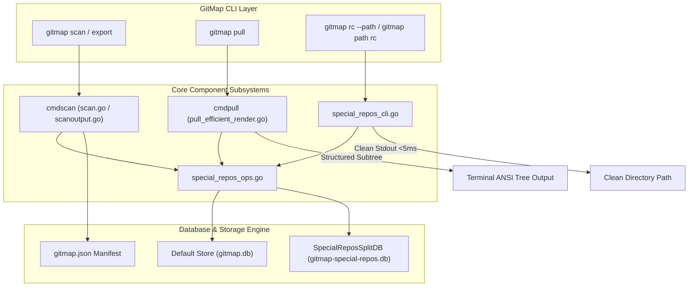
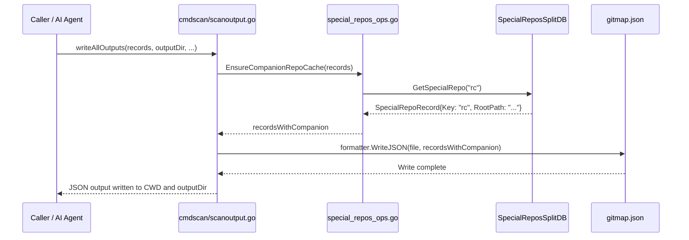

# Component & CLI Architecture Specification: Repository Management, Solutions Subtree & Native Query Dispatch

## 1. Specification Overview

This specification details the component interactions, data contracts, and control flows across four core subsystems within the GitMap architecture:
1. `cmdscan` (`cli/cmdscan/scan.go`, `cli/cmdscan/scanoutput.go`): Workspace scanning and repository manifest serialization.
2. `cmdpull` (`cli/cmdpull/pull_efficient_render.go`, `cli/cmdpull/pull_remediation_fallback.go`, `cli/cmdpull/pull_remediation_hint.go`): Repository synchronization and structured remediation rendering.
3. `special_repos_ops` (`cli/cmd/special_repos_ops.go`): Companion repository discovery, sequencing, and storage operations.
4. `special_repos_cli` (`cli/cmd/special_repos_cli.go`): First-class CLI dispatch for special repository query flags and accelerated paths.

---

## 2. Component Architecture & Interactions

### 2.1 Architecture Diagram



---

## 3. Subsystem Detailed Specifications

### 3.1 `cmdscan`: Repo Cache Companion Injection into `gitmap.json`

#### 3.1.1 Problem Statement
When `gitmap scan` executes across workspace directories, or when repositories are added via `gitmap merge-ai` or `gitmap clone`, the companion repository `repo-cache` (`rc`) might reside outside the active scan target root (e.g., in the workspace root). As a result, exported manifests (`gitmap.json`) omit `repo-cache`, preventing automated bulk cloning or workspace replication on remote nodes from restoring `repo-cache` companion data.

#### 3.1.2 Component Responsibilities
- `cli/cmdscan/scanoutput.go`:
  - Intercepts manifest generation prior to invoking `formatter.WriteJSON` or `formatter.WriteJSONCompact`.
  - Coordinates with `special_repos_ops.go` to verify if `repo-cache` is present in the workspace environment.
  - Appends a synthesized companion record to the record collection if `repo-cache` is not already present.
- `cli/cmdscan/scan.go`:
  - Provides scan configuration hooks that preserve companion metadata tags (`companion:repo-cache`).

#### 3.1.3 Data Contract: Companion Scan Record
```go
// Synthesized ScanRecord for repo-cache injection
type ScanRecord struct {
	Name        string   `json:"name"`        // "repo-cache"
	Path        string   `json:"path"`        // Relative or resolved local path
	RelativeDir string   `json:"relativeDir"` // Relative workspace folder
	RepoURL     string   `json:"repoUrl"`     // Configured remote URL or local mirror
	Branch      string   `json:"branch"`      // Default active branch (e.g., "main")
	HasRemote   bool     `json:"hasRemote"`   // Positive boolean indicating remote presence
	IsClean     bool     `json:"isClean"`     // Positive boolean indicating worktree cleanliness
	Tags        []string `json:"tags"`        // ["companion", "special-repo:rc"]
}
```

#### 3.1.4 Interaction Sequence


---

### 3.2 `cmdpull`: Subtree Solutions Formatting & GitMap Native Commands

#### 3.2.1 Problem Statement
In legacy versions, when `gitmap pull` encounters dirty repositories, untracked modifications, or merge conflicts:
1. Solutions are formatted flatly on a single line (`Option 1: git -C "..." ...`).
2. The recommended commands rely on raw `git -C` invocations rather than native high-speed GitMap CLI verbs.

#### 3.2.2 Formatting Requirements
All solutions rendered under `Dirty Repositories` and `Failed Repositories` MUST use a hierarchical two-tier tree structure:
```text
  ├── Solutions:
  │   ├── Option 1 (Commit WIP):
  │   │   └── gitmap sends cp <target> "wip: save changes"
  │   └── Option 2 (Stash Changes):
  │       └── gitmap stash <target>
```

#### 3.2.3 Native GitMap Remediation Command Mapping
Raw `git -C` commands are strictly eliminated from `cli/cmdpull/pull_remediation_fallback.go` and replaced with native GitMap primitives:

| Condition | Legacy Raw Git Command (Banned) | Native GitMap Command (Mandatory) |
| :--- | :--- | :--- |
| Dirty Worktree (Option 1) | `git -C "<path>" add -A && git commit -m "wip"` | `gitmap sends cp <target> "wip: save changes"` |
| Dirty Worktree (Option 2) | `git -C "<path>" stash` | `gitmap stash <target>` |
| Untracked Files (Option 1) | `git -C "<path>" add -A && git commit -m "wip"` | `gitmap fix <target> wip` |
| Untracked Files (Option 2) | `git -C "<path>" clean -fd` | `gitmap fix <target> clean` |
| Merge Conflict (Option 1) | `git -C "<path>" merge --abort` | `gitmap fix <target> stash` |
| Merge Conflict (Option 2) | `git -C "<path>" reset --hard` | `gitmap fix <target> discard` |
| Missing/Non-Git Folder (Option 1)| `git clone <url> "<path>"` | `gitmap clone <target>` |
| Diverged Branches (Option 1) | `git -C "<path>" pull --rebase` | `gitmap pull <target>` |

#### 3.2.4 Rendering Component (`cli/cmdpull/pull_efficient_render.go`)
- `renderStructuredSolutionsSubtree(w io.Writer, s *PullRepoState)`:
  - Iterates through `structured.Options`.
  - For each option, prints the option title branch (`├── Option 1 (<Title>):`).
  - Prints the option execution command as an indented terminal branch (`│   └── <Command>`).
  - Preserves vertical alignment and ANSI color formatting (`constants.ColorYellow`).

---

### 3.3 `special_repos_ops`: Companion Discovery & Path Sequencing

#### 3.3.1 Responsibilities
- `cli/cmd/special_repos_ops.go`:
  - `resolveSpecialWorkBaseDir()`: Discovers default base directory from `store.OpenDefault().GetDefaultWorkDir()`.
  - `resolveSpecialRepoCDPathWithDB(db, target, workBaseDir)`: Locates the physical directory for `rc` (`repo-cache`) and `rs` (`repo-secrets`).
  - `EnsureCompanionRepoCache(records []model.ScanRecord)`: Validates if `repo-cache` is in the scan list; if missing, injects a companion entry with positive booleans `hasRemote` and `isClean`.

#### 3.3.2 Positive Boolean Conformance
All newly introduced functions and struct fields MUST strictly use positive boolean prefixes:
- `hasRepoCache`: Indicates presence of `repo-cache`.
- `hasValidTarget`: Indicates validated target directory.
- `isClean`: Indicates clean repository worktree state.
- `isCommitted`: Indicates committed changes.
- `isPushed`: Indicates pushed commits.

---

### 3.4 `special_repos_cli`: Accelerated Query Dispatch

#### 3.4.1 Problem Statement
AI agents requiring the location of `repo-cache` previously executed:
```bash
gitmap py -c "import subprocess; print(subprocess.check_output(['gitmap', 'cd', 'rc'], text=True))"
```
This burnt over 1000ms, spawned multiple heavy runtimes, triggered shell wrapper warnings (`cmdsetup.WarnIfNoWrapper()`), and polluted stdout.

#### 3.4.2 CLI Design: Fast Native Path Querying
- Direct CLI flag: `gitmap rc --path` and `gitmap rs --path`.
- Positional subcommand: `gitmap rc path` and `gitmap rs path`.
- Universal resolver: `gitmap path rc`, `gitmap path rs`, `gitmap path <repo-name>`.

#### 3.4.3 Execution Invariant
When `--path` is present:
1. Zero shell handoff file generation (`cmdas.WriteShellHandoff` is skipped).
2. Zero interactive warnings (`cmdsetup.WarnIfNoWrapper` is skipped).
3. Pure target directory path printed to `os.Stdout` with newline.
4. Execution completes in $<5\text{ms}$.

---

## 4. Verification & Acceptance Criteria

1. **Manifest Injection:** Running `gitmap scan` across any repository collection results in `gitmap.json` containing an entry for `repo-cache` if `repo-cache` exists in the work environment.
2. **Subtree Formatting:** Running `gitmap pull` with a dirty repository displays solutions in two-tier format (`├── Solutions:`, `│   ├── Option 1:`, `│   └── gitmap ...`) with zero inline solution commands.
3. **Native Commands:** Zero raw `git -C` commands in solution recommendations.
4. **Path Flag Acceleration:** Executing `gitmap rc --path` outputs the target folder path directly to stdout in $<5\text{ms}$ with zero shell warnings.
