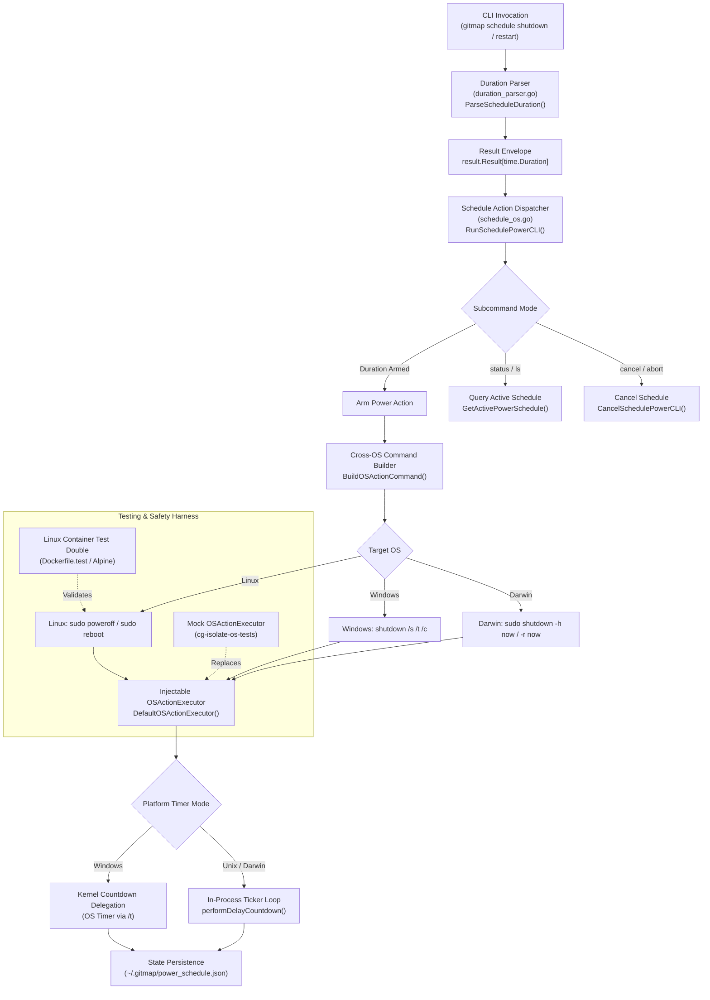
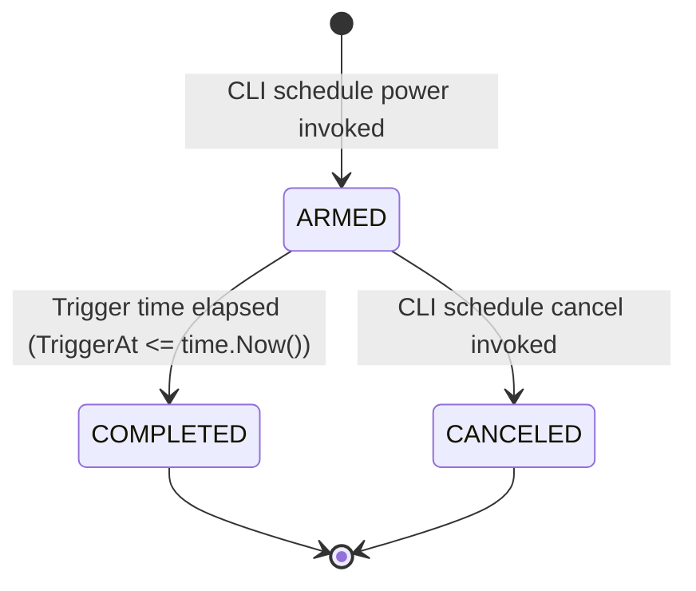

# Cross-OS Power Scheduling Architecture & Systems Overview

## 1. Executive Summary

GitMap provides robust cross-platform system power scheduling capabilities via the `gitmap schedule` command family. Users can schedule automated machine shutdowns or reboots across Windows, Linux, and macOS (Darwin) environments with flexible human-friendly duration specifications (e.g., `1:45hr`, `2h`, `120m`, `1day`).

Because system-level power actions (`shutdown`, `reboot`, `poweroff`) interact directly with the host operating system kernel and system daemons, cross-platform execution requires dedicated OS command abstractions, hybrid countdown mechanisms (kernel countdown on Windows vs in-process countdown on Unix), injectable test doubles to prevent accidental host interruptions, and containerized verification via Docker.

This specification details the end-to-end architecture, OS execution contracts, timer lifecycle, safety invariants, and containerized test harnesses.

---

## 2. System Architecture Topology

The scheduling subsystem is organized into discrete, modular layers within `cli/cmdschedule`:



---

## 3. Cross-OS Command Topology

Different operating systems expose divergent power management binaries, syntax flags, privilege models, and cancellation protocols. GitMap normalizes these into standard `OSActionType` contracts (`OSActionShutdown`, `OSActionRestart`, `OSActionCancel`).

| Target OS | Shutdown Command | Restart Command | Abort / Cancel Command | Elevation Requirement |
|---|---|---|---|---|
| **Windows** | `shutdown /s /t <sec> /c <msg>` | `shutdown /r /t <sec> /c <msg>` | `shutdown /a` | Standard / Elevated shell |
| **Linux** | `sudo poweroff` | `sudo reboot` | `shutdown -c` | Sudo / Wheel privileges |
| **Darwin (macOS)** | `sudo shutdown -h now` | `sudo shutdown -r now` | `shutdown -c` | Sudo / Admin privileges |

### 3.1 Windows Command Mechanics
- **Executable**: `shutdown.exe` (invoked as `shutdown`).
- **Shutdown Flag**: `/s` designates full machine poweroff.
- **Restart Flag**: `/r` designates operating system reboot.
- **Delay Flag**: `/t <seconds>` instructs the Windows Kernel RPC service to manage the countdown asynchronously.
- **Comment Flag**: `/c "<message>"` embeds a system notification broadcasted to desktop users.
- **Abort Flag**: `/a` terminates any pending scheduled shutdown across the Windows subsystem.

### 3.2 Linux Command Mechanics
- **Executable**: `sudo` invoking `poweroff` or `reboot`.
- **Systemd Integration**: Modern Linux distributions running systemd route `poweroff` and `reboot` via `systemctl`. Immediate commands cleanly transition all systemd services through target shutdown sequence.
- **Alternative Unix Fallback**: In environments where direct binary dispatch is preferred, `shutdown -h +<m>` or `shutdown -r +<m>` can be utilized; however, `sudo poweroff` and `sudo reboot` triggered after an in-process delay ensure deterministic sub-second resolution and uniform process lifecycle control.

### 3.3 Darwin (macOS) Command Mechanics
- **Executable**: `sudo` invoking `/sbin/shutdown`.
- **Halt Flag**: `-h now` performs clean Unix daemon termination and turns off machine power.
- **Reboot Flag**: `-r now` initiates macOS kernel reboot.
- **Cancellation**: `shutdown -c` cancels pending legacy BSD shutdown notices.

---

## 4. In-Process vs. Kernel Countdown Mechanics

A key architectural divergence across operating systems is how countdown delays are executed:

### 4.1 Kernel Countdown Delegation (Windows)
1. On Windows, the operating system kernel features a built-in countdown service.
2. Passing `/t <seconds>` offloads the countdown to the OS kernel.
3. The host displays a native system notification banner (e.g., "Windows will shut down in 10 minutes").
4. GitMap process execution completes immediately after dispatching the command, avoiding the need to keep a long-running CLI process open in the background.
5. In `cli/cmdschedule/schedule_os.go`, `performDelayCountdown` immediately skips delay execution when `runtime.GOOS == "windows"`.

### 4.2 In-Process Countdown Execution (Linux & Darwin)
1. On Unix-like operating systems, system power utilities often require root privileges (`sudo`) and may lack granular sub-second countdown UI handlers.
2. GitMap manages the countdown loop in-process via `performDelayCountdown()`.
3. The process maintains a dynamic countdown loop with step resolution (`time.Second` intervals), invoking the optional `OnTick(remaining)` callback to drive terminal progress renderers.
4. Once the configured delay expires, `DefaultOSActionExecutor` invokes the native power binary (`sudo poweroff` or `sudo shutdown -h now`).
5. If the user invokes `gitmap schedule shutdown cancel` in another session, GitMap marks the state file as `CANCELED`.

---

## 5. Flexible Duration Parsing Architecture

Duration strings are resolved through `ParseScheduleDuration(raw string)` in `cli/cmdschedule/duration_parser.go`. The parser implements a cascading multi-pattern regex engine returning a monadic `DurationResult` (`result.Result[time.Duration]`).

### 5.1 Supported Duration Formats

| Format Pattern | Sample Input | Parsed Duration | Conversion Logic |
|---|---|---|---|
| **Immediate / Zero** | `now`, `0`, `0s`, `""` | `0s` | Returns zero duration instantly |
| **Colon Notation (HMS)** | `01:45:00` | `1h 45m 0s` | `hours * 3600 + mins * 60 + secs` |
| **Colon Notation (HM)** | `1:45hr`, `1:45h` | `1h 45m 0s` | `hours * 3600 + mins * 60` |
| **Colon Notation (MS)** | `2:30m` | `2m 30s` | Minutes and seconds calculation |
| **Day Multiplier** | `1day`, `1d`, `2days` | `24h`, `48h` | Floating point parsed days $\times 24\text{h}$ |
| **Hour Multiplier** | `2h`, `1.5hours`, `2hr` | `2h`, `1h 30m` | Value $\times 3600\text{s}$ |
| **Minute Multiplier** | `120m`, `30mins`, `45m`| `2h`, `30m`, `45m` | Value $\times 60\text{s}$ |
| **Second Multiplier** | `90s`, `300sec`, `10s` | `90s`, `5m`, `10s` | Direct integer or float seconds |
| **Raw Numeric Seconds**| `3600` | `1h` | Direct base-10 integer parsing |

### 5.2 Error Containment
- If an unrecognized string is provided (e.g., `invalid-timer`), the parser produces an `apperror.AppError` with code `E_INVALID_DURATION`, category `apperror.ErrorTypeValidation`, and severity `SeverityError`.
- No raw panics or uncaught exceptions are thrown.

---

## 6. Safety Invariants & Test Double Isolation

A core mandate of `cg-isolate-os-tests` is that automated test suites must **never** trigger real machine reboots or power interruptions on the host development machine.

### 6.1 Injectable Executor Contract
```go
type OSActionExecutor func(params OSActionParams) error
var DefaultOSActionExecutor OSActionExecutor = executeNativeOSAction
```

- In production, `DefaultOSActionExecutor` calls `executeNativeOSAction()`, which invokes `exec.Command()`.
- In unit and integration test suites, tests replace `DefaultOSActionExecutor` with a mock function (`setupMockExecutor()`) that records parameters without issuing OS syscalls.
- `defer cleanup()` restores the original executor when the test completes.

### 6.2 Test Verification Guarantees
- Tests assert that `Action`, `Delay`, `Seconds`, `Executable`, and `Args` match expected platform outputs.
- Tests exercise Windows, Linux, and Darwin command constructors independently of the host's actual `runtime.GOOS`.

---

## 7. Containerized Verification via Docker

To verify GitMap's Linux behavior when running on a Windows or macOS development machine, GitMap provides an automated Linux testing container harness:

### 7.1 Docker Testing Strategy
- **Base Image**: `golang:1.24-alpine` provides an ultra-lightweight, CGO-free Linux kernel environment.
- **Verification Targets**:
  1. Compiles the GitMap binary natively under Alpine Linux.
  2. Runs test suites with mock executors validating Linux power action paths.
  3. Verifies that `poweroff`, `reboot`, and `shutdown` commands generate appropriate Unix arguments.
  4. Validates that state persistence writes to standard Unix paths (`~/.gitmap/power_schedule.json`).
- **Cross-Compilation Fallback**: When Docker daemon is not active on the host machine, CI and developers run:
  ```bash
  GOOS=linux GOARCH=amd64 CGO_ENABLED=0 go test -run=^$ ./cli/cmdschedule/...
  ```
  This validates pure-Go multi-platform compilation without requiring container runtime dependencies.

---

## 8. Persistence & State Machine Lifecycle

Power schedules are tracked on disk to allow querying (`gitmap schedule shutdown status`) and cancellation (`gitmap schedule shutdown cancel`) across distinct terminal sessions.



- **State File Location**: `~/.gitmap/power_schedule.json` (or temporary directory if home directory is unavailable).
- **Test Override**: Unit tests isolate state mutation using `stateFileOverride` within temporary directories (`t.TempDir()`).
- **Human Formatter**: `FormatRemainingDuration(target time.Time)` calculates hours, minutes, and seconds until trigger for clean terminal feedback.
