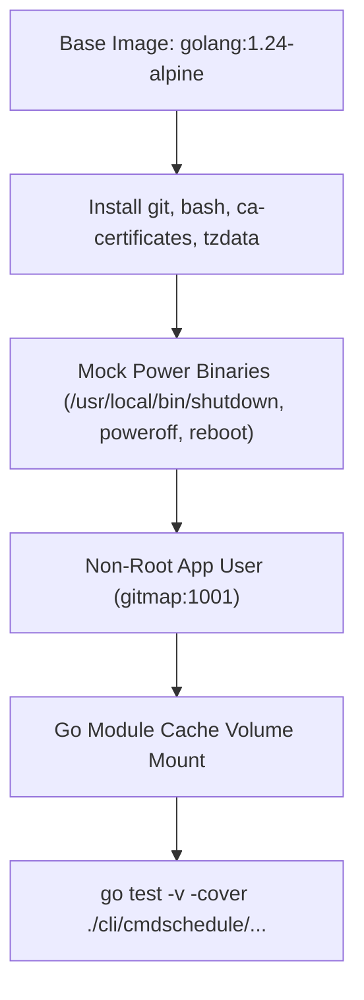
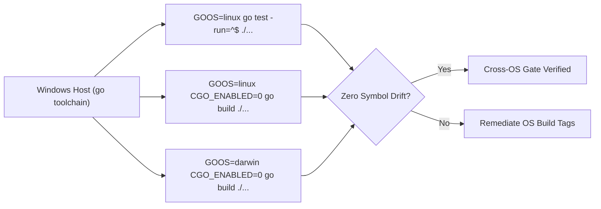

# Docker & Linux Container Testing Strategy

**Specification File:** `02-spec/21-app/gitmap-testing-and-schedule-management/03-docker-and-linux-container-strategy.md`  
**Parent Plan:** `.ai-memory/plans/gitmap-testing-and-schedule-management.md`  
**Status:** RATIFIED  
**Target Subsystems:** `cli/cmdschedule`, `Dockerfile.test`, `.github/workflows`

---

## 1. Executive Summary & Host Discovery Findings

GitMap power scheduling and fleet operations require verified cross-platform compatibility across Windows, Linux, and macOS. During preflight inspection of the active development workstation, host capability probing yielded the following findings:

| Component | Status | Empirical Finding & Impact |
|---|---|---|
| **Docker CLI / Daemon** | NOT INSTALLED | `docker` executable is absent from the host `PATH`. Native container execution cannot run directly on the local host. |
| **WSL (Windows Subsystem for Linux)** | UNCONFIGURED | `wsl.exe` exists in `System32`, but zero Linux distributions are installed (`wsl -l -v` exits with code 1). |
| **Go Toolchain** | AVAILABLE | Go toolchain (`windows/amd64`) supports pure Go cross-compilation (`GOOS=linux`, `GOOS=darwin`). |

### Architectural Dual-Track Solution
To guarantee full Linux verification without blocking on host software installations, GitMap adopts a rigorous two-part strategy:

1. **Host-Side Pure Go Cross-Compilation Gate:** Enforce compile-time verification across all targets (`GOOS=linux`, `GOOS=darwin`) using `GOOS=linux go test -run=^$ ./...` and `GOOS=linux go build ./...` directly on the host.
2. **Hermetic `Dockerfile.test` Specification:** Author an ultra-lightweight, standardized test harness targeting `golang:1.24-alpine` for deterministic containerized execution in CI/CD pipelines (GitHub Actions) or workstations where Docker/Podman is provisioned.

---

## 2. Container Architecture & `Dockerfile.test` Specification

The container testing harness isolates all OS interactions, installs necessary toolchain dependencies, and provides mock system binaries so power scheduling tests execute hermetically.



### 2.1 Specification Contract: `Dockerfile.test`

```dockerfile
# GitMap Linux Container Testing Harness
FROM golang:1.24-alpine AS test-runner

# Install minimal toolchain dependencies
RUN apk add --no-cache git bash ca-certificates tzdata

# Create mock power management binaries to ensure tests never fail on missing OS tools
RUN echo '#!/bin/sh\necho "MOCK_SHUTDOWN: $*"' > /usr/local/bin/shutdown && \
    echo '#!/bin/sh\necho "MOCK_POWEROFF: $*"' > /usr/local/bin/poweroff && \
    echo '#!/bin/sh\necho "MOCK_REBOOT: $*"' > /usr/local/bin/reboot && \
    chmod +x /usr/local/bin/shutdown /usr/local/bin/poweroff /usr/local/bin/reboot

# Configure unprivileged execution user
RUN addgroup -g 1001 -S gitmap && adduser -u 1001 -S gitmap -G gitmap

WORKDIR /workspace

# Pre-copy go module definitions for layer caching
COPY go.mod go.sum ./
RUN go mod download

# Copy source tree
COPY . .

# Run test suite under non-root user
USER gitmap
ENV CGO_ENABLED=0
ENV CI=true

ENTRYPOINT ["go", "test", "-v", "./cli/cmdschedule/..."]
```

### 2.2 Container Execution Model

When executed in a container runtime (local Docker or CI/CD container runner):
- **CGO_ENABLED=0:** Enforces pure Go compilation with modernc.org/sqlite, avoiding GCC/musl C dependencies.
- **Mock Binary Interception:** Even if a test inadvertently invokes the shell runner rather than the mock executor, the dummy `/usr/local/bin/*` scripts safely intercept calls and log arguments to stdout without system impact.
- **Rootless Security:** Execution as unprivileged user `1001` ensures container tests cannot alter root-level container configuration.

---

## 3. Pure Go Linux Cross-Compilation Strategy

Cross-compilation is GitMap's primary local verification mechanism when container runtimes are unavailable.



### 3.1 Verification Commands

1. **Linux Package Test Symbol Check:**
   ```bash
   GOOS=linux GOARCH=amd64 CGO_ENABLED=0 go test -run=^$ ./cli/cmdschedule/...
   ```
   *Validates that Linux-specific types, function calls, and build tags in `cmdschedule` compile without running tests.*

2. **Full Repository Linux Cross-Build:**
   ```bash
   GOOS=linux GOARCH=amd64 CGO_ENABLED=0 go build -o /dev/null ./...
   ```
   *Guarantees zero Windows-specific filepath separators, syscalls, or registry dependencies leak into root binaries.*

3. **Darwin (macOS) Cross-Build:**
   ```bash
   GOOS=darwin GOARCH=amd64 CGO_ENABLED=0 go build -o /dev/null ./...
   ```
   *Validates macOS BSD command path compatibility (`sudo shutdown -h now`).*

---

## 4. Cross-OS Power Scheduling Behavioral Matrix

GitMap adapts its power scheduling mechanics based on target operating system topology:

| Operating System | Scheduled Action | Emitted Command & Arguments | Cancellation Command |
|---|---|---|---|
| **Windows** | Shutdown | `shutdown /s /t <sec> /c "GitMap scheduled shutdown"` | `shutdown /a` |
| **Windows** | Restart | `shutdown /r /t <sec> /c "GitMap scheduled restart"` | `shutdown /a` |
| **Linux (Systemd / SysV)** | Shutdown | `sudo poweroff` (after internal countdown delay) | `shutdown -c` |
| **Linux (Systemd / SysV)** | Restart | `sudo reboot` (after internal countdown delay) | `shutdown -c` |
| **Darwin (macOS)** | Shutdown | `sudo shutdown -h now` (after countdown delay) | `sudo killall shutdown` |
| **Darwin (macOS)** | Restart | `sudo shutdown -r now` (after countdown delay) | `sudo killall shutdown` |
| **Container / Headless** | Any | Intercepted by `OSActionExecutor` mock | In-memory cancellation |

### 4.1 Native Windows vs Unix Countdown Differences
- **Windows:** Native `shutdown.exe` accepts `/t <seconds>`, delegating the countdown loop to the Windows kernel.
- **Linux & Darwin:** Commands like `poweroff` or `shutdown now` take immediate effect. GitMap's `cmdschedule` executes an internal ticker (`performDelayCountdown`) before calling the native binary, ensuring users can cancel via `gitmap schedule shutdown cancel`.

---

## 5. CI/CD Workflow Integration (`docker-test.yml`)

The container test specification maps to automated GitHub Actions jobs:

```yaml
name: Cross-OS & Container Test Gate
on: [push, pull_request]

jobs:
  container-test:
    name: Linux Container Harness
    runs-on: ubuntu-latest
    steps:
      - name: Checkout Code
        uses: actions/checkout@v4

      - name: Build and Run Dockerfile.test
        run: |
          docker build -t gitmap-test -f Dockerfile.test .
          docker run --rm gitmap-test

  cross-compile:
    name: Cross-Compilation Verification
    runs-on: ubuntu-latest
    steps:
      - name: Setup Go
        uses: actions/setup-go@v5
        with:
          go-version: '1.24'

      - name: Test Linux Cross-Compilation
        run: |
          GOOS=linux CGO_ENABLED=0 go test -run=^$ ./...
          GOOS=darwin CGO_ENABLED=0 go test -run=^$ ./...
```

---

## 6. Verification & Quality Gates

- **Gate C1 (Zero Docker Dependency on Host):** Tests and local verification suites must succeed when Docker is absent.
- **Gate C2 (Hermetic Dockerfile.test Portability):** The test Dockerfile contains zero host-specific paths or secrets.
- **Gate C3 (Linux Compilation Parity):** All packages in `./cli/...` compile cleanly under `GOOS=linux`.
- **Gate C4 (Relative Path Compliance):** All path definitions use standard forward-slash relative Git paths.
