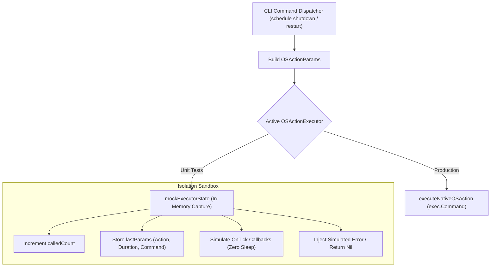
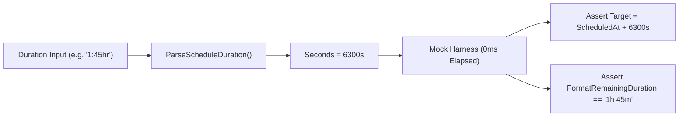

# Safety & OS Test Isolation Specification

**Specification File:** `02-spec/21-app/gitmap-testing-and-schedule-management/04-safety-and-os-test-isolation.md`  
**Parent Plan:** `.ai-memory/plans/gitmap-testing-and-schedule-management.md`  
**Standard Reference:** `.agents/skills/cg-isolate-os-tests/skill.md`  
**Status:** RATIFIED  
**Target Subsystems:** `cli/cmdschedule/schedule_os*.go`, `cli/cmdschedule/schedule_power_state*.go`

---

## 1. Safety Mandate & Destructive Command Ban

Automated test execution across polyglot test runners, CI/CD pipelines, and local developer workstations must **never** execute real operating system power commands, package upgrades, or filesystem destructions.

### 1.1 Prohibited System Invocations in Tests

The following commands and binaries are strictly banned from direct execution in unit or integration tests:

```text
PROHIBITED INVOCATIONS:
- Windows: shutdown.exe (/s, /r, /a, /p, /h, /hybrid, /t)
- Linux:   poweroff, reboot, halt, shutdown, init 0, init 6
- Systemd: systemctl poweroff, systemctl reboot, systemctl halt
- Darwin:  shutdown (-h, -r, now), osascript -e 'tell app "System Events" to restart'
```

Any test executing or attempting to execute the unmocked host binary constitutes a **P0 critical failure**.

---

## 2. Injectable OSActionExecutor Architecture

To satisfy strict test isolation, `cli/cmdschedule` models OS power operations through an injectable functional interface (`OSActionExecutor`):



### 2.1 Interface Definition & Param Structure

```go
// OSActionType identifies the target power state operation.
type OSActionType string

const (
    OSActionShutdown OSActionType = "shutdown"
    OSActionRestart  OSActionType = "restart"
    OSActionCancel   OSActionType = "cancel"
)

// OSActionParams bundles execution parameters for isolation.
type OSActionParams struct {
    Action     OSActionType
    Delay      time.Duration
    Seconds    int64
    Executable string
    Args       []string
    OnTick     func(remaining time.Duration)
}

// OSActionExecutor defines the injectable function signature.
type OSActionExecutor func(params OSActionParams) error

// DefaultOSActionExecutor points to native execution in production.
var DefaultOSActionExecutor OSActionExecutor = executeNativeOSAction
```

---

## 3. Hermetic Mock Testing Pattern

Every unit test exercising `RunSchedulePowerCLI` or power state mutation must use the standard mock setup and teardown fixture:

```go
type mockExecutorState struct {
    calledCount int
    lastParams  OSActionParams
    returnErr   error
}

func (m *mockExecutorState) execute(params OSActionParams) error {
    m.calledCount++
    m.lastParams = params
    return m.returnErr
}

func setupMockExecutor() (*mockExecutorState, func()) {
    mock := &mockExecutorState{}
    orig := DefaultOSActionExecutor
    DefaultOSActionExecutor = mock.execute
    return mock, func() { DefaultOSActionExecutor = orig }
}
```

### 3.1 Invariant Rules for Test Authors
1. **Always `defer cleanup()` immediately:** Guarantees `DefaultOSActionExecutor` is restored even if tests panic or fail assertions.
2. **Assert call counts:** Validate that `mock.calledCount == 1` for valid runs, and `mock.calledCount == 0` for validation rejections or `--help` requests.
3. **Assert parameter fidelity:** Validate that `mock.lastParams.Action`, `mock.lastParams.Seconds`, and `mock.lastParams.Args` match expectations.

---

## 4. Mock Duration Math & Countdown Isolation

Real-world power scheduling delays (`1:45hr`, `30m`, `10s`) must never trigger actual wall-clock sleeps during test execution.



### 4.1 Fast Arithmetic Target Calculations
- **Duration Parsing Verification:** Validate colon formats (`1:45hr` -> 6300s), unit abbreviations (`2h` -> 7200s, `30m` -> 1800s, `45s` -> 45s), and pure integers (`120` -> 120s).
- **Target Arithmetic:** Assert `TriggerAt.Equal(ScheduledAt.Add(Duration))`.
- **Countdown Resolution:** Tests for `resolveCountdownStep` verify that durations $> 1s$ step at $1s$ intervals, while durations $< 1s$ return the exact remainder.
- **Fast-Forward OnTick Callbacks:** In tests requiring ticker coverage, mock executors invoke `params.OnTick` in a loop without invoking `time.Sleep`, achieving 100% logic coverage in $< 1\text{ms}$.

---

## 5. Filesystem State File Isolation

State persistence records (`power_schedule.json`) must never overwrite developer home directory state files (`~/.gitmap/power_schedule.json`) during testing.

### 5.1 Test State Override Pattern

`cli/cmdschedule` provides an internal test variable `stateFileOverride`:

```go
func setupTestPowerStateFile(t *testing.T) string {
    tempDir := t.TempDir()
    tempFile := filepath.Join(tempDir, "power_schedule.json")
    SetStateFileOverrideForTest(tempFile)
    t.Cleanup(func() {
        SetStateFileOverrideForTest("")
    })
    return tempFile
}
```

### 5.2 State Lifecycle Transitions
State transition tests assert the following lifecycle without modifying the host filesystem:

```
[CLI Command] ──> ARMED ──(Trigger Passed)──> COMPLETED
                    │
                    └──(Cancel CLI)─────────> CANCELED
```

---

## 6. Verification Quality Gates & Compliance Checklist

| Quality Gate | Invariant Requirement | Enforcement Verification |
|---|---|---|
| **Gate S1** | Zero host reboot calls | Mock harness captures all executable invocations |
| **Gate S2** | Teardown restoration | `defer cleanup()` ensures zero global executor pollution |
| **Gate S3** | Zero wall-clock sleep | Unit test suite runs in $< 200\text{ms}$ total |
| **Gate S4** | Isolated state files | Tests run against `t.TempDir()` temporary JSON paths |
| **Gate S5** | Negative error paths | Invalid durations or executor errors handled cleanly with `AppError` |
