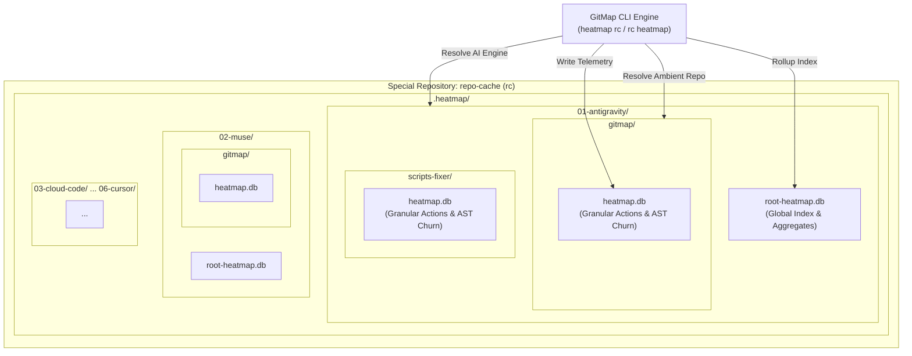
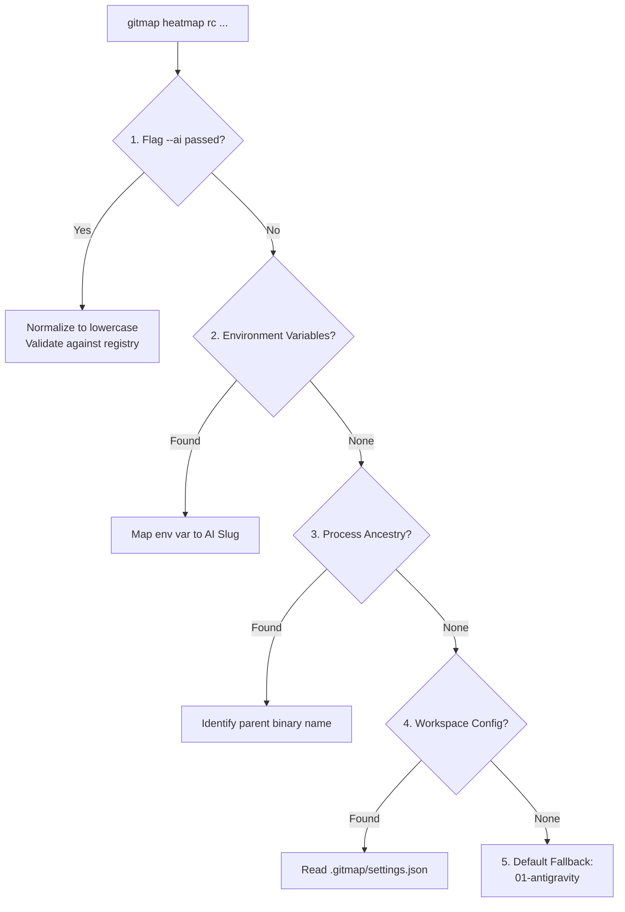
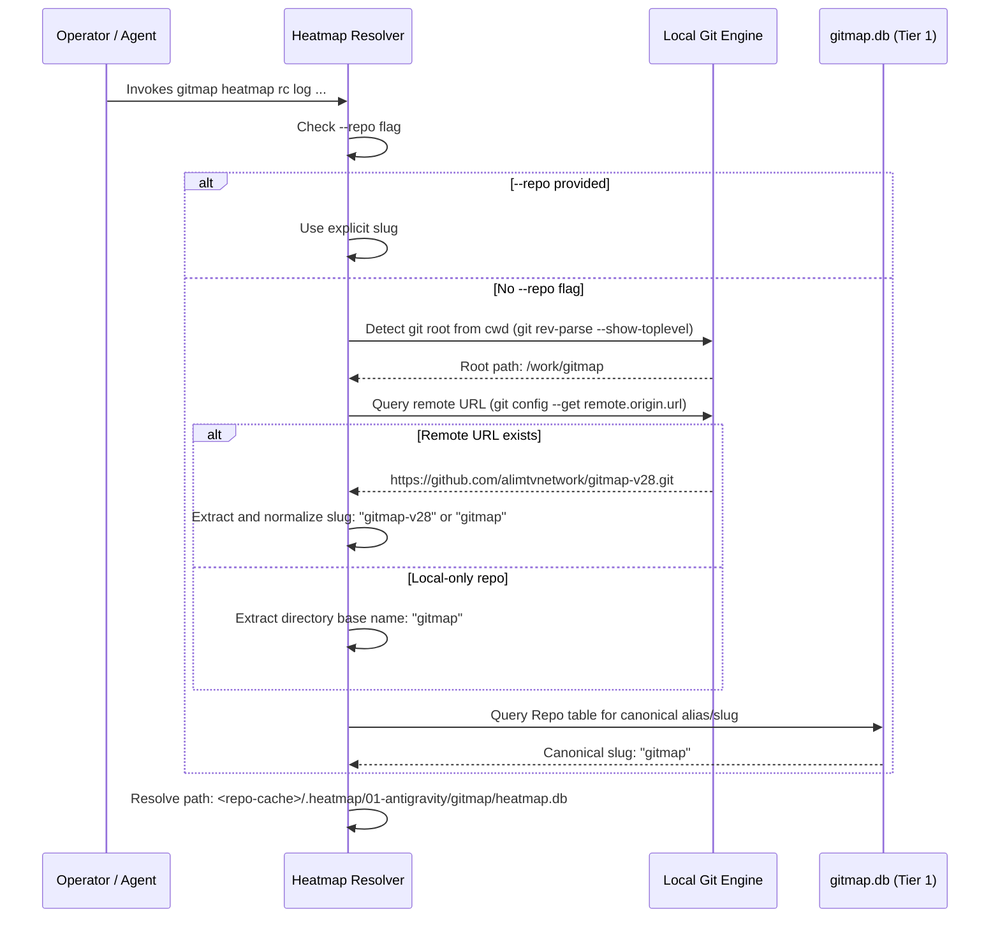
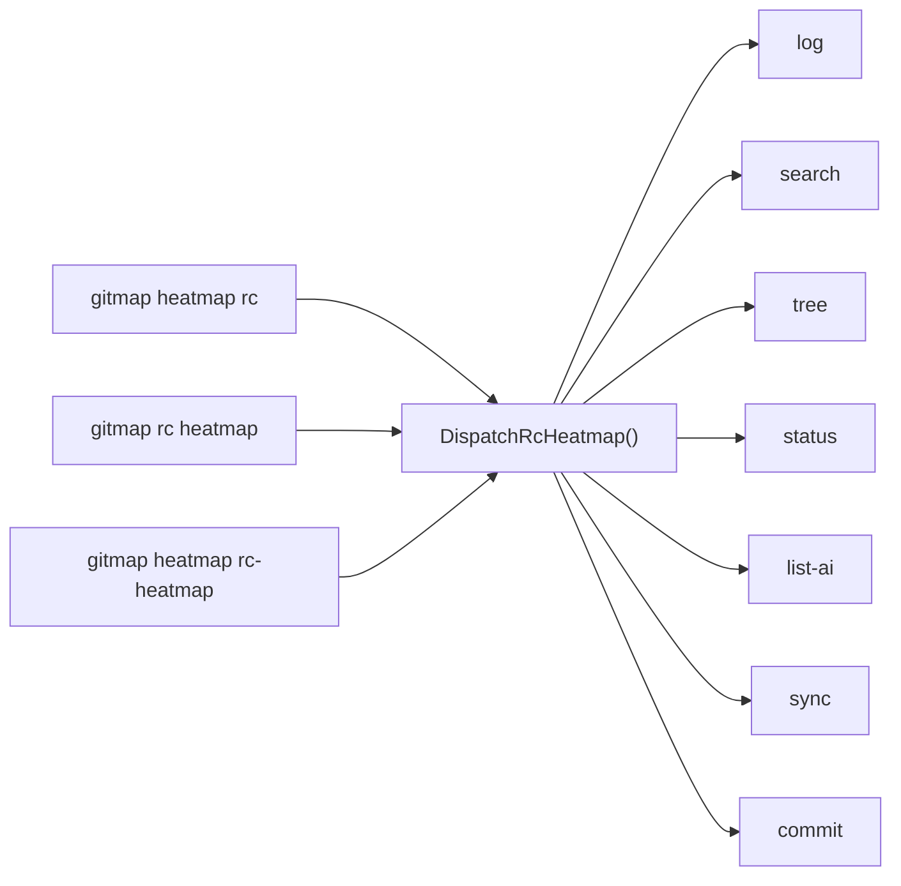

# Architecture Specification: repo-cache Heatmap Tree & Multi-AI Split-DB Engine

- **Spec ID:** `02-spec/21-app/heatmap-command-and-database-structure-instructions/01-architecture-spec.md`
- **Feature Slug:** `heatmap-command-and-database-structure-instructions`
- **Module:** `cli/heatmap`, `cli/store`, `cli/cmd`, `repo-cache/.heatmap`
- **Status:** APPROVED
- **Version:** 1.0.0
- **Target Audience:** Autonomous AI Agents, Multi-Agent Orchestrators, GitMap Core Engineers
- **Target Release:** Minor Bump

---

## 1. Executive Summary & Architectural Motivation

Autonomous software engineering relies on parallel AI agent collaboration across polyglot repositories. When AI models analyze, edit, and refactor code, their cognitive decisions—such as the exact files touched, line ranges modified, reasoning context, expected outcomes, and command execution traces—are frequently lost when subagent processes terminate.

Storing decision telemetry within local application repositories causes noise in working trees, pollutes git history, and risks committing large binary SQLite write-ahead log (`WAL`) files into application source control. Conversely, storing telemetry in temporary OS directories causes state erasure between reboots and container redeployments, preventing cross-session learning and historical repository heat analysis.

To solve this fundamentally, GitMap establishes the **repo-cache Heatmap Storage Architecture**. This subsystem relocates all persistent AI decision telemetry into the dedicated companion repository `repo-cache` under the structured `.heatmap/` namespace. By partitioning data across sequenced AI engine namespaces (`01-<ai-name>/`) and utilizing a **Two-Tier Split-DB Topology** (`root-heatmap.db` and `<repo-slug>/heatmap.db`), GitMap provides:

1. **Zero Contamination of Application Repositories:** All cognitive tracking, action logging, and AST churn records live inside `repo-cache/.heatmap/`, completely isolated from application codebases.
2. **Multi-AI Engine Namespacing:** Isolated directory prefixes for supported AI engines (`01-antigravity`, `02-muse`, `03-cloud-code`, `04-codex`, `05-grok`, `06-cursor`) preventing schema lock contention and telemetry collisions between disparate agent runtimes.
3. **Two-Tier Split-DB Hierarchy:** A global index database (`root-heatmap.db`) for cross-repository search and rollup analytics, combined with per-repository split databases (`<repo-slug>/heatmap.db`) for high-throughput, lock-free action telemetry.
4. **Flexible Tri-Alias CLI Routing:** Seamless interoperability supporting `gitmap heatmap rc`, `gitmap rc heatmap`, and `gitmap heatmap rc-heatmap` command syntaxes.
5. **Ambient Context Resolution:** Automatic detection of repository URL and slug from the active working directory (`cwd`) with explicit CLI override capability.

---

## 2. Directory Hierarchy & Storage Topology

All heatmap persistence resides within the special companion repository `repo-cache` (resolved via `store.ResolveSpecialRepoPath("rc")`). The physical directory tree follows a strict canonical structure:

```text
<repo-cache>/
└── .heatmap/
    ├── 01-antigravity/
    │   ├── root-heatmap.db
    │   ├── gitmap/
    │   │   ├── heatmap.db
    │   │   ├── heatmap.db-shm
    │   │   └── heatmap.db-wal
    │   ├── scripts-fixer/
    │   │   └── heatmap.db
    │   └── wp-html-automate/
    │       └── heatmap.db
    ├── 02-muse/
    │   ├── root-heatmap.db
    │   └── gitmap/
    │       └── heatmap.db
    ├── 03-cloud-code/
    │   ├── root-heatmap.db
    │   └── gitmap/
    │       └── heatmap.db
    ├── 04-codex/
    │   ├── root-heatmap.db
    │   └── gitmap/
    │       └── heatmap.db
    ├── 05-grok/
    │   ├── root-heatmap.db
    │   └── gitmap/
    │       └── heatmap.db
    └── 06-cursor/
        ├── root-heatmap.db
        └── gitmap/
            └── heatmap.db
```

### 2.1 Storage Roles by Tier

| File / Folder | Scope | Primary Purpose | Concurrency Control |
|---|---|---|---|
| `<repo-cache>/.heatmap/` | Global Root | Root storage container for all AI cognitive telemetry. | Git tracked, ignored in app repos. |
| `0X-<ai-name>/` | AI Namespace | Sequenced namespace dedicated to a specific AI tool or engine. | Isolated by agent environment. |
| `0X-<ai-name>/root-heatmap.db` | Global AI Index | Master index of all repositories, tasks, total actions, and cross-repo search. | WAL mode, single-writer pool. |
| `0X-<ai-name>/<repo-slug>/` | Repository Container | Directory matching the normalized target repository slug. | Scoped to specific workspace repo. |
| `0X-<ai-name>/<repo-slug>/heatmap.db` | Per-Repo Split-DB | High-frequency action logs, file touch churn, line ranges, and causal decision trees. | WAL mode, `SetMaxOpenConns(1)`. |



---

## 3. AI Naming, Sequence Prefixes & Auto-Detection

### 3.1 Supported AI Engine Registry

Each AI agent environment is cataloged with a standardized two-digit sequence prefix and lowercase kebab-case slug:

| Sequence Prefix | Canonical AI Slug | Display Label | Primary Target Runtime |
|---|---|---|---|
| `01-` | `antigravity` | Google Antigravity | Google DeepMind Agentic Coding / Gemini CLI |
| `02-` | `muse` | Meta Muse Engine | Muse Autonomous Fleet Runner |
| `03-` | `cloud-code` | Google Cloud Code | Cloud Code IDE Extension / Duet AI |
| `04-` | `codex` | OpenAI Codex | GitHub Copilot / OpenAI Coding Agents |
| `05-` | `grok` | xAI Grok | xAI Grok Developer Tooling |
| `06-` | `cursor` | Cursor IDE | Anysphere Cursor Composer / Agents |

### 3.2 Dynamic Resolution & Auto-Detection Hierarchy

When executing heatmap commands, the effective AI engine is determined using a deterministic 5-step fallback pipeline:



#### Step 1: Explicit Command-Line Flag
- Flag: `--ai <name>` (or `-a <name>`).
- Values: `antigravity`, `muse`, `cloud-code`, `codex`, `grok`, `cursor`.
- Normalization: Inward values are lowercased and stripped of leading numbers (e.g. `01-antigravity` becomes `antigravity`).

#### Step 2: Environment Variable Inspection
The resolver inspects system environment variables in priority order:
1. **Antigravity:** `ANTIGRAVITY_AGENT_ID`, `ANTIGRAVITY_INSTANCE_ID`, `GEMINI_CLI_VERSION`.
2. **Muse:** `MUSE_RUNNER_ID`, `MUSE_VERSION`, `MUSE_MODE`.
3. **Cloud Code:** `CLOUD_CODE_PROJECT`, `CLOUD_CODE_VERSION`, `GOOGLE_CLOUD_AGENT`.
4. **Codex:** `CODEX_ENV`, `COPILOT_AGENT`, `OPENAI_AGENT_SESSION`.
5. **Grok:** `GROK_API_KEY`, `GROK_RUNNER_ID`.
6. **Cursor:** `CURSOR_AGENT`, `CURSOR_PROJECT_DIR`, `CURSOR_SETTINGS`.

#### Step 3: Process Ancestry Inspection
On supported host operating systems, the resolver inspects parent process names (`antigravity.exe`, `cursor.exe`, `code.exe`, `muse.exe`).

#### Step 4: Installation Settings
If unassigned, the resolver queries GitMap configuration:
`gitmap settings get heatmap.default_ai` (stored in `installation.db`).

#### Step 5: Canonical Fallback
If all probes yield empty results, the system defaults to `antigravity` (`01-antigravity`).

### 3.3 Dynamic Sequencing for Unregistered AI Engines
If a user specifies a custom AI engine via `--ai custom-agent`, GitMap dynamically scans `<repo-cache>/.heatmap/` for existing sequence numbers (`01-`, `02-`, ...). It assigns the next available sequential prefix (e.g., `07-custom-agent`) and persists the directory mapping.

---

## 4. Ambient Workspace, Repository URL & Slug Detection

Heatmap operations are context-aware and automatically identify the target application repository from the ambient current working directory (`cwd`).

### 4.1 Resolution Algorithm



### 4.2 Slug Normalization Rules
To ensure cross-platform compatibility across Linux, macOS, and Windows filesystems:
1. **Lowercase Only:** All slugs are strictly converted to ASCII lowercase (`strings.ToLower`).
2. **Special Characters:** Characters outside `[a-z0-9-_]` are replaced with hyphens (`-`).
3. **Trailing Suffixes:** Suffixes like `.git` or `.bundle` are stripped.
4. **Consecutive Hyphens:** Collapsed to a single hyphen (`--` -> `-`).
5. **Boundary Trimming:** Leading and trailing hyphens are trimmed.

---

## 5. Master SQLite Database Schemas

All databases adhere strictly to GitMap's database guidelines:
- **Table Names:** Strict `PascalCase` (e.g., `HeatmapActionLog`, `HeatmapParentTask`).
- **Column Names:** Strict `camelCase` (e.g., `actionId`, `taskSlug`, `createdAt`, `isExpectationMet`).
- **Boolean Columns:** Positive naming conventions prefixed with `is` or `has` (e.g., `isExpectationMet`, `isWalEnabled`, `hasActiveLocks`), stored as `INTEGER` (`0` or `1`).
- **Concurrency Mode:** WAL mode enabled (`PRAGMA journal_mode=WAL;`), synchronous normal (`PRAGMA synchronous=NORMAL;`), foreign keys enabled (`PRAGMA foreign_keys=ON;`).

### 5.1 Root Index Database Schema (`root-heatmap.db`)

Located at `<repo-cache>/.heatmap/0X-<ai-name>/root-heatmap.db`.

```sql
-- AI Engine Metadata Registry
CREATE TABLE IF NOT EXISTS HeatmapAiRegistry (
    aiId INTEGER PRIMARY KEY AUTOINCREMENT,
    aiSlug TEXT NOT NULL UNIQUE,
    sequencePrefix TEXT NOT NULL,
    displayName TEXT NOT NULL,
    detectedVersion TEXT NOT NULL DEFAULT '',
    environmentSignature TEXT NOT NULL DEFAULT '',
    isAutoDetected INTEGER NOT NULL DEFAULT 1,
    createdAt TEXT NOT NULL DEFAULT CURRENT_TIMESTAMP,
    updatedAt TEXT NOT NULL DEFAULT CURRENT_TIMESTAMP
);

-- Global Repository Summary and Activity Index
CREATE TABLE IF NOT EXISTS HeatmapGlobalRepoIndex (
    repoId INTEGER PRIMARY KEY AUTOINCREMENT,
    repoSlug TEXT NOT NULL UNIQUE,
    repoName TEXT NOT NULL,
    remoteUrl TEXT NOT NULL DEFAULT '',
    localPath TEXT NOT NULL DEFAULT '',
    totalActionsCount INTEGER NOT NULL DEFAULT 0,
    totalFilesTouched INTEGER NOT NULL DEFAULT 0,
    expectationsMetPercent REAL NOT NULL DEFAULT 100.0,
    lastActiveTaskSlug TEXT NOT NULL DEFAULT '',
    lastActionTimestamp TEXT NOT NULL DEFAULT CURRENT_TIMESTAMP,
    isArchived INTEGER NOT NULL DEFAULT 0,
    createdAt TEXT NOT NULL DEFAULT CURRENT_TIMESTAMP,
    updatedAt TEXT NOT NULL DEFAULT CURRENT_TIMESTAMP
);

-- Cross-Repository Search and Action Rollup Index
CREATE TABLE IF NOT EXISTS HeatmapGlobalActionIndex (
    globalActionId INTEGER PRIMARY KEY AUTOINCREMENT,
    repoSlug TEXT NOT NULL,
    taskSlug TEXT NOT NULL,
    localActionId INTEGER NOT NULL,
    actionType TEXT NOT NULL,
    filePath TEXT NOT NULL,
    startLine INTEGER NOT NULL DEFAULT 0,
    endLine INTEGER NOT NULL DEFAULT 0,
    reasoningNotes TEXT NOT NULL DEFAULT '',
    isExpectationMet INTEGER NOT NULL DEFAULT 1,
    actionTimestamp TEXT NOT NULL DEFAULT CURRENT_TIMESTAMP,
    FOREIGN KEY (repoSlug) REFERENCES HeatmapGlobalRepoIndex(repoSlug) ON DELETE CASCADE
);

-- Indexes for Fast Global Search
CREATE INDEX IF NOT EXISTS idxGlobalActionSearch 
    ON HeatmapGlobalActionIndex (repoSlug, actionType, filePath);
CREATE INDEX IF NOT EXISTS idxGlobalActionTimestamp 
    ON HeatmapGlobalActionIndex (actionTimestamp DESC);
CREATE INDEX IF NOT EXISTS idxGlobalActionTask 
    ON HeatmapGlobalActionIndex (taskSlug);
```

### 5.2 Per-Repository Split-DB Schema (`heatmap.db`)

Located at `<repo-cache>/.heatmap/0X-<ai-name>/<repo-slug>/heatmap.db`.

```sql
-- Parent Task Registry
CREATE TABLE IF NOT EXISTS HeatmapParentTask (
    taskId INTEGER PRIMARY KEY AUTOINCREMENT,
    taskSlug TEXT NOT NULL UNIQUE,
    taskGoal TEXT NOT NULL,
    taskStatus TEXT NOT NULL DEFAULT 'IN_PROGRESS',
    aiSlug TEXT NOT NULL,
    repoSlug TEXT NOT NULL,
    totalSubtasks INTEGER NOT NULL DEFAULT 0,
    completedSubtasks INTEGER NOT NULL DEFAULT 0,
    isCompleted INTEGER NOT NULL DEFAULT 0,
    startedAt TEXT NOT NULL DEFAULT CURRENT_TIMESTAMP,
    completedAt TEXT NOT NULL DEFAULT '',
    createdAt TEXT NOT NULL DEFAULT CURRENT_TIMESTAMP,
    updatedAt TEXT NOT NULL DEFAULT CURRENT_TIMESTAMP
);

-- Permitted Reasoning States Enum Lookup
CREATE TABLE IF NOT EXISTS HeatmapReasoningState (
    stateCode TEXT PRIMARY KEY,
    stateDescription TEXT NOT NULL,
    displayOrder INTEGER NOT NULL DEFAULT 0
);

INSERT OR IGNORE INTO HeatmapReasoningState (stateCode, stateDescription, displayOrder) VALUES
('EXPLORATION', 'Scanning codebase, reading files, discovering dependencies', 1),
('SPEC_REFINEMENT', 'Authoring or updating specifications and architecture docs', 2),
('CODE_EDITING', 'Applying surgical source code modifications and refactoring', 3),
('VERIFICATION', 'Validating syntax, linters, schemas, or diagnostic checks', 4),
('REMEDIATION', 'Correcting lint errors, rollbacks, or edge-case handling', 5),
('COMPLETED', 'Subtask or task fully achieved with all acceptance criteria met', 6);

-- Granular Cognitive Action Log
CREATE TABLE IF NOT EXISTS HeatmapActionLog (
    actionId INTEGER PRIMARY KEY AUTOINCREMENT,
    parentActionId INTEGER,
    taskSlug TEXT NOT NULL,
    repoSlug TEXT NOT NULL,
    actionType TEXT NOT NULL,
    filePath TEXT NOT NULL,
    startLine INTEGER NOT NULL DEFAULT 0,
    endLine INTEGER NOT NULL DEFAULT 0,
    codeSnippet TEXT NOT NULL DEFAULT '',
    commandText TEXT NOT NULL DEFAULT '',
    reasoningState TEXT NOT NULL DEFAULT 'EXPLORATION',
    reasoningNotes TEXT NOT NULL DEFAULT '',
    expectedOutcome TEXT NOT NULL DEFAULT '',
    actualOutcome TEXT NOT NULL DEFAULT '',
    isExpectationMet INTEGER NOT NULL DEFAULT 1,
    executionDepth INTEGER NOT NULL DEFAULT 1,
    executionOrder INTEGER NOT NULL DEFAULT 1,
    durationMs INTEGER NOT NULL DEFAULT 0,
    createdAt TEXT NOT NULL DEFAULT CURRENT_TIMESTAMP,
    FOREIGN KEY (parentActionId) REFERENCES HeatmapActionLog(actionId) ON DELETE SET NULL,
    FOREIGN KEY (reasoningState) REFERENCES HeatmapReasoningState(stateCode)
);

-- File Churn and Touch Frequency Tracker
CREATE TABLE IF NOT EXISTS HeatmapFileChurn (
    churnId INTEGER PRIMARY KEY AUTOINCREMENT,
    filePath TEXT NOT NULL UNIQUE,
    fileExtension TEXT NOT NULL DEFAULT '',
    readCount INTEGER NOT NULL DEFAULT 0,
    analyzeCount INTEGER NOT NULL DEFAULT 0,
    modifyCount INTEGER NOT NULL DEFAULT 0,
    execCmdCount INTEGER NOT NULL DEFAULT 0,
    totalTouchCount INTEGER NOT NULL DEFAULT 0,
    totalLinesModified INTEGER NOT NULL DEFAULT 0,
    lastActionType TEXT NOT NULL DEFAULT '',
    lastTaskSlug TEXT NOT NULL DEFAULT '',
    lastTouchedAt TEXT NOT NULL DEFAULT CURRENT_TIMESTAMP,
    createdAt TEXT NOT NULL DEFAULT CURRENT_TIMESTAMP,
    updatedAt TEXT NOT NULL DEFAULT CURRENT_TIMESTAMP
);

-- Indexes for Fast Querying and Tree Traversal
CREATE INDEX IF NOT EXISTS idxActionTask 
    ON HeatmapActionLog (taskSlug, executionOrder ASC);
CREATE INDEX IF NOT EXISTS idxActionParent 
    ON HeatmapActionLog (parentActionId);
CREATE INDEX IF NOT EXISTS idxActionFile 
    ON HeatmapActionLog (filePath);
CREATE INDEX IF NOT EXISTS idxFileChurnTotal 
    ON HeatmapFileChurn (totalTouchCount DESC);
```

---

## 6. CLI Command Syntax & Routing Topology

### 6.1 Tri-Alias Routing Architecture

To accommodate natural agent dictation, CLI shortcuts, and unified subcommand hierarchies, GitMap exposes three equivalent entry points:

1. **`gitmap heatmap rc <subcommand> [flags]`**
2. **`gitmap rc heatmap <subcommand> [flags]`**
3. **`gitmap heatmap rc-heatmap <subcommand> [flags]`**

All three entry points dispatch directly into the shared execution function:
`heatmap.DispatchRcHeatmap(ctx context.Context, args []string, out io.Writer) error`.



### 6.2 Subcommands Specification

#### 1. `log`
Records an atomic cognitive action into `<repo-cache>/.heatmap/0X-<ai-name>/<repo-slug>/heatmap.db` and updates `root-heatmap.db`.

- **Syntax:**
  `gitmap heatmap rc log [flags]`
- **Supported Flags:**
  - `-t, --task <slug>`: Parent task slug (required or auto-resolved from active context).
  - `-a, --action <READ|ANALYZE|MODIFY|EXEC_CMD>`: Action classification (default: `ANALYZE`).
  - `-f, --file <path>`: File path touched (relative to repo root).
  - `-l, --lines <start-end>`: Line range (e.g. `12-45`).
  - `-s, --state <STATE>`: Reasoning state (`EXPLORATION`, `SPEC_REFINEMENT`, `CODE_EDITING`, `VERIFICATION`, `REMEDIATION`, `COMPLETED`).
  - `-r, --reason <text>`: Semantic rationale for action.
  - `-e, --expected <outcome>`: What the agent expects to happen.
  - `-o, --actual <outcome>`: What actually occurred.
  - `-m, --met <bool>`: Positive boolean (`true` or `false`) if outcome matched expectation.
  - `-p, --parent <id>`: Parent action ID for causal trees.
  - `-c, --code <snippet>`: Code or AST snippet inspected or edited.
  - `--cmd <command>`: CLI or shell command executed.
  - `--ai <name>`: AI engine override (default: auto-detected).
  - `--repo <slug>`: Target repository slug override (default: auto-detected from `cwd`).

#### 2. `search`
Searches cognitive action history across files, snippets, rationales, and task slugs.

- **Syntax:**
  `gitmap heatmap rc search "<query>" [flags]`
- **Supported Flags:**
  - `-t, --task <slug>`: Scope search to specific task.
  - `-f, --file <path>`: Filter by file path prefix.
  - `-a, --action <type>`: Filter by action type.
  - `--ai <name>`: Target specific AI namespace.
  - `--repo <slug>`: Target specific repo slug.
  - `-g, --global`: Search across all repositories using `root-heatmap.db`.
  - `-j, --json`: Emit structured JSON records.

#### 3. `tree`
Renders an ASCII hierarchy of the causal decision chain showing parent and child actions, execution order, states, and outcomes.

- **Syntax:**
  `gitmap heatmap rc tree [flags]`
- **Supported Flags:**
  - `-t, --task <slug>`: Task slug to render (defaults to latest active).
  - `-d, --depth <N>`: Maximum tree recursion depth (default: unlimited).
  - `--ai <name>`: Target AI namespace.
  - `--repo <slug>`: Target repo slug.
  - `-j, --json`: Emit raw hierarchical tree nodes as JSON.

- **Example ASCII Output:**
  ```text
  Task: heatmap-command-and-database-structure-instructions (AI: 01-antigravity)
  ├── [1] (EXPLORATION) READ cli/store/special_repos_split_db.go:1-60 (Outcome: Met)
  │   └── [2] (SPEC_REFINEMENT) ANALYZE cli/cmd/roottooling.go:180-210 (Outcome: Met)
  │       ├── [3] (SPEC_REFINEMENT) MODIFY 02-spec/21-app/.../01-architecture-spec.md (Outcome: Met)
  │       └── [4] (SPEC_REFINEMENT) MODIFY .ai-memory/plans/.../01-heatmap-rc-tree-splitdb.md (Outcome: Met)
  └── [5] (VERIFICATION) EXEC_CMD git status (Outcome: Met)
  ```

#### 4. `status`
Displays summary statistics, health indicators, expectations met percentage, and the top most frequently touched files.

- **Syntax:**
  `gitmap heatmap rc status [flags]`
- **Supported Flags:**
  - `-t, --task <slug>`: Filter summary by task slug.
  - `--ai <name>`: Target AI namespace.
  - `--repo <slug>`: Target repo slug.
  - `-j, --json`: Emit JSON payload.

- **Example Tabular Output:**
  ```text
  === GitMap RC Heatmap Status ===
  AI Engine:          01-antigravity
  Target Repo:        gitmap (work/gitmap)
  Active Task:        heatmap-command-and-database-structure-instructions
  Total Actions:      42 (READ: 18, ANALYZE: 12, MODIFY: 8, EXEC_CMD: 4)
  Expectations Met:   95.2% (40/42)
  Top Touched Files:
    1. cli/store/special_repos_split_db.go (8 touches, 42 lines modified)
    2. cli/heatmap/heatmap_rc_cmd.go       (6 touches, 180 lines modified)
    3. cli/cmd/roottooling.go              (4 touches, 24 lines modified)
  ```

#### 5. `list-ai`
Discovers and lists all configured and detected AI engine folders under `<repo-cache>/.heatmap/`.

- **Syntax:**
  `gitmap heatmap rc list-ai [flags]`
- **Supported Flags:**
  - `-j, --json`: Output JSON array of AI engines with sequence, action counts, and database sizes.

#### 6. `sync`
Performs maintenance, WAL checkpointing, and rollup synchronization between per-repo databases and `root-heatmap.db`.

- **Syntax:**
  `gitmap heatmap rc sync [flags]`
- **Supported Flags:**
  - `--ai <name>`: Target specific AI namespace or `all`.
  - `--repo <slug>`: Target specific repo slug or `all`.
  - `--vacuum`: Execute SQLite `VACUUM` and checkpoint `PRAGMA wal_checkpoint(TRUNCATE)`.
  - `-j, --json`: Output sync summary report.

#### 7. `commit`
Stages and commits heatmap changes inside `<repo-cache>` with a structured commit message, optionally pushing upstream.

- **Syntax:**
  `gitmap heatmap rc commit [flags]`
- **Supported Flags:**
  - `-m, --message <text>`: Custom commit message.
  - `-p, --push`: Push commit upstream to remote tracking branch.
  - `--no-push`: Force local commit without pushing.
  - `--ai <name>`: Target AI engine name to scope commit message.
  - `--repo <slug>`: Target repo slug to scope commit message.
- **Default Commit Message Pattern:**
  `chore(heatmap): sync <ai-name> decision telemetry for <repo-slug> [auto]`

---

## 7. Muse Prompt & Coding Guidelines Hygiene

All documentation, specifications, and code files authored under this initiative must adhere strictly to repository coding standards:

1. **Strictly Lowercase `readme.md`:**
   - Any index or overview file must be named `readme.md` in all lowercase.
   - Mixed-case variations like `README.md` or `Readme.md` are strictly prohibited.
2. **Sequenced Markdown Files:**
   - All specification and plan markdown files must follow the pattern `nn-name.md` where `nn` is a two-digit integer prefix (e.g. `01-architecture-spec.md`, `01-heatmap-rc-tree-splitdb.md`).
3. **Strictly Relative Paths:**
   - Absolute filesystem paths (e.g. `C:\work\...` or `D:\work\...`) must never be hardcoded into documentation, schemas, or Go source code.
   - Use relative workspace paths (e.g. `02-spec/21-app/...`, `cli/store/...`, `repo-cache/.heatmap/...`).
4. **Positive Boolean Conventions:**
   - All boolean types, struct fields, and column names must be expressed with positive polarity (`isWalModeEnabled`, `isExpectationMet`, `isCompleted`, `hasActiveLocks`), avoiding inverted double negatives.
5. **Single-Writer Concurrency:**
   - Database connections must configure `db.SetMaxOpenConns(1)` for write operations to prevent SQLite database lock contention in multi-worker environments.

---

## 8. Acceptance Criteria

- [ ] **AC-1:** The `<repo-cache>/.heatmap/0X-<ai-name>/` directory hierarchy is deterministically generated upon first telemetry write.
- [ ] **AC-2:** Supported AI engines (`antigravity`, `muse`, `cloud-code`, `codex`, `grok`, `cursor`) map correctly to sequence prefixes `01-` through `06-`.
- [ ] **AC-3:** In the absence of an explicit `--ai` flag, the resolver accurately auto-detects the active AI engine from environment variables, process names, or falls back to `01-antigravity`.
- [ ] **AC-4:** Ambient repository slug and remote URL are extracted from the current working directory (`cwd`) without requiring manual configuration.
- [ ] **AC-5:** All three CLI command invocations (`gitmap heatmap rc`, `gitmap rc heatmap`, `gitmap heatmap rc-heatmap`) route to the identical execution pipeline.
- [ ] **AC-6:** All 7 subcommands (`log`, `search`, `tree`, `status`, `list-ai`, `sync`, `commit`) accept designated flags and produce formatted human-readable or JSON outputs.
- [ ] **AC-7:** Database schemas use `PascalCase` table names, `camelCase` column names, positive booleans, and WAL journaling.
- [ ] **AC-8:** Zero build or test commands executed during specification authoring.
