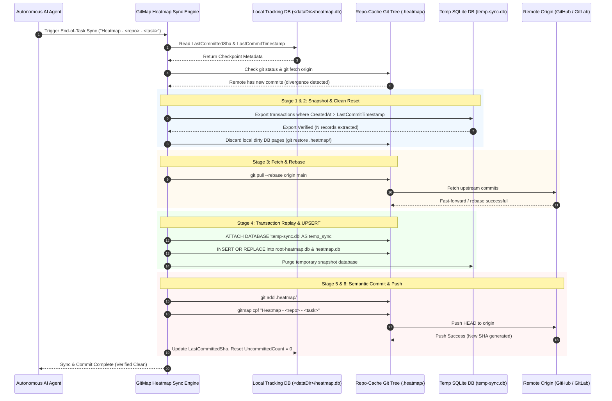

# Conflict Resolution & Automatic Synchronization Specification

- **Feature Slug:** `heatmap-command-and-database-structure-instructions`
- **Module:** `cli/heatmap`, `cli/cmd`, `cli/store`
- **Specification Version:** 2.0.0
- **Status:** APPROVED
- **Target Audience:** Multi-Agent Workers, Lead Orchestrators, Systems Engineers
- **Target Release:** Minor Bump

---

## 1. Executive Summary & Problem Formulation

In multi-agent and multi-machine environments, multiple AI instances (such as Antigravity, Muse, Cloud Code, Codex, Grok, and Cursor) concurrently generate telemetry, task statuses, and execution trees across disparate repositories. When these agents synchronize their activity to the shared `repo-cache` (`rc`) companion repository, standard Git merge strategies fail:

1. **Binary File Incompatibility:**
   SQLite database files (`root-heatmap.db` and `<repo-slug>/heatmap.db`) are binary storage containers. Git cannot perform 3-way textual diffing on SQLite pages. Any standard merge attempt produces either merge conflicts (`both modified`) or fatal database page corruption.
2. **Multi-AI Race Conditions:**
   Agent A on Machine 1 may commit telemetry for `01-antigravity/` while Agent B on Machine 2 concurrently commits telemetry for `02-muse/` or even modifies the same shared `root-heatmap.db` registry.
3. **Transient Network or Rebase Disconnects:**
   If a remote push is rejected because the remote tracking branch has moved forward, uncommitted local changes prevent an immediate `git pull --rebase`.

To solve this deterministically, GitMap implements the **Transaction-Timeframe Snapshot & Replay Engine**. Instead of relying on Git to merge binary files, GitMap:
- Identifies uncommitted local transactions via the local tracking database (`<dataDir>/heatmap.db`).
- Extracts them into a temporary SQLite snapshot database (`temp-sync-<timestamp>.db`).
- Discards binary working-tree modifications and pulls/rebases the latest remote Git tree cleanly.
- Re-injects the exported transactions into the updated databases using idempotent SQL merge operations.
- Finalizes the operation by executing an atomic feature commit via `gitmap cpf` and pushing upstream.

---

## 2. Synchronization Architecture & Sequence Flow



---

## 3. Conflict Detection Heuristics & Tracking Engine

The local tracking database (`<dataDir>/heatmap.db`) maintains the authoritative record of what has been pushed to the remote repository.

### 3.1 Divergence Detection Algorithm

Before performing any commit, the sync engine queries `HeatmapLocalTracking`:

```sql
SELECT RepoSlug, AiName, LastCommittedSha, LastCommitTimestamp, UncommittedChangeCount, IsDirty
FROM HeatmapLocalTracking
WHERE RepoSlug = :repoSlug AND AiName = :aiName;
```

The engine then interrogates Git in the `repo-cache` directory:

1. **Local Working Tree Dirty Check:**
   Runs `git status --porcelain .heatmap/`. If modified `.db` files exist, `IsDirty` is flagged as `1`.
2. **Remote Upstream Invalidation Check:**
   Executes `git fetch origin` followed by checking if local `HEAD` matches `origin/<default-branch>`:
   ```bash
   LOCAL_SHA=$(git rev-parse HEAD)
   REMOTE_SHA=$(git rev-parse origin/main)
   ```
   If `LOCAL_SHA != REMOTE_SHA` and `LOCAL_SHA != LastCommittedSha`, remote changes have arrived from another AI agent or another workstation. Conflict resolution is immediately engaged.

---

## 4. The 6-Stage Autonomous Reconciliation Protocol

### 4.1 Stage 1: Delta Isolation & Temporary SQLite Export

When conflicts or uncommitted changes are detected, the engine must isolate all records created since `LastCommitTimestamp` before touching the Git working tree.

1. **Create Ephemeral Database:**
   Generates a temporary database filename:
   `.heatmap/temp-sync-<timestamp>.db` (or `<dataDir>/temp-sync-<timestamp>.db`).
2. **Execute Delta Extraction Queries:**
   The engine attaches the temporary database to `root-heatmap.db` and `<repo-slug>/heatmap.db`:

   ```sql
   ATTACH DATABASE '.heatmap/temp-sync-20261018T041200Z.db' AS temp_sync;

   -- 1. Extract newly added AI sessions
   CREATE TABLE temp_sync.HeatmapAiSession AS
   SELECT * FROM HeatmapAiSession
   WHERE CreatedAt > :LastCommitTimestamp OR UpdatedAt > :LastCommitTimestamp;

   -- 2. Extract registered repositories
   CREATE TABLE temp_sync.HeatmapRepoRegistry AS
   SELECT * FROM HeatmapRepoRegistry
   WHERE CreatedAt > :LastCommitTimestamp OR UpdatedAt > :LastCommitTimestamp;

   -- 3. Extract parent tasks
   CREATE TABLE temp_sync.HeatmapParentTask AS
   SELECT * FROM HeatmapParentTask
   WHERE CreatedAt > :LastCommitTimestamp OR UpdatedAt > :LastCommitTimestamp;

   -- 4. Extract granular action logs (from repo heatmap.db)
   CREATE TABLE temp_sync.HeatmapActionLog AS
   SELECT * FROM HeatmapActionLog
   WHERE CreatedAt > :LastCommitTimestamp;

   -- 5. Extract execution tree nodes
   CREATE TABLE temp_sync.HeatmapExecutionTree AS
   SELECT * FROM HeatmapExecutionTree
   WHERE CreatedAt > :LastCommitTimestamp;

   DETACH DATABASE temp_sync;
   ```

3. **Verify Snapshot Integrity:**
   Executes `PRAGMA integrity_check;` on `temp-sync-<timestamp>.db`. If corrupt or zero rows exported when changes were expected, halts with `apperror.New("E_HEATMAP_TX_EXPORT", "temporary snapshot integrity failed")` without modifying the working tree.

---

### 4.2 Stage 2: Safe Reset & Discard

With all in-flight changes safely stored in `temp-sync-<timestamp>.db`:
1. The engine closes all active SQLite connections to `root-heatmap.db` and `heatmap.db` to release OS file locks (preventing Windows error `32: The process cannot access the file because it is being used by another process`).
2. Reverts the binary SQLite files in `repo-cache` to the last committed state:
   ```bash
   git restore .heatmap/
   # Fallback if git restore is unavailable:
   git checkout -- .heatmap/
   ```

---

### 4.3 Stage 3: Fetch & Rebase Remote Changes

Now that the working tree is completely clean, the engine integrates upstream commits:
```bash
git pull --rebase origin main
```

- Because local modifications to `.db` files were cleanly discarded, the rebase succeeds automatically without textual merge conflicts.
- If upstream branch contains changes from another AI (e.g. `02-muse/` or newly pushed sessions in `01-antigravity/`), Git cleanly fast-forwards or replays commits onto the latest remote `HEAD`.

---

### 4.4 Stage 4: Delta Re-Injection & Transaction Replay

The engine re-opens the freshly updated SQLite databases and re-injects the extracted transactions using idempotent UPSERT queries:

1. **Re-Inject into `root-heatmap.db`:**
   ```sql
   ATTACH DATABASE '.heatmap/temp-sync-20261018T041200Z.db' AS temp_sync;

   -- Upsert AI Sessions
   INSERT INTO HeatmapAiSession (
       SessionUuid, AiName, SequencePrefix, MachineHostname, OsPlatform,
       AgentRole, StartedAt, CompletedAt, IsActive, HasCompleted,
       TotalTasksExecuted, TotalActionsLogged, Notes, Comments, CreatedAt, UpdatedAt
   )
   SELECT
       SessionUuid, AiName, SequencePrefix, MachineHostname, OsPlatform,
       AgentRole, StartedAt, CompletedAt, IsActive, HasCompleted,
       TotalTasksExecuted, TotalActionsLogged, Notes, Comments, CreatedAt, UpdatedAt
   FROM temp_sync.HeatmapAiSession
   ON CONFLICT(SessionUuid) DO UPDATE SET
       CompletedAt = excluded.CompletedAt,
       IsActive = excluded.IsActive,
       HasCompleted = excluded.HasCompleted,
       TotalTasksExecuted = excluded.TotalTasksExecuted,
       TotalActionsLogged = excluded.TotalActionsLogged,
       UpdatedAt = excluded.UpdatedAt;

   -- Upsert Parent Tasks
   INSERT INTO HeatmapParentTask (
       TaskSlug, TaskName, RepoSlug, Status, StepBudget, CompletedSteps,
       HasCompleted, IsActive, StartedAt, CompletedAt, Notes, Comments, CreatedAt, UpdatedAt
   )
   SELECT
       TaskSlug, TaskName, RepoSlug, Status, StepBudget, CompletedSteps,
       HasCompleted, IsActive, StartedAt, CompletedAt, Notes, Comments, CreatedAt, UpdatedAt
   FROM temp_sync.HeatmapParentTask
   ON CONFLICT(TaskSlug) DO UPDATE SET
       Status = excluded.Status,
       CompletedSteps = excluded.CompletedSteps,
       HasCompleted = excluded.HasCompleted,
       IsActive = excluded.IsActive,
       CompletedAt = excluded.CompletedAt,
       UpdatedAt = excluded.UpdatedAt;

   DETACH DATABASE temp_sync;
   ```

2. **Re-Inject into `<repo-slug>/heatmap.db`:**
   ```sql
   ATTACH DATABASE '.heatmap/temp-sync-20261018T041200Z.db' AS temp_sync;

   -- Insert Action Logs without ID conflict
   INSERT INTO HeatmapActionLog (
       ParentLogId, TaskSlug, RepoSlug, ActionType, FilePath, StartLine, EndLine,
       CodeSnippet, CommandText, ReasoningState, ReasoningNotes, ExpectedOutcome,
       ActualOutcome, IsExpectationMet, ExecutionDepth, ExecutionOrder, DurationMs,
       Notes, Comments, CreatedAt
   )
   SELECT
       ParentLogId, TaskSlug, RepoSlug, ActionType, FilePath, StartLine, EndLine,
       CodeSnippet, CommandText, ReasoningState, ReasoningNotes, ExpectedOutcome,
       ActualOutcome, IsExpectationMet, ExecutionDepth, ExecutionOrder, DurationMs,
       Notes, Comments, CreatedAt
   FROM temp_sync.HeatmapActionLog;

   -- Re-link Execution Tree
   INSERT OR REPLACE INTO HeatmapExecutionTree (
       RootLogId, NodeLogId, ParentLogId, NodeDepth, SiblingOrder, PathVector,
       IsLeaf, HasChildren, CreatedAt, UpdatedAt
   )
   SELECT
       RootLogId, NodeLogId, ParentLogId, NodeDepth, SiblingOrder, PathVector,
       IsLeaf, HasChildren, CreatedAt, UpdatedAt
   FROM temp_sync.HeatmapExecutionTree;

   DETACH DATABASE temp_sync;
   ```

3. **Cleanup Ephemeral Snapshot:**
   Once replay transaction commits successfully, deletes `temp-sync-<timestamp>.db`.

---

### 4.5 Stage 5: Local Machine Tracking State Update

The engine records that local pending records are merged and ready for commit:
```sql
UPDATE HeatmapLocalTracking
SET SyncStatus = 'COMMITTED',
    UncommittedChangeCount = 0,
    IsDirty = 0,
    LastSyncAttemptAt = CURRENT_TIMESTAMP,
    LastSuccessfulSyncAt = CURRENT_TIMESTAMP,
    UpdatedAt = CURRENT_TIMESTAMP
WHERE RepoSlug = :repoSlug AND AiName = :aiName;
```

---

### 4.6 Stage 6: Semantic Feature Commit & Remote Push

The operation culminates in an atomic Git commit and push using GitMap's native semantic commit command:

1. **Stage Files in `repo-cache`:**
   ```bash
   git -C <repo-cache> add .heatmap/
   ```
2. **Execute Semantic Commit:**
   ```bash
   gitmap -C <repo-cache> cpf "Heatmap - <repo> - <task>"
   ```
   *Example:*
   ```bash
   gitmap cpf "Heatmap - gitmap - heatmap-command-and-database-structure-instructions"
   ```
3. **Capture New Commit SHA & Record in Log:**
   ```bash
   NEW_SHA=$(git -C <repo-cache> rev-parse HEAD)
   ```
   Updates `HeatmapLocalTracking.LastCommittedSha = NEW_SHA` and inserts an audit row into `HeatmapCommitLog` in `root-heatmap.db`.

---

## 5. Automated End-of-Task Invariant Protocol

### 5.1 The "No Push = Not Done" Rule

Autonomous AI agents operating within GitMap workspaces must adhere to a strict completion protocol:
> **MANDATORY INVARIANT:** Before an agent outputs its final verification message, marks a subtask as complete, or declares a task finished, it MUST trigger the Heatmap Automatic Synchronization & Commit Engine. If telemetry is uncommitted or unpushed, the task is legally considered incomplete.

### 5.2 Pre-Verification Hook Execution

At the end of any execution plan, the agent triggers:
```bash
gitmap heatmap rc sync --repo <repo-slug> --task <task-slug>
```
or invokes the internal helper:
```go
err := heatmap.SynchronizeAndCommitHeatmap(ctx, repoSlug, aiName, taskSlug, commitSummary)
```

If the push fails (e.g. transient GitHub rate limiting), the engine retries up to 3 times with exponential backoff (2s, 4s, 8s). If all retries fail, the local changes remain safely recorded in `HeatmapLocalTracking` with `SyncStatus = 'DIRTY'`, ensuring no data loss occurs and the next session will resume synchronization.

---

## 6. Disaster Recovery & Edge Case Remediation

| Scenario | Risk | Recovery Protocol |
|---|---|---|
| **Process Crash During Rebase** | Working tree in detached HEAD or rebase-in-progress | Engine checks `.git/rebase-apply` or `.git/rebase-merge`. If present, runs `git rebase --abort`. Reads existing `temp-sync-*.db` and re-engages from Stage 3. |
| **Windows File Lock Collision** | SQLite `.db-wal` or `.db` locked by background process | Engine uses `store.CloseAllHeatmapConnections()`, sleeps 500ms, and retries. PRAGMA `busy_timeout` set to 5000ms. |
| **Network Outage During Push** | Local commit created but remote push rejected | Commit remains intact locally; `LastCommittedSha` updated; `SyncStatus` marked `DIRTY_PUSH_PENDING`. Push retries on next command invocation. |
| **Corrupted Temporary Snapshot** | SQLite export truncated | If `PRAGMA integrity_check` fails on `temp-sync.db`, engine ABORTS immediately WITHOUT running `git restore`, preserving the original `.db` files. |
