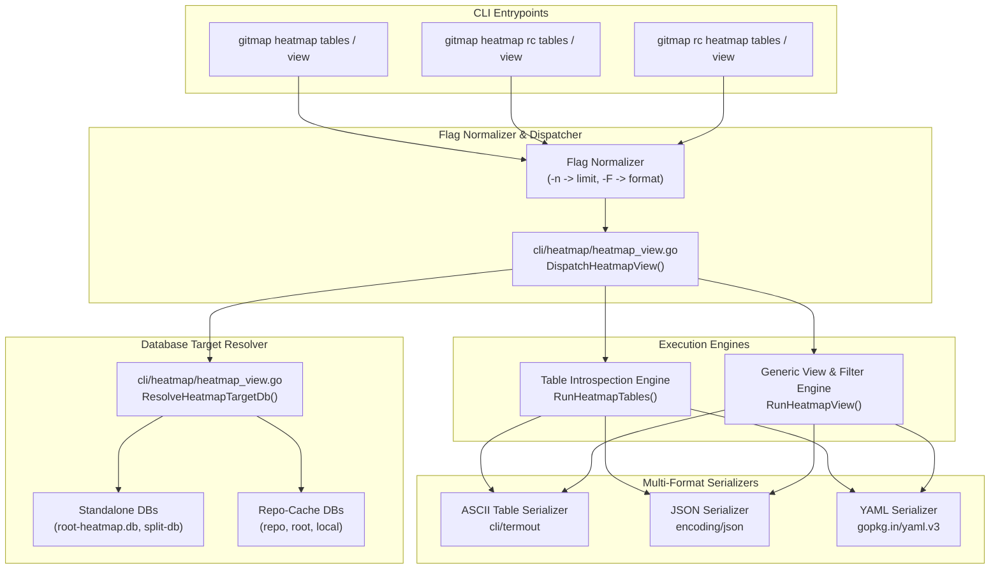
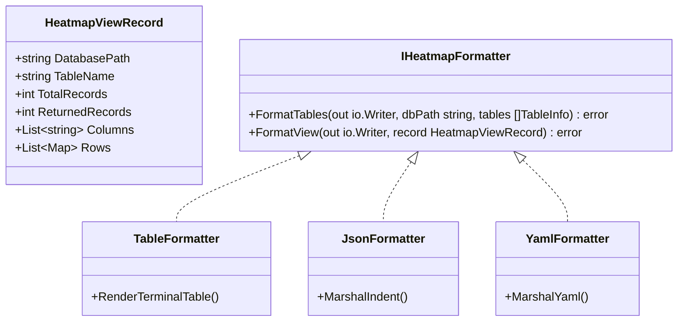

# Architecture Specification: Heatmap Table Inspection, Multi-Format Viewers & RC Admin Integration

- **Spec ID:** `02-spec/21-app/heatmap-commands-testing-and-rc-admin-instructions/01-architecture-spec.md`
- **Feature Slug:** `heatmap-commands-testing-and-rc-admin-instructions`
- **Module:** `cli/heatmap`, `cli/store`, `cli/termout`
- **Status:** APPROVED
- **Version:** 1.0.0
- **Target Audience:** Autonomous AI Agents, Multi-Agent Orchestrators, GitMap Core Engineers
- **Target Release:** Minor Bump

---

## 1. Executive Summary & Problem Formulation

In autonomous and multi-agent software engineering workflows, agents routinely inspect code, perform deep reasoning, plan changes, and execute mutations across diverse repositories. To monitor and coordinate these operations without polluting application repositories with ephemeral runtime churn or SQLite database locks, GitMap provides the Heatmap subsystem. 

The Heatmap architecture spans two complementary execution tiers:
1. **Standalone Heatmap (`gitmap heatmap`):** Tracks ambient and workspace-local telemetry, action logs, causal execution trees, and task statuses directly within the primary workspace or split SQLite databases.
2. **Companion Repo-Cache Heatmap (`gitmap heatmap rc` / `gitmap rc heatmap`):** Isolates all persistent cognitive traces, AST churn records, and reasoning steps inside the companion `repo-cache` repository under the `.heatmap/` namespace partitioned by AI engine (`01-antigravity`, `02-muse`, `03-cloud-code`, `04-codex`, `05-grok`, `06-cursor`).

### 1.1 The Operational Gap

While both tiers provide command-line interfaces for logging actions (`log`), searching history (`search`), visualizing execution hierarchies (`tree`), and viewing summaries (`status`), human engineers and autonomous agents encounter significant operational friction during diagnostics and administration:

1. **Lack of Native Table Introspection:** Agents cannot quickly discover which SQLite tables exist in a given heatmap database without launching external SQLite tools or writing ad-hoc Python/Go inspection scripts.
2. **No Generic Record Viewer:** Querying records across specific tables (such as `HeatmapActionLog`, `HeatmapParentTask`, `HeatmapAiSession`, `HeatmapCommitLog`, `HeatmapRepoRegistry`, or `HeatmapLocalTracking`) requires custom CLI commands or direct SQL query execution, which creates code duplication and increases maintenance overhead.
3. **Inflexible Serialization Formats:** Agents parsing CLI output require machine-friendly formats like JSON or YAML, while human engineers inspecting terminal outputs require cleanly formatted ASCII tables with column alignment. Previously, output formatting was fragmented or limited to raw text and basic JSON flags.
4. **Code Bifurcation Between Standalone and Companion Commands:** Without a unified data view architecture, identical table inspection logic risks being duplicated across `cli/heatmap/heatmap_cmd.go` and `cli/heatmap/heatmap_rc_cmd.go`.

### 1.2 Proposed Architectural Solution

This specification establishes a unified, DRY (Don't Repeat Yourself) **Table Inspection & Multi-Format Viewer Architecture** implemented within `cli/heatmap/heatmap_view.go`. 

The architecture introduces two new subcommands across both `gitmap heatmap` and `gitmap heatmap rc`:
- `tables`: Introspects the target SQLite database catalog, displaying all user tables, views, column counts, row counts, and storage metrics.
- `view <table>`: Queries and displays records from a specified table with rich filtering flags (`--task`, `--repo`, `--id`, `--ai`), record limiting (`--limit` / `-n`), database selection (`--db`), and multi-format serialization (`--format <table|json|yaml>` / `-F`).

---

## 2. Unified System Architecture & Component Interactions



### 2.1 Core Architectural Principles

1. **Strict DRY Engine (`cli/heatmap/heatmap_view.go`):** All database resolution, table schema introspection, SQL query generation, parameter binding, dynamic row scanning, and format rendering are centralized in `cli/heatmap/heatmap_view.go`. Both `DispatchHeatmapSubsystem` (in `heatmap_cmd.go`) and `DispatchRcHeatmap` (in `heatmap_rc_cmd.go`) delegate directly to this shared implementation.
2. **First-Class YAML & JSON Serialization:** Machine readability is guaranteed by integrating Go's standard `encoding/json` and `gopkg.in/yaml.v3` for structured output. Human readability is guaranteed via `cli/termout` ASCII tables.
3. **Pluggable Database Targeting (`--db <repo|root|local>`):** Heatmap stores data in hierarchical SQLite databases. The `--db` flag allows explicit target selection while maintaining smart defaults based on the subcommand context and table name.
4. **SQL Injection Immunity:** Table names are strictly whitelisted against `sqlite_master` metadata before query assembly. All user-supplied filter parameters (`--task`, `--repo`, `--id`) are bound using parameterized SQL placeholders (`?`).
5. **Read-Only Concurrency Protection:** Table inspection and record views execute non-blocking read-only queries with a 5000ms busy timeout, preventing lock contention with concurrent writer agents.

---

## 3. Command Line Interface Specification

### 3.1 Subcommand: `tables`

Inspects the SQLite master catalog of the resolved heatmap database and displays an inventory of all user tables and views.

#### 3.1.1 Command Signatures
- Standalone: `gitmap heatmap tables [flags]`
- Companion RC: `gitmap heatmap rc tables [flags]`
- Companion RC Alias: `gitmap rc heatmap tables [flags]`

#### 3.1.2 Supported Flags
| Long Flag | Short Flag | Value Type | Default | Description |
|---|---|---|---|---|
| `--format` | `-F` | `string` (`table` \| `json` \| `yaml`) | `table` | Serialization format for the table inventory |
| `--db` | N/A | `string` (`repo` \| `root` \| `local`) | Contextual | Explicit target database selector |
| `--ai` | N/A | `string` | Auto-detected | Target AI engine namespace (RC mode) |
| `--repo` | N/A | `string` | Ambient cwd | Target repository slug for split/repo databases |
| `--json` | `-j` | `boolean` | `false` | Convenience alias for `--format json` |

#### 3.1.3 Introspection Query & Metrics
The `tables` engine executes:
```sql
SELECT name, type 
FROM sqlite_master 
WHERE type IN ('table', 'view') AND name NOT LIKE 'sqlite_%' 
ORDER BY type, name;
```
For each discovered table or view, the engine retrieves:
1. **Column Count:** `SELECT count(*) FROM pragma_table_info(?)`
2. **Row Count:** `SELECT count(*) FROM "{tableName}"`
3. **Schema Definition:** Extracted from `sqlite_master.sql`

---

### 3.2 Subcommand: `view <table>`

Introspects and queries rows from a specified table or view, applying optional query filters, bounding the result set with a limit, and formatting the output.

#### 3.2.1 Command Signatures
- Standalone: `gitmap heatmap view <table> [flags]`
- Companion RC: `gitmap heatmap rc view <table> [flags]`
- Companion RC Alias: `gitmap rc heatmap view <table> [flags]`

#### 3.2.2 Supported Flags
| Long Flag | Short Flag | Value Type | Default | Description |
|---|---|---|---|---|
| `--limit` | `-n` | `integer` | `50` | Maximum number of rows to retrieve (clamped 1..1000) |
| `--format` | `-F` | `string` (`table` \| `json` \| `yaml`) | `table` | Output serialization format |
| `--task` | N/A | `string` | Empty | Filter records by `TaskSlug` if column exists in table |
| `--repo` | N/A | `string` | Empty / Ambient | Filter records by `RepoSlug` if column exists; sets DB scope |
| `--id` | N/A | `integer` | `0` | Filter records by primary key ID column |
| `--ai` | N/A | `string` | Auto-detected | Scope companion database to specific AI namespace |
| `--db` | N/A | `string` (`repo` \| `root` \| `local`) | Contextual | Explicit target database selector |
| `--json` | `-j` | `boolean` | `false` | Convenience alias for `--format json` |

#### 3.2.3 Dynamic Query Construction & Column Awareness
Before querying `<table>`, the engine verifies table existence in `sqlite_master` and inspects column definitions via `PRAGMA table_info("{tableName}")`.

Filtering predicates are added dynamically only if the respective column exists:
- If `--task <slug>` is provided and table contains `TaskSlug`: appends `WHERE TaskSlug = ?`.
- If `--repo <slug>` is provided and table contains `RepoSlug`: appends `AND RepoSlug = ?`.
- If `--id <id>` is provided and table contains a primary key (e.g. `HeatmapActionLogId`, `HeatmapParentTaskId`, `HeatmapAiSessionId`): appends `AND <PkColumn> = ?`.
- Results are ordered descending by primary key or `CreatedAt` (`ORDER BY <PkColumn> DESC LIMIT ?`).

---

## 4. Database Selection & Resolution Matrix

Heatmap persistence is partitioned across multiple SQLite files to provide lock-free concurrency and prevent git workspace contamination. The `--db <repo|root|local>` flag selects the active database file according to the following resolution matrix:

### 4.1 Standalone Mode (`gitmap heatmap tables/view`)

| `--db` Flag | Resolved Database Path | Canonical Tables Expected |
|---|---|---|
| `root` (Default) | `store.ResolveHeatmapRootDbPath("")`<br/>(e.g., `<baseDataDir>/heatmap.db` or workspace root) | `HeatmapParentTask`<br/>`HeatmapReasoningState`<br/>`HeatmapActionLog` |
| `repo` | `store.ResolveHeatmapRepoSplitDbPath(repoSlug, "")`<br/>(e.g., `<splitDbDir>/heatmap/<repoSlug>.db`) | `HeatmapActionLog`<br/>`HeatmapParentTask` |
| `local` | `store.ResolveHeatmapRootDbPath("")` | `HeatmapParentTask`<br/>`HeatmapActionLog` |

### 4.2 Companion RC Mode (`gitmap heatmap rc tables/view`)

| `--db` Flag | Resolved Database Path | Canonical Tables Expected |
|---|---|---|
| `repo` (Default for action telemetry) | `store.ResolveRcHeatmapRepoDbPath(aiName, repoSlug)`<br/>`<repo-cache>/.heatmap/<prefix>-<ai>/<repo-slug>/heatmap.db` | `HeatmapActionLog`<br/>`HeatmapExecutionTree`<br/>`HeatmapReasoningState` |
| `root` (Default for session/global tables) | `store.ResolveRcHeatmapRootDbPath(aiName)`<br/>`<repo-cache>/.heatmap/<prefix>-<ai>/root-heatmap.db` | `HeatmapAiSession`<br/>`HeatmapRepoRegistry`<br/>`HeatmapParentTask`<br/>`HeatmapCommitLog` |
| `local` (Tracking database) | `store.ResolveRcHeatmapLocalTrackingDbPath()`<br/>`<dataDir>/heatmap.db` | `HeatmapLocalTracking` |

### 4.3 Smart Contextual Defaulting
When `--db` is not specified on the CLI:
1. In companion RC mode (`heatmap rc`):
   - If the requested table is `HeatmapAiSession`, `HeatmapRepoRegistry`, or `HeatmapCommitLog`, the resolver automatically selects `--db root`.
   - If the requested table is `HeatmapLocalTracking`, the resolver automatically selects `--db local`.
   - If the requested table is `HeatmapActionLog`, `HeatmapExecutionTree`, or `HeatmapReasoningState`, the resolver defaults to `--db repo`.
   - For `tables` (listing all tables), the resolver defaults to `--db repo` if `--repo` or ambient repo is present, otherwise `--db root`.
2. In standalone mode (`heatmap`):
   - Defaults to `--db root`. If `--repo` is explicitly passed, defaults to `--db repo`.

---

## 5. Multi-Format Serialization Architecture

The viewer architecture supports three first-class serialization formats, specified via `--format <table|json|yaml>` or `-F <table|json|yaml>`.



### 5.1 Terminal ASCII Table Formatter (`--format table`)
- Utilizes GitMap's native `cli/termout` rendering infrastructure.
- Columns are dynamically sized with automatic truncation and ellipsis (`...`) for wide textual columns (e.g. `CodeSnippet`, `ReasoningNotes`, `ErrorMessage`) to maintain 100-character terminal viewport cleanliness.
- Numerical values are right-aligned; text and dates are left-aligned; booleans render as `true`/`false`.
- Empty result sets emit a clear diagnostic line: `No records found in table '<name>' matching criteria.`

### 5.2 JSON Formatter (`--format json`)
- Implemented using Go standard library `encoding/json`.
- Output is indented with two spaces (`"  "`) for human and agent readability.
- Output envelope adheres to GitMap's universal JSON response structure:
  ```json
  {
    "database": "D:/work/repo-cache/.heatmap/01-antigravity/gitmap/heatmap.db",
    "table": "HeatmapActionLog",
    "totalCount": 142,
    "returnedCount": 2,
    "limit": 50,
    "columns": ["HeatmapActionLogId", "TaskSlug", "ActionType", "FilePath", "CreatedAt"],
    "records": [
      {
        "HeatmapActionLogId": 142,
        "TaskSlug": "heatmap-commands-testing-and-rc-admin-instructions",
        "ActionType": "MODIFY",
        "FilePath": "cli/heatmap/heatmap_view.go",
        "CreatedAt": "2026-10-18T05:00:00Z"
      }
    ]
  }
  ```

### 5.3 YAML Formatter (`--format yaml`)
- Implemented using `gopkg.in/yaml.v3`.
- Emits clean, deterministic 2-space indented YAML structures.
- Multi-line strings (code snippets, commands, stack traces) render with YAML literal block scalars (`|`), preserving formatting and preventing ugly escaped quote strings.
- Example YAML output:
  ```yaml
  database: D:/work/repo-cache/.heatmap/01-antigravity/gitmap/heatmap.db
  table: HeatmapActionLog
  totalCount: 142
  returnedCount: 1
  limit: 50
  columns:
    - HeatmapActionLogId
    - TaskSlug
    - ActionType
    - FilePath
  records:
    - HeatmapActionLogId: 142
      TaskSlug: heatmap-commands-testing-and-rc-admin-instructions
      ActionType: MODIFY
      FilePath: cli/heatmap/heatmap_view.go
  ```

---

## 6. Shared DRY Engine Implementation Design

To guarantee compliance with GitMap's file size rules (strictly <= 300 lines per file), the view engine is partitioned into cohesive, single-responsibility files under `cli/heatmap/`:

```
cli/heatmap/
├── heatmap_cmd.go             # Standalone heatmap CLI routing (updated)
├── heatmap_rc_cmd.go          # Companion RC heatmap CLI routing (updated)
├── heatmap_view.go            # Entry points: RunHeatmapTables, RunHeatmapView, Target DB Resolution
├── heatmap_view_query.go      # SQL query assembly, column introspection, dynamic row scanning
└── heatmap_view_format.go     # Multi-format serializers: Table (termout), JSON, YAML
```

### 6.1 `cli/heatmap/heatmap_view.go` Responsibilities
- Exports `RunHeatmapTables(isRc bool, flags map[string]string, out io.Writer) error`
- Exports `RunHeatmapView(isRc bool, tableName string, flags map[string]string, out io.Writer) error`
- Resolves target SQLite database file paths based on `isRc`, `--db`, `--ai`, `--repo`, and `tableName`.
- Enforces flag sanitization and short-flag expansion (`-n` -> `limit`, `-F` -> `format`).

### 6.2 `cli/heatmap/heatmap_view_query.go` Responsibilities
- Interrogates `sqlite_master` for table catalog and schema definitions.
- Interrogates `pragma_table_info` to retrieve column names and types.
- Constructs parameterized `SELECT` queries with filters (`TaskSlug`, `RepoSlug`, primary key ID).
- Performs generic `rows.Scan` into typed map representations (`map[string]interface{}`) handling SQLite types (`int64`, `float64`, `[]byte`, `string`, `nil`).

### 6.3 `cli/heatmap/heatmap_view_format.go` Responsibilities
- Renders tables inventory in Table, JSON, or YAML format.
- Renders generic table records in Table, JSON, or YAML format.
- Truncates oversized text columns for terminal view while keeping full fidelity in JSON and YAML.

---

## 7. CLI Dispatch Integration & Tri-Alias Support

The `tables` and `view` subcommands are wired directly into both entrypoint dispatchers:

### 7.1 Standalone Dispatcher (`cli/heatmap/heatmap_cmd.go`)
```go
// In DispatchHeatmapSubsystem:
switch subcmd {
case "tables":
    return RunHeatmapTables(false, flags, out)
case "view":
    if len(pos) == 0 {
        return apperror.NewValidation("heatmap", "E1001", "missing table name for view command")
    }
    return RunHeatmapView(false, pos[0], flags, out)
// ... existing cases: log, search, tree, status, rc ...
}
```

### 7.2 Companion RC Dispatcher (`cli/heatmap/heatmap_rc_cmd.go`)
```go
// In DispatchRcHeatmap:
switch subcmd {
case "tables":
    return RunHeatmapTables(true, flags, out)
case "view":
    if len(pos) == 0 {
        return apperror.NewValidation("heatmap_rc", "E1001", "missing table name for rc view command")
    }
    return RunHeatmapView(true, pos[0], flags, out)
// ... existing cases: log, search, tree, status, list-ai, commit, sync ...
}
```

### 7.3 Argument & Short-Flag Normalization
The existing `shortFlagMap` in `heatmap_cmd.go` is expanded to include `-n` and `-F`:
```go
var shortFlagMap = map[string]string{
    "t": "task", "a": "action", "f": "file", "l": "lines",
    "c": "code", "s": "state", "r": "reason", "p": "parent", 
    "j": "json", "n": "limit", "F": "format",
}
```
This guarantees that `-n 10` normalizes to `limit: 10`, and `-F yaml` normalizes to `format: yaml`.

---

## 8. Error Handling & Validation Matrix

All validation and execution errors are wrapped using GitMap's standard `apperror` package, ensuring consistent error envelopes without raw panic stack traces:

| Condition | Error Code | HTTP/CLI Exit Code | Error Message Pattern |
|---|---|---|---|
| Missing table name in `view` | `E1001` | Exit Code 2 | `missing table name for view command. Usage: gitmap heatmap view <table>` |
| Table does not exist in SQLite DB | `E1002` | Exit Code 2 | `table '<name>' not found in database '<path>'` |
| Invalid `--format` specified | `E1003` | Exit Code 2 | `invalid format '<val>': must be one of 'table', 'json', or 'yaml'` |
| Invalid `--db` selector | `E1004` | Exit Code 2 | `invalid db target '<val>': must be one of 'repo', 'root', or 'local'` |
| Database connection failure | `E2001` | Exit Code 1 | `failed to open heatmap database at '<path>': <err>` |
| SQL query execution error | `E2002` | Exit Code 1 | `failed to execute view query on table '<name>': <err>` |

---

## 9. Security, Concurrency & Governance

1. **Strictly Parameterized Queries:** Dynamic table inspection constructs queries where filter inputs are passed as parameters to `QueryContext` or `QueryRowContext`. SQL string interpolation for user-provided filter values is strictly prohibited.
2. **Table Identifier Whitelisting:** Table names passed to `view <table>` are checked against the slice of tables returned from `sqlite_master`. If the requested table name does not exist in the whitelist, the command returns validation error `E1002` immediately without executing arbitrary SQL.
3. **Double-Quoted Table Escaping:** Verified table names are enclosed in double quotes (`"tableName"`) when formatted into SQL queries to prevent keyword collision and identifier injection.
4. **Read-Only Concurrency Pragmas:** Database handles opened by the view engine configure:
   - `PRAGMA busy_timeout = 5000;`
   - `PRAGMA temp_store = MEMORY;`
   - Maximum open connections capped at 1 for deterministic local SQLite file handles.

---

## 10. Acceptance Criteria & Quality Checklist

- [ ] **AC-01:** `gitmap heatmap tables` lists all tables in the default standalone root database with names, column counts, and row counts.
- [ ] **AC-02:** `gitmap heatmap rc tables` lists all tables in the default companion repo database for the active AI engine.
- [ ] **AC-03:** `--db <repo|root|local>` correctly targets the respective SQLite database in both standalone and RC modes.
- [ ] **AC-04:** `gitmap heatmap view <table>` and `gitmap heatmap rc view <table>` output row records using the default ASCII table format.
- [ ] **AC-05:** Passing `--format json` or `-j` produces formatted, two-space indented JSON adhering to the specified envelope schema.
- [ ] **AC-06:** Passing `--format yaml` or `-F yaml` produces valid, parseable YAML formatted via `gopkg.in/yaml.v3`.
- [ ] **AC-07:** Passing `--limit <N>` or `-n <N>` bounds the maximum returned records to `N`.
- [ ] **AC-08:** Filtering with `--task`, `--repo`, or `--id` properly applies SQL `WHERE` clauses when those columns are present in the table.
- [ ] **AC-09:** Shared DRY implementation lives in `cli/heatmap/heatmap_view*.go` without duplicated query or formatting logic.
- [ ] **AC-10:** All new and modified Go files stay strictly `<= 300 lines` with nesting depth `<= 1`.
- [ ] **AC-11:** All markdown paths and references are strictly relative.
- [ ] **AC-12:** Zero builds and zero tests run during specification authoring.
