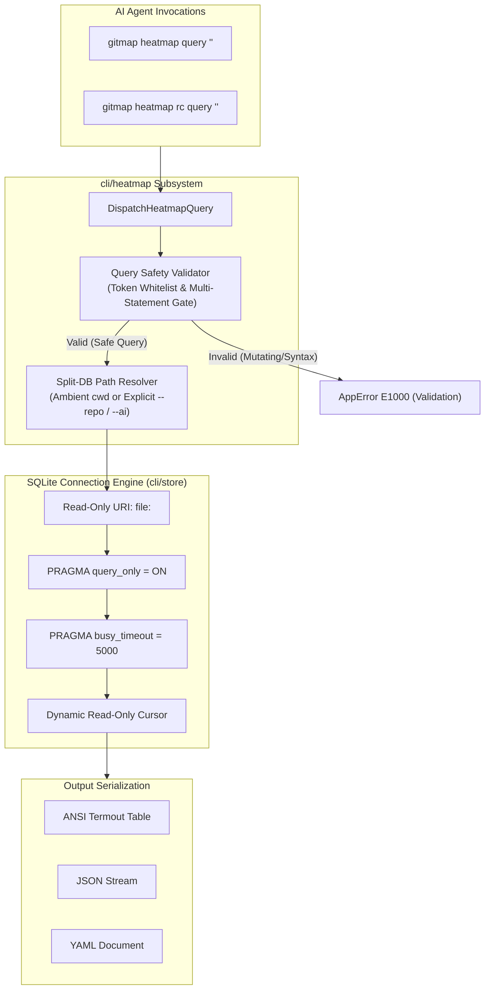

# Database Query Specification: Safe Direct SQL Query Engine for AI Agents

- **Spec ID:** `02-spec/21-app/heatmap-commands-testing-and-rc-admin-instructions/02-database-query-spec.md`
- **Feature Slug:** `heatmap-commands-testing-and-rc-admin-instructions`
- **Module:** `cli/heatmap`, `cli/store`, `cli/termout`
- **Status:** APPROVED
- **Specification Version:** 1.0.0
- **Target Audience:** Autonomous AI Agents, Multi-Agent Orchestrators, Systems Engineers, Database Architects
- **Target Release:** Minor Bump

---

## 1. Executive Summary & Problem Definition

Autonomous AI agents coordinating across polyglot repositories require high-speed, direct visibility into persistent cognitive telemetry stored within SQLite heatmap databases. While pre-canned CLI commands (`gitmap heatmap search`, `gitmap heatmap tree`, `gitmap heatmap status`) address standard introspection scenarios, complex analytical tasks require flexible SQL querying:

1. **Ad-Hoc Telemetry Mining:** AI agents must aggregate touched file churn across arbitrary timeframes, calculate code-to-reasoning ratios, and correlate specific cognitive states (e.g. `REMEDIATION`) with failed expectation outcomes.
2. **Causal Lineage & Recursive Hierarchy Traversal:** Determining how a parent goal broke down into sub-plans across multiple agent sessions requires executing recursive Common Table Expressions (`WITH RECURSIVE`) over `HeatmapExecutionTree`.
3. **Cross-Repository Heat Audits:** Orchestrator agents must query `root-heatmap.db` to discover which workspaces have the highest operational churn without scanning individual repository directories.

However, giving AI subagents shell access or unrestricted database tools introduces substantial architectural risks:
- Accidental write operations (`UPDATE`, `INSERT`, `DELETE`, `DROP`) mutating immutable audit logs.
- SQLite database lock contention between simultaneous reader and writer subagents.
- SQL injection or destructive multi-statement scripts polluting schema integrity.

To solve this, GitMap provides the **Direct SQL Query Engine for AI Agents**, exposed via:
- `gitmap heatmap query "<sql>"` (inspects local repository heatmap)
- `gitmap heatmap rc query "<sql>"` (inspects repo-cache split-DB or root heatmap)

The query engine guarantees absolute read-only safety through cryptographic read-only file connections, SQLite internal security PRAGMAs, multi-layer query validation, and multi-format serialization (ANSI tables, JSON, and YAML).

---

## 2. Architectural Overview & Workflow

The Direct SQL Query Engine acts as a strictly guarded, non-mutating gateway between autonomous AI agents and the underlying SQLite databases (`root-heatmap.db` and `<repo-slug>/heatmap.db`).



---

## 3. Command Syntax & Routing Specification

### 3.1 Local Repository Heatmap Query
Executes read-only queries against the local machine tracking database or the repository split-db located within the active repository context.

```bash
gitmap heatmap query "<sql>" [flags]
```

#### Flags:
| Flag | Short | Default | Description |
|---|---|---|---|
| `--db <path>` | `-d` | Auto-detected | Explicit relative path to a target SQLite database file. |
| `--format <type>` | `-f` | `table` | Output format: `table`, `json`, or `yaml`. |
| `--limit <n>` | `-l` | `100` | Maximum rows to return (appends safety limit if omitted in query). |
| `--json` | `-j` | `false` | Shorthand alias for `--format json`. |
| `--yaml` | `-y` | `false` | Shorthand alias for `--format yaml`. |

### 3.2 Repository Cache (`repo-cache`) Heatmap Query
Executes read-only queries against the synchronized `repo-cache` hierarchy (`.heatmap/01-<ai-name>/...`).

```bash
gitmap heatmap rc query "<sql>" [flags]
```

#### Tri-Alias Routing Parity:
The following invocations are semantically identical:
```bash
gitmap heatmap rc query "<sql>"
gitmap rc heatmap query "<sql>"
gitmap heatmap rc-heatmap query "<sql>"
```

#### RC-Specific Flags:
| Flag | Short | Default | Description |
|---|---|---|---|
| `--ai <name>` | `-a` | `01-antigravity` | Target AI engine sequence (e.g. `01-antigravity`, `02-muse`, `03-cloud-code`). |
| `--repo <slug>` | `-r` | Ambient cwd | Target repository slug (e.g. `gitmap`, `movie-cli`). |
| `--tier <tier>` | `-t` | `repo` | Target database tier: `repo` (`<repo-slug>/heatmap.db`) or `root` (`root-heatmap.db`). |
| `--format <type>` | `-f` | `table` | Output format: `table`, `json`, or `yaml`. |
| `--limit <n>` | `-l` | `100` | Maximum rows to return. |
| `--json` | `-j` | `false` | Shorthand alias for `--format json`. |
| `--yaml` | `-y` | `false` | Shorthand alias for `--format yaml`. |

---

## 4. Multi-Layer Security & Read-Only Enforcement

To eliminate any chance of data corruption or write locks, the engine enforces security across four defense layers:

### 4.1 Layer 1: Lexical Query Safety Validator
Before any database connection is touched, the query string undergoes lexical token validation:
1. **Comment Stripping:** Strips SQL single-line (`--`) and multi-line (`/* ... */`) comments to prevent hidden clause masking.
2. **Whitespace Normalization:** Trims leading/trailing whitespace and normalizes consecutive spaces.
3. **Whitelisted Statement Prefixes:** The statement must begin with one of the following whitelisted keywords:
   - `SELECT`
   - `PRAGMA` (limited to read-only pragmas such as `table_info`, `index_list`, `foreign_key_list`, `database_list`)
   - `EXPLAIN`
   - `WITH` (for Common Table Expressions)
4. **Forbidden Mutating Keywords:** The statement is rejected with `E1000` if it contains any of the following mutating tokens:
   - `INSERT`, `UPDATE`, `DELETE`, `DROP`, `ALTER`, `CREATE`, `REPLACE`, `ATTACH`, `DETACH`, `VACUUM`, `REINDEX`, `TRANSACTION`, `COMMIT`, `ROLLBACK`.
5. **Multi-Statement Injection Block:** Statements containing unquoted semicolons (`;`) followed by non-whitespace characters are strictly prohibited to prevent chained payload injections.

### 4.2 Layer 2: SQLite Connection URI Flag (`mode=ro`)
The SQLite driver opens the connection using URI parameters enforcing read-only access at the operating system file descriptor level:

```go
dsn := fmt.Sprintf("file:%s?mode=ro&cache=shared", resolvedDbPath)
conn, err := sql.Open("sqlite", dsn)
```

If the operating system or SQLite attempts any file modification, the operation fails immediately with an OS permission denial.

### 4.3 Layer 3: SQLite Runtime PRAGMA Locks
Immediately after opening the read-only connection, the query engine applies two non-negotiable runtime PRAGMAs:

```sql
PRAGMA query_only = ON;
PRAGMA busy_timeout = 5000;
```

- **`PRAGMA query_only = ON;`**: Informs the SQLite engine that all mutating SQL operations must be rejected at compile time with `SQLITE_READONLY`. Even if a query bypasses lexical validation, SQLite itself refuses execution.
- **`PRAGMA busy_timeout = 5000;`**: Specifies a 5000ms retry window when other subagents are actively committing transactions into WAL mode, avoiding transient `database is locked` errors.

### 4.4 Layer 4: Bounded Row Execution
To prevent unbounded memory allocation and hanging AI agent contexts, the engine:
1. Enforces a maximum result count (default `100`, max configurable `1000`).
2. Closes database cursors immediately upon completing row streaming or reaching the threshold.

---

## 5. Output Serialization Formats

The direct query engine provides three serialization formats tailored for different consumer contexts.

### 5.1 Format: `table` (Default Terminal ANSI Output)
Uses `cli/termout` to render formatted terminal tables with dynamic column headers, truncation, and alignment.

```text
+--------------------+------------+-------------+---------------------+------------------+
| HEATMAPACTIONLOGID | TASKSLUG   | ACTIONTYPE  | FILEPATH            | REASONINGSTATE   |
+--------------------+------------+-------------+---------------------+------------------+
| 1042               | task-heat  | CODE_EDIT   | cli/heatmap/cmd.go  | CODE_EDITING     |
| 1043               | task-heat  | VERIFY      | cli/heatmap/cmd.go  | VERIFICATION     |
| 1044               | task-heat  | TREE_GEN    | cli/store/rc.go     | EXPLORATION      |
+--------------------+------------+-------------+---------------------+------------------+
(3 rows returned in 1.42ms)
```

### 5.2 Format: `json` (Agent Structured JSON Stream)
Outputs clean JSON suitable for automated parsing by LLMs, Python scripts, or `jq`.

```json
{
  "query": "SELECT HeatmapActionLogId, TaskSlug, ActionType, FilePath FROM HeatmapActionLog WHERE TaskSlug = 'task-heat' LIMIT 2",
  "count": 2,
  "durationMs": 1.42,
  "columns": ["HeatmapActionLogId", "TaskSlug", "ActionType", "FilePath"],
  "rows": [
    {
      "HeatmapActionLogId": 1042,
      "TaskSlug": "task-heat",
      "ActionType": "CODE_EDIT",
      "FilePath": "cli/heatmap/cmd.go"
    },
    {
      "HeatmapActionLogId": 1043,
      "TaskSlug": "task-heat",
      "ActionType": "VERIFY",
      "FilePath": "cli/heatmap/cmd.go"
    }
  ]
}
```

### 5.3 Format: `yaml` (Compact Human/Agent Readable Format)
Renders clean YAML for inclusion in agent reasoning context windows:

```yaml
query: "SELECT HeatmapActionLogId, TaskSlug, ActionType FROM HeatmapActionLog WHERE HeatmapActionLogId = 1042"
count: 1
durationMs: 0.98
rows:
  - HeatmapActionLogId: 1042
    TaskSlug: "task-heat"
    ActionType: "CODE_EDIT"
```

### 5.4 Data Normalization Rules:
- `NULL` values render as empty strings in tables and `null` in JSON/YAML.
- SQLite integer booleans (`0` / `1`) for columns prefixed with `Is` or `Has` are normalized to boolean `false` / `true` when requested.
- Binary blobs are hex-encoded or serialized as `"<blob: N bytes>"`.

---

## 6. Canonical AI Agent Query Catalog

AI agents should utilize the following canonical query patterns for common introspection tasks:

### 6.1 Trace Search by Task Slug
Retrieves chronological execution traces for a specific task lifecycle:
```sql
SELECT 
    HeatmapActionLogId,
    ActionType,
    FilePath,
    StartLine,
    EndLine,
    ReasoningState,
    IsExpectationMet,
    CreatedAt
FROM HeatmapActionLog
WHERE TaskSlug = 'heatmap-commands-testing-and-rc-admin-instructions'
ORDER BY HeatmapActionLogId ASC;
```

### 6.2 Exact Trace Inspection by Action Log ID
Inspects deep reasoning notes, code snippets, and outcomes for an individual event:
```sql
SELECT 
    HeatmapActionLogId,
    ParentLogId,
    TaskSlug,
    ActionType,
    FilePath,
    CodeSnippet,
    CommandText,
    ReasoningState,
    ReasoningNotes,
    ExpectedOutcome,
    ActualOutcome,
    IsExpectationMet
FROM HeatmapActionLog
WHERE HeatmapActionLogId = 1042;
```

### 6.3 Repository File Churn & Hotspot Analysis
Identifies which files have undergone the highest editing volume under the active task:
```sql
SELECT 
    FilePath,
    COUNT(*) AS TotalActions,
    SUM(CASE WHEN ActionType = 'CODE_EDIT' THEN 1 ELSE 0 END) AS CodeEdits,
    MAX(CreatedAt) AS LastTouchedAt
FROM HeatmapActionLog
WHERE TaskSlug = 'heatmap-commands-testing-and-rc-admin-instructions'
GROUP BY FilePath
ORDER BY TotalActions DESC;
```

### 6.4 Finding Unmet Expectations & Failed Actions
Extracts all actions where execution failed or expectations diverged:
```sql
SELECT 
    HeatmapActionLogId,
    TaskSlug,
    ActionType,
    FilePath,
    ExpectedOutcome,
    ActualOutcome,
    CreatedAt
FROM HeatmapActionLog
WHERE IsExpectationMet = 0
ORDER BY HeatmapActionLogId DESC;
```

### 6.5 Hierarchical Tree Reconstruction via Recursive CTE
Traverses causal action chains from root to leaf:
```sql
WITH RECURSIVE ActionChain AS (
    SELECT 
        HeatmapActionLogId,
        ParentLogId,
        TaskSlug,
        ActionType,
        FilePath,
        0 AS Depth,
        CAST(HeatmapActionLogId AS TEXT) AS PathTrace
    FROM HeatmapActionLog
    WHERE ParentLogId IS NULL AND TaskSlug = 'heatmap-commands-testing-and-rc-admin-instructions'
    
    UNION ALL
    
    SELECT 
        c.HeatmapActionLogId,
        c.ParentLogId,
        c.TaskSlug,
        c.ActionType,
        c.FilePath,
        p.Depth + 1,
        p.PathTrace || ' -> ' || CAST(c.HeatmapActionLogId AS TEXT)
    FROM HeatmapActionLog c
    JOIN ActionChain p ON c.ParentLogId = p.HeatmapActionLogId
)
SELECT * FROM ActionChain ORDER BY Depth, HeatmapActionLogId;
```

### 6.6 Cross-Repository Activity Rollup (`root-heatmap.db`)
Aggregates activity across all repositories tracked by an AI engine:
```sql
SELECT 
    r.RepoSlug,
    r.TotalActionsRecorded,
    COUNT(t.HeatmapParentTaskId) AS TotalParentTasks,
    MAX(t.UpdatedAt) AS LastActive
FROM HeatmapRepoRegistry r
LEFT JOIN HeatmapParentTask t ON r.RepoSlug = t.RepoSlug
GROUP BY r.RepoSlug
ORDER BY r.TotalActionsRecorded DESC;
```

---

## 7. Error Handling, Validation Envelopes & Exit Codes

The query engine strictly wraps all errors within `apperror.AppError` and outputs consistent diagnostic messages:

### 7.1 Diagnostic Error Codes:
| Error Code | Category | Condition | Exit Code |
|---|---|---|---|
| `E1000` | Validation | Empty query, disallowed mutating statement (`INSERT`, `DROP`, etc.), or multi-statement injection. | `2` (`ExitCodeUsageError`) |
| `E1001` | Database | Target SQLite database file does not exist or cannot be resolved. | `1` (`ExitCodeGeneralError`) |
| `E1002` | SQL Syntax | SQLite syntax error in provided SQL string (e.g. invalid column name). | `1` (`ExitCodeGeneralError`) |
| `E1003` | Format | Unsupported serialization format requested (not in `table`, `json`, `yaml`). | `2` (`ExitCodeUsageError`) |
| `E1004` | Concurrency | SQLite busy timeout exceeded (database locked after 5000ms). | `1` (`ExitCodeGeneralError`) |

### 7.2 Structured Validation Response Example:
When `--json` is supplied and a validation failure occurs, the engine responds:
```json
{
  "error": {
    "code": "E1000",
    "subsystem": "heatmap_query",
    "message": "only read-only queries (SELECT, PRAGMA, EXPLAIN, WITH) are permitted; mutating keyword 'DROP' detected",
    "exitCode": 2
  }
}
```

---

## 8. File Structure & Architectural Boundaries

Implementation files are strictly partitioned to maintain file size limits (<= 300 lines) and single-responsibility isolation:

```text
cli/heatmap/
├── heatmap_cmd.go                 <-- Subsystem dispatcher (routes 'query')
├── heatmap_rc_cmd.go              <-- RC subsystem dispatcher (routes 'rc query')
├── heatmap_query.go               <-- Query command handler & flag processing
├── heatmap_query_validator.go     <-- Lexical sanitizer & read-only AST validator
└── heatmap_query_format.go        <-- ANSI table, JSON, and YAML serializers

cli/store/
└── heatmap_query_store.go         <-- Read-only DB connection opener, PRAGMA setup & row scanner
```

Every Go file must maintain:
- File line count <= 300 lines.
- Cyclomatic complexity / nesting depth <= 1 (using early guard returns).
- Zero reliance on external binary dependencies (pure Go SQLite driver compatibility).
- Strict adherence to relative path resolution.
