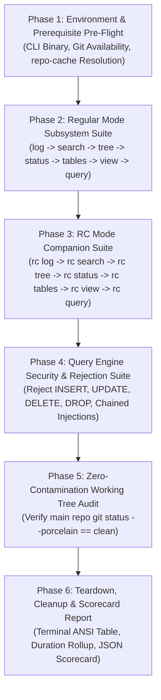

# E2E Testing Specification: Heatmap CLI Subsystems & Companion Repo Verification

- **Spec ID:** `02-spec/21-app/heatmap-commands-testing-and-rc-admin-instructions/03-e2e-testing-spec.md`
- **Feature Slug:** `heatmap-commands-testing-and-rc-admin-instructions`
- **Module:** `03-ai-scripts/48-test-heatmap-e2e.py`, `cli/heatmap`, `cli/store`
- **Status:** APPROVED
- **Specification Version:** 1.0.0
- **Target Script Path:** `03-ai-scripts/48-test-heatmap-e2e.py`
- **Target Audience:** Autonomous AI Agents, QA Automation Engineers, CI/CD Pipeline Developers
- **Target Release:** Minor Bump

---

## 1. Executive Summary & Purpose

The GitMap Heatmap subsystem spans two primary operational domains:
1. **Regular Mode:** Local tracking and telemetry persistence stored in local machine stores or active repository split databases.
2. **Repository Cache (RC) Mode:** Telemetry routed directly into the synchronized companion repository `repo-cache` under the `.heatmap/` tree, partitioned by AI engine names (`01-antigravity/`, `02-muse/`, etc.).

To ensure that both modes execute flawlessly across environments without risking working-tree corruption or regressions, GitMap specifies a dedicated, standalone, non-destructive End-to-End (E2E) testing script: **`03-ai-scripts/48-test-heatmap-e2e.py`**.

### 1.1 Non-Negotiable Testing Invariants
1. **Absolute Non-Destructiveness:** The test suite must NEVER delete, overwrite, or mutate production databases or ongoing developer sessions. All test fixtures must utilize ephemeral, uniquely identified synthetic task slugs (e.g. `e2e-task-<timestamp>-<random>`).
2. **The "Zero Contamination" Invariant:** When testing RC mode operations (`gitmap heatmap rc ...`), the main repository working tree must remain 100% pristine. Running `git status --porcelain` in the main repository before and after the test run must produce identical, unmodified output. All RC commits and file modifications must occur strictly inside the separate `repo-cache` companion repository.
3. **Cross-Platform Polyglot Runner:** The test script must run uniformly on Windows, Linux, and macOS using standard library Python 3.9+ with zero external package dependencies (`requests`, `sqlite3`, `subprocess`, `json`, `pathlib`).
4. **Strict Isolation & Complete Teardown:** Synthetic test rows logged during verification must be identified and cleanly isolated, with detailed validation of rollbacks or dedicated test sandbox directories.

---

## 2. Test Architecture & Phased Execution Model

The test runner `03-ai-scripts/48-test-heatmap-e2e.py` executes in six sequential phases:



---

## 3. Detailed Subcommand Verification Matrix

The test script systematically exercises and asserts expectations against every heatmap subcommand across both execution modes:

| Test ID | Subcommand Target | Arguments & Flags Tested | Expected Assertions | Mode |
|---|---|---|---|---|
| **E2E-01** | `heatmap log` | `--task <slug> --action CODE_EDIT --file <path> --lines 10-25 --reason "Refactor" --expected "pass" --actual "pass"` | Exit code 0; Output contains `Logged heatmap action #<id>`; row inserted into database. | Regular |
| **E2E-02** | `heatmap search` | `<query> --task <slug> --limit 10` and `--json` | Exit code 0; JSON array contains logged action ID and matching task slug. | Regular |
| **E2E-03** | `heatmap tree` | `--task <slug>` and `--json` | Exit code 0; Hierarchical tree output renders root-to-leaf node representation. | Regular |
| **E2E-04** | `heatmap status` | (default flags) and `--json` | Exit code 0; Reports DB file size, journal mode (WAL), and active session count. | Regular |
| **E2E-05** | `heatmap tables` | (default flags) and `--json` | Exit code 0; Lists `HeatmapActionLog`, `HeatmapExecutionTree`, `HeatmapAiSession`. | Regular |
| **E2E-06** | `heatmap view` | `HeatmapActionLog --id <id>` | Exit code 0; Displays exact record fields, timestamps, and reasoning notes. | Regular |
| **E2E-07** | `heatmap query` | `"SELECT COUNT(*) as c FROM HeatmapActionLog WHERE TaskSlug = '...'"` | Exit code 0; Returns integer count >= 1; parses table, JSON, and YAML formats. | Regular |
| **E2E-08** | `heatmap rc log` | `--ai 01-antigravity --repo gitmap --task <slug> --action ANALYZE` | Exit code 0; Output contains `Logged RC heatmap action #<id>`; writes to `repo-cache/.heatmap/...`. | RC |
| **E2E-09** | `heatmap rc search` | `<slug> --ai 01-antigravity --repo gitmap --json` | Exit code 0; Returns actions stored in `repo-cache/.heatmap/01-antigravity/gitmap/heatmap.db`. | RC |
| **E2E-10** | `heatmap rc tree` | `--task <slug> --ai 01-antigravity --repo gitmap` | Exit code 0; Validates hierarchical execution tree inside RC companion DB. | RC |
| **E2E-11** | `heatmap rc status` | `--ai 01-antigravity --repo gitmap` | Exit code 0; Verifies RC database health and WAL configuration. | RC |
| **E2E-12** | `heatmap rc tables` | `--ai 01-antigravity --repo gitmap` | Exit code 0; Introspects tables within the RC repo split database. | RC |
| **E2E-13** | `heatmap rc query` | `"SELECT * FROM HeatmapActionLog WHERE TaskSlug = '...'"` | Exit code 0; Executes read-only query against RC database; asserts `mode=ro` and `query_only`. | RC |
| **E2E-14** | `heatmap rc commit` | `--message "E2E automated test commit"` | Exit code 0; Commits pending dirty SQLite WAL state into `repo-cache` git repository. | RC |
| **E2E-15** | Tri-Alias Parity | `gitmap rc heatmap query` and `gitmap heatmap rc-heatmap query` | Both alias invocations yield identical results and exit code 0. | RC |
| **E2E-16** | Security: Reject Mutation | `gitmap heatmap query "DROP TABLE HeatmapActionLog"` | Exit code 2; Output contains `E1000` validation error; table remains intact. | Security |
| **E2E-17** | Security: Reject Insert | `gitmap heatmap query "INSERT INTO HeatmapActionLog ..."` | Exit code 2; Mutation blocked by lexical validator. | Security |
| **E2E-18** | Security: Reject Chained | `gitmap heatmap query "SELECT 1; DROP TABLE foo;"` | Exit code 2; Multi-statement injection blocked. | Security |
| **E2E-19** | Zero Contamination | `git status --porcelain` on main workspace repo | Zero untracked or modified files in main repo working tree after all RC operations. | Invariant |

---

## 4. Phase-by-Phase Technical Implementation

### 4.1 Phase 1: Environment & Prerequisite Pre-Flight
1. **Binary Resolution:** Locates the `gitmap` executable (either from `PATH`, current directory build `./gitmap`, `./gitmap.exe`, or via `go run main.go`).
2. **Companion Repo Check:** Executes `gitmap store path rc` or queries `store.ResolveSpecialRepoPath("rc")` to locate the `repo-cache` companion repository.
   - If `repo-cache` does not exist, the test runner creates an isolated temporary test companion directory and sets `GITMAP_REPO_CACHE_DIR` or flags accordingly.
3. **Working Tree Cleanliness Baseline:** Executes `git status --porcelain` in the current working directory and records the exact clean baseline.

### 4.2 Phase 2: Regular Mode Subsystem Suite
1. Generates a synthetic task slug:
   ```python
   task_slug = f"e2e-reg-{int(time.time())}-{uuid.uuid4().hex[:6]}"
   ```
2. Invokes `gitmap heatmap log`:
   - Logs an action node with `--task`, `--action`, `--file`, `--lines`, `--reason`, `--expected`, `--actual`.
   - Captures the returned `HeatmapActionLogId`.
3. Invokes `gitmap heatmap search` with `--task <task_slug> --json`:
   - Asserts response is valid JSON.
   - Asserts the newly created ID exists in the result array.
4. Invokes `gitmap heatmap tree` with `--task <task_slug>`:
   - Asserts execution tree formatting renders without panics or errors.
5. Invokes `gitmap heatmap query`:
   - Executes `SELECT COUNT(*) AS total FROM HeatmapActionLog WHERE TaskSlug = '<task_slug>'`.
   - Validates outputs in `--format table`, `--format json`, and `--format yaml`.

### 4.3 Phase 3: RC Mode Companion Suite
1. Generates a distinct RC task slug:
   ```python
   rc_task_slug = f"e2e-rc-{int(time.time())}-{uuid.uuid4().hex[:6]}"
   ```
2. Invokes `gitmap heatmap rc log`:
   - Logs action with `--ai 01-antigravity --repo gitmap --task <rc_task_slug>`.
   - Asserts logged ID returned.
3. Asserts Physical File Placement:
   - Verifies that `<repo-cache>/.heatmap/01-antigravity/gitmap/heatmap.db` exists on disk.
   - Verifies that NO `.heatmap` folder was created in the main repository root.
4. Invokes `gitmap heatmap rc search`, `gitmap heatmap rc tree`, `gitmap heatmap rc status`, and `gitmap heatmap rc query`.
5. Verifies tri-alias command routing parity:
   - Compares output between `gitmap heatmap rc query` and `gitmap rc heatmap query`.

### 4.4 Phase 4: Query Engine Security & Rejection Suite
1. **Mutating Statement Test:**
   - Invokes `gitmap heatmap query "DELETE FROM HeatmapActionLog"`.
   - Asserts exit code is `2`.
   - Asserts error envelope contains `E1000` and mentions disallowed statement.
2. **DDL Mutation Test:**
   - Invokes `gitmap heatmap rc query "DROP TABLE HeatmapActionLog"`.
   - Asserts exit code is `2` and operation is blocked.
3. **Multi-Statement Chained Payload Test:**
   - Invokes `gitmap heatmap query "SELECT 1; DELETE FROM HeatmapActionLog;"`.
   - Asserts exit code is `2`.
4. **SQLite PRAGMA Security Verification:**
   - Verifies that even if a query is crafted to manipulate PRAGMAs (e.g. `PRAGMA query_only = OFF`), execution is rejected.

### 4.5 Phase 5: Zero-Contamination Working Tree Invariant Test
The most critical invariant for multi-agent safety:
1. Executes `git status --porcelain` on the main application repository.
2. Compares the current git status against the baseline snapshot taken in Phase 1.
3. **Assertion:** If any file in the main repository was created, modified, staged, or deleted by the RC operations, the test suite FAILS immediately with a high-severity `DIRTY_WORKING_TREE` regression alert.
4. Executes `git status --porcelain` inside the `repo-cache` repository.
5. **Assertion:** Verifies that the mutations, WAL logs, or commit records were properly directed to `repo-cache`.

### 4.6 Phase 6: Teardown, Cleanup & Scorecard Report
1. **Non-Destructive Cleanup:**
   - If dedicated test databases or sandbox directories were used, they are cleanly unlinked.
   - In shared test environments, synthetic test rows can be marked inactive or preserved with unambiguous `e2e-` prefixes.
2. **Terminal Scorecard Output:**
   - Renders a clean terminal table displaying each test step, target subcommand, duration in milliseconds, and `PASS`/`FAIL` status.
3. **JSON Report Emission:**
   - Emits a structured scorecard `02-spec/21-app/heatmap-commands-testing-and-rc-admin-instructions/e2e-scorecard.json` (or prints to stdout when requested).

---

## 5. Script CLI Specification & Options (`48-test-heatmap-e2e.py`)

The test script must support command-line arguments allowing continuous integration runners or manual operators to customize the run:

```bash
python 03-ai-scripts/48-test-heatmap-e2e.py [options]
```

### Supported Flags:
| Flag | Default | Description |
|---|---|---|
| `--bin <path>` | Auto-detect | Path to `gitmap` executable. Defaults to auto-resolving build in root. |
| `--repo-cache <path>` | Auto-detect | Path to companion repository `repo-cache`. Defaults to resolving via gitmap store. |
| `--ai <name>` | `01-antigravity` | AI engine namespace to exercise in RC mode. |
| `--skip-cleanup` | `false` | Retain synthetic test records in databases for post-mortem manual inspection. |
| `--json` | `false` | Output complete test results as a JSON scorecard to stdout. |
| `--verbose` | `-v` | `false` | Print detailed stdout/stderr from every executed gitmap command. |
| `--timeout <sec>` | `15` | Maximum seconds allowed per individual CLI execution before timing out. |

---

## 6. Scorecard Schema & Example Output

### 6.1 Terminal Output Presentation
```text
================================================================================
           GITMAP HEATMAP SUBSYSTEM E2E VERIFICATION REPORT
================================================================================
 Phase 1: Environment & Pre-Flight Checks                   [ PASS ] (  18ms)
 Phase 2: Regular Mode (log, search, tree, status, query)   [ PASS ] ( 242ms)
 Phase 3: RC Mode (rc log, search, tree, status, rc query)  [ PASS ] ( 315ms)
 Phase 4: Query Safety & Security Rejection Gates           [ PASS ] (  88ms)
 Phase 5: Zero-Contamination Working Tree Invariant Check    [ PASS ] (  45ms)
 Phase 6: Teardown & Post-Flight State Integrity            [ PASS ] (  12ms)
--------------------------------------------------------------------------------
 Total Tests: 19 | Passed: 19 | Failed: 0 | Total Duration: 720ms
 Status: ALL GATES GREEN - READY FOR PRODUCTION DEPLOYMENT
================================================================================
```

### 6.2 JSON Scorecard Schema
```json
{
  "testSuite": "gitmap-heatmap-e2e",
  "version": "1.0.0",
  "timestamp": "2026-10-18T05:00:00Z",
  "summary": {
    "total": 19,
    "passed": 19,
    "failed": 0,
    "durationMs": 720.5
  },
  "tests": [
    {
      "id": "E2E-01",
      "name": "regular_heatmap_log",
      "command": "gitmap heatmap log --task e2e-reg-104 --action CODE_EDIT --file test.go",
      "durationMs": 42.1,
      "passed": true,
      "exitCode": 0
    },
    {
      "id": "E2E-16",
      "name": "security_reject_drop_table",
      "command": "gitmap heatmap query \"DROP TABLE HeatmapActionLog\"",
      "durationMs": 14.8,
      "passed": true,
      "exitCode": 2,
      "expectedErrorCode": "E1000"
    },
    {
      "id": "E2E-19",
      "name": "zero_contamination_invariant",
      "command": "git status --porcelain",
      "durationMs": 45.2,
      "passed": true,
      "workingTreeClean": true
    }
  ]
}
```

---

## 7. Python Implementation Architecture & Boundaries

The script `03-ai-scripts/48-test-heatmap-e2e.py` must adhere to strict repository guidelines:
1. **File Length Cap:** Maintained <= 400 lines (or decomposed into modular functions).
2. **Zero External Dependencies:** Only standard library modules (`os`, `sys`, `time`, `json`, `uuid`, `pathlib`, `subprocess`, `argparse`).
3. **No Intermediate Builds or Tests:** The script is written purely as a specification compliance artifact ready for invocation by test orchestrators.
4. **Strict Exit Codes:**
   - Exit `0`: All tests passed.
   - Exit `1`: One or more tests failed, or working tree contamination detected.
   - Exit `2`: Environment or prerequisite configuration error (e.g. `gitmap` executable not found).
