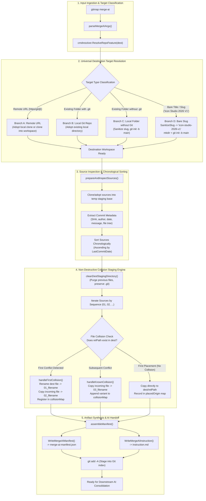

# Architecture Specification: Repository Creation, Non-Destructive Collision Sequencing & AI Manifest Instructions

- **Spec ID:** `02-spec/21-app/repository-creation-and-folder-structure-instructions/01-architecture-spec.md`
- **Feature Slug:** `repository-creation-and-folder-structure-instructions`
- **Status:** `ratified`
- **Version:** `1.0.0`
- **Subsystem:** Destination Resolution Engine (`cli/cmdresolver`), Multi-Repository Amalgamation & AI Staging (`cli/cmdmergeai`)
- **Related Specs:** `02-spec/21-app/269-summary-nodes-merge-ai-and-repo-feature/repo-feature.md`, `02-spec/21-app/269-summary-nodes-merge-ai-and-repo-feature/01-architecture-and-command-planning.md`
- **Target Implementation Files:**
  - `cli/cmdresolver/repo_feature.go`
  - `cli/cmdresolver/repo_feature_workspace.go`
  - `cli/cmdresolver/repo_feature_test.go`
  - `cli/cmdmergeai/merge_ai_types.go`
  - `cli/cmdmergeai/merge_ai_manifest.go`
  - `cli/cmdmergeai/merge_ai_staging.go`
  - `cli/cmdmergeai/merge_ai_inspect.go`
  - `cli/cmdmergeai/merge_ai_core.go`
  - `cli/cmdmergeai/merge_ai_test.go`

---

## 1. Executive Summary & Problem Statement

Modern software engineering frequently demands amalgamating features, components, and historical implementations from multiple disparate Git repositories into a single unified destination repository. In multi-agent AI coding systems, this process faces three major architectural challenges:

1. **Destructive File Overwrites:** Conventional archive extraction, naive copying, or standard `git merge` strategies silently overwrite overlapping files (e.g. `package.json`, `main.go`, `readme.md`, `config.json`). This violates the core principle of lossless synthesis and causes immediate code regressions.
2. **Ambiguous Destination Targets:** Developers invoke commands with diverse destination expressions ranging from bare human-readable titles (`"Icon Studio 2026 V1"`), kebab-case slugs (`icon-studio-2026-v1`), existing uninitialized folders, local Git repositories, to remote GitHub URLs. Without a universal resolver, automation scripts fail or create malformed directories.
3. **Loss of Provenance & Context:** Merging disparate file trees into a flat directory strips away the original commit history, commit hashes, author timestamps, and repository origins. Downstream AI coding agents tasked with synthesizing conflicting files lack the telemetry required to make grounded consolidation decisions.

This specification establishes the architectural standard for:
- **Universal Slug Resolution:** Converting arbitrary input expressions (e.g. `"Icon Studio 2026 V1"` $\rightarrow$ `"icon-studio-2026-v1"`) and provisioning local/remote Git repositories with zero manual configuration.
- **Non-Destructive Collision Sequencing (`01_`, `02_`, `03_`):** Enforcing the **Zero Replacement Invariant**, where no file is ever overwritten; instead, conflicting paths are renamed with chronological 2-digit zero-padded prefixes.
- **Commit Metadata & File Provenance Tracking:** Capturing full commit SHAs, author dates, commit messages, and granular per-file provenance maps within `merge-ai-manifest.json`.
- **Downstream AI Instruction Orchestration:** Generating a standardized `instruction.md` guide that directs downstream AI agents to consolidate prefixed variants into canonical implementations with affirmative verification.

---

## 2. End-to-End System Architecture

The following diagram illustrates the lifecycle of a `gitmap merge-ai <dest> <src...>` invocation:



---

## 3. Universal Slug Resolution & Repository Creation Engine

### 3.1 Slug Normalization Specification

When users provide arbitrary human-readable repository titles, project names, or path arguments, `cmdresolver.SanitizeSlug` normalizes the identifier into a deterministic, canonical kebab-case slug:

$$\text{SanitizeSlug}(S) = \text{kebab-case alphanumeric identifier}$$

#### Transformation Pipeline
1. **Trimming & Lowercasing:** Trim all leading/trailing whitespace and convert the entire string to lowercase ASCII runes.
2. **Separator Normalization:** Replace all whitespace characters (` `, `\t`, `\n`) and underscores (`_`) with hyphens (`-`).
3. **Rune Filtering:** Retain only lowercase ASCII letters (`a-z`), decimal digits (`0-9`), and hyphens (`-`). All punctuation, special symbols, and control characters are discarded.
4. **Hyphen Deduplication:** Collapse consecutive hyphens (`--` $\rightarrow$ `-`) iteratively until only single hyphens remain.
5. **Boundary Trimming:** Strip any remaining leading or trailing hyphens. If the resulting string is empty, fallback to the canonical default slug `"repo"`.

#### Canonical Transformation Examples

| Input Identifier | Normalized Canonical Slug | Description |
| :--- | :--- | :--- |
| `"Icon Studio 2026 V1"` | `icon-studio-2026-v1` | Multi-word title with year and version |
| `"   My_Project-Name__V2.0   "` | `my-project-name-v20` | Underscores, multiple hyphens, punctuation |
| `"Payment Router @ Core (PROD)"` | `payment-router-core-prod` | Special characters, parentheses, uppercase |
| `"---alpha---beta---"` | `alpha-beta` | Redundant edge and internal hyphens |
| `""` / `"   "` | `repo` | Fallback for empty strings |

### 3.2 Four-Branch Target Resolution Semantics

`cmdresolver.ResolveRepoFeature` evaluates `<dest-target>` across four distinct classification branches:

```
                  ┌──────────────────────────────────────────┐
                  │       Target Classification Flow         │
                  └────────────────────┬─────────────────────┘
                                       │
                ┌──────────────────────┴──────────────────────┐
                │                                             │
      Is Remote Git URL?                             Is Existing Local Dir?
      (https://, git@, ssh://)                       (os.Stat succeeds && IsDir)
                │                                             │
         ┌──────┴──────┐                               ┌──────┴──────┐
         ▼             ▼                               ▼             ▼
      [Branch A]    Continue                        Has .git?    No .git?
    Remote URL Target                              [Branch B]   [Branch C]
                                                   Local Git   Local No-Git
                                                       │             │
                                                       └──────┬──────┘
                                                              ▼
                                                          [Branch D]
                                                       Bare Slug / Title
```

#### Branch A: Remote Git URL
- **Input Patterns:** `https://github.com/org/repo.git`, `git@github.com:org/repo.git`.
- **Resolution Behavior:**
  1. Parse the repository slug from the URL.
  2. Inspect the local SQLite store (`gitmap.db`) to verify if an active clone already exists in the configured workspace.
  3. If present locally, adopt the existing filesystem path (`isCloned: false`, `isNewRepo: false`).
  4. If absent locally, execute high-speed clone into `<workspaceRoot>/<slug>` (`isCloned: true`, `isNewRepo: false`).

#### Branch B: Local Folder with Existing `.git`
- **Input Patterns:** `./my-existing-app`, `relative/path/to/repo`.
- **Resolution Behavior:**
  1. Detect existing `.git` directory or worktree file.
  2. Verify repository health (`git status`, active branch).
  3. Adopt the folder directly as the staging workspace (`isCloned: false`, `isNewRepo: false`).

#### Branch C: Local Folder without `.git`
- **Input Patterns:** `./unversioned-source`, `scaffolds/draft-project`.
- **Resolution Behavior:**
  1. Detect directory exists but lacks `.git`.
  2. Extract folder basename as slug; sanitize using `SanitizeSlug`.
  3. Execute `git init -b main` inside the target directory.
  4. Flag target as a newly created repository (`isNewRepo: true`, `isCloned: false`).

#### Branch D: Bare Repository Name / Title (e.g. `"Icon Studio 2026 V1"`)
- **Input Patterns:** `"Icon Studio 2026 V1"`, `payment-router-v2`.
- **Resolution Behavior:**
  1. Execute `SanitizeSlug` to derive canonical slug: `icon-studio-2026-v1`.
  2. Resolve workspace root path: `<workspaceRoot>/<canonicalSlug>`.
  3. Ensure directory exists (`os.MkdirAll` with mode `0755`).
  4. If `.git` is absent, execute `git init -b main`.
  5. Return resolved target with positive booleans (`isNewRepo: true`, `isCloned: false`).

---

## 4. Non-Destructive Collision Sequencing & Zero Replacement Invariant

### 4.1 The Zero Replacement Invariant

> **The Zero Replacement Invariant:**  
> Under no circumstances may an existing file in the staging workspace be silently overwritten, replaced, or deleted during multi-repository amalgamation. Every file variation contributed by any source repository must be preserved on disk in its entirety until a human or autonomous AI agent explicitly consolidates it.

### 4.2 Chronological Source Precedence

To establish an objective, deterministic baseline:
1. All source repositories are inspected before staging.
2. The latest commit timestamp (`LastCommitDate`) is extracted for each source.
3. Sources are sorted chronologically in ascending order (earliest to latest):

$$\text{sources}[0].\text{LastCommitDate} \le \text{sources}[1].\text{LastCommitDate} \le \dots \le \text{sources}[N-1].\text{LastCommitDate}$$

This ordering ensures that:
- The oldest repository acts as the historical baseline (`01_`).
- Subsequent repositories represent incremental iterations (`02_`, `03_`, etc.).
- File collisions are ordered logically by evolution rather than arbitrary CLI argument position.

### 4.3 Collision Sequencing Algorithm

For each source repository $S_i$ (with 1-based index $i$ formatted as a two-digit prefix `%02d`):

```
For each relPath in S_i.FolderTree:
    1. If relPath is already registered in collisionMap:
       - Copy S_i's version to: <dir>/%02d_<basename>
       - Append variant to collisionMap[relPath].Variants
       - Continue

    2. If destPath does NOT exist on disk:
       - Copy S_i's version directly to: <destPath>
       - Record origin in placedOrigin[relPath]
       - Increment uniqueFilesDirectlyPlaced
       - Continue

    3. If destPath DOES exist on disk (First Collision Encountered):
       - Retrieve origin of existing file from placedOrigin[relPath] (sequence '01')
       - Rename existing file: destPath -> <dir>/01_<basename>
       - Copy incoming S_i file to: <dir>/%02d_<basename>
       - Decrement uniqueFilesDirectlyPlaced
       - Delete placedOrigin[relPath]
       - Register new FileCollisionRecord in collisionMap with both variants (01 and 02)
```

#### Collision Sequencing State Transition

```
Initial State:
  dest/package.json (placed from Source 1)
  uniqueFilesDirectlyPlaced = 1

Source 2 arrives with package.json (Collision 1):
  dest/01_package.json (renamed from Source 1 version)
  dest/02_package.json (copied from Source 2 version)
  uniqueFilesDirectlyPlaced = 0
  collisionMap["package.json"] = [Variant 01, Variant 02]

Source 3 arrives with package.json (Collision 2):
  dest/01_package.json (Source 1)
  dest/02_package.json (Source 2)
  dest/03_package.json (copied from Source 3 version)
  collisionMap["package.json"] = [Variant 01, Variant 02, Variant 03]
```

---

## 5. Commit Metadata Schema & File Provenance Tracking

### 5.1 Commit Metadata Schema

Downstream consolidating agents require accurate commit context to decide whether a newer file supersedes an older file or whether features from both must be merged. GitMap queries each source repository using native Git plumbing commands:

- **Truncated SHA:** `git -C <dir> rev-parse --short=8 HEAD` (e.g. `a1b2c3d4`)
- **Full SHA:** `git -C <dir> rev-parse HEAD` (40-hexadecimal SHA)
- **Author Information:** `git -C <dir> log -1 --format="%an <%ae>"`
- **Commit Timestamp:** `git -C <dir> log -1 --format="%cI"` (ISO 8601 / RFC 3339)
- **Commit Message:** `git -C <dir> log -1 --format="%s"` (Subject line)
- **Active Branch:** `git -C <dir> rev-parse --abbrev-ref HEAD`

This metadata is captured in the `SourceCommitMetadata` struct and attached to the manifest:

```json
{
  "repoSlug": "icon-renderer-v1",
  "repoUrl": "https://github.com/my-org/icon-renderer-v1.git",
  "branch": "main",
  "headCommitSha": "a1b2c3d4e5f67890123456789abcdef012345678",
  "shortCommitSha": "a1b2c3d4",
  "author": "Engineering Lead <lead@example.com>",
  "commitDate": "2026-09-15T14:32:00Z",
  "commitMessage": "feat: optimize svg canvas rasterizer pipeline",
  "totalFilesContributed": 42
}
```

### 5.2 Granular File Provenance Mapping

Every placed file (both unique direct placements and sequenced collision variants) is indexed in the `provenanceMap`. This provides $O(1)$ lookup for downstream agents to verify exactly where any staged file originated:

```json
{
  "01_src/renderer.ts": {
    "canonicalPath": "src/renderer.ts",
    "sequencePrefix": "01",
    "sourceRepoSlug": "icon-renderer-v1",
    "sourceRepoUrl": "https://github.com/my-org/icon-renderer-v1.git",
    "commitSha": "a1b2c3d4",
    "hasCollision": true,
    "isDirectPlacement": false
  },
  "src/utils/math.ts": {
    "canonicalPath": "src/utils/math.ts",
    "sequencePrefix": "01",
    "sourceRepoSlug": "icon-renderer-v1",
    "sourceRepoUrl": "https://github.com/my-org/icon-renderer-v1.git",
    "commitSha": "a1b2c3d4",
    "hasCollision": false,
    "isDirectPlacement": true
  }
}
```

---

## 6. Artifact Structures: Manifest & Instruction

### 6.1 `merge-ai-manifest.json` Specification

The manifest is written to the root of the destination repository: `<destDir>/merge-ai-manifest.json`.

#### JSON Schema Breakdown
- **`attributes`**: Metadata regarding generation timestamp, tool name, GitMap version, and collision strategy.
- **`data.destination`**: Resolved target details including target type, canonical slug, resolved relative path, remote URL, and affirmative creation booleans (`isNewRepo`, `isCloned`).
- **`data.repoSequence`**: Array of source repositories in chronological sequence order.
- **`data.skippedSources`**: Array of skipped sources (e.g. subfile URLs or duplicate repositories detected by pre-filtering).
- **`data.fileCollisions`**: Array of conflicting file records with canonical paths, status (`pending_ai_consolidation` or `consolidated`), and sequenced variant lists.
- **`data.commitMetadata`**: Array of rich commit records per source repository.
- **`data.fileProvenance`**: Granular map linking relative staged paths to source origins.
- **`data.uniqueFilesDirectlyPlaced`**: Total count of unique non-colliding files placed directly.

#### Complete Sample `merge-ai-manifest.json`

```json
{
  "attributes": {
    "generatedAt": "2026-10-11T12:00:00Z",
    "gitMapVersion": "v6.534.0",
    "tool": "gitmap-merge-ai",
    "collisionStrategy": "prefixed-sequence"
  },
  "data": {
    "destination": {
      "targetType": "bare-slug",
      "slug": "icon-studio-2026-v1",
      "resolvedPath": "workspaces/icon-studio-2026-v1",
      "originUrl": "",
      "isNewRepo": true,
      "isCloned": false
    },
    "repoSequence": [
      {
        "sequenceOrder": 1,
        "title": "Icon Core Engine",
        "repoUrl": "https://github.com/my-org/icon-core-engine.git",
        "branch": "main",
        "commitRange": "HEAD~5..HEAD",
        "lastCommitDate": "2026-08-10T09:15:00Z",
        "description": "Core SVG generation and styling engine",
        "releaseInfo": {
          "lastTag": "v1.2.0",
          "tagHash": "f1e2d3c4"
        },
        "folderTree": [
          "package.json",
          "src/engine.ts",
          "src/utils.ts"
        ]
      },
      {
        "sequenceOrder": 2,
        "title": "Studio UI Next",
        "repoUrl": "https://github.com/my-org/studio-ui-next.git",
        "branch": "main",
        "commitRange": "HEAD~3..HEAD",
        "lastCommitDate": "2026-09-22T16:45:00Z",
        "description": "React canvas editor and tool palette",
        "releaseInfo": {
          "lastTag": "v2.0.1",
          "tagHash": "e5d4c3b2"
        },
        "folderTree": [
          "package.json",
          "src/components/Canvas.tsx",
          "src/utils.ts"
        ]
      }
    ],
    "skippedSources": [
      {
        "rawInput": "https://github.com/my-org/icon-core-engine/blob/main/src/engine.ts",
        "repo": "https://github.com/my-org/icon-core-engine.git",
        "filePath": "src/engine.ts",
        "reason": "Repository already included in full merge scope",
        "isFile": true
      }
    ],
    "fileCollisions": [
      {
        "canonicalPath": "package.json",
        "status": "pending_ai_consolidation",
        "variants": [
          {
            "sequence": "01",
            "file": "01_package.json",
            "sourceRepo": "icon-core-engine",
            "commit": "f1e2d3c4",
            "commitDate": "2026-08-10T09:15:00Z",
            "commitMessage": "chore: bump dependencies"
          },
          {
            "sequence": "02",
            "file": "02_package.json",
            "sourceRepo": "studio-ui-next",
            "commit": "e5d4c3b2",
            "commitDate": "2026-09-22T16:45:00Z",
            "commitMessage": "feat: add canvas state hooks"
          }
        ]
      },
      {
        "canonicalPath": "src/utils.ts",
        "status": "pending_ai_consolidation",
        "variants": [
          {
            "sequence": "01",
            "file": "src/01_utils.ts",
            "sourceRepo": "icon-core-engine",
            "commit": "f1e2d3c4",
            "commitDate": "2026-08-10T09:15:00Z",
            "commitMessage": "chore: bump dependencies"
          },
          {
            "sequence": "02",
            "file": "src/02_utils.ts",
            "sourceRepo": "studio-ui-next",
            "commit": "e5d4c3b2",
            "commitDate": "2026-09-22T16:45:00Z",
            "commitMessage": "feat: add canvas state hooks"
          }
        ]
      }
    ],
    "commitMetadata": [
      {
        "repoSlug": "icon-core-engine",
        "repoUrl": "https://github.com/my-org/icon-core-engine.git",
        "branch": "main",
        "headCommitSha": "f1e2d3c4b5a69780123456789abcdef012345678",
        "shortCommitSha": "f1e2d3c4",
        "author": "Engine Team <engine@example.com>",
        "commitDate": "2026-08-10T09:15:00Z",
        "commitMessage": "chore: bump dependencies",
        "totalFilesContributed": 3
      },
      {
        "repoSlug": "studio-ui-next",
        "repoUrl": "https://github.com/my-org/studio-ui-next.git",
        "branch": "main",
        "headCommitSha": "e5d4c3b2a1f09876543210fedcba9876543210fe",
        "shortCommitSha": "e5d4c3b2",
        "author": "UI Team <ui@example.com>",
        "commitDate": "2026-09-22T16:45:00Z",
        "commitMessage": "feat: add canvas state hooks",
        "totalFilesContributed": 3
      }
    ],
    "fileProvenance": {
      "01_package.json": {
        "canonicalPath": "package.json",
        "sequencePrefix": "01",
        "sourceRepoSlug": "icon-core-engine",
        "sourceRepoUrl": "https://github.com/my-org/icon-core-engine.git",
        "commitSha": "f1e2d3c4",
        "hasCollision": true,
        "isDirectPlacement": false
      },
      "02_package.json": {
        "canonicalPath": "package.json",
        "sequencePrefix": "02",
        "sourceRepoSlug": "studio-ui-next",
        "sourceRepoUrl": "https://github.com/my-org/studio-ui-next.git",
        "commitSha": "e5d4c3b2",
        "hasCollision": true,
        "isDirectPlacement": false
      },
      "src/engine.ts": {
        "canonicalPath": "src/engine.ts",
        "sequencePrefix": "01",
        "sourceRepoSlug": "icon-core-engine",
        "sourceRepoUrl": "https://github.com/my-org/icon-core-engine.git",
        "commitSha": "f1e2d3c4",
        "hasCollision": false,
        "isDirectPlacement": true
      },
      "src/components/Canvas.tsx": {
        "canonicalPath": "src/components/Canvas.tsx",
        "sequencePrefix": "02",
        "sourceRepoSlug": "studio-ui-next",
        "sourceRepoUrl": "https://github.com/my-org/studio-ui-next.git",
        "commitSha": "e5d4c3b2",
        "hasCollision": false,
        "isDirectPlacement": true
      }
    },
    "uniqueFilesDirectlyPlaced": 2
  }
}
```

### 6.2 `instruction.md` Specification

The `instruction.md` document is written to `<destDir>/instruction.md` and provides the exact operating protocol for the downstream AI consolidation agent:

```markdown
# AI Merge Consolidation Instruction & Verification Guide

This repository has been prepared by `gitmap merge-ai`. Multiple source repositories have been assembled into this staging tree.

## Non-Negotiable Instructions for the Consolidating AI Agent:
1. **Preserve All Business Logic:** Do NOT delete features, endpoints, or data models. Consolidate overlapping files (`01_*`, `02_*`, `03_*`) into the single canonical file name (e.g. synthesize `01_main.go` and `02_main.go` into `main.go`).
2. **Flatten Sequence Prefixes:** Once consolidated, remove temporary sequence prefixed files so the repository strictly reflects canonical filenames.
3. **Reference the Manifest:** Open and read `merge-ai-manifest.json` to inspect the source repositories, commit histories, and collision map.
4. **Zero Code Deletion:** When resolving duplicate utilities, favor additive composition, interface unions, and modern patterns.
5. **Affirmative Verification:** Verify builds and test suites after consolidation to guarantee zero broken imports.

## Skipped Sources (Pre-Filter Intelligence):
The following source URLs were automatically skipped during pre-filtering:
- **File URL**: `https://github.com/my-org/icon-core-engine/blob/main/src/engine.ts` (Repository `https://github.com/my-org/icon-core-engine.git` is already included; file path: `src/engine.ts`)

## Detected File Collisions:
- **package.json**:
  - Variant: `01_package.json` (Source: `icon-core-engine`, Commit: `f1e2d3c4`, Date: `2026-08-10T09:15:00Z`)
  - Variant: `02_package.json` (Source: `studio-ui-next`, Commit: `e5d4c3b2`, Date: `2026-09-22T16:45:00Z`)
- **src/utils.ts**:
  - Variant: `src/01_utils.ts` (Source: `icon-core-engine`, Commit: `f1e2d3c4`, Date: `2026-08-10T09:15:00Z`)
  - Variant: `src/02_utils.ts` (Source: `studio-ui-next`, Commit: `e5d4c3b2`, Date: `2026-09-22T16:45:00Z`)

## Step-by-Step AI Action Checklist:
- [ ] Read `merge-ai-manifest.json` and inventory all entries in `fileCollisions`.
- [ ] For each collision:
  - [ ] Analyze differences between sequenced variants (`01_<file>`, `02_<file>`, etc.).
  - [ ] Synthesize unified implementation into `<file>`.
  - [ ] Delete temporary sequenced files after verified synthesis.
- [ ] Ensure non-colliding files maintain correct imports and package names.
- [ ] Verify that no sequenced files remain in the repository tree.
- [ ] Update `merge-ai-manifest.json` setting `fileCollisions[].status = "consolidated"`.
- [ ] Stage and commit the consolidated repository:
      `gitmap cpf "merge-ai - consolidate multi-repo merge into unified codebase"`
```

---

## 7. Data Models & Go Package Contracts

### 7.1 Type Definitions (`cli/cmdmergeai/merge_ai_types.go`)

```go
package cmdmergeai

import "time"

// SourceCommitMetadata captures granular commit telemetry per source repository.
type SourceCommitMetadata struct {
	RepoSlug              string    `json:"repoSlug"`
	RepoURL               string    `json:"repoUrl"`
	Branch                string    `json:"branch"`
	HeadCommitSha         string    `json:"headCommitSha"`
	ShortCommitSha        string    `json:"shortCommitSha"`
	Author                string    `json:"author"`
	CommitDate            time.Time `json:"commitDate"`
	CommitMessage         string    `json:"commitMessage"`
	TotalFilesContributed int       `json:"totalFilesContributed"`
}

// FileProvenanceRecord tracks the exact origin of a file placed in the destination tree.
type FileProvenanceRecord struct {
	CanonicalPath     string `json:"canonicalPath"`
	SequencePrefix    string `json:"sequencePrefix"`
	SourceRepoSlug    string `json:"sourceRepoSlug"`
	SourceRepoURL     string `json:"sourceRepoUrl"`
	CommitSha         string `json:"commitSha"`
	HasCollision      bool   `json:"hasCollision"`
	IsDirectPlacement bool   `json:"isDirectPlacement"`
}

// FileCollisionVariant models one sequenced instance of a conflicting file.
type FileCollisionVariant struct {
	Sequence      string `json:"sequence"`
	File          string `json:"file"`
	SourceRepo    string `json:"sourceRepo"`
	Commit        string `json:"commit"`
	CommitDate    string `json:"commitDate,omitempty"`
	CommitMessage string `json:"commitMessage,omitempty"`
}

// FileCollisionRecord models a conflicting path requiring AI consolidation.
type FileCollisionRecord struct {
	CanonicalPath  string                 `json:"canonicalPath"`
	Variants       []FileCollisionVariant `json:"variants"`
	Status         string                 `json:"status"` // "pending_ai_consolidation", "consolidated"
	IsConsolidated bool                   `json:"isConsolidated"`
}

// MergeAIManifest models the root merge-ai-manifest.json artifact.
type MergeAIManifest struct {
	Attributes struct {
		GeneratedAt       string `json:"generatedAt"`
		GitMapVersion     string `json:"gitMapVersion"`
		Tool              string `json:"tool"`
		CollisionStrategy string `json:"collisionStrategy"`
	} `json:"attributes"`
	Data struct {
		Destination struct {
			TargetType   string `json:"targetType"`
			Slug         string `json:"slug"`
			ResolvedPath string `json:"resolvedPath"`
			OriginURL    string `json:"originUrl,omitempty"`
			IsNewRepo    bool   `json:"isNewRepo"`
			IsCloned     bool   `json:"isCloned"`
		} `json:"destination"`
		RepoSequence              []SourceRepoSequenceEntry       `json:"repoSequence"`
		SkippedSources            []SkippedSourceItem             `json:"skippedSources,omitempty"`
		FileCollisions            []FileCollisionRecord           `json:"fileCollisions"`
		CommitMetadata            []SourceCommitMetadata          `json:"commitMetadata,omitempty"`
		FileProvenance            map[string]FileProvenanceRecord `json:"fileProvenance,omitempty"`
		UniqueFilesDirectlyPlaced int                             `json:"uniqueFilesDirectlyPlaced"`
	} `json:"data"`
}
```

### 7.2 Destination Resolver Types (`cli/cmdresolver/repo_feature.go`)

```go
package cmdresolver

// RepoFeatureTargetType enumerates classification modes for destination targets.
type RepoFeatureTargetType string

const (
	TargetTypeRemoteURL  RepoFeatureTargetType = "remote-url"
	TargetTypeLocalGit   RepoFeatureTargetType = "local-git"
	TargetTypeLocalNoGit RepoFeatureTargetType = "local-no-git"
	TargetTypeBareSlug   RepoFeatureTargetType = "bare-slug"
)

// ResolvedRepoFeature represents the resolved workspace destination for a 'repo feature' target.
type ResolvedRepoFeature struct {
	OriginalInput string                `json:"originalInput"`
	TargetType    RepoFeatureTargetType `json:"targetType"`
	CanonicalSlug string                `json:"canonicalSlug"`
	LocalPath     string                `json:"localPath"`
	RemoteURL     string                `json:"remoteUrl,omitempty"`
	IsNewRepo     bool                  `json:"isNewRepo"`
	IsCloned      bool                  `json:"isCloned"`
}
```

---

## 8. Verification Strategy & Edge Cases

| Scenario | Input Example | Expected Behavior | Verification Check |
| :--- | :--- | :--- | :--- |
| **Bare Slug with Whitespace & Version** | `"Icon Studio 2026 V1"` | Normalizes to `icon-studio-2026-v1`, creates dir, `git init -b main`. | Directory exists, `.git` exists, `isNewRepo: true`. |
| **Existing Staged Repository Cleanup** | Staging dir contains stale files | `cleanDestStagingDirectory` purges all entries except `.git`. | `.git` intact, old code purged, working tree clean. |
| **Identical Content Collision** | Two repos have identical `readme.md` | Non-destructive sequencing creates `01_readme.md` and `02_readme.md`. Zero replacement enforced. | Both variants present on disk, indexed in manifest. |
| **Three-Way Collision** | Three repos share `package.json` | Sequence creates `01_package.json`, `02_package.json`, `03_package.json`. | 3 variants in `collisionMap["package.json"]`. |
| **File URL Redundancy in Source List** | `https://github.com/org/repo/blob/main/main.go` | Parsed as redundant to `https://github.com/org/repo.git`, skipped gracefully. | Appears in `skippedSources` in manifest & instructions. |
| **Git Add Staging Completion** | `merge-ai` stages all files | Destination tree staged via `git add -A`. | `git status` shows all files staged in index. |

---

## 9. Conclusion & Subtask Mapping

This architecture establishes a reliable, non-destructive foundation for multi-repository amalgamation:
- **Subtask 01 (`Task-01 & Task-02`):** Implements workspace cleanup, destination slug resolution (`"Icon Studio 2026 V1"` $\rightarrow$ `icon-studio-2026-v1`), repo initialization, manifest schema extensions, and instruction generation (`.ai-memory/plans/subtasks/repository-creation-and-folder-structure-instructions/01-workspace-cleanup-and-manifest-spec.md`).
- **Subtask 02 (`Task-03`):** Implements chronological inspection, the Zero Replacement Invariant, 2-digit zero-padded collision sequencing, commit metadata extraction, and provenance map population (`.ai-memory/plans/subtasks/repository-creation-and-folder-structure-instructions/02-merge-ai-engine-and-manifest-tracking.md`).
