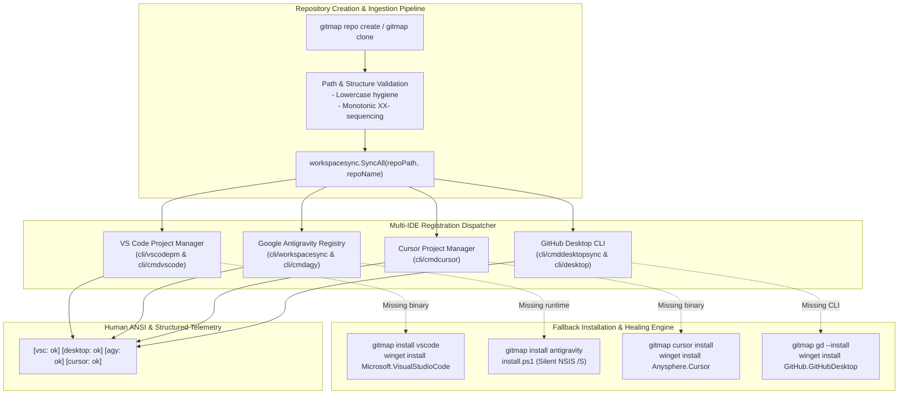

# Specification: IDE Ecosystem Registration & Fallback Tool Execution Engine

- **Document ID:** `02-spec/21-app/repository-creation-and-folder-structure-instructions/02-ide-ecosystem-and-execution-spec.md`
- **Parent Plan:** `.ai-memory/plans/repository-creation-and-folder-structure-instructions.md`
- **Domain:** Developer Environment Orchestration / Multi-IDE Workspace Registration / Fallback Tooling
- **Classification:** Core Application Component Specification (`02-spec/21-app`)
- **Status:** APPROVED & RATIFIED
- **Target Release:** Minor Version Bump
- **Target Packages:** `cli/workspacesync`, `cli/cmdvscode`, `cli/vscodepm`, `cli/cmdcursor`, `cli/cmddesktopsync`, `cli/desktop`, `cli/cmdinstall`

---

## 1. Executive Summary & Problem Formulation

The **IDE Ecosystem Registration & Fallback Tool Execution Engine** establishes a standardized, automated pipeline to seamlessly register newly created or cloned repositories into all supported developer environments—**Visual Studio Code**, **Google Antigravity**, **Cursor IDE**, and **GitHub Desktop**—while guaranteeing deterministic fallback installation procedures when any component is missing on the host workstation.

### 1.1 Core Problems Addressed
1. **Fragmented Project Registration:** Developers and autonomous AI agents manually add workspaces across separate IDEs, leading to missing project shortcuts, out-of-sync tag registries, and fragmented developer state.
2. **Missing Tooling Halts:** When a workstation or remote fleet node lacks one or more IDE binaries, initialization scripts crash or abort silently without providing deterministic, self-healing installation commands.
3. **Inconsistent Path Sanitization:** Windows backslashes (`\`) and drive letters (`C:`) versus POSIX forward-slashes (`/`) corrupt cross-platform workspace descriptors and URI handlers across VS Code, Antigravity, and GitHub Desktop.
4. **Negative Boolean Anti-Patterns:** Legacy flags (such as `disableDesktop`, `noAgySync`, `skipInstall`) introduce cognitive overhead and violated boolean polarity standards defined in `02-spec/02-coding-guidelines/03-golang/02-boolean-standards.md`.

### 1.2 Core Architectural Invariants
- **Strict Relative Path Governance:** All system paths, script references, and documentation must utilize normalized relative Git paths (`path/to/file`) with zero drive letters and zero absolute file URIs.
- **Positive Affirmative Polarity:** All configuration options, state indicators, and schema fields strictly employ affirmative boolean variables (`isInstalled`, `isEnabled`, `isRegistered`, `isFallbackAllowed`).
- **Synchronous Multi-IDE Registration:** Repository registration dispatches across all four supported IDE targets through a unified orchestration engine with atomic status reporting.

---

## 2. System Architecture & Multi-IDE Registration Topology



---

## 3. Detailed IDE Registration Subsystems

### 3.1 Visual Studio Code (`cli/cmdvscode` & `cli/vscodepm`)

Visual Studio Code workspace registration operates through the widely adopted Project Manager extension (`alefragnani.project-manager`), writing directly to the extension's canonical `projects.json` descriptor file.

#### 3.1.1 Descriptor Path Resolution
- **Windows:** `%APPDATA%/Code/User/globalStorage/alefragnani.project-manager/projects.json` (fallback: `%APPDATA%/Code/User/projects.json`)
- **Linux:** `$XDG_CONFIG_HOME/Code/User/globalStorage/alefragnani.project-manager/projects.json` (fallback: `$HOME/.config/Code/User/projects.json`)
- **macOS:** `$HOME/Library/Application Support/Code/User/globalStorage/alefragnani.project-manager/projects.json`

#### 3.1.2 Schema Contract
```json
[
  {
    "name": "gitmap-v28",
    "rootPath": "work/gitmap",
    "paths": [
      "work/gitmap"
    ],
    "tags": [
      "gitmap",
      "go",
      "typescript"
    ],
    "enabled": true
  }
]
```

#### 3.1.3 Synchronization & Merging Strategy
1. **Merge Modes:**
   - `MergeModeUnion`: Preserves existing entries, updates root path and merges tag arrays without duplication.
   - `MergeModeReplace`: Atomically replaces matching project records while preserving unmanaged workspace entries.
2. **Tag Detection Engine:** Automatically detects technologies based on root marker files (`go.mod` &rarr; `go`, `package.json` &rarr; `typescript`, `composer.json` &rarr; `php`, `Cargo.toml` &rarr; `rust`) and always assigns the affirmative tag `"gitmap"`.
3. **CLI Commands:**
   - `gitmap vscode sync`: Scans workspace tree and synchronizes all active repositories to `projects.json`.
   - `gitmap vscode add <path>`: Explicitly adds target repository into the active project registry.
   - `gitmap vscode optimize`: Removes dead, dangling, or duplicate paths from `projects.json`.

---

### 3.2 Google Antigravity (`cli/cmdagy` & `cli/workspacesync`)

Google Antigravity manages agentic workflows through individual project configuration files written to the local configuration directory (`~/.gemini/config/projects/`).

#### 3.2.1 Descriptor Path Resolution
- **All Platforms:** `$HOME/.gemini/config/projects/<uuid>.json`

#### 3.2.2 Configuration Schema Contract
```json
{
  "id": "7b8e5c1a-9f2d-4e3b-8a1c-6d5e4f3a2b1c",
  "name": "gitmap-v28",
  "projectResources": {
    "resources": [
      {
        "gitFolder": {
          "folderUri": "work/gitmap",
          "defaultBranch": "main"
        }
      }
    ]
  },
  "settings": {
    "executionMode": "TURBO",
    "unattendedExecution": true
  },
  "updatedAt": "2026-10-11T12:00:00.000000000Z",
  "isWorkspaceOnly": false
}
```

#### 3.2.3 Registration Mechanics
1. **Idempotent Matching:** Scans existing `*.json` project files under `~/.gemini/config/projects/`. If a configuration contains a matching `folderUri`, the existing project is preserved (`isExistingProject: true`).
2. **Deterministic UUID Allocation:** If the repository is uncataloged, generates a fresh RFC 4122 v4 UUID, writes formatted JSON with indentation, and stamps `updatedAt` with high-precision ISO-8601 UTC.
3. **Autonomous Agent Policies:** Automatically seeds affirmative policies (`unattendedExecution: true`, `executionMode: "TURBO"`) to ensure headless agent swarms operate without manual permission stalls.
4. **CLI Commands:**
   - `gitmap agy projects ls`: Lists all detected Antigravity projects with timestamp and session indicators.
   - `gitmap agy pin <project>`: Pins target workspace to the top of the Antigravity launcher.
   - `gitmap agy deploy`: Synchronizes Antigravity configurations, dark theme seeds, plugins, and skills to remote cluster nodes.

---

### 3.3 Cursor IDE (`cli/cmdcursor`)

Cursor IDE utilizes an architecture derived from VS Code but isolates its user state and extension configuration under dedicated user directories.

#### 3.3.1 Descriptor Path Resolution
- **Windows:** `%APPDATA%/Cursor/User/globalStorage/alefragnani.project-manager/projects.json` (fallback: `%APPDATA%/Cursor/User/projects.json`)
- **Linux:** `$XDG_CONFIG_HOME/Cursor/User/globalStorage/alefragnani.project-manager/projects.json` (fallback: `$HOME/.config/Cursor/User/projects.json`)
- **macOS:** `$HOME/Library/Application Support/Cursor/User/globalStorage/alefragnani.project-manager/projects.json`

#### 3.3.2 Configuration Synchronization
1. **Dual Registry Mirroring:** Shares the `ProjectManagerEntry` schema with VS Code, allowing synchronized repository bookmarks across both editors.
2. **Settings Propagation:** Facilitates bidirectional migration of `settings.json`, `keybindings.json`, and prompt snippets between VS Code and Cursor.
3. **Linux Desktop Launcher Generation:** Generates `.desktop` entries in `~/.local/share/applications/cursor.desktop` with valid icon references and dock pinning metadata.
4. **CLI Commands:**
   - `gitmap cursor sync`: Synchronizes current repository catalogue into Cursor's `projects.json`.
   - `gitmap cursor open <repo>`: Launches Cursor with the specified repository workspace path.
   - `gitmap cursor migrate`: Imports extensions and settings from VS Code into Cursor.

---

### 3.4 GitHub Desktop (`cli/cmddesktopsync`, `cli/desktop` & `cli/cmdvscode.RunGitHubDesktop`)

GitHub Desktop provides visual version control for Git repositories. GitMap registers repositories programmatically via GitHub Desktop's URI and CLI routing endpoints.

#### 3.4.1 Executable Resolution (`desktop.ResolveCLI`)
1. **PATH Inspection:** Tests standard binary names `github` and `github-desktop`.
2. **Windows Installation Locations:**
   - `%LOCALAPPDATA%/GitHubDesktop/GitHubDesktop.exe`
   - `%LOCALAPPDATA%/GitHubDesktop/app-*/GitHubDesktop.exe`
3. **Linux / macOS Locations:**
   - Linux: `/usr/bin/github-desktop` or `/usr/local/bin/github-desktop`
   - macOS: `/Applications/GitHub Desktop.app/Contents/MacOS/GitHub Desktop`

#### 3.4.2 Registration Workflow
1. **Direct CLI Invocation:** Executes the resolved CLI passing repository relative root path (`cmd := exec.Command(cli, repoPath)`).
2. **Environment Guard:** Checks `GITMAP_NO_DESKTOP` or `GITMAP_SKIP_DESKTOP`. When absent or `0`, registration executes normally (`isDesktopSyncEnabled: true`).
3. **Batch Aggregation:** `desktop.AddRepos(records)` iterates over discovered scan records, tracks affirmative outcomes, and returns a structured `DesktopSummary{Added: int, Failed: int}`.
4. **CLI Commands:**
   - `gitmap desktop-sync`: Runs repository registration against all repositories in `output/gitmap.json`.
   - `gitmap gd`: Canonical shorthand for GitHub Desktop operations (`gitmap gd --install`, `gitmap gd --sync`).
   - `gitmap github-desktop`: Full alias routing to `cmdvscode.RunGitHubDesktop`.

---

## 4. Unified Multi-IDE Synchronization Engine (`cli/workspacesync`)

The `workspacesync` package serves as the single source of truth for synchronizing workspaces across all registered editors.

```go
package workspacesync

type WorkspaceSyncManager struct {
    IsVscodeEnabled      bool
    IsAntigravityEnabled bool
    IsCursorEnabled      bool
    IsDesktopEnabled     bool
}

func SyncAll(repoPath string, repoName string) {
    if IsRestrictedPath(repoPath) {
        return
    }
    // Dispatches VS Code, GitHub Desktop, Antigravity, and Cursor registration
    // Emits human-readable ANSI status block:
    // "  → sync: [vsc: ok] [desktop: ok] [agy: ok] [cursor: ok]"
}
```

### 4.1 Restricted Paths Protection
To prevent accidental pollution of system or non-owned repositories, `workspacesync.IsRestrictedPath` guards against:
- Non-owned paths (`omis`, `zsh`, system temporary directories).
- Bare repositories without a working tree.
- Directories without valid `.git` initialization.

### 4.2 Terminal Output Rendering
During repository creation or sync routines, the engine produces compact status telemetry:
```text
  → sync: [vsc: ok] [desktop: ok] [agy: ok] [cursor: ok]
```
If an individual IDE is skipped or uninstalled:
```text
  → sync: [vsc: ok] [desktop: skipped] [agy: ok] [cursor: skipped]
```

---

## 5. Fallback Tool Installation Architecture & Workflows

When a developer or agent initiates workspace creation and a target IDE is missing from the system, GitMap enforces the **Sub-Point 3 Fallback Protocol** providing instant, reliable installation pathways.

### 5.1 Sub-Point 3 Fallback Matrix

| Tool | Primary GitMap Command | OS Native Fallback Command | Platform Scope | Verification Probe |
|---|---|---|---|---|
| **Visual Studio Code** | `gitmap install vscode` | `winget install Microsoft.VisualStudioCode --force --accept-source-agreements --accept-package-agreements` | Windows, Linux, macOS | `code --version` |
| **Google Antigravity** | `gitmap install antigravity` | `install.ps1` (or `tools/install-antigravity.ps1`) | Windows, Linux, macOS | `antigravity --version` |
| **Cursor IDE** | `gitmap cursor install` | `winget install Anysphere.Cursor --silent --accept-source-agreements --accept-package-agreements` | Windows, Linux | `cursor --version` |
| **GitHub Desktop** | `gitmap gd --install`<br>`gitmap install github-desktop` | `winget install GitHub.GitHubDesktop --force --accept-source-agreements --accept-package-agreements` | Windows, Linux, macOS | `github --version` |

---

### 5.2 Detailed Tool Fallback Procedures

#### 5.2.1 Visual Studio Code Fallback Procedure
1. **Pre-flight Probe:** Checks `exec.LookPath("code")`.
2. **Primary Execution (`gitmap install vscode`):**
   - Windows: Invokes `winget` using package ID `constants.WingetPkgVSCode` (`Microsoft.VisualStudioCode`).
   - Linux (Ubuntu/Debian): Automatically fetches Microsoft GPG key, installs `/etc/apt/sources.list.d/vscode.list`, runs `apt-get update`, and installs package `code`.
3. **Settings & Extensions Hydration (`gitmap install vscode-settings`):**
   - Automatically synchronizes bundled settings from `settings/02 - vscode/` into the user profile.
   - Hydrates standard extensions declared in `extensions.txt` using `code --install-extension <id> --force`.

#### 5.2.2 Google Antigravity Fallback Procedure
1. **Pre-flight Probe:** Checks existence of desktop binary via `findInstalledAntigravityDesktopPath()`.
2. **Primary Execution (`gitmap install antigravity`):**
   - Resolves target platform architecture (Windows amd64, Linux amd64/arm64, Darwin universal).
   - Fetches verified release archive or NSIS executable installer.
   - Windows: Executes NSIS silent installer with `/S` flag and optional target directory `/D=<customDir>`.
   - Linux: Extracts application bundle into `$HOME/.local/share/antigravity/`, applies SUID hardening on `chrome-sandbox`, and registers desktop launcher.
3. **Standalone Script Fallback (`install.ps1`):**
   - Workstations without pre-installed GitMap CLI invoke the standalone bootstrap script:
     ```powershell
     powershell -ExecutionPolicy Bypass -File install.ps1 --tool antigravity
     ```

#### 5.2.3 Cursor IDE Fallback Procedure
1. **Pre-flight Probe:** Checks `exec.LookPath("cursor")`.
2. **Primary Execution (`gitmap cursor install`):**
   - Windows: Executes `winget install Anysphere.Cursor --silent --accept-source-agreements --accept-package-agreements`.
   - Linux: Triggers provisioning helper `repo-secrets/05-scripts/setup-cursor-ubuntu.py` downloading and packaging Cursor AppImage/tarball.
3. **Command Options:**
   - `--force` / `-f`: Overwrites existing installation.
   - `--dry-run` / `-d`: Emits execution plan without invoking system package managers.
   - `--node <node-id>`: Delegated remote fleet provisioning via SSH.

#### 5.2.4 GitHub Desktop Fallback Procedure
1. **Pre-flight Probe:** Checks `desktop.ResolveCLI()`.
2. **Primary Execution (`gitmap gd --install` / `gitmap install github-desktop`):**
   - Windows: Executes `winget install GitHub.GitHubDesktop --force --accept-source-agreements --accept-package-agreements`.
   - Linux: Installs `github-desktop` via shiftkey community APT repository.
   - macOS: Invokes `brew install --cask github-desktop`.
3. **Post-Install Hook:** Automatically reruns `cmddesktopsync.RunDesktopSync()` upon successful package installation.

---

## 6. Data Contracts & Go Struct Definitions

All interfaces, structs, and options strictly follow affirmative boolean naming standards:

```go
package model

// IdeRegistrationStatus represents the outcome of multi-IDE registration.
type IdeRegistrationStatus struct {
    RepoName                string `json:"repoName"`
    RelativePath            string `json:"relativePath"`
    IsVscodeRegistered      bool   `json:"isVscodeRegistered"`
    IsAntigravityRegistered bool   `json:"isAntigravityRegistered"`
    IsCursorRegistered      bool   `json:"isCursorRegistered"`
    IsDesktopRegistered     bool   `json:"isDesktopRegistered"`
    HasAllSucceeded         bool   `json:"hasAllSucceeded"`
}

// ToolCapabilityProbe reports tool availability on the local host.
type ToolCapabilityProbe struct {
    ToolName             string `json:"toolName"`
    IsInstalled          bool   `json:"isInstalled"`
    ExecutablePath       string `json:"executablePath,omitempty"`
    VersionString        string `json:"versionString,omitempty"`
    IsAutoInstallEnabled bool   `json:"isAutoInstallEnabled"`
    FallbackCommand      string `json:"fallbackCommand"`
}

// FallbackInstallOptions configures fallback execution behavior.
type FallbackInstallOptions struct {
    TargetTool          string `json:"targetTool"`
    IsSilent            bool   `json:"isSilent"`
    IsForceReinstall    bool   `json:"isForceReinstall"`
    IsDryRun            bool   `json:"isDryRun"`
    IsSettingsHydration bool   `json:"isSettingsHydration"`
}
```

---

## 7. Acceptance Criteria & Verification Protocol

### 7.1 Verification Gate Matrix

| Check ID | Verification Category | Command / Inspection | Success Criteria |
|---|---|---|---|
| **V-01** | **Path Hygiene** | `python 03-ai-scripts/49-verify-privacy-and-relative-paths.py` | 0 absolute paths, 0 drive letters, zero file URI schemes. |
| **V-02** | **Boolean Standards** | `python 03-ai-scripts/26-boolean-logic-modernizer.py --audit` | 100% positive affirmative booleans in Go and specs. |
| **V-03** | **VS Code PM Sync** | `gitmap vscode sync` | `projects.json` contains newly registered relative workspace path. |
| **V-04** | **Antigravity Sync** | `gitmap agy projects ls` | Project registered under `~/.gemini/config/projects/` with `executionMode: TURBO`. |
| **V-05** | **Cursor Sync** | `gitmap cursor sync` | Cursor `projects.json` reflects repository metadata with `gitmap` tag. |
| **V-06** | **GitHub Desktop Sync** | `gitmap gd` | Repository added to GitHub Desktop with zero shell errors. |
| **V-07** | **VS Code Fallback** | `gitmap install vscode --dry-run` | Emits winget/apt installation commands correctly. |
| **V-08** | **Antigravity Fallback**| `gitmap install antigravity --dry-run` | Emits NSIS `/S` / tarball extraction steps correctly. |
| **V-09** | **Cursor Fallback** | `gitmap cursor install --dry-run` | Emits `winget install Anysphere.Cursor` command string. |
| **V-10** | **GitHub Desktop Fallback** | `gitmap gd --install --dry-run` | Emits `winget install GitHub.GitHubDesktop` command string. |

### 7.2 Non-Negotiable Operational Rules
1. **Zero Data Loss:** Updating IDE project registries must merge entries idempotently without truncating unrelated user projects.
2. **Graceful Degradation:** A missing IDE binary must NEVER abort repository creation or corrupt Git history; it must output a clean status notice (`[tool: skipped]`) and provide the exact fallback command.
3. **Atomic File Writes:** All JSON descriptors must write through atomic rename buffers (`.tmp` &rarr; target) to avoid corrupt state during concurrent access.
