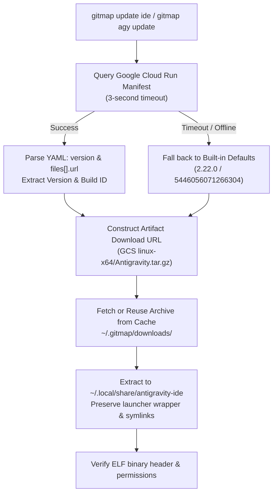

# Specification: Dynamic Manifest Resolution & Antigravity IDE 2.22.0 Update Architecture

- **Spec ID:** `02-spec/21-app/root-cause-analysis-and-update-instructions/02-dynamic-manifest-and-update-architecture.md`
- **Status:** `APPROVED`
- **Version:** `1.0.0`
- **Target Subsystem:** GitMap CLI Core, `cmdinstall`, `cmdupdate`
- **Parent Task:** `root-cause-analysis-and-update-instructions`

---

## 1. Architecture Overview

To eliminate hardcoded version staleness and ensure continuous parity between Linux and Windows, GitMap must adopt a hybrid version resolution architecture:



---

## 2. Dynamic Manifest Query Engine (`cli/cmdinstall/installantigravity_fetch.go`)

### 2.1 Manifest Endpoint Contract
- **Endpoint:** `https://antigravity-hub-auto-updater-974169037036.us-central1.run.app/manifest/latest-x64-linux.yml`
- **Alternative Status Endpoint:** `https://antigravity-hub-auto-updater-974169037036.us-central1.run.app/status`
- **Format:** YAML / JSON
- **Timeout:** 3000ms strictly enforced via `http.Client{Timeout: 3 * time.Second}` to ensure offline / air-gapped workstations never hang.

### 2.2 Version & Build ID Extraction
From the manifest payload:
```yaml
version: 2.22.0
files:
  - url: https://storage.googleapis.com/antigravity-public/antigravity-hub/2.22.0-5446056071266304/linux-x64/Antigravity.AppImage
```
The extraction logic parses:
1. `version`: `2.22.0`
2. `buildID`: Extracted from the URL pattern `antigravity-hub/{version}-{buildID}/`. For 2.22.0, the parsed build ID is `5446056071266304`.

### 2.3 Built-in Default Constants (`cli/cmdinstall/installantigravity_types.go`)
Updated to the verified production release:
```go
const (
	AntigravityDefaultVersion = "2.22.0"
	AntigravityDefaultBuildID = "5446056071266304"
	AntigravityBaseURL        = "https://storage.googleapis.com/antigravity-public/antigravity-hub"
	AntigravityManifestURL    = "https://antigravity-hub-auto-updater-974169037036.us-central1.run.app/manifest/latest-x64-linux.yml"
)
```

---

## 3. Preservation of Runtime Sandbox & Desktop Integration

When GitMap downloads and extracts the 2.22.0 tarball into `~/.local/share/antigravity-ide/`:
1. **Extraction Hygiene:** Archive is unpacked with `tar -xzf archivePath -C destDir --strip-components=1`. The destination directory is guaranteed to exist via `os.MkdirAll(destDir, 0755)` prior to extraction.
2. **Canonical Launcher Wrapper (`antigravity-ide.run`):** Created with permissions `0755` executing:
   ```bash
   #!/bin/bash
   REAL_SOURCE="$(readlink -f "${BASH_SOURCE[0]}" 2>/dev/null || realpath "${BASH_SOURCE[0]}" 2>/dev/null || echo "${BASH_SOURCE[0]}")"
   DIR="$(cd "$(dirname "$REAL_SOURCE")" && pwd)"

   if [ "$DIR" = "$HOME/.local/bin" ] || [ "$DIR" = "/usr/local/bin" ] || [ "$DIR" = "/usr/bin" ]; then
       [ -d "$HOME/.local/share/antigravity-ide" ] && DIR="$HOME/.local/share/antigravity-ide"
   fi

   export LD_LIBRARY_PATH="$DIR:$DIR/lib:${LD_LIBRARY_PATH:-}"
   EXEC="$DIR/antigravity"
   [ -f "$EXEC" ] || EXEC="$DIR/Antigravity"

   export ELECTRON_OZONE_PLATFORM_HINT="auto"
   export DONT_PROMPT_WSL_INSTALL=1

   exec "$EXEC" --no-sandbox "$@"
   ```
3. **Symlink Chain:**
   - `~/.local/bin/antigravity -> ~/.local/share/antigravity-ide/antigravity-ide.run`
   - `~/.local/bin/agy -> ~/.local/share/antigravity-ide/antigravity-ide.run`
   - `~/.local/bin/antigravity-ide -> ~/.local/share/antigravity-ide/antigravity-ide.run`
   - `~/.local/share/antigravity -> ~/.local/share/antigravity-ide`
4. **Desktop Integration:** Deploy `antigravity.desktop` pointing to `antigravity-ide.run %U` and refresh icon databases.
