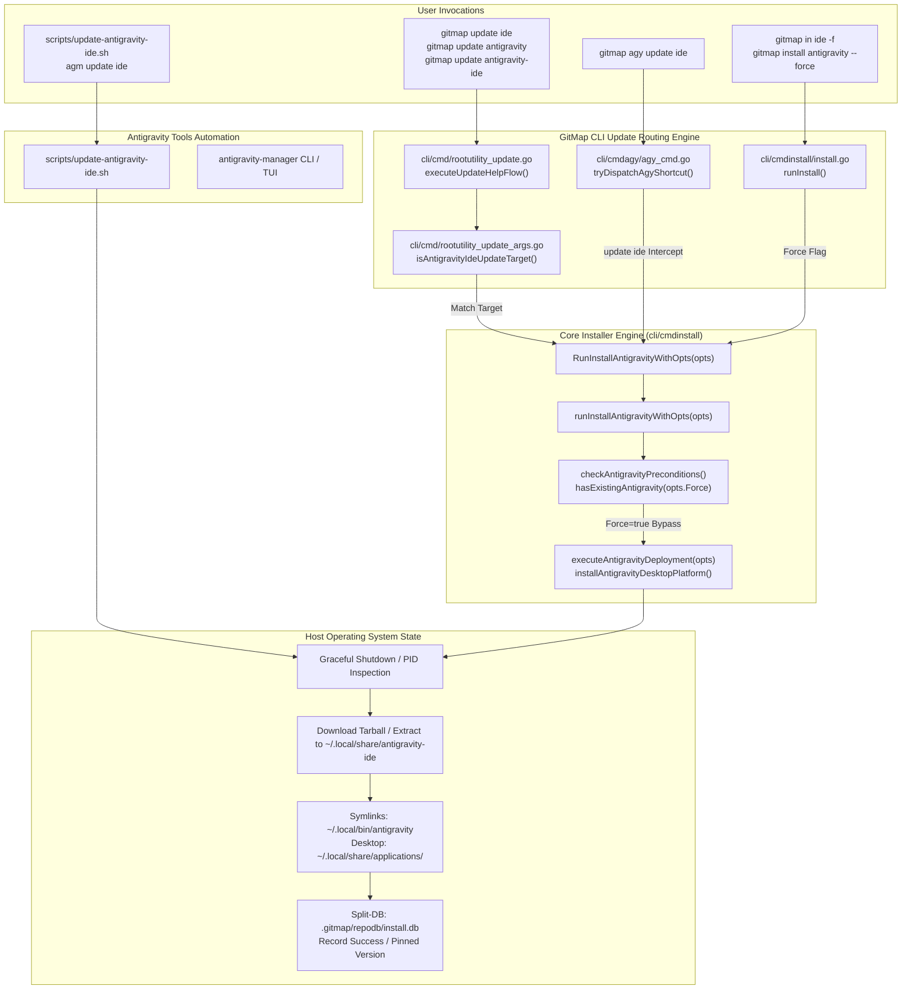

# 21-app/update-antigravity-ide: Antigravity IDE Update Architecture & GitMap CLI Specification

- **Spec ID:** `02-spec/21-app/update-antigravity-ide/01-architecture-and-gitmap-command.md`
- **Status:** `APPROVED`
- **Version:** `1.0.0`
- **Subsystem:** Developer Toolchain Updater, GitMap CLI Core, Antigravity Manager Tools, Desktop IDE Fleet Maintenance
- **Target Repositories:** `gitmap`, `antigravity-manager`, `scripts-fixer`
- **Target Files:**
  - `cli/cmd/rootutility_update.go`
  - `cli/cmd/rootutility_update_args.go`
  - `cli/cmdagy/agy_cmd.go`
  - `cli/cmdagy/agy_projects_update.go`
  - `cli/cmdinstall/exports.go`
  - `cli/cmdinstall/installantigravity.go`
  - `scripts/update-antigravity-ide.sh`
- **Dependencies:** `cli/cmdinstall`, `cli/cmdupdate`, `cli/cmdagy`, `cli/cmdssh`, `cli/store`

---

## 1. Executive Summary & Core Intent

Google Antigravity Desktop IDE is the primary AI-powered developer environment across local workstations and remote fleet nodes. While GitMap historically supported initial installation via `gitmap in antigravity` and `gitmap in ide`, it lacked dedicated update semantics. Attempting `gitmap update antigravity` or `gitmap update ide` triggered unrecognized target errors (`E1001`), and running `gitmap agy update ide` misrouted to conversation project metadata timestamp touch routines.

This specification details the unified architectural design for updating Antigravity IDE across GitMap and companion Antigravity tools. It ratifies:
1. First-class GitMap CLI update commands: `gitmap update antigravity`, `gitmap update ide`, `gitmap update antigravity-ide`, and `gitmap agy update ide`.
2. Seamless integration with force-reinstallation mechanics: routing to `cmdinstall.RunInstallAntigravityWithOpts(cmdinstall.InstallOptions{Force: true})`.
3. Clear disambiguation between Antigravity Manager (`agm`) updates and Antigravity Desktop IDE (`ide`) updates.
4. Companion Antigravity tools update automation: standalone portable script `scripts/update-antigravity-ide.sh` and `antigravity-manager` CLI integration.
5. Strict adherence to relative path hygiene with zero absolute paths across all documentation, code, and test suites.

---

## 2. System Topology & Update Flow



---

## 3. GitMap CLI Command Additions & Alias Matrix

### 3.1 Supported Update Invocations

The update command router shall accept the following canonical commands and aliases:

| Command Invocations | Component Target | Routing Target Function | Force Mode |
| :--- | :--- | :--- | :--- |
| `gitmap update antigravity` | Antigravity Desktop IDE | `cmdinstall.RunInstallAntigravityWithOpts` | `Force: true` |
| `gitmap update ide` | Antigravity Desktop IDE | `cmdinstall.RunInstallAntigravityWithOpts` | `Force: true` |
| `gitmap update antigravity-ide` | Antigravity Desktop IDE | `cmdinstall.RunInstallAntigravityWithOpts` | `Force: true` |
| `gitmap update agy-ide` | Antigravity Desktop IDE | `cmdinstall.RunInstallAntigravityWithOpts` | `Force: true` |
| `gitmap agy update ide` | Antigravity Desktop IDE | `cmdinstall.RunInstallAntigravityWithOpts` | `Force: true` |
| `gitmap in ide -f` | Antigravity Desktop IDE | `cmdinstall.RunInstall` | `Force: true` |
| `gitmap install antigravity --force` | Antigravity Desktop IDE | `cmdinstall.RunInstall` | `Force: true` |
| `gitmap update agm` | Antigravity Manager | `cmdinstall.RunUpdateAgManagerWithOpts` | N/A |
| `gitmap update` | GitMap CLI binary | `cmdupdate.RunUpdate` | N/A |

### 3.2 Supported Flags & Modifiers

When running `gitmap update <target>`, the following flags are parsed and forwarded:

- `--dry-run` / `-n`: Preview download URL, destination directories, and planned file modifications without altering disk state.
- `--version <semver>` / `-v <semver>`: Target an explicit build version (e.g., `gitmap update ide --version 2.20.0`).
- `--pin`: Record the specified version in Split-DB (`store.PinVersion`) so subsequent unattended updates adhere to the pinned release.
- `--verbose`: Stream detailed extraction progress and curl/wget network telemetry to stdout.
- `--remote <host>` / `-r <host>` / `--node <alias>`: Dispatch IDE update command across SSH to target fleet node via `cmdssh.RunSSHUpdateCLI`.

---

## 4. Argument Parsing & Routing Engine Specification

### 4.1 Token Disambiguation (`cli/cmd/rootutility_update_args.go`)

The updater must cleanly differentiate between:
1. **Self-Update Target**: `gitmap`
2. **Antigravity Manager Target**: `agm`, `ag-manager`, `antigravity-manager`
3. **Antigravity Desktop IDE Target**: `antigravity`, `ide`, `antigravity-ide`, `agy-ide`, `antigravity-desktop`
4. **Fleet / Remote Targets**: `all`, `all-nodes`, `ssh`, `remote`

#### New Target Detection Helper: `isAntigravityIdeUpdateTarget`

```go
// isAntigravityIdeUpdateTarget checks if arguments request an Antigravity IDE update.
func isAntigravityIdeUpdateTarget(args []string) bool {
    for _, arg := range args {
        if !strings.HasPrefix(arg, "-") && isAntigravityIdeToken(arg) {
            return true
        }
    }
    return false
}

// isAntigravityIdeToken returns true if token represents Antigravity Desktop IDE.
func isAntigravityIdeToken(arg string) bool {
    switch strings.ToLower(strings.TrimSpace(arg)) {
    case "antigravity", "ide", "antigravity-ide", "agy-ide", "antigravity-desktop":
        return true
    default:
        return false
    }
}
```

#### Disambiguation Rules:
- If token is `agm`, `ag-manager`, or `antigravity-manager`, route to `runUpdateAgManagerTarget(args)`.
- If token is `antigravity`, `ide`, `antigravity-ide`, `agy-ide`, or `antigravity-desktop`, route to `runUpdateAntigravityIdeTarget(args)`.
- If token is `agy` followed by `ide` (e.g. `gitmap update agy ide` or `gitmap agy update ide`), route to `runUpdateAntigravityIdeTarget(args)`.
- If token is `agy` alone, it refers to Antigravity CLI / Manager ecosystem, defaulting to `runUpdateAgManagerTarget(args)`.

#### Updated Known Target Predicate: `isKnownUpdateTargetOrFlag`

`isKnownUpdateTargetOrFlag(token string)` must include all Antigravity IDE tokens:
```go
case "all", "all-nodes", "allnodes", "ls", "list", "ssh", "remote",
     "gitmap", "agm", "agy", "ag-manager", "antigravity-manager",
     "antigravity", "ide", "antigravity-ide", "agy-ide", "antigravity-desktop":
    return true
```

#### Updated Suggestion Engine: `suggestUpdateTarget`

```go
case "anti", "antigrav", "antigravity", "id", "idea", "desktop":
    return "ide"
```

#### Updated Help Text: `updateUsageHelpText`

```text
Available update commands:
  gitmap update                          - Self-update local gitmap binary
  gitmap update ide                      - Update Google Antigravity Desktop IDE (alias: antigravity)
  gitmap update all                      - Update all fleet cluster nodes in parallel (alias: gitmap ua)
  gitmap update all --include-others     - Update all cluster nodes and discovered hosts
  gitmap update all zip --include-others - Distribute zip packages via SCP across all nodes
  gitmap update-all-zip --include-others - Fast zip distribution across all nodes (alias: uaz)
  gitmap update ls                       - List installed software inventory across fleet nodes
  gitmap update agm                      - Update Antigravity Manager
  gitmap update ssh <target>             - Update package on specified SSH target
```

### 4.2 Dispatch Flow (`cli/cmd/rootutility_update.go`)

In `executeUpdateHelpFlow(args []string)`:

```go
func executeUpdateHelpFlow(args []string) error {
    remoteTarget, cleanArgs := extractRemoteUpdateTarget(args)
    if remoteTarget != "" {
        return cmdssh.RunSSHUpdateCLI([]string{resolveUpdatePackage(cleanArgs), remoteTarget})
    }
    targetVer := extractVersionFromArgs(args)
    applyPinIfRequested(args, targetVer)
    if isAntigravityIdeUpdateTarget(args) {
        return runUpdateAntigravityIdeTarget(args)
    }
    if isAgmUpdateTarget(args) {
        return runUpdateAgManagerTarget(args)
    }
    configureTargetVersion(targetVer)
    if len(args) > 0 && !isKnownUpdateTargetOrFlag(args[0]) {
        handleUnknownUpdateTarget(args[0])
        return nil
    }
    return cmdupdate.RunUpdate()
}
```

#### Handler Implementation: `runUpdateAntigravityIdeTarget`

```go
func runUpdateAntigravityIdeTarget(args []string) error {
    remoteTarget, cleanArgs := extractRemoteUpdateTarget(args)
    if remoteTarget != "" {
        return cmdssh.RunSSHUpdateCLI([]string{"ide", remoteTarget})
    }
    ver := resolveEffectiveVersion("antigravity", extractVersionFromArgs(cleanArgs))
    opts := cmdinstall.InstallOptions{
        Tool:    "antigravity",
        Force:   true,
        DryRun:  hasDryRunArg(cleanArgs),
        Version: ver,
        Verbose: hasVerboseArg(cleanArgs),
    }
    return cmdinstall.RunInstallAntigravityWithOpts(opts)
}
```

### 4.3 Command Interception in `cmdagy` (`cli/cmdagy/agy_cmd.go`)

When a user executes `gitmap agy update ide`:
1. `DispatchAgy` strips the leading `agy` token.
2. In `tryDispatchAgyShortcut(args []string)`, inspect if `len(args) >= 2 && args[0] == "update" && isAntigravityIdeToken(args[1])`.
3. Intercept execution before `agyUpdateCmd` (which touches project JSON timestamp) and route directly:

```go
if len(args) >= 2 && strings.EqualFold(args[0], "update") && isAntigravityIdeToken(args[1]) {
    opts := cmdinstall.InstallOptions{
        Tool:    "antigravity",
        Force:   true,
        DryRun:  hasDryRunArg(args[2:]),
        Version: extractVersionFromArgs(args[2:]),
    }
    return cmdinstall.RunInstallAntigravityWithOpts(opts), true
}
```

### 4.4 Force Installation Routing in `cmdinstall` (`cli/cmdinstall/`)

In `cli/cmdinstall/installantigravity.go`:
```go
func checkAntigravityPreconditions(info AntigravityPlatformInfo, opts installOptions) bool {
    if hasExisting := hasExistingAntigravity(opts.Force); hasExisting {
        return true
    }
    return handleAntigravityDryRun(info, opts.DryRun)
}
```
When `opts.Force` is `true`:
- `hasExistingAntigravity(true)` evaluates to `false`.
- The short-circuit "already installed" message is bypassed.
- Execution proceeds to `executeAntigravityDeployment(opts)`, downloading the latest archive and overwriting previous binaries in `~/.local/share/antigravity-ide` or `/opt/antigravity`.

---

## 5. Antigravity Tools (`antigravity-manager`) Update Script & Automation

### 5.1 Standalone Shell Script: `scripts/update-antigravity-ide.sh`

The companion update script provides a zero-dependency POSIX bash script executable in standalone environments, CI pipelines, and via `antigravity-manager`.

#### Script Location:
- In `gitmap`: `scripts/update-antigravity-ide.sh`
- In `antigravity-manager`: `scripts/update-antigravity-ide.sh`

#### Script Synopsis:
```bash
#!/usr/bin/env bash
# scripts/update-antigravity-ide.sh
# Unattended updater for Google Antigravity Desktop IDE on Linux and macOS
```

#### Core Capabilities:
1. **Running Process Inspection**:
   - Detects active IDE instances via `pgrep -f "antigravity"`.
   - Offers graceful termination signal (`SIGTERM`), with fallback force kill (`SIGKILL`) when `--force` or `--kill-running` is specified.
2. **Platform & Architecture Resolution**:
   - Detects OS (`Linux`, `Darwin`) and hardware architecture (`x86_64` -> `x64`, `aarch64`/`arm64` -> `arm64`).
   - Verifies system tar, curl/wget, and glibc/libstdc++ prerequisites.
3. **Download & Checksum Validation**:
   - Pulls release metadata or default target archive from Google Cloud Storage hub (`https://storage.googleapis.com/antigravity-public/antigravity-hub/...`).
   - Downloads archive into temporary scratch directory (`/tmp/antigravity-update-XXXXXX` or `$XDG_RUNTIME_DIR/antigravity-update-XXXXXX`).
4. **Atomic In-Place Replacement**:
   - Extracts archive into staging folder: `~/.local/share/antigravity-ide.new`.
   - Swaps directories atomically using backup rotation:
     - `~/.local/share/antigravity-ide` -> `~/.local/share/antigravity-ide.bak`
     - `~/.local/share/antigravity-ide.new` -> `~/.local/share/antigravity-ide`
     - Removes `.bak` upon successful post-flight binary verification.
5. **Launcher & Desktop Entry Reconciliation**:
   - Validates executable permissions (`chmod 0755 ~/.local/share/antigravity-ide/antigravity`).
   - Generates or updates launcher script in `~/.local/bin/antigravity` ensuring `--no-sandbox` compatibility for unconfined Electron builds on Linux (AppArmor userns guard).
   - Updates `~/.local/share/applications/antigravity.desktop` XDG desktop entry with correct icon path and executable target.

### 5.2 Antigravity Manager Integration

Within `antigravity-manager`:
- The CLI command `agm update ide` or `antigravity-manager update ide` executes `scripts/update-antigravity-ide.sh`.
- The GUI Desktop Manager interface features an "Update IDE" action button in the System Maintenance and Environment Diagnostic pane, triggering the script in a pty terminal wrapper with live progress reporting.

---

## 6. Invariants, Safety Guarantees, & Error Handling

### 6.1 Compaction & Architectural Invariants

1. **Compaction Invariant: Update Parity**:
   - Every mechanism that performs an install (`gitmap in ide -f`, `gitmap update ide`, `gitmap update antigravity`, `gitmap agy update ide`, `scripts/update-antigravity-ide.sh`) must target identical install destinations and preserve database parity.
2. **Positive Boolean Naming Rule**:
   - All flags, variables, and struct fields must use positive boolean identifiers (e.g. `isForceUpdate`, `hasExistingInstall`, `isDownloadValid`, `isDryRunMode`). Inverted names (e.g. `noForce`, `skipCheck`) are prohibited.
3. **Strict Relative Path Invariant**:
   - Zero absolute paths across all documents, logs, scripts, and tests. Use relative paths rooted at workspace or dynamic standard expansions (`$HOME`, `~`, `filepath.Join(userHome, ...)`).
4. **Atomic Rollback Guarantee**:
   - If archive download or decompression is interrupted, the existing IDE installation must remain operational without broken shared libraries or missing runtime files.

### 6.2 Error Codes & Diagnostics

| Code | Subsystem | Trigger Condition | Remediation / Output |
| :--- | :--- | :--- | :--- |
| `E1001` | Update CLI | Unknown update target token passed | Print formatted suggestion header and display valid update targets |
| `E1080` | Antigravity Fetch | Network failure downloading IDE tarball | Log failing endpoint, verify DNS/internet, retry with backoff |
| `E1081` | Antigravity Deploy | Extraction failed or corrupt tar payload | Retain existing installation, log tar error, clean temporary stage |
| `E1082` | Antigravity Process | Active IDE process locked during update | Prompt user or terminate with `--kill-running` flag |
| `E1083` | Post-flight Check | Binary not found at expected path | Check permissions and directory permissions |

---

## 7. Verification Gates & Acceptance Criteria

```yaml
verificationGates:
  VG-01:
    description: "Verify 'gitmap update ide' and 'gitmap update antigravity' trigger force installation flow"
    criteria: "Invokes cmdinstall.RunInstallAntigravityWithOpts with Force=true and returns exit code 0"
  VG-02:
    description: "Verify 'gitmap agy update ide' intercepts update before project metadata touch"
    criteria: "Dispatches to IDE updater and does not fail on missing project JSON"
  VG-03:
    description: "Verify dry-run mode previews operations without writing to disk"
    criteria: "'gitmap update ide --dry-run' outputs planned download URL and target directories"
  VG-04:
    description: "Verify suggestion engine recommends 'ide' for misspelled inputs"
    criteria: "'gitmap update anti' suggests 'gitmap update ide'"
  VG-05:
    description: "Verify scripts/update-antigravity-ide.sh executes unattended on Linux"
    criteria: "Shell script passes shellcheck/syntax-check and performs atomic directory swap"
  VG-06:
    description: "Verify zero absolute paths across all artifacts and code changes"
    criteria: "linter-scripts/check-relative-paths.py reports zero violations"
```
